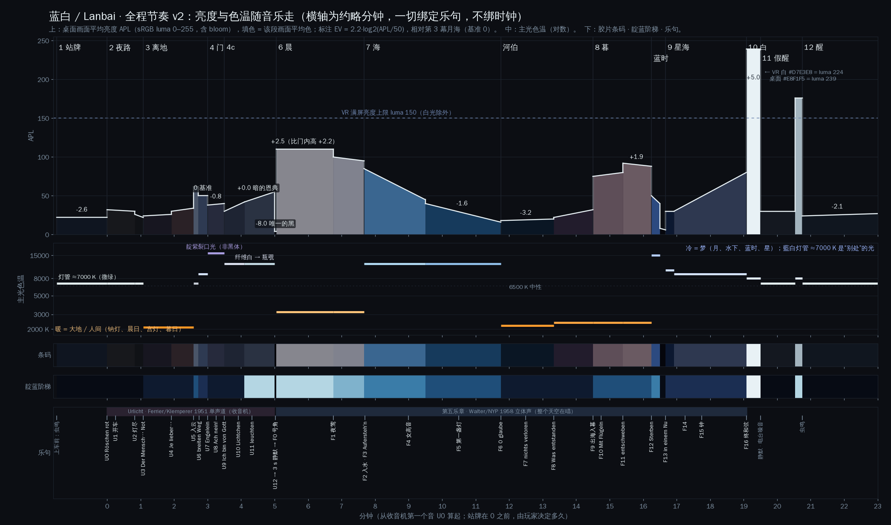

# 蓝白 / Lanbai · 美术圣经 ART BIBLE（v2.1 定稿 · 按实测乐句重排）

> 本文件是全部美学决定的唯一依据：内容、材质、光、色、调色。实现方（Unity 2022.3 · Built-in RP · VRChat SDK Worlds · UdonSharp · PPv2 · 烘焙光照）按此执行。
> 它综合了四份专家稿（`lens_cine.md` 摄影与调色、`lens_lookdev.md` 材质与大气、`lens_story.md` 叙事诗句音乐、`lens_tech.md` VR 与性能）和两份审稿（`critique_awe.md` 震撼与美、`critique_feasibility.md` 可行性与 VR 安全），并对其中所有冲突做了裁决（附录 A、附录 C）。**原稿、审稿与本圣经冲突时，以本圣经为准。**

> **v2.1 · 改了什么（相对 v2）**
> - **时间全部换成实测**（`FromLocal/cues.md` / `cues.json`）。§2 重写成秒表（出发 = 0），全文的“约 N 秒”换成实测秒数。马勒一个音都没剪，画面去适应音乐。
> - **每个子场景的边界都放在录音里听得见的转折上**（裁决见 `v21/synthesis.md`）：F2h 的真静入水；7a 按合唱 / 间奏 / 合唱分三段；河伯在女低音之前问出；出海落在 7c 最响的 7 s（F9s + 0.5）；最轻的 17 s（F11）给最静的画面。
> - **变短的段落重新编排**：3a 只剩一次升起（大地从脚下落走）；晨 30.2 s 只有光、不放字；暮在海外 64.7 s，只有一次变形；蓝时 8.15 s，不压缩。
> - **改掉 v2 的几处错误**：出海先钉住曝光再放开；第 4 幕不爬升；7c 雾色离开紫线；海镜里的太阳降为闪光路径；v2 的“银河 1.2 秒到 80%”是 +3.55 EV 的全画面跳变（E1–E16，附录 A）。
> - **定稿：两份审稿（`v21/critique_consistency.md`、`v21/critique_beauty.md`）全部处理**（E17–E27，附录 C 末表），每一项亮度变化都按视向重新仿真（`ramp_checks_v21.json`）：
>   - **晨与第二次白**是一条按“极端视向”建的遮罩曲线，**限速不限时长**（0.85 EV/s）：晨按车门里的太阳扇区建，每方向 8.7 秒，整幅晨落在召唤最响的膨胀 F0s 上；第二次白 1.5 秒预滚 + 8.0 秒，剪 3 挪到 1251.96。
>   - **银河按光源点燃**：F13 那一帧所有的星同时出现（这是真正的“一瞬”，按爬升律是 +0.00 EV），银河的辉光走一条光源增益线 4.2 秒涨满；不再用曝光把 fff 按暗；满亮后保持 10 秒。
>   - **十三面镜分两段**：一路加速到合唱最后的 *tragen!*（F15），尾声是三声钟；白的冲击落在尾声最响的一下，膨胀在星海唯一的那口“吸气”开始时到顶。
>   - **暮真的飞起来**：翼在 *entschweben* 上把下坠翻成上升。**深海的中段**按间奏的三拍做，播下的光不灭。**长音 *Leben*** 是一段光的“袖”。
>   - **第 4 幕只出 *Ach nein!* 一联**（第 4 幕文字 18%）：不再有例外，不需要用户点头。**7c 保持暗的低谷**（雾止于 `#3A2629`）。
> - **诗句停留补上译文系数 ×1.3**；用户的两句分别挪到海镜与 7c。
> - 新产物：`score.png`、`ramp_checks_v21.json`（与本文件同在 `art/`），工具在 `v21/tools/`。v2 原稿存档在 `archive_v2/`。

> **版本 v2 · 改了什么（相对 v1）**
> - **触手之门重做**（用户点名要「震撼 宏大」的那一幕）：天还在被撕开——裂口从挡风玻璃里的一道伤（U6，约 12°）长到 U8 冲出画框、要抬头从新加的**车顶天窗**里看；透镜形、翻卷的靛蓝丝绸边、两道分叉裂；紫色收成**黄昏靛紫**，裂口核心是**未染的白**；裂口两侧加一条**光雾带**，黑色巨臂第一次有了“体量”；远处加 300–500 条**远潮**；巨像“头清脚没”；皮肤去掉等距环节（蚯蚓感）。
> - **门内改成“暗的恩典”**：APL 60→100 改为 30→55，染料越往里越薄（淡紫 → 瓶覗 → 暖白点）；光唇不再同心；晨因此比门内高 +2.2 EV，真正“亮起来”。
> - **颜色纪律**：紫只在第 4 幕（规则可量化，§1.3.4）；晨 = 白上的藍与金；暮的阴影 = 靛石；海 = 群青不是青绿；河伯 = 朱与靛；萤火虫 Lichtchen = 暖白。
> - **星海**：黑保持黑（S9b 曝光 +0.8 → +0.3），光来自光源；镜子穿越后碎成星尘；镜缘纹样恒定间距让“一面比一面大”读得出来；第 13 面镜从 F14 起就在远处等着。
> - **PPv2 的数学改正**：PPv2 的覆盖是“插值到绝对值”，不是叠加——所有曝光助手改成 `EXPO_UP/DOWN` + 权重公式；bloom 阈值是 gamma 空间、有软膝——全部 profile 的阈值重新求解，现在只有发光体会 bloom；遮罩球会被调色——填色按当时的 grade 求解并补偿。
> - **VR 与光照的修正**：几处运动数值违反自己的铁律（已改）；遮罩球跟随每个人的头；灯光不再重复计算；头像在车厢里不再是黑的；远裁剪 45 km。
> - **所有图重新生成并目检**：15 张色板、15 套 LUT、15 张前后对照（现在“之后”含 bloom）、`score.png`；新增 `ramp_checks_v2.json`（白光与闪光的爬升律仿真）。v1 全部存档在 `archive_v1/`。

**本文件的法律：**
1. **屏幕目标值是法律，参数只是起点。** 文中所有 hex 除特别注明外，都是“截图上应当读到的颜色”（display target，sRGB）。“填”（set）是要在 Unity 取色器里输入的值。真实资产让某个目标对不上时，改参数去追目标，**永远不改目标**。
2. **音乐是时钟。** 一切事件绑定到乐句标签（U0–U12、F0–F16 及 §2 的子标签），不绑定到秒。文中的秒数（t，出发 = 0）是按 `FromLocal/cues.json` 算出来**给人看的**；写成“F9s + 0.5”的就是“F9s 之后 0.5 秒”，标签一挪，事件跟着走。
3. **美第一，VR 安全第二，性能第三。** 但 §1.8 的 VR 铁律没有例外。

---

## 0. 文件索引（全部在 `art/` 下；v2.1 的工具与工作文件在 `art/v21/`）

| 文件 | 内容 |
|---|---|
| `ART_BIBLE.md` | 本文件（**v2.1 定稿**；副本在 `v21/ART_BIBLE.md`）。v2 原稿存档在 `archive_v2/ART_BIBLE_v2.md` |
| `score.png` | **v2.1** 全程亮度 / 色温 / 条码 / 靛蓝阶梯 / 屏幕上的字 / 实测乐句与子标签对照图（§2），横轴是时间轴秒（副本 `v21/score.png`） |
| `ramp_checks_v21.json` | **v2.1** 按实测时间重跑的全部爬升律与闪烁核查（每个事件带 t 与 PASS / FAIL；遮罩、银河点燃与白**按视向**核查，§1.8；副本在 `v21/`） |
| `v21/synthesis.md` | v2.1 的裁决与节拍表原稿（三份重排提案 → 综合）；与本圣经冲突时以本圣经为准 |
| `v21/critique_consistency.md`、`v21/critique_beauty.md` | 定稿前的两份审稿（一致性与 VR；对着实测录音的美学）：处理见附录 C 末表 |
| `v21/tools/` | `cues_v21.py`（全部标签 → 秒，含 v2.1 子标签与镜子时间表）、`scene_data_v21.py` + `make_score_v21.py`（生成 `score.png`）、`verify_ramps_v21.py`（生成 `ramp_checks_v21.json`）、`starsea_views.py`（任意视向的星海测试帧，按光源拆开） |
| `v21/work/final/` | 定稿的运动与逐视向计算：`motion_final.json`（各处位置与速度）、`dusk_motion_final.json`（暮的上升）、`ign_views.json`（银河点燃七个视向） |
| `FromLocal/cues.md`、`cues.json`、`cues_*.png` | **本地实测的乐句标签**（文件秒与时间轴秒）：§2 的一切都从这里来 |
| `archive_v2/score_v2.png` | v2 的总谱（约略分钟，**已被 `score.png` 取代**） |
| `palettes/Palette_*.png` | 每一幕的色板（屏幕目标值 + 角色），`Palette_00_overview.png` 是总览 |
| `luts/Lanbai_S*_*_1024x32.png` | 每一幕的调色 LUT，PPv2 LDR 条带格式（32³） |
| `luts/Lanbai_S*_*.cube` | 同一调色，标准 `.cube`（32³，sRGB 进 / sRGB 出）——**只给 DaVinci / ffmpeg 用，不要放进 `Assets/`**（§1.7） |
| `luts/hdr_external/*_HDRext33.cube` | 同一调色，PPv2 HDR “External” 模式用（LogC 进 / 线性出，33³） |
| `luts/Lanbai_Neutral_1024x32.png`, `luts/Neutral.cube` | 中性（恒等）LUT：先用它验证方向与导入设置 |
| `previews/Preview_S*_*.png` | 每个 profile 的前 / 后对照：“之前”= 中性，“之后”= **完整 profile 含 bloom**；下方灰阶与参考色卡经过 LUT |
| `grades_final.json` | **所有 PPv2 profile 与助手的最终参数**（机器可读；编辑器脚本据此生成 `.asset`） |
| `calib_final.md` / `.json` | 校准表：§A 灰卡 / 白卡；§B 雾 / 天 / 自发光 “目标 → 填值”（含 ×T0 bloom 系数）；§C 调色测试卡 11 级灰阶；§D **遮罩球按实时 grade 的填色** |
| `ramp_checks_v2.json` | v2 的爬升律仿真（**已被 `ramp_checks_v21.json` 取代**） |
| `bible_work/*.py` | 生成以上一切的脚本（改 `make_grades.py`、`scene_data.py` 后重跑） |
| `critique_awe.md`、`critique_feasibility.md` | 两份审稿（处理结果见附录 C） |
| `lens_*.md`、`lens_cine/`、`lens_tech/` | 四份原稿及其工具（`flashcheck.py`、`FlickerTable.cs`、`LanbaiVR.cginc`、`Lanbai_Overlay.shader`、`Lanbai_PointSprites.shader`） |
| `lookdev_sign_mock.png`, `work/sign_*_albedo_mock.png` | 站牌样稿（珐琅反照率已改为 `#DDE9EA`，见 §5.2） |
| `archive_v1/`、`archive_v2/` | v1 的圣经、色板、对照图、score、grades、calib；v2 的圣经与 score，存档 |

> **已修正的工具错误（v1 起）：** `lens_cine/ppv2.py` 里 ACEScg→sRGB 矩阵第三行写错。v2 的模拟器（`bible_work/lutlib_core.py`）另外改正了：bloom 阈值与 clamp 用 Unity 的 `GammaToLinearSpaceExact`；prefilter 里做 clamp；金字塔层数按 1920 宽屏幕计算。所有 v2 数值都由它算出。

---

## 1. 总纲

### 1.1 论点（一句话）

**蓝白是一场把夜“褪色”的梦。** 它从雨夜车站最深的靛（褐 `#070B14`）开始，天被撕开，露出染料下未染的白；穿过每一层天空与海，最后停在「藍白」——靛染最浅的一缸，几乎是白，永远不是白（`#E8F1F5`，从不 `#FFFFFF`）。然后一切巨大的东西都以能握在手里的尺寸回来：银河变成萤火虫，铜镜变成水洼，天空的裂口变成一根灯管。**宏大在旅途，眼泪在归来。**

### 1.2 四根支柱

| 支柱 | 意思 | 看得见的做法 |
|---|---|---|
| **蓝 / 白** | 名字就是颜色。全片沿一条八级靛蓝阶梯（§3.1）从深往浅“褪色”，最后回到深处，天边留一线浅。 | 站牌是藍白珐琅上的靛蓝字；车身上白下靛；窗帘是淡靛布；站灯与车厢灯管是藍白冷光；裂口是撕开靛布露出的白；门内越走越浅；白光就是藍白。 |
| **天海互镜** | 庄子：“其视下也，亦若是则已矣”。往下看与往上看一样。 | 湿路、水田、海面、海的底面、暮色的“另一片天”、白铜镜、倒悬的海、静止的水洼。 |
| **照片级 + 电影调色** | 照片感来自数值纪律、湿高光和大气，而不是贴图分辨率。 | 真实反照率范围（§1.6）、GGX 湿面拉长高光、指数雾做空气透视、Neutral 色调映射 + 每幕参数化调色、**只让发光体 bloom**。 |
| **克制对压倒** | 一个一直宏大的世界，哪里都不宏大。 | 每个高峰前至少 10 秒低谷；巨物无声而缓慢（自身运动 ≤ 0.5°/s）；画框随宏大而变宽：窗（1–3）→ **天窗**（4，裂口大过挡风玻璃）→ 顶棚破洞（7）→ 没有墙（8）→ 什么都没有（9）。 |

### 1.3 画面语法（每一幕都遵守）

1. **每帧只有一个最亮点，而且是眼睛该去的地方。** 依次是：站灯、车灯隧道 / 钠灯、月（与远处的裂口线）、裂口、门内的暖白点、（黑）、太阳（车门里）、云盖下被斜光照亮的远处海面（305–318 s）、太阳重现、海镜（倒影太阳只是闪光路径，比日盘低 ≥ 1.3 EV）、斯涅尔之窗、宫灯 / 门光、7c 窗里的日弧、日刃与日盘、日线、天问、上升的镜线、白本身、倒挂的灯、站灯。
2. **蓝住在每一个阴影里，包括暖场。** 阴影里不允许出现暖色；暮色里阴影是靛石色，暖只在光里。
3. **暖色是配给的，暖 = 大地、人、你离开的世界。** 只允许：钠灯、车头灯、尾灯、收音机表盘、门内前方的暖白光点、两次太阳（晨、暮）、深海宫灯的朱红、Lichtchen。远处的暖光永远很小。
4. **紫只属于第 4 幕（裂口）。** 可量化的规则：**第 4、4c 幕以外，画面中任何大于 2% 的区域都不得 h_ab 290–325 且 C\* > 15**（CIE Lab）。第 4 幕里紫也只在伤口附近：U7–U8 正前方截图中 C\* > 30 的紫 ≤ 10%。第 6 幕另有更严的一条：h_ab 285–330 且 C\* > 12 的区域 ≤ 2%（晨不许有薰衣草）。玫瑰、琥珀和深靛紫留给暮。（v2 前后对照图上已量过，见 §2 末表。）
5. **大于画面 2% 的区域不得纯黑或纯白**：保持在 `#030409`–`#F4F7FA` 之间（`#030409` 只有投入的 3 秒黑允许到达；其他夜景的地板是 `#04060B`）。小发光体（灯头、日、裂口核心、星点、镜线）可以裁切。夜间调色把输入 0 抬到约 `#02060C` 的蓝黑，**永不压红到 0**（这也防止 OLED 头显的黑拖影）。
6. **地平线永远水平。** 车永不俯仰、永不侧倾、没有发动机声（它从未开动过）。坠落靠东西从窗外“升起”来表现。
7. **一镜到底。** 只有三次“剪”：进入黑（投入，3 秒，248.64）和进入两次白（1149.31、1251.96）。其余每个转场都是穿过某个东西：断崖、云底、裂口、黑、云峡、云盖、水面、台地边沿、海底、暮的天花、镜子、白。
8. **什么都不碰你。** 触手、镜缘、浪，永远不碰车。穿过车的只有光带（里尔克：美“从容地不屑于毁灭我们”）。
9. **调色跟着录音史走。** 1951 单声道收音机段是“档案”调（低饱和；桌面版有颗粒，**从收音机第一个音 U0 开始**）；声音在离地时“打开”，调色也跟着打开；1958 立体声终乐章是全彩；假醒回到档案调——“正常”就是旧录音。**第 1 幕与第 12 幕是同一个真实世界，都是干净的镜头。**

### 1.4 调色管线（全局，不许改）

**色调映射：Neutral，每一个 profile 都是；Color Grading 模式 = High Definition Range。永不 ACES。**
理由：（a）PPv2 无法在 volume 之间插值 tonemapper 枚举，只用一种才能平滑交叉淡化；（b）Neutral 在线性 0.3 以下几乎是恒等（0.18 → 显示 118/255），实现方在看不到我们屏幕的情况下也能预测无光照 / 自发光的数值；（c）ACES 会把靛蓝推向紫 / 青，并在夜景里压死 0.01 以下的暗部；（d）抬起的黑位保护 OLED。“胶片感”的对比由 log 空间的 Contrast 滑块刻意加上。

**相机：** VRC 参考相机 **Allow HDR = 开**；Project Settings → Graphics → Tier Settings 的 **HDR = 开、HDR Mode = FP16**（否则 bloom 和一切 `@ +n` 的 HDR 填值都被钳在 1）。near **0.05 m**，far **45 000 m**（远潮在 12 km、3a 的裂口线在 30 km；Unity 在 PC 上是反向 Z，精度由 near 决定，45 km 没有问题）。Clear = Skybox。

**PostProcessLayer**（挂在参考相机上）：Volume Layer = 专用层 `PostProcessing`（只放 volume）；Trigger = 相机；Anti-aliasing = **None**（MSAA 由 VRChat 画质设置给；TAA 在 VR 里拖影）；Stop NaN = 开；Directly to Camera Target = 关；**Dithering = 开**——这是 §1.8“VR 里不许有锁屏元素”的**唯一明文例外**：它是 ±1 LSB、逐帧变化的噪声，看不见，却能压住夜空暗部的色带。

**Volume 架构：** 15 个场景 profile，各一个全局 volume，priority = 时间顺序（`grades_final.json`）。助手：`EXPO_UP`（100）、`EXPO_DOWN`（99）、`WHITE_SAT` / `WHITE_BLOOM`（96）；桌面镜头层 `LENS_CLEAN` / `LENS_ARCHIVE`（199/200）。
- **交叉淡化规则：** 旧 volume 保持 weight 1，新的（priority 更高）从 0 升到 1；新的到 1 之后再把旧的设为 0。**绝不**一升一降——那会经过 PPv2 默认值，闪出一帧未调色画面。**全屏遮罩（黑 / 白）完全不透明时，换 grade 一律“同一帧硬切”**（旧 1→0、新 0→1），并在同一帧把遮罩填色换成新 profile 那一行（§1.8、`calib_final.md` §D）。
- **曲线按内容选：** 主要是曝光变化 → weight 对时间**线性**（PPv2 的 postExposure 在两个场景 profile 之间按 EV 线性混合 = 恒定 EV/秒）；主要是颜色变化 → smoothstep。可见的颜色淡化 ≥ 8 秒；藏在遮挡下的随意。
- **每个场景 profile 覆盖同一整套参数**：Color Grading（mode、tonemapper、temperature、tint、postExposure、colorFilter、hueShift、saturation、contrast、lift、gamma、gain）与 Bloom（intensity、threshold、softKnee、clamp、diffusion、anamorphicRatio、color、fastMode），Vignette / Grain 以 intensity 0 覆盖。漏覆盖一项，淡化时就会穿过默认值。

**⚠ PPv2 的覆盖是“插值到绝对值”，不是叠加（v2 改正）。** 每个被覆盖的参数都是 `param = lerp(当前值, 该 volume 的值, weight)`。所以一个“+1 EV 的助手”并不会加 1 EV——它把曝光拉向 +1 这个**绝对值**。v1 的写法在实际引擎里会得到：破云 +0.95 EV（写的是 +0.5）、裂口闪光 +2.2 EV（写的是 +1.5）、镜子脉冲从第 3 面起反而变暗。v2 的做法：
- 只有两个曝光助手：**`EXPO_UP`（postExposure = +4）** 与 **`EXPO_DOWN`（postExposure = −4）**，远目标，只覆盖 postExposure。
- Director 每帧先算出场景 volume 已经混合好的底值 **b**（交叉淡化中 b = lerp(pe_旧, pe_新, w_新)），再把这一帧所有曝光事件（BEAT 衰减 + 闪光 + 白光爬升 + 镜子脉冲）加成**一个 ΔEV(t)**，然后设 **w = ΔEV / (4 − b)**（ΔEV > 0，用 EXPO_UP）或 **w = −ΔEV / (b + 4)**（ΔEV < 0，用 EXPO_DOWN）。结果恰好是 b + ΔEV，且 w 对 ΔEV 线性，所以 EV 线性的包络保持 EV 线性。
- 饱和度与 bloom 的助手（`WHITE_SAT`、`WHITE_BLOOM`）单独成 volume，按自己的比例走——本来就是“拉向一个绝对值”，所以直接用。
- 各事件的权重已算好（附录 B 表 B2）。Route C（External LUT，profile 的 postExposure = 0）同一个公式，b = 0。

**⚠ Bloom 的三条真语义（v2 改正）：**
1. `threshold` 是 **gamma 空间**：PPv2 先做 `GammaToLinearSpaceExact(threshold)`（< 1 用 sRGB 曲线，≥ 1 用 2.2 次方）。
2. 有软膝：**bloom 从场景线性 T0 = GammaToLinear(threshold) × (1 − softKnee) 开始**（在 postExposure **之前**比较）。v1 的阈值 0.7–1.1 意味着显示 100–166 以上的一切都在 bloom：天空、云、诗句、4c 的整片薄雾。
3. `clamp` 也是 gamma：v1 写的 24 其实是线性 1 088。要钳在线性 24，填 **4.24**。

**v2 规则：每个场景 profile 的阈值都已求解，使 T0 = “中性灰显示为 luma 228” 所需的场景线性值。** 结果：显示 ≤ luma 225 的一切（天、云、雾、受光表面、**诗句**）永不 bloom；只有发光体与湿高光 bloom。`calib_final.md` §B 的 **×T0** 列告诉你每个发光体 bloom 多少（< 1 不晕、1–2 微晕、> 2 明显发光）。其余共同参数：`fastMode = true`（全体一致，布尔值会跳）、`clamp = 4.24`、`anamorphicRatio = 0`、`diffusion ≤ 9`、无 dirt。

- **任何 profile 都不许开：** Auto Exposure、Motion Blur、Depth of Field、Chromatic Aberration、Lens Distortion、Ambient Occlusion、SSR、bloom dirt。
- **轨迹球（lift/gamma/gain）** 是 PPv2 的 `Vector4`（xyz = 色轮颜色，最大通道 1；w = 偏移），用脚本从 `grades_final.json` 写入。夜间 lift 固定为 `(0.9875, 0.9905, 1, 0.008)`：黑抬到 `#02060C` 的蓝黑且不压红。**禁止**把 lift 色轮直接拖向蓝（红通道变负、夜黑变成数码青 `#00070B`，已测，已否决）。
- **Udon 只改 `PostProcessVolume.weight`**（若 SDK 未暴露，给每个 volume 一个 Animator 驱动 weight）。profile 由 `LanbaiGradeBuilder.cs` 从 `grades_final.json` 生成。

**桌面镜头层（仅桌面）：** `LENS_CLEAN`（暗角 0.20 / 柔度 0.40 / `#02040A`；颗粒 0.06、size 0.8，单色）在桌面上**始终为 1，包括第 1 幕**。`LENS_ARCHIVE`（暗角 0.26 / 0.45；颗粒 0.20、size 1.0、亮度贡献 0.85，单色）叠在它上面：**U0（收音机第一个音，3.90）起 8 秒升到 1（→ 11.90）——颗粒就是那张 1951 年的唱片；U3 声音打开时（50.30）8 秒回到 0（→ 58.30）**（暗角与颗粒可插值，不需要遮挡）；10→11 在白遮罩下升回 1（1178.46，假醒是档案），11→12 在第二次白下回到 0（剪 3，1251.96）。**第 10 幕的白里两层都在膨胀的 6 秒内降到 0**（1138.78 → 1144.78）：白不是被拍下来的，没有暗角。开始时 `if (Networking.LocalPlayer.IsUserInVR())` 把两者的 GameObject 设为 inactive：**VR 里没有任何锁屏效果**（除上面明文例外的 dithering）。

**完整参数表见附录 B，机器可读版本 `grades_final.json`。**

### 1.5 曝光哲学

- **EV0 = 第 3 幕月下云海**（S3，postExposure −0.9，月光平行光 E = 1、Inspector 强度 1.0 是全片照度基准）。其他所有场景的亮度都相对它来写。
- **亮度不是响度。** 最亮的梦境（晨）是远方号角的静；最响的（星海 fff）是暗的，只在最后才爬向光。**门内的恩典也是暗的**：它是恐惧之后的呼吸，不是光的高潮——光的高潮留给晨（比门内高 +2.2 EV）。
- **梦里的一天。** 色温：暖（晨）→ 冷（水下正午）→ **暖（暮，全片唯一的暖调色）**→ 最冷（蓝时）→ 冷（星）→ 中性（白）。一生，一日。
- **饱和度讲录音史：** −15（站）→ **−22**（单声道收音机）→ −6（声音打开）→ −10（门：被抽走颜色的恐惧）→ −14（门内：染料在变薄）→ +2（立体声，颜色诞生，但晨只有藍与金）→ **+5**（暮，最多的颜色）→ 0（星、白）→ **−22**（假醒，档案重现）→ −8（醒：梦在现实里留下一点颜色）。
- **对比的三座峰：** 门（+16，恐惧）、深海（+16，黑暗中的信）、星海高潮（+16，黑保持黑）；在白里降到 0，调色自己溶解。
- **三个工具的分工：** 灯光强度负责“场景里有多少光”；雾与天空负责“空气”；postExposure 只负责“眼睛适应”。**先按灰卡调灯，再按 §2 的 APL 用 postExposure 修整**（±15% 之内），顺序不能反。§2 的 APL **含 bloom**；在 v2 阈值下 bloom 对 APL 的影响 < 5%（门的测试帧 +0.7 luma，星海高潮 +1.5）。

**校准套件（每幕做一次，约 10 分钟）：**
1. **调色测试卡：** 11 个无光照方片，雾关，emission = 0.18 × 2^k（k = −6..+4），放在隐藏调试层上。每个 profile 在 weight 1 时截图，必须与 `calib_final.md` §C 的 11 级色值相差 ≤ 3（k = +3、+4 两格在负曝光 profile 下会进 bloom 的软膝，比较时关掉 bloom 或忽略这两格）。
2. **灰卡 / 白卡：** 0.5 m 方片，Standard，灰卡 albedo `#767676`（线性 0.18）、白卡 `#E6E6E6`（≈0.80），smoothness 0。放在每盏命名的灯下截图，调灯直到读数符合（每幕“光”一节与 `calib_final.md` §A）。
3. **雾、天空、自发光** 按 `calib_final.md` §B 填值；**遮罩球** 按 §D。
4. **APL**：桌面 1920×1080、水平 FOV 90°、坐姿头位、正前方截图的 Rec.709 平均亮度，对照 §2 表格（±15%）。
5. 另加 lookdev 的**校准球**（18% 灰、80% 白、镜面铬、sRGB 30 黑，smoothness 0.2）放在车窗边，截图取色对照每幕的“屏幕目标”。

**Built-in 灯光的三个陷阱：**
1. **强度按 gamma 空间施加**（`lightsUseLinearIntensity = false`，VRChat 客户端如此）：线性照度 E = 颜色_线性 × 强度^2.2。本文给出 E，并给出平行光的 **Inspector 值 = E^(1/2.2)**。两盏同色灯要线性 2 倍，强度比是 ×1.37。
   > ⚠ **这一条作废（总导演裁决 D-00 / D-07）。** VRChat SDK 强制 `lightsUseLinearIntensity = true`：**Inspector 值 = 线性照度 E**，不要开 1/2.2 次方。本文各幕灯光表里的 “Inspector” 一栏一律不用，只看 E。（10-08 本地门测试、10-24 第 7a 包都在这里踩过坑。）
2. **烘焙点 / 聚光灯是平方反比衰减，实时的是 Unity 旧式 range 衰减。** 实时与烘焙的双胞胎不能照抄强度，各自用灰卡校。
3. **天空是无光照贴图**，灯光与天空的相对关系只能靠灰卡与白卡确定。

### 1.6 材质与光照的全局规则

**反照率纪律（sRGB）：** 非金属 48–231（线性 0.03–0.80）。**明文例外**（且只有这些）：黑橡胶、黑漆、黑亚麻 ≥ sRGB 38；触手 sRGB 30–44（线性 0.013–0.025，湿皮的“墨”来自镜面条纹，不来自反照率）；湿沥青与湿泥按 Lagarde 湿润模型（线性 0.02–0.035）。**任何东西都不超过 sRGB 235**；车身白漆 ≤ 218。金属度只取 0 或 1（只在 1–2 px 的锈蚀 / 掉漆过渡里出现中间值）；**金属的反照率 ≥ sRGB 150**（再暗就是电介质了——铜绿、积垢、暗化的铜都按金属度 0 做）。

**光滑度参考：** 干沥青 0.15–0.25 · 湿沥青膜 0.74–0.84 · 水洼 0.96–0.98 · 搪瓷 0.88–0.93 · 旧车漆侧面 0.45–0.62 / 氧化车顶 0.25–0.35 · 乙烯座椅 0.42–0.70 · 橡胶 0.20–0.35 · 不锈钢 0.55–0.82 · 铬 0.85–0.92 · 玻璃 0.97 · 布 0.10–0.25 · 大漆 0.78–0.86 · 宝贝壳 0.92 · 珍珠母 0.86 · 抛光白铜镜 0.94 · 铜绿 0.30–0.35 · 湿叶 0.55–0.65 · 湿树皮 0.45 · 触手湿皮 0.70–0.90（条纹化）。

**湿润模型（Lagarde）**，由全局 `_Udon_Wetness`（0–1）驱动：多孔材质满湿时反照率 × 沥青 0.50 / 混凝土 0.55 / 树皮木头 0.60 / 泥土 0.55；非多孔（漆、搪瓷、玻璃、金属、乙烯）不变；膜光滑度 = lerp(s, 0.85, wet)；法线强度 ×0.6；水洼：反照率 ×0.25、光滑度 0.97、法线 ×0.05 + 雨纹。

**光照架构（v2 改正了重复计算和头像照明）：**
- **车永远在世界原点，世界从它旁边移过**（跑步机）。这是故事（它从未开动），也是最稳的做法。**会移动的根物体**（R_Stop、R_Road、R_Gate、R_Sea……）**Batching Static 与 Occlusion Static 关、Contribute GI 开**——光照贴图随物体移动仍然有效，静态批处理不行。
- **偏航只允许在天空没有特征的场景**（第 2、11 幕：阴云夜、海天花）。天空盒永不旋转，车一转，日月星就会跟着车转——所以第 3–9 幕的路径是直的。
- **车厢灯管单独烘：** 在一个只有车的烘焙场景里，只开灯管（站灯、车头灯、天光都关），把结果存成普通贴图 **`_CabinTubeLM`（+ `_CabinTubeLMDir`）**，`Lanbai/Cabin` 用 uv1 采样它 × `_Udon_CabinLightmap`（不再用 `unity_Lightmap`）。这样站灯落在车门踏步上的光不会被带进第 2、3、11 幕。
- **R_Stop 烘焙时车隐藏（或车的 Contribute GI 关）。** 车门漏到路肩的冷光是 R_Stop 自己的一盏烘焙面光（放在门洞位置）。车外壳在第 1、12 幕受站灯：一盏实时点光，culling = `BusExterior` 层，无阴影，Important，按灰卡校。
- **不许有 Mixed 灯。** 站灯的湿路镜面由解析 `_Udon_Lamp0..7` 与盒投影探针承担。**车头灯永不烘焙**：只有一盏实时双瓣聚光（第 1、2、11、12 幕），否则路面被照两次。
- **一盏实时“世界主光”平行光**（月 / 日；软阴影；culling = **Bus + Tentacles + Player + PlayerLocal**），让窗框在座位上投下移动的光带，也让你自己的手接到暮日和镜缘的光。它在每一幕都开着且带阴影（无主光的场景强度调到接近 0）——`_CameraDepthTexture` 只在有带阴影的实时平行光时存在，软粒子依赖它。**它的代价（深度预渲染 + 级联阴影 + 全屏阴影收集，约 1.0 ms @ 9 MP）已计入 §1.9。** 阴影距离、级联、软粒子由 VRChat 客户端的画质决定，不能依赖“25 m”：所有自定义深度淡出都写 `#pragma multi_compile _ SOFTPARTICLES_ON`，关掉时退回硬边。
- **头像补光：** 灯管是烘焙的，头像拿不到。车厢里加两盏 **Not Important 点光**（每排灯管一盏，culling = Player + PlayerLocal，无阴影，`#E4F1F3`，座位处按灰卡 `#585F64` 校，强度 × `_Udon_CabinLightmap`）。钠灯扫光、镜缘点光、Lichtchen 点光的 culling 都加上 **Player + PlayerLocal**。
- **地面世界（站、路模块、宫殿）全烘焙**；天空世界无光照（天空盒、云卡、光带、海）。天空世界里被照亮的只有触手、车和人。
- **不烘任何光照探针**（凸包外会外推）。环境光 = **Trilight**，每幕由 Udon 设置。
- **任何时刻触及车的实时像素灯：≤ 1 盏带阴影 + 3 盏不带阴影（Important）。** 补光用 Not Important（折进 SH，免费）。**带 cookie 的灯必须是 Important**——Built-in 对 Not Important 灯忽略 cookie。

**雾：只用 Exponential。** Graphics → Shader Stripping → Fog Modes = Custom，只勾 Exponential；场景雾开着；“关”= 密度 0；`RenderSettings.fog` 永不切换；所有自定义 shader `#pragma multi_compile_fog`。密度 d：50% 在 0.693/d 米，90% 在 2.303/d 米。
- **雾色 = 该方向地平线的天空颜色。** 内置雾只有一个颜色，所以所有自定义 shader 走 **`LanbaiFog.cginc`**：雾色 = `LanbaiHorizon(viewDir)`（与 `Lanbai/Sky` 共用的地平线函数，参数 `_Udon_FogBandDir / Color / Width`），`RenderSettings.fogColor` 只是给内置 shader 的平均值。第 4 幕的光雾带（§6·4）就靠它。
- **雾封顶与高度衰减（`_FogCap`、`_FogHeightFalloff`）：** 远处的巨物不许被雾吃成“比天还亮的鬼影”（雾永远不可能比同一仰角的天更亮）。
- **天上的东西不吃雾：** 月、日、裂口、星、云环光带、远处灯点——用自带距离衰减的无雾 shader（`_FogMode 2`：exp(−d·_Atten)）。
- 雾色与密度由 Udon 按曲线驱动，2–6 秒交叉，永不硬切（遮挡下除外）。

**反射（全片不用 `VRCMirrorReflection`，它 +60–100% GPU 还会让人停下照镜子）：**
- 无穷远的内容（海、星海、暮色天花、斯涅尔之窗）→ 自定义 shader 用反射 / 折射向量查 **编辑器烘好的每幕立方图** `_Udon_ReflCube`（256/面，BC6H，含天空与云卡）。
- 静止水洼、水田、第一面镜子 → **模板缓冲镜像副本**。
- 湿路高光、海底面闪光、雨滴里的倒影 → **解析 GGX 灯**（最多 8 个 `_Udon_Lamp0..7`）。
- 近处光泽（铬栏杆、车漆、湿站牌）→ **每幕一个盒投影烘焙探针**，作为车的子物体（256²，车站 512²），Udon 只开当前那一个。

**无光照 / 自发光资产必须以场景线性值进入调色：**
- 云卡：云端将**重新导出场景线性版**（不做 tonemap，曝光 −1 EV，直通 alpha，sRGB PNG，shader ×2），并**用实现方选定的 HDRI 重新打光**，且按 v2 目标：**晨云影 `#8593AA`、暮云影 `#363D59`**（v1 的晨卡阴影是薰衣草、暮卡阴影是紫红，见 `deliver/Clouds`，都作废）。v2 到来之前，现有云卡用 `Lanbai/UnlitCardHDR` 里的 **inverse-Neutral**，并在 shader 里加一个“阴影色相拉回”参数（h_ab 285–330 → 272 / 285，C\* × 0.62）——这正是 `previews/Preview_S6`、`Preview_S8` 的做法。
- **诗句屏幕亮度 ≤ luma 224**（bloom 从 228 开始，所以永不 bloom）。颜色见 §7.5。
- 要发光的东西：看 `calib_final.md` §B 的 ×T0 列；要明显发光的 ≥ 2 × T0。

### 1.7 LUT 文件：是什么、怎么用、先验证

**主路线永远是参数化 profile（Route A）**：15 个 HDR profile（Neutral），按 weight 交叉淡化。PPv2 在 HDR 模式下每帧把混合后的参数烘成内部 LUT，在参数空间里混合（色温经过中间色温、曝光按 EV 线性），看起来像光在变，不像幻灯片溶解。**LUT 文件是同一套调色的“烘焙副本”**，用途按优先级：

1. **截图核对（最重要）。** 本 LUT 的定义是“以中性为参照的显示层 look”：**输入** = 同一帧在 PPv2 HDR + Neutral、所有参数默认（= profile S10）下的截图；**输出** = 该幕 profile 下的同一帧（含 postExposure、白平衡、对比、lift/gamma/gain、饱和度；**不含 bloom / 暗角 / 颗粒**——bloom 是空间效果，LUT 装不下）。做法：只开 S10 截一张图 → 套上该幕 `.cube` → 与开该幕 profile、**bloom 关**的截图比较，应在 ±2 码以内（v2 模拟：均值 0.18–0.33 码，p99 ≤ 1.0 码）。**负曝光的 profile（S3、S4、S4c、S6、S7a、S7b、S8、S8b）比较时排除 S10 截图里 ≥ 254 的像素**：S10 下已经裁掉的高光，显示层 LUT 无法找回（S4 的最大误差 v1 为 11.7 码、v2 为 17.2 码，都是这个原因；均值 0.25、p99 0.63）。
2. **Route C · HDR External（与主路线等价的备选）：** `luts/hdr_external/*_HDRext33.cube`，输入域 = ALEXA LogC，输出 = 显示线性，33³，**postExposure 已烘入**。用法：PPv2 的 `.cube` 导入器（`CubeLutAssetImporter`）→ profile 的 Color Grading 设 Mode = External、Lookup Texture = 该 Texture3D、**postExposure = 0**。与参数化路线相差 p99 0.5 码。曝光助手照常用（b = 0 的同一公式）。**注意：** External LUT 在 volume 之间按显示线性光混合，是“溶解”不是 EV 线性；改变曝光的交叉淡化（2→3、7b→8、11→12）要用 w(t) = (2^(ΔEV·x) − 1)/(2^ΔEV − 1)，x = 0..1，或者留在 Route A。
3. **Route B · LDR 条带（仅应急）：** `*_1024x32.png` 放进 Color Grading 模式 **Low Definition Range** 的 **Lookup Texture**。⚠ LDR 模式没有 tonemapper、**没有 postExposure**——所有曝光助手（BEAT、闪光、白、镜子脉冲）在 Route B 下全部失效；输入在进 LUT 前被钳到 1.0。只在 HDR 路线出问题时用于夜景。

**⚠ `.cube` 不要进 `Assets/`：** PPv2 的 `CubeLutAssetImporter` 会把 `Assets/` 下**每一个** `.cube` 都自动转成 Texture3D。32³ 的显示层 cube 和 `Neutral.cube` 不是 LogC 输入，转出来是错的。它们放在仓库的 `Assets/` 之外（给 DaVinci / ffmpeg 用），或改名 `.cube.txt`。只有 `hdr_external/*_HDRext33.cube` 可以进 `Assets/`（仅 Route C）。

**条带格式：** 1024×32，32³；x = 蓝切片 × 32 + 红，y = 绿，**Unity 采样时第 0 行在底部**（PNG 是左上原点，所以文件里绿色最大值在最上面一行）。`.cube`：`LUT_3D_SIZE 32`，DOMAIN 0–1，红变化最快。

**Unity 导入设置（条带 PNG）：** Texture Type = **Default**；**sRGB (Color Texture) = 关**；Generate Mip Maps = **关**；Wrap Mode = **Clamp**；Filter Mode = **Bilinear**；**Aniso Level = 0**；Compression = **None**；Max Size ≥ 1024；Non-Power-of-2 = None。（PPv2 的 “Invalid LUT import settings” 检查包括 Aniso = 0。）

**⚑ 先验证方向：** 在一个**LDR 模式**的测试 profile 里放 `Lanbai_Neutral_1024x32.png`，比较 **contribution 0 与 contribution 1** 两张截图——**必须完全相同**。（不要拿它和 HDR/Neutral 的 S10 比：LDR 没有 tonemapper，两者本来就不同，会被误判成方向错误。）若不同：检查 sRGB 是否关、是否被压缩、Aniso 是否 0、行是否被翻转（我们写文件时已翻转，Unity 不应再翻；翻转或 R/B 对调会造成约 255 码的错误，一眼可见）。

| 幕 | profile | LUT 文件（`luts/`） |
|---|---|---|
| 1 站牌 | S1 | `Lanbai_S1_01_stop` |
| 2 夜路 | S2 | `Lanbai_S2_02_nightroad` |
| 3 离地 / 月海（基准） | S3 | `Lanbai_S3_03_liftoff_moon` |
| 4 触手之门 | S4 | `Lanbai_S4_04_gate` |
| 4c 门内 | S4c | `Lanbai_S4c_04c_inside_tear` |
| 5 投入 | S4c（+ 黑遮罩），遮罩下硬切 S6 | 同 S4c |
| 6 晨 | S6 | `Lanbai_S6_06_dawn` |
| 7a 海面之下 | S7a | `Lanbai_S7a_07a_undersea` |
| 7b 深海 · 河伯 | S7b | `Lanbai_S7b_07b_deep_palace` |
| 8 暮 | S8 | `Lanbai_S8_08_dusk` |
| 8b 蓝时 | S8b | `Lanbai_S8b_08b_bluehour` |
| 9 星海 | S9a → S9b | `Lanbai_S9a_09a_starsea`、`Lanbai_S9b_09b_starsea_climax` |
| 10 白 | S10（中性） | `Lanbai_S10_10_white`（= 恒等，验证用） |
| 11 假醒 | S11（= S2） | `Lanbai_S11_11_false_wake` |
| 12 醒 | S12 | `Lanbai_S12_12_wake` |

### 1.8 VR 舒适铁律（永不破例）

**光敏安全**
- 任意 1 秒内**最多 2 次闪烁**（WCAG 2.3.1 允许 3 次；VR 填满视野，我们留余量）。闪烁 = 相对亮度一对 ≥ 0.10 的反向变化、较暗态 < 0.80、发生在 4.4° 见方的任意区域内。
- **红闪：** 任何饱和红（线性 R/(R+G+B) ≥ 0.8）大于 1°² 的元素，0.5 秒内变化不得超过 20%。尾灯、朱漆、钠灯都是稳的；永远没有转向灯 / 双闪。
- **全片唯一的授权闪光** = 裂口尽头的 `FLASH_TEAR`，**结束于 U12**（248.64）：通过 `EXPO_UP` 加 **+1.5 EV**（w = 1.5/(4 + 0.9) = 0.306），U12 − 0.75（247.89）起 0.4 秒 EV 线性升起，保持 0.1 秒，0.25 秒落入黑，黑在 U12 盖满（与 Urlicht 的播放淡出同时到零）。**没有 bloom 覆盖**（v1 的 14 / 0.6 / 0.8 会让整片门内薄雾一起 bloom，实际 +2.5 EV）。仿真：全画面 +1.3 EV（门内测试帧是第 5 重，APL 34 → 59）；4c 实际结束在 APL 55，所以真正的峰值约 **APL 83–95**（按 +1.3 EV 或按测试帧的 APL 比例推算）——仍远低于 VR 上限 150，所以 **VR 与桌面同为 +1.5 EV**；若实测 VR 峰值 APL > 150，把 ΔEV 降到正好 150 为止。它之前 1.5 秒内不得有任何其他变化——**前方暖白光点在 U12 − 2.25（246.39）停止长大**（v2 写的 U12 − 1.5 是按“闪光始于 U12”算的，E12），最大 12° 直径，它自己的长大遵守爬升律。
- **第 4 幕管灯闪烁只准播放预计算表** `lens_tech/out/FlickerTable.cs`（以 U9 为零点；实测 U6 = U9 − 45.75 s，**丢弃阈值改为 `t < −45.75`**，丢 6 条（v2 写的是 7 条，E6）；U6→U7（133.80–150.30）有 8 次稀疏跌落——怕刚开始；U7 起 28 次，约每秒一次；最后一次在 U9 前 1.66 秒（177.89）），再叠加灯管 shader 里 ±6%、< 2 Hz 的连续微颤。
- 镜子脉冲：通过 `EXPO_UP` 加 +0.35 EV（0.08 秒入 / 0.35 秒出，w = 0.35/(4 − b(t))，仿真全画面 +0.24 EV），**第 1–11 面**；第 12 面（1137.58）的穿越就是白的冲击本身、第 13 面（F16）是剪 2，**这两面不加脉冲**，只保留车厢里扫过的光线。
- 萤火虫各自异步（0.35 秒脉冲、2–6 秒暗）。**v2 删掉了第 12 幕的“田野回应之浪”**（§6·12）。
- 截图协议：桌面 1920×1080、FOV 90、坐姿；以 60 fps 录 PNG 序列：（a）夜路的钠灯扫光（17–40 s）；（b）U4h → 入水（**99–368 s**，覆盖门、晨、云峡、**F1b1 的太阳重现**、海镜），看前方一次、抬头看天窗一次、**看车门一次**，F1b1 另看过道的座椅一次（晨与太阳重现按视向计）；（c）水柱（500–560 s，F3e1 的最后一道光柱）；（d）宫殿行列的铜灯扫光（668–735 s）与 F7p（805–820 s）；（e）7c → 暮（898–1001 s）；（f）F13 点燃（1016–1030 s），正前方、抬头（+60°）、银心方向（−30° / +12°）各一次；（g）9 的最后 30 秒到 10（1119–1150 s），正前方与**向下看**各一次；（h）10 → 11 → 12（1178–1260 s），正前方与**侧窗**各一次。逐段跑 `python lens_tech/flashcheck.py <dir> --fps 60 --hfov 90`，要求 `lanbai_flash_rule: PASS` 且除裂口闪光外 `lanbai_ramp_law: PASS`；另加 VR 峰值检查：白以外全画面 APL ≤ 150。

**亮度爬升律（绝不在头显里“砸白”）**
- L = 全画面平均相对亮度（线性），EV = log2(max(L, 0.004))。任何全画面变亮：**任意 0.25 秒 ≤ 0.5 EV、任意 1 秒 ≤ 1.0 EV、任意 2 秒 ≤ 1.8 EV**。变暗免费（但计入闪烁）。
- 形状是**亮度的指数、EV 的线性**：遮罩淡化用 `EvOverlayAlpha()`（`lens_tech.md` 附录 A）；曝光淡化用线性 weight（对场景 volume）或线性 ΔEV（对 EXPO 助手）。
- 空间擦除（例如晨光“从上往下”）允许。**全画面的 EV 速度是各像素 EV 速度按亮度加权的平均，上限是最快的那个像素**（它可以比最快的像素慢，E2 的对照就是：全画面 1.82 EV/s，单个像素约 2.6 EV/s）——所以**只要每个方向自己的爬升满足爬升律，全画面一定满足**（充分条件），擦除只错开**起点**，软边 ≥ 30°。
- **遮罩淡化只有一条曲线，按“极端视向”建，限速不限时长（定稿，E17）。** `EvOverlayAlpha(x, Lfrom, Lto, Lscene, Lover)` 的 `Lscene` 是一个**标量**：所有方向跑同一条 alpha 曲线，只是起点按方向错开。同一条曲线下，**离遮罩亮度越远的视向 EV 走得越快**（从黑里亮起来的晨：比 `Lscene` 亮的视向更快；变白的遮罩：比 `Lscene` 暗的视向更快）；所以曲线按最难的那个视向建，时长由速度推出：**T = log2(L_极端 / 0.004) / 0.85 EV/s**（2 秒窗 ≤ 1.70）。变亮的遮罩（**晨**）按**最亮**的视向建——车门里的太阳扇区，设计值 APL 210 → **每方向 8.7 秒**；变白的遮罩（**第二次白**）按**最暗**的视向建——侧窗外的夜，从地板起 → **1.5 秒预滚到地板 + 8.0 秒**。shader 里两个状态都知道的淡化可以真正逐像素：**暮的天花溶化每像素 T = ΔEV_px / 0.85 ≥ 5 秒**。v2 写的“7 秒 + 从上往下擦除、每像素 ≥ 2 秒”字面实现会是 1.82 EV / 1 s、3.55 EV / 2 s，FAIL（E2）；v2.1 草稿的“每方向 7.5 秒 / 6.5 秒”实际是按正前方平均亮度建的一条曲线，只仿真过正前方：车门视向 0.52 / 1.67 / 2.78 EV、侧窗视向 0.79 / 2.18 / 3.37 EV，FAIL（E17）。
- 结果（定稿，按实测时间与视向重跑，`ramp_checks_v21.json`）：黑 → 晨 = 1.5 秒预滚 + 一条按最亮视向建的曲线、每方向 8.7 秒、按方向错开（254.14 → 266.34，共 12.2 秒，落在 F0s），各视向最坏 0.21 / 0.84 / 1.68 EV；深海 → 暮 = 出海那一帧 `EXPO_DOWN` 钉住（7c 末 `#3A2629` 时 2.43 EV），再用一条 EV 线性的线 6.75 秒放开到 F9 上的 +0.5 EV（922.36 → 929.11），4 秒回落，0.39 / 0.66 / 1.00 EV；**银河点燃 = F13 那一帧所有星点同时出现（每个视向 +0.00 EV）+ 银河辉光与星空底一条光源增益线 EV 线性 4.2 秒涨满（1018.21 → 1022.41），不用曝光**，五个视向最坏 0.22 / 0.87 / 1.72 EV（E18）；最后的白 = 从第 12 面（1137.58）起 1.2 秒冲击（+1.0 EV）+ 6 秒膨胀（到 +2.4 EV，1144.78）+ 1.53 秒保持 + 3 秒遮罩（→ 1149.31），第 13 面的镜面自发光 +3 EV 只在膨胀与保持里升，正前方与向下看最坏 0.19 / 0.73 / 1.21 EV；第二次白 = 1.5 秒预滚 + 一条按最暗视向建的曲线、每方向 8.0 秒到 `#A3B4BE`、从车窗向内错开 2 秒（1240.46 → 1251.96），各视向最坏 0.22 / 0.85 / 1.69 EV。每一项的数字见 §6.x 与附录 B 表 B3。
- **峰值亮度：** 第 10 幕的白 VR = `#D7E3E8`（luma ≈ 224），桌面 = `#E8F1F5`（luma 239），由 `IsUserInVR()` 选择。**峰值保持 ≤ 30 秒，按这个定义算：峰值 `#D7E3E8` / `#E8F1F5` 从 F16（1149.31）保持到静默结束（1178.46）= 29.15 秒**，只余 0.85 秒——本地若延长播放淡出，必须同步缩短 5 秒静默；之前 11.73 秒的爬升与之后 8 秒的收缩不计入（`lens_tech` §3.3 的 30 秒上限说的是“保持峰值”）。±2% 0.1 Hz 呼吸。其他所有场景 VR 下全画面 APL ≤ luma 150（白光膨胀越过 150 的部分属于白；向下看时第 13 面在保持里到 luma ≈ 220，永远不亮过白本身）。

**全屏遮罩球（黑与白）**
- `Lanbai_Overlay` 球：**每个客户端把自己的球每帧移到自己的头部位置**（只跟位置、不跟旋转），r = 1.5 m，Cull Front、ZTest Always。v1 的“r 4 m、以主座位为中心”对后排的人和站起来的人只盖住一块圆盘，他们会看见根物体在“黑”和“白”里切换。均匀的、只跟位置的球不是锁屏元素：方向性的擦除（晨的从上往下、白收缩进灯里）按世界方向计算，照样成立。
- 抖动噪声用球的**物体空间方向** `normalize(v.vertex.xyz)` 做哈希（不是每只眼自己的视线方向——那会让两只眼看到不同的噪声，在 20–30 秒的白里产生双眼闪烁）。
- **遮罩在 PPv2 之前渲染，会被调色。** 遮罩可见期间，Udon 每帧设 `overlay.rgb = 填值(当时起作用的 profile) × 2^(−ΔEV)`，ΔEV = EXPO_UP/DOWN 当前加上的曝光——这是精确的，因为 postExposure 在 LUT 之前相乘。遮罩全满时换 grade 一律同一帧硬切，同一帧换填值。填值表：`calib_final.md` §D。
- 离开车厢包围盒（Director 2 Hz 检查）的人，在 0.5 秒遮罩下送回座位。

**运动与参照系**
- 横滚 = 俯仰 = 0，永远（天空盒也永不旋转）。偏航 ≤ 3°/s，角加速度 ≤ 1.5°/s²，弯道半径 ≥ 250 m，**只在第 2、11 幕**。
- 任何速度变化 ≥ 4 秒、smoothstep；**合成**线加速度 ≤ 1.5 m/s²（smoothstep 的峰值 = 1.5 × 平均值——排时间表时按峰值算）。**零颠簸**（1–4 Hz 垂直振动是最致晕的频段；旧车的感觉靠声音和窗帘摆动）。
- 天、日、月、星、地平线云环都**固定在大地坐标**，只有近处的东西移动。
- **休息参照：** 第 9 幕之前，窗框、立柱、前排座椅和座位下**至少 1.2 × 1.6 m 的地板**始终在；自己的座位最后消失（第 13 面镜）。**隐形碰撞体永远存在。**
- **20 m 内经过的醒目物体在眼睛处 ≤ 60°/s**，也就是相对速度 **v ≤ 1.05 × d**（m/s，d 为最近距离 m）：8 m → ≤ 8 m/s，20 m → ≤ 21 m/s。**豁免：** 连续、低对比、不受光的地面 / 草 / 路肩与暗杆（比背景亮不超过 4 个显示级）。触手路径离眼睛 ≥ 8 m（8 m 是震撼，3 m 是 jump scare）；除自己的车厢外，任何东西不进入眼前 0.3 m。

**立体与锁屏**
- VR 里**不得有任何锁屏元素**：颗粒、暗角、镜头污渍、色差、畸变、屏幕空间体积光、径向模糊（明文例外：PPv2 dithering ±1 LSB）。
- 除遮罩球外**没有 ZTest Always**。
- 所有文字世界锁定，从不头锁（§7）。
- 每个自定义 shader 用 SPS-I 立体宏（`LanbaiVR.cginc`），**必须在头显里闭一只眼、再闭另一只眼各看一遍**——ClientSim 是单目的。

### 1.9 性能预算（参考：RTX 3060 级、Index 100% / Quest 2 Link 1.0×，约 9 MP @ 90 Hz）

- 世界 ≤ **5.3 ms** 持续（峰值 ≤ 6.3 ms、≤ 5 秒），**其中包含常开阴影平行光的深度与阴影约 1.0 ms**；PPv2 ≤ **1.2 ms**；透明覆盖持续 ≤ **4 FSE**（**车厢玻璃约 0.7 FSE 每一幕都要算进去**）、峰值 ≤ 7；任一像素 ≤ 8 层；每幕活动粒子 ≤ **5 000**（≤ 8 个系统，无碰撞、无灯光模块）；Udon ≤ 0.4 ms。
- 显存 ≤ **700 MB**；下载 ≤ **250 MB**（DXT 纹理 Crunch 90–100，法线 100；云卡、渐变、远潮图集用 BC7，天空与光照贴图用 BC6H 不 crunch）；关闭 Streaming Mipmaps；音频 Streaming、Vorbis 0.5。
- 热点：第 4 幕（≈7.1 ms，含远潮 0.2 ms）与第 7b 幕宫殿（≈6.4 ms；**宫殿从 F5（644.96）起就在视野里并烘焙照亮，一直到 7c 的前 40 秒——约 190–210 秒，整段按这个热点预算**）；6b / 6c 云墙 + 海 + 云盖同屏约 30 秒。**第 4 幕 U8 时的透明分项上限（FSE）：** 光晕 ≤ 1.0、光束 ≤ 0.7、纤维 ≤ 0.5、车厢玻璃 0.7、云海 0.9、远潮 0.2——合计 4.0。**砍的顺序**——门：光束卡 12→8→6、光晕层 3→2、中层触手 400 m 外用 LOD2、远潮 500→300、尘 300→150、bloom diffusion 8.5→7.5、只有最近 3 条触手投影；海：光柱 16→10、鱼 1500→700、关 POM、海雪 1200→700。
- **auto-lite：** 第 1 幕静止时 Director 测 10 秒帧时，持续超过头显帧间隔 1.25 倍则自动启用上述砍法；公告板上也有手动开关。
- 场景根物体只在遮挡下（黑、白、入云、水面以下）激活 / 关闭；出生时在 3 秒黑场后让所有根物体在相机前激活 2 帧预热 shader。

---

## 2. 全程节奏：亮度与色温的总谱（v2.1 · 实测时间轴）

*`score.png`。上：桌面画面平均亮度（APL，sRGB luma 0–255，**含 bloom**），填色 = 该段画面平均色，数字是相对第 3 幕月海的 EV（EV = 2.2·log2(APL/50)，只作比较用）。中：主光色温（对数；非黑体的光用它自己的颜色画：裂口的靛紫、门内纤维的白、藍白灯管、水下的光、生物光）。下：胶片条码、靛蓝阶梯、屏幕上的字（每一句诗在屏幕上的起止）、实测乐句、v2.1 子标签。横轴是**时间轴秒**（出发 = 0）；站牌段在 0 之前，由玩家决定多久。三条点线 = 全片仅有的三次剪。*

**时钟（v2.1，按本地实测，`FromLocal/cues.md`）：**
- **t = 0 出发**（全房间同步的那一刻）→ 3.0 s 收音机调台噪音 → Urlicht 文件从 0 秒开始放：**t = 文件秒 + 3.0**。Urlicht 播到 U12 结尾（文件 245.64 s，最后一个可闻采样）——4c 有完整的 69.1 s。播放淡出 246.9 → 248.64（文件 243.9 → 245.64）。
- U12 → F0 **恰好 3.0 s 数字静音**（投入）。末乐章从文件 11.18 s 开始放（F0 前 0.1 s，0.1 s 淡入；0–11.2 s 是被静音替换掉的那声尖叫的余响，不播）：**t = 文件秒 + 240.36**。
- 末乐章播到文件结尾（t 1173.46；播放淡出 1170.96 → 1173.46，即文件 930.6 → 933.1）→ **5 s 白里的数字静默 → 1178.46 进入第 11 幕**。第 11、12 幕在音乐之外，时刻从 1178.46 起算。
- 本地把 `cues.json` 编进 Udon 时间线（`float[]`），**所有事件绑标签**；本文里的 t 是算出来给人看的。v2.1 新增的子标签（下表标“v2.1”）请本地加进 `cues.json` 的 `U_sub` / `F_sub`；标“波形”的是从 `cues_finale.png` 的响度曲线读的（±0.5–1 s），**请小楠在 Audacity 里听一下再拖**，拖动之后本文所有相对时刻跟着走。最值得用耳朵确认的：**F9s**（出海必须落在膨胀的起音上）、**F8r**（必须在 *leben!* 唱完之后）、**F1b1**（太阳重现）、**F3e / F3e1–3 / F3i**（7a 的间奏三拍）。
- **由标签直接算出、不要手填的两个量：** 第 4 幕世界速度 **v_g = 2 700 m ÷ (U9 − U6) = 2 700 ÷ 45.75 = 59.02 m/s**（§6·4）；第 9 幕镜子时间表（§6·9）：第 1 面 = F13 + 14.2（点燃 4.2 s + 保持 10 s），第 1–10 面一路加速到 **F15**（合唱最后的 *tragen!*），间隔 2.5 s × r^k 从 F15 往回排、Σd = 82.95 s → **r = 1.3083**；第 11–13 面是尾声的三声钟（1125.55、1137.58、F16）。`cues.md` 的 r = 1.2265（从 F16 倒数整段）不再使用（E20）。

### 2.1 全部乐句标签（时间轴秒）

**Urlicht（Ferrier / Klemperer 1951；t = 文件秒 + 3.0）**

| 标签 | 事件 | 文件秒 | t | 置信 / 来源 | v2.1 画面 |
|---|---|---|---|---|---|
| **U0** | *O Röschen rot!* 第一个音 | 0.90 | **3.90** | 高 | 声音先到，车不动；S1 → S2 与 `LENS_ARCHIVE` 8 s |
| **U1** | 铜管众赞歌起（Choralmäßig） | 14.50 | **17.50** | 高 | 车滑出去（0 → 10 m/s，12 s） |
| **U2** | 众赞歌最后几句开始（灯尽） | 31.00 | **34.00** | 中 | 回头：站灯在后窗里退成一点、消失 |
| U2b | 众赞歌第三句起 | 36.10 | **39.10** | v2.1 · cues.md | **灯尽**：11.2 s 暗段（S3 → 0.3 起） |
| **U3** | *Der Mensch liegt in größter Not!* | 47.30 | **50.30** | 高 | 断崖：大地从脚下落走；声音打开 |
| U3b | …in größter Pein! | 57.70 | **60.70** | v2.1 · cues.md | 灯海揭示完，画面落定 |
| **U4** | *Je lieber möcht' ich im Himmel sein* | 72.80 | **75.80** | 高 | 升起完成；李白在 U4 − 4.0（71.80） |
| U4b | 第二遍 Je lieber… | 88.60 | **91.60** | v2.1 · cues.md | — |
| U4h | 第二遍 Himmel 高音（到 104.6） | 96.50 | **99.50** | v2.1 · cues.md | **触云**：天窗先白（8 s EV 线性） |
| **U5** | 管弦过渡（人声结束） | 104.50 | **107.50** | 高 | 完全入云（遮挡下切根物体） |
| U5r | 全团休止（到 U6k） | 124.50 | **127.50** | v2.1 · cues.md | 全片第一次完全静止 1.6 s |
| U6k | 调性转换，*Etwas bewegter* 管弦先进 | 126.10 | **129.10** | 高 | **破云**：月、云原、远处的伤 |
| **U6** | *Da kam ich auf einen breiten Weg* | 130.80 | **133.80** | 高 | 月光之路铺开：路通向门 |
| **U7** | *Da kam ein Engelein* | 147.30 | **150.30** | 高 | 中层触手、远潮；唱词 |
| U7b | *…und wollt' mich abweisen* | 152.10 | **155.10** | 中 | 巨像 2 吞月 |
| **U8** | *Ach nein!* | 163.15 | **166.15** | 高 | 近处触手同向涌过；裂口冲出挡风玻璃、进天窗 |
| U8b | *Ich ließ mich nicht abweisen!*（第一遍） | 164.90 | **167.90** | 中 | ≈169.2 裂口顶到天窗正中 |
| U8c | 第二遍 *Ach nein! Ich ließ mich nicht abweisen!* | 168.40 | **171.40** | 低 | 第二遍：只留给画面，不出字 |
| **U9** | *Ich bin von Gott* | 176.55 | **179.55** | 高 | **进入**；管灯一闪 → 灭 |
| LIP1 | 光唇 1 = U9 *Ich bin von Gott*（入口） | 176.55 | **179.55** | 高 | 光唇 1（光带推迟到 180.15） |
| LIP2 | 光唇 2 = *…und will wieder zu Gott* | 179.90 | **182.90** | 中 | 光唇 2 |
| **U10** | *Der liebe Gott*（…wird mir ein Lichtchen geben） | 182.95 | **185.95** | 高 | （= LIP3） |
| LIP3 | 光唇 3 = U10 *Der liebe Gott* | 182.95 | **185.95** | 高 | 光唇 3 |
| LIP4 | 光唇 4 = *…wird mir ein Lichtchen geben* | 190.90 | **193.90** | 中 | 光唇 4；暖白点出现；*ein Lichtchen* 196.1 表盘提亮 |
| **U11** | *wird leuchten mir*（…bis in das ewig selig Leben） | 199.40 | **202.40** | 高 | （= LIP5） |
| LIP5 | 光唇 5 = U11 *wird leuchten mir* | 199.40 | **202.40** | 高 | 光唇 5；暖白点开始长大 |
| LIP6 | 光唇 6 = *…bis in das ewig* | 204.15 | **207.15** | 中 | 光唇 6 |
| LIP7 | 光唇 7 = *selig* | 211.05 | **214.05** | 中 | 光唇 7 |
| LIP8 | 光唇 8 = 长音 *Leben* | 221.75 | **224.75** | 中 | 光唇 8：瓶覗 |
| U_voiceEnd | 人声完全结束，管弦尾声 230.8–245.64 | 230.80 | **233.80** | 高 | 尾声 14.8 s：没有光唇 |
| **U12** | 终和弦结束（文件最后一个可闻采样） | 245.64 | **248.64** | 高 | `FLASH_TEAR` 在此落尽 → 黑（**剪 1**） |

**末乐章（Walter / NYP 1958；t = 文件秒 + 240.36）**

| 标签 | 事件 | 文件秒 | t | 置信 / 来源 | v2.1 画面 |
|---|---|---|---|---|---|
| **F0** | 大召唤第一声远方号角 | 11.28 | **251.64** | 高 | 第一声号角——仍然是黑 |
| F0s | 召唤的膨胀（号角 + 小号，峰 ≈268.4） | 26.00 | **266.36** | v2.1 · 波形 | 云塔应答 |
| **F1** | 长笛 / 短笛的鸟鸣（远方铜管之上） | 41.50 | **281.86** | 中 | 尘开始闪（夜莺）；峡口张开 |
| F1c | 全团渐强起 | 51.50 | **291.86** | v2.1 · 波形 | 云墙在渐强上升起 |
| F1t | 定音鼓滚奏（到 303.4） | 61.00 | **301.36** | v2.1 · cues.md | 云墙最高 |
| F1b1 | 远方铜管峰（这一段最响） | 78.00 | **318.36** | v2.1 · 波形 | **太阳重现** |
| F1b2 | 第二次铜管峰（−30.5 dB；文件 86 只有 −44） | 88.00 | **328.36** | v2.1 · 波形 | 海镜的第一块（刹车已在 327.26 开始） |
| F1z | 第二段鸟鸣（到 353.0） | 105.00 | **345.36** | v2.1 · cues.md | 「我从天空坠入深海」 |
| **F2** | 最后一声鸟鸣 | 111.70 | **352.06** | 中 | 离海 53 m |
| F2h | 大召唤之后真正的静（持续和弦结束） | 122.90 | **363.26** | 高 | **入水**（全曲唯一的真静） |
| **F3** | 合唱 ppp 无伴奏 *Aufersteh'n, ja aufersteh'n* | 126.85 | **367.21** | 高 | 斯涅尔之窗；海雪上升 |
| **F4** | 女高音从合唱里浮起（*Unsterblich Leben*） | 205.65 | **446.01** | 中 | 第一条生物荧光 |
| F4p | 第一段合唱的女高音峰（−24 dB） | 222.00 | **462.36** | v2.1 · 波形 | 光柱汇成一束，从天窗的破洞落到手上 |
| F3e | 第一段合唱（含女高音）结束，管弦间奏起 | 234.00 | **474.36** | v2.1 · 波形 | 开始下沉；S7a → S7b |
| F3e1 | 间奏第一次膨胀（≈504–510，比前面的合唱响约 10 dB） | 266.00 | **506.36** | v2.1 · 波形 | **斯涅尔之窗最后一闪**：最后一道光柱扫过座椅 |
| F3e2 | 间奏第二次膨胀（≈532–534） | 292.00 | **532.36** | v2.1 · 波形 | 右窗外海脊的石壁升过去 |
| F3e3 | 间奏淡出（≈556–559，落到 −47 dB） | 316.00 | **556.36** | v2.1 · 波形 | 最后一点藍随音乐熄灭 |
| F3i | 第二段合唱 Wieder aufzublühn ppp 起 | 318.50 | **558.86** | v2.1 · 波形 | **播种**：生物光一颗颗被播下 |
| **F5** | 女低音之前的管弦间奏（第二段合唱 *…die starben* 结束） | 404.60 | **644.96** | 高 | 远远的下方一个暖点 |
| F5p | 间奏膨胀之峰 | 415.50 | **655.86** | v2.1 · 波形 | 整条神道可见 |
| F5q | 间奏安静的台地（到 ≈707） | 435.00 | **675.36** | v2.1 · 波形 | 行列：12 对灯（第 1 对在 672.0，F5q 之前）依次经过（淹没的夜路） |
| F5r | 间奏第二次膨胀（到 ≈728） | 468.50 | **708.86** | v2.1 · 波形 | **河伯之问**（714.0） |
| **F6** | 女低音 *O glaube, mein Herz, o glaube* | 495.20 | **735.56** | 高 | 女低音 = 回答；F6 + 4.7（740.26）起 8 秒刹停 |
| **F7** | *Es geht dir nichts verloren!*（…*Dein, was du geliebt*） | 507.90 | **748.26** | 高 | 车停在门前 35 m |
| F7e | 女低音乐句结束 | 537.00 | **777.36** | v2.1 · cues.md | 静止 |
| F7s | 女高音 O glaube: du wardst nicht umsonst geboren! | 556.50 | **796.86** | v2.1 · 波形 | 离开：沿台地边沿下沉 |
| F7p | 女高音 *…gelitten!* 的峰（−20 dB，海里最响的独唱） | 572.00 | **812.36** | v2.1 · 波形 | 车沉过台地边沿的下缘：30 盏宫灯同时在头顶，宫殿成了星座 |
| **F8** | 合唱 *Was entstanden ist, das muss vergehen* | 594.80 | **835.16** | 高 | 头顶的星座在雾里一盏一盏暗下去 |
| F8a | 合唱强起 Was vergangen, auferstehen! | 608.50 | **848.86** | v2.1 · 波形 | **退去的灯在下面复活** |
| F8b | Hör' auf zu beben! | 637.60 | **877.96** | v2.1 · cues.md | 颤动停止；玫瑰光起 |
| F8c | Bereite dich zu leben!（到 921.66） | 661.80 | **902.16** | v2.1 · cues.md | 焦散自下；「自深海坠入另一片天空」（903.0） |
| F8r | 一口气的休止（*Bereite dich zu leben!* 唱完） | 681.30 | **921.66** | v2.1 · cues.md | 水里最后的静止（0.7 秒） |
| F9s | O Schmerz 之前的管弦膨胀（峰 ≈924.9） | 681.50 | **921.86** | v2.1 · 波形 | **出海 = F9s + 0.5（922.36）** |
| **F9** | 二重唱 *O Schmerz! Du Alldurchdringer!* | 688.75 | **929.11** | 高 | **日刃**；曝光峰 |
| F9t | O Tod! Du Allbezwinger! | 696.90 | **937.26** | v2.1 · cues.md | 天花的镜带变厚 |
| F9b | *…Nun bist du bezwungen!* 结束 | 700.00 | **940.36** | 中 | 论点之帧 |
| **F10** | 二重唱 *Mit Flügeln, die ich mir errungen* | 701.90 | **942.26** | 中 | 窗帘成翼，托住下坠、翻成上升 |
| F10e | 二重唱 werd' ich entschweben | 716.00 | **956.36** | v2.1 · cues.md | **唯一的变形**；下坠在这个词上翻成上升（956.52 速度过零） |
| F10l | zum Licht, zu dem kein Aug' gedrungen | 720.70 | **961.06** | v2.1 · cues.md | 翼入光 |
| **F11** | 合唱 *Mit Flügeln… werde ich entschweben* | 729.40 | **969.76** | 中 | 另一片天：最静的画面（+3 m/s 匀速上升） |
| F11b | 合唱的 *entschweben* | 736.00 | **976.36** | 低 | （±2 s，不绑事件；庄子 L3 的 976.4 大约落在这里） |
| **F12** | *Sterben werd' ich, um zu leben!* | 746.70 | **987.06** | 高 | 日线收成一点 |
| **F13** | *Aufersteh'n, ja aufersteh'n wirst du, mein Herz, in einem Nu!* 管风琴 fff | 777.85 | **1018.21** | 高 | **所有的星同一帧出现**（天问 → 16 颗星）；银河辉光 4.2 s 涨满 |
| **F14** | *Was du geschlagen, zu Gott wird es dich tragen!* | 819.30 | **1059.66** | 中 | 第 13 面镜在下方等着 |
| **F15** | 合唱结束，管弦结尾（钟、锣） | 875.00 | **1115.36** | 高 | 合唱最后的 *tragen!* = **第 10 面镜**（加速的终点）；之后是尾声的三声钟 |
| **F16** | 终和弦起音 | 908.95 | **1149.31** | 高 | 第 13 面镜带走座位；白（**剪 2**） |
| F16r | 终和弦收（乐队停） | 930.40 | **1170.76** | 高 | 和弦收；播放淡出 1170.96 → 1173.46 |
| F_end | 文件结束（−47 dBFS 的尾巴被截断） | 933.10 | **1173.46** | 高 | → 5 s 白里的数字静默 → 1178.46 |

非乐句的时刻：**0** 出发 · **248.64** 剪 1（黑）· **1137.58** 白的冲击（第 12 面）· **1149.31** 剪 2（白）· **1178.46** 10 → 11 · **1240.46** 第二次白起 · **1251.96** 剪 3 · **1254.96** 第 12 幕的时钟起点。

### 2.2 总谱表

APL = 桌面正前方画面平均 luma（含 bloom）；EV 相对第 3 幕月海，只作比较。

| 段 | 乐句 | t（s） | 长（s） | APL（桌面） | EV vs S3 | 主光 | 调色 | 画面说什么 |
|---|---|---|---|---|---|---|---|---|
| 1 站牌 | 虫鸣，无音乐 | 玩家决定 | — | 22 | −2.6 | 藍白灯管 ≈7000 K | S1 | 雨夜里唯一一座光的小岛 |
| 静候 | 调台噪音 → U0 *O Röschen rot* | 0 – 17.50 | 17.5 | 22 | −2.6 | 同上 | S1 → S2（U0） | 声音先到，车不动 |
| 2 夜路 | U1 众赞歌 → U2b | 17.50 – 39.10 | 21.6 | 32 → 30 | −1.4 → −1.6 | 管灯 + 钠灯扫光 2050 K | S2 | 5 盏灯 = 众赞歌的脉搏；全片颜色最少（单声道） |
| 暗段 | 众赞歌第三、四句 | 39.10 – 50.30 | 11.2 | 24 → 22 | −2.3 → −2.6 | 只有车头灯 | S2（S3 → 0.3 起） | 低谷：路不再是路 |
| 3a 一次升起 | U3 *Not* · U3b *Pein* → U4 | 50.30 – 75.80 | 25.5 | 24 → 27 | −2.3 → −2.0 | 城市钠光自下 | S2 → S3 0.3 | 大地从脚下落走；大地最后的温度在你脚下 |
| 3b 云底 | U4 *Je lieber…*（李白） | 75.80 – 99.50 | 23.7 | 28 → 34 | −1.8 → −1.2 | 橙色云底 | — | 我欲 / Je lieber |
| 触云 | U4h 第二遍 *Himmel* | 99.50 – 107.50 | 8.0 | 34 → 62 | −1.2 → +0.7 | 散射 | — | 车顶碰到天，天窗先白 |
| 云中 | U5 管弦 → U5r 休止 | 107.50 – 129.10 | 21.6 | 62（≥ 58） | +0.7 | 散射，暖 → 冷 | S3 0.3 → 1（遮挡） | 一口灰光；城市的余温在云里死去；第一次完全静止 |
| 3c 月之路 | U6k 破云 · U6 *breiten Weg* | 129.10 – 150.30 | 21.2 | **50（基准）** | **0** | 月 9000 K | S3 → S4 | 第一片开阔：紺上的银；路通向门 |
| 4 触手之门 | U7 *Engelein* → U8 *Ach nein!* → U9 | 150.30 – 179.55 | 29.25 | 38 → 40 | −0.9 → −0.7 | 靛紫裂口光 + 月轮廓 | S4 | 一道还在撕开的伤，光雾前的黑色巨臂 |
| 4c 门内 | U9 喉 · LIP4 *Lichtchen* · U11 *selig Leben* · 尾声 | 179.55 – 248.64 | 69.1 | **30 → 55** | −1.6 → +0.3 | 纤维白 → 瓶覗 + 表盘 | S4c | 暗的恩典；染料越来越薄 |
| 5 投入 | 3.0 s 数字静音 | 248.64 – 251.64 | 3.0 | **4** | **−8.0** | 无 | 黑下硬切 S6 | 全片唯一的黑 |
| **6 晨** | F0 号角（黑里）→ 日出 → F1 | 251.64 – 281.86 | 30.2 | **110**（266.34 起，F0s） | **+2.5**（比门内 +2.2） | 晨日 3200 K | S6 | 光作为回答：白上的藍与金；无字 |
| 6b 云峡 | F1 鸟鸣 → F1c → F1t | 281.86 – 305.40 | 23.5 | 108 → 96 | +2.4 → +2.1 | 晨日沿峡谷射入 | S6 | 云墙在渐强上升起 |
| 6c 云盖之下 | 海第一次出现 → F1b1 太阳重现 | 305.40 – 337.00 | 31.6 | 74 → 92 | +1.2 → +1.9 | 云盖下的天光，再是低日 | S6 | 一次小的呼吸 |
| 6d 海镜 | F1z 鸟鸣 · F2 · 渐弱的和弦 | 337.00 – 363.26 | 26.3 | 94 → 90 | +2.0 → +1.9 | 晨日 + 镜面 | S6 | 坠入天空（用户之句） |
| 7a 被海接住 | **F2h 入水** · F3 *Aufersteh'n* · F4 | 363.26 – 474.36 | 111.1 | 85 → 60 | +1.7 → +0.6 | 透过水面的日光 | S7a | 悬在斯涅尔之窗下（群青） |
| 水柱 | F3e 间奏 · F3e1 · F3e2 · F3e3 | 474.36 – 558.86 | 84.5 | 60 → 46 → 35 → 25（F3e3 起） | +0.6 → −2.2 | 越来越少；最后一道光柱（F3e1） | S7a → S7b 线性 | 越响越暗；间奏的三拍 = 画面的三拍 |
| 播种 | F3i *Wieder aufzublühn* → F5 | 558.86 – 644.96 | 86.1 | 25 → 16 | −2.2 → −3.6 | 生物光（诞生闪后留微光） | S7a → S7b | 种下的光不灭：到 F5 约 200 个冷光点 |
| 7b-i 近 | F5 → F5p | 644.96 – 668.60 | 23.6 | 16 → 18 | −3.6 → −3.2 | 灯列显出 | S7b | 灯早就亮着，不是为你点的 |
| 7b-ii 行列 | F5q 台地 · F5r 第二次膨胀（河伯） | 668.60 – 735.56 | 67.0 | 18 → 20 | −3.2 → −2.9 | 宫灯 2200 K 自下 | S7b | 朱与靛；淹没的夜路 |
| 7b-iii 门前 | F6 *O glaube* · F7 *nichts verloren* | 735.56 – 796.86 | 61.3 | 20 | −2.9 | 开着的门 | S7b | 灯亮、门开、无人 |
| 7b-iv 离开 | F7s 女高音 · F7p 宫灯在头顶 | 796.86 – 835.16 | 38.3 | 20 → 18 | −2.9 → −3.2 | 宫灯在上 | S7b | 不是白白出生；宫殿成了头顶的星座 |
| 7c 海底即天 | F8 · F8a · F8b · F8c | 835.16 – 922.36 | 87.2 | 18 → 30（897.96）→ **34** | −3.2 → −1.2 | 玫瑰光自下 | S7b | 退去的在下面复活；海底开始发光；**暗的低谷**保持到出海 |
| **8 暮** | F9s 膨胀出海 · F9 · F10 · F10e/l · F11 | 922.36 – 987.06 | 64.7 | 34 → **80（F9 峰）→ 76 → 90** | −1.2 → +1.5 → +1.9 | 暮日 2400 K 在眼高 | S7b → S8 | 感情之顶；全片唯一的暖调；翼把下坠翻成上升 |
| 8b 蓝时 | F12 *Sterben werd' ich* | 987.06 – 1001.21 | 14.15 | 88 → 50 → 40 | +1.8 → 0 → −0.7 | 只有天 | S8 → S8b | 蓝最纯的一刻（8.15 s） |
| 9a 天问 | *um zu leben* 的渐强 | 1001.21 – 1018.21 | 17.0 | 40 → 6 | −0.7 → −6.7 | 无 | S8b → S9a | 上下未形；越响越暗 |
| 9b 一瞬 | F13 *in einem Nu* fff | 1018.21 – 1032.41 | 14.2 | 6 →（所有星同一帧出现，+0.00 EV）→ 30（辉光 EV 线性 4.2 s，1022.41 满；保持 10 s） | −6.7 → −1.6 | 星光 | S9a | 一瞬间所有的星；银河的光在 fff 里涨满 |
| 9c 十三面镜 | F14 · F15 *tragen!* · 尾声 → F16 | 1032.41 – 1149.31 | 116.9 | 30 → 73（1137.58）→ 白的爬升 | −1.6 → +1.2 | 镜光 + 银河 | S9a → S9b（x^2.5） | 越来越快，直到合唱最后的字；尾声三声钟；光随每次穿越积累，黑保持黑 |
| 10 白 | F16 终和弦 + 5 s 静默 | 1149.31 – 1178.46 | **29.15** | **239 / VR 224** | **+5.0 / +4.8** | 藍白场 | S10（中性） | 名字作为颜色 |
| 11 假醒 | 静默、电台噪音 | 1178.46 – 1240.46 | 62.0 | 30 | −1.6 | = 第 2 幕 | S11 = S2 | 正常就是档案 |
| 第二次白 | — | 1240.46 – 1254.96 | 14.5 | 30 → 176（1251.96 满）| +4.0 | — | 1251.96 遮罩下 S11 → S12 | 醒来，不是死去 |
| 12 醒 | 虫鸣 | 1254.96 – | — | 24 → 27 | −2.3 → −2.0 | 藍白灯管 | S12 | 真实世界留下一点颜色 |

### 2.3 实测与 v2 估计差得多的段落，以及 v2.1 怎么重排

| 段 | 实测（s） | v2 估计（s） | v2.1 的做法 |
|---|---|---|---|
| 2 夜路（U1 → U2b） | 21.6 | 约 50 | 起步 15 → 12 s；灯尽挪到 U2b；5 次扫光，暗段仍有 11.2 s（E7） |
| 3a 离地（U3 → U4） | 25.5 | 约 50 | 错峰的两段加速排不下：**前进与上升用同一条 25.5 s smoothstep**（合成峰值 1.21 m/s²）；揭示靠 300 m 断崖（大地落走），不靠爬高 |
| 3b 云底 → 破云（U4 → U6k） | 53.3 | 约 50 | 差不多；破云从 U6 提前到 U6k（管弦先进的那一下），“宽阔的路”在 U6 唱出时才铺开 |
| 4c 门内（U9 → U12） | 69.1 | 约 90 | 一条减速（E5）；8 重光唇按实测时刻；尾声 14.8 s 没有光唇 |
| 6 晨（F0 → F1） | 30.2 | 约 100 | **只做光**：不放字、不放云峡；云峡、云盖、海镜挪到 F1 之后的 81.4 s 下降里 |
| F1 → F2 / F2h | 70.2 + 11.2 | 约 55 | 云峡 · 云盖之下 · 海镜三段；在 F2h 真正的静里入水，不在 F2 |
| 7a 水柱（F3e → F3i） | 84.5 | 约 60 | 间奏比前面的合唱响约 10 dB，自己有三拍：F3e1 斯涅尔之窗最后一闪、F3e2 海脊、F3e3 淡出；播下的光不灭（E22） |
| 7b 河伯（F5 → F8） | 190.2 | 约 95 | 91 s 间奏 = 近 · 行列（12 对灯）· 河伯之问；女低音 = 回答；女高音 = 离开，女高音最高处宫殿成了头顶的星座 |
| 7c（F8 → F9） | 94.0 | 约 70 | 退去 → 复活 → 海底发光 → 暮之句；出海挪到 F9s + 0.5（最响的膨胀） |
| 8-i 暮（F9 → F11） | 40.6 | 60–70 | 暮从 F8b 起就在海底发光，在屏幕上共 124 s；出海后 64.7 s 是一个连续的乐章：一个镜头、一个光源、一次变形；翼在 *entschweben* 上把下坠翻成上升（E23） |
| 8-ii 另一片天（F11 → F12） | 17.3 | 约 50 | 变形在 F10e 就开始，≈965.4 落定；F11 最轻的 17 s 给最静的画面（庄子） |
| 蓝时 + 天问（F12 → F13） | 31.15 | ≥ 30 | 6 + 8.15 + 8 + 9.0 正好放下，**不压缩** |
| 9c 十三面镜（F13 → F16） | 131.1 | 约 145 | 两段：r = 1.3083 一路加速到 F15 *tragen!*，尾声三声钟；白的冲击在第 12 面（E1、E20） |
| 10 白（F16 → 静默结束） | 29.15 | ≤ 30 | 余量只有 0.85 s |

**这张谱里要看的六个形状：**
1. **低谷在每个高峰之前**：暗段 → 离地；云中的休止 → 破云；**门内的暗 → 晨**；水柱的暗 → 宫殿；7c 的暗水 → 暮；天问的黑 → 银河。
2. **亮度不是响度**：F3e 的间奏越响越暗；F12 → F13 全片最大的渐强里画面一直在变暗；fff 的星海是暗的，只在最后爬升。
3. **梦里的一天**（色温线）：晨暖 → 水下冷 → 暮暖（唯一暖调）→ 蓝时最冷 → 星冷 → 白中性。
4. **靛蓝阶梯**（最下一条）：从 L0 往 L7 褪色；门内第一次瞥见 L6（瓶覗），中途在海里重新被染深，最后 L7，然后跌回 L0——天边留一线浅。
5. **唯一的黑与唯一的白**：投入（APL 4）和白（239）。其余一切都在二者之间。
6. **（v2.1 新）晨之后不是一整块平台**，而是 110 → 74 → 92 → 90 的一次小呼吸：云盖挡住太阳、太阳在最响的远方铜管上重新出来；入水前最后一段仍然是亮的。
7. **（定稿）暗不是空**：从 F3e3 到出海，APL ≤ 34 持续约 360 秒——这是暮比深海亮 +4 EV 的本钱。但这段暗里每一次音乐的起伏都有一个画面事件（F4p、F3e1、F3e2、F3e3、播种、行列、F7p、宫灯复活、玫瑰光），暗而不平。

**v2 的冲突标注已解决：** v2 写“若 build 的音频剪辑不同，送回标签，我们重排”。标签送回来了：实测 F12 → F16 = 162.2 s（v2 按场景表估约 170 s），场景表的分配（*O glaube* 在 7、*Mit Flügeln* 在 8）成立；WORLD.md 所说“最后约 9 分钟的合唱”不按字面理解。

**v2 前后对照图的实测（`previews/`，“之后”= 完整 profile 含 bloom；程序化测试帧的 APL 不等于设计 APL，只有 S4 / S6 帧是按目标校过的）：**

| profile | 测试帧 APL | luma < 12 | 紫（h 290–325, C\* > 15） | 备注 |
|---|---|---|---|---|
| S4 门 | **42**（v1 同类帧 26.5） | **0%**（v1 74.5%） | 8.0%；C\* > 30 只有 3.7% | 验收：APL 36–42、< 12 的 ≤ 40%、强紫 ≤ 10%：全部通过 |
| S4c 门内 | 34（第 5 重） | 0% | **0%**（v1 67%） | 暗的恩典 |
| S6 晨 | **110**（按天顶目标校过） | 0% | 0%；薰衣草（h 285–330, C\* > 12）0% | v1 25.7% 紫 |
| S7a 海 | 98（仰看斯涅尔之窗） | 0% | 0% | 灰阶色相 201–209°（蓝），红不再为 0 |
| S8 暮 | 68（8-i） | 0% | **0.8%**（v1 16.5%） | |
| S9b 星海高潮 | 73 | 0% | 0% | −5 档背景 = `#0E1218`（v1 `#14181E` 奶灰） |

---

## 3. 母题

实现方不需要“表现”这些链条；只要按各幕的规定摆好每一环即可。列在这里，是为了没有人无意中弄断一环。

### 3.1 靛蓝阶梯（褪色）

| 级 | 名 | 屏幕色 | 统治哪里 | 回声（接近但不等于这一级的颜色） |
|---|---|---|---|---|
| L0 | 褐 kachi（最深） | `#070B14` | 1 站、2 夜路、5 投入、12 醒（夜的地板） | |
| L1 | 濃藍 koiai | `#0E1A2F` | 1/2/11/12 的雾与地平线、门的天空、门内第 1 重、深海 | 诗句暗衬 |
| L2 | 紺 kon | `#1B2E52` | 3 的月空、9 的星空 | 站牌字 `#16406A`（介于 L2 与 L3） |
| L3 | 藍 ai | `#1F4E79` | 30 m 深的海水、8 的海之天花 | 河伯的灯光远端 `#26496C` |
| L4 | 縹 hanada | `#3A7CA8` | 海面下的浅水（`#3876AB`） | |
| L5 | 浅葱 asagi | `#7FB2CC` | 光柱、晨的地影带 | 水下光柱 `#90BFE9` |
| L6 | 瓶覗 kamenozoki | `#B4D6E3` | 晨的背日天空、斯涅尔之窗边缘、**门内第 8 重光唇的纤维 `#C2D8E2`** | |
| L7 | **藍白 aijiro**（最浅，“几乎是白”） | `#E8F1F5` | 10 的白、斯涅尔之窗核心、站牌珐琅 | 诗句 `#D9E2E7` |

世界永远到不了 `#FFFFFF`。它停在“几乎”。梦就是那个“几乎”。

### 3.2 白的等级（不是一种白）

| 白 | 屏幕色 | 角色 |
|---|---|---|
| **藍白**（梦的白） | `#E8F1F5`（VR 全屏 `#D7E3E8`） | 10 的白场、斯涅尔之窗 |
| **未染的白**（裂口核心） | `#F5F2EC` | 靛布撕开后露出的布的本色——不是光的颜色，是布的颜色 |
| 站牌珐琅（受光） | `#D0DBDF` | 名字作为颜色，在进入梦之前就见到 |
| **灯白**（藍白灯管及其路面光带） | `#EEF5F7` | 站灯、车厢管灯：梦立在现实里的一块 |
| **月白** | `#DDE7F5` | 月光之路、月面 `#EAEEF4`、触手轮廓（身上更蓝 `#A9C2FF`） |
| 日白（热，只给两次太阳） | 晨 `#FFF3DE` / 暮 `#FFE2B0` | 只在日核 |
| 暖白（Lichtchen 链） | 门内光点 `#FFF1DC` → 萤火虫 `#FCF5DA` | “一点小小的光” |
| 白铜镜白 | `#CDBF9C` | 星海里镜面反射的银河，以及它碎成的星尘 |

### 3.3 母题链

| 母题 | 链条（按场景） |
|---|---|
| **名字「蓝白」** | 1 站牌读正 → 2–4 目的地牌从车内看是**镜像反字** → 梦里名字溶进世界：蓝是夜空，裂口把它撕到白；门内染料越来越薄，露出**瓶覗**（藍白的前一缸）→ 10 白就是藍白 → 11 目的地牌亮着但**空白** → 12 站牌读正、目的地牌又是反字 → 公告板 LANBAI / 蓝白。天空里写三次：蓝时的 `#2E4F8A`、白光的 `#E8F1F5`、醒来天边那一线 `#1B2431→#33465B`。 |
| **一盏灯 → 许多 → 无穷 → 一个** | 1 站上的一根灯管 → 2 有节奏的路灯 → 3 数不清的灯（光之海）→ 4 一道可怕的光（裂口）→ 4c **Lichtchen**：收音机表盘 `#F2B169`，死去车厢里唯一的暖光，然后是前方的暖白光点 `#FFF1DC` → 6 太阳 → 7b 两列为无人而燃的水下铜灯 → **7c 退去的灯在脚下倒着复活**（F8a *Was vergangen, auferstehen*）→ 8 海之天花里 20–30 个金点，天花溶化时它们**最后走**、散在天顶 → **蓝时的第一批星正好从那里出现**，随后的变暗里一颗颗熄灭，**天顶那一颗最后走：它在天问开始对焦的那一刻（1009.21）熄灭，把光交给问题** → 天问的 16 个字变成 16 颗星（F13）：宫殿被带上了天，灯变成了星 → 9 所有的星同时 → 11 挂在海上的灯 → 12 又是一根灯管，和**一点飞到你面前的暖白小光 `#FCF5DA`**（与门内的光点同一种暖白：Urlicht 许诺的 Lichtchen，兑现）。 |
| **车厢管灯（人的光）** | 稳（家）→ U6 开始稀疏地跌落、U7 起每秒一次（怕）→ U9 死（此后你被世界照亮）→ 11 啪地复原、完美稳定（太完美）→ 12 稳，但一根灯管的一端以 3%、0.5 Hz 微颤。 |
| **收音机（盒子里的声音）** | 噪音，然后祈祷（U0，此刻颗粒出现）→ U3 声音逃进整个空间（颗粒消失）→ *ein Lichtchen*（196.1）表盘提亮一档，成为 Lichtchen → 投入时熄灭，永不再亮 → 11 只有噪音，60 秒自己咔哒关掉 → 12 暗、无声：*Fled is that music*。 |
| **开着的门，三道门槛** | 车门在站台开着，**它从不关** → 裂口是第二道门 → 晨的太阳框在开着的车门里 → 海里宫殿的门开着、亮着，在挡风玻璃里、**空司机座的后面**：“亮着，空着”在同一个画框 → 白是第三道门。**只有假醒时门是关的。** 12 门开着。 |
| **天窗（车顶的一块玻璃）** | 1 雨打在上面，水珠从边缘滴下 → 3 触云（U4h）时它**第一个变白**：它离云最近 → 4 裂口大过挡风玻璃，只能抬头从天窗看它；裂口的光从天窗落成一块方光斑，沿过道移动 → 6 晨里全世界第一块亮起来的天（254.14）→ 8 天窗里是暮的天 → 7 车厢的侵蚀**从天窗的边开始**：屋顶的第一个洞，就是本来就在那里的那扇窗 → 12 又在滴水。 |
| **一滴雨（车从未开动）** | 1 坐下时主座位车窗上一滴 4 mm 的雨开始往下滑，滑了 2 cm 停住 → 12 第二次白之后，同一滴雨**恰好还在那里**，在 8 秒内滑完剩下的路，落到胶条。整场梦只花了一滴雨的时间。（本地，零成本。） |
| **亮着，空着** | 车：灯亮、门开、无司机 → 海里的宫殿：灯亮、门开、无神灵（灵何为兮水中？）→ 答案在结尾：坐在那辆亮着的空车里的人，是你。 |
| **穿过车厢的光带（五种速度）** | 钠灯扫光每 3.2 秒（2，5 次，世界）→ 裂口光唇间隔 2.75 → 10.7 秒、**扫过 1.2 → 2.4 秒**（4c，恩典：渐慢由扫光本身承担，因为实测的光唇间隔不是单调变长的），**第 8 重在长音 *Leben* 里停留 6 秒**→ **青铜宫灯每 5.1 秒、从下面来**（7b，12 对，淹没的夜路：更慢、在水下）→ 铜镜从 21.9 秒到 2.5 秒（9c，狂喜，越来越快，直到合唱最后的 *tragen!*；然后尾声三声钟，每 10–12 秒一面，一面比一面大）→ 钠灯扫光又是每 3.2 秒（11，似曾相识）。同一个 shader 功能：`Lanbai/Cabin` 的发光切片遮罩。 |
| **水** | 雨（1–3）→ 云（3–4）→ 海（7）→ 海的底面作为天（8）→ **天河 / 银河**（9）→ 倒悬的海（11）→ 滴入静水的水滴、那一滴雨（12）。 |
| **尘（马勒的 mein Staub）** | 晨光里的尘，在 F1 的鸟鸣上开始闪（6）→ 唱着 *Aufersteh'n… mein Staub* 时从窗外升起的海雪（7a）→ 生物光在 *Wieder aufzublühn wirst du gesät* 上**一颗一颗被播下**（7a，F3i），**播下的不灭**：每颗留一点恒定的冷光，到 F5 约 200 个，宫殿的暖点是这片光里唯一暖的（播下的光 → 宫灯 → 星）→ **星尘：每面镜子穿过你之后碎成的尘，向上升**（9）→ 萤火虫（12）。尘又升起：每个尺度上看得见的复活。 |
| **镜（天 = 海）** | 1 湿沥青，破碎的镜；玻璃上每一滴雨里有一盏倒立的小灯 → 2 暗玻璃映出车厢 → 3 下面的灯接续成上面的星 → 6 入水前平静的海映出晨空 → 7 斯涅尔之窗；**退去的宫灯在下方的暗镜里倒着复活**（F8a），镜面在 *Hör' auf zu beben!*（F8b）上停止颤动；海底裂开成天 → 8 **另一片天**：上下都是天，太阳熔成一条线，但下面的云是别的云——不是倒影，是“亦若是” → 9 镜子变成物体，把天从你身体里托上去，然后碎成尘 → 11 海挂在路上方 → 12 静止的水洼，一滴水打碎倒影又让它**复原**。 |
| **窗帘（车厢里的蓝白）** | 站台时系着不动 → 夜路摆动 → 晨光里逆光发淡蓝 → 海里向上漂浮 → 暮色里成为**翅膀**：F10 *Mit Flügeln* 上**托住下坠、把它翻成上升**（速度在二重唱的 *werd' ich entschweben*（F10e）上过零），同一刻松开横杆、朝太阳飞走——翼已经把你托起来了，所以不再需要翼 → 12 又系着不动。 |
| **两句“坠入”** | 用户梦里的两句共用一个位置（−15° / −12° / 40 m），互为照相底片：晨那句暗字写在亮的海镜上方，暮那句亮字写在 7c 的暗水里；**两句都在穿过镜面之前约 18–19 秒出现，都向下漂进它们要穿过的那面镜子**（海镜 → 入水；倒置的斯涅尔之窗 → 出海）。 |
| **夜莺** | 马勒大召唤里的长笛与短笛（6，画面伙伴是光里的尘，**不画鸟**）→ 济慈 *Ode to a Nightingale* 最后一行 → 12 真的夜莺飞过近处的田，济慈的句子在它离开后出现。 |
| **垂直轴** | 上（离地、门）→ 下（坠落、下沉）→ 下变成上（海底是天；暮里被翼托起，第一次往上升）→ 上下未定（天问）→ 东西从下面升起（镜）→ 海在上（假醒）→ 平地（站）。 |

---

## 4. 车厢（全片 20 分钟都在画框里）

车厢是每一幕的画框：0.3 m 看必须真，同时要安静到让窗外成为主角。
**色彩：** 牛血红乙烯座椅（人、年代、温度）+ 奶白天花与墙 + 淡靛布窗帘（又一次藍白）+ 不锈钢扶杆 + 炭灰橡胶地板。牛血红 / 奶白 / 淡蓝是一组分裂互补色，在藍白管灯、琥珀钠光、晨金、暮光下都好看。

### 4.1 布局与主座位

- **主座位（hero seat）= 第一排右侧（车门正后方）靠窗座**；眼睛离地板 1.15 m（≈离路面 2.1 m）。所有构图为它调，其他座位也必须成立。车门在右前。
- 从主座位看（⚑ 需截图确认）：挡风玻璃约方位 −50°..+25°、仰角 −15°..+18°；前门玻璃 +30°..+65°；右侧窗 +60°..+150°、仰角上限约 +25°；**天窗约方位 −5°..+23°、仰角 +40°..+68°**。空的司机座与方向盘在左前下方，**必须看得见**（诡异的缺席）。
- **没有任何道具**，除了收音机与空的司机座。**唯一的文字**是目的地牌上的「蓝白」。

### 4.2 材质（`Lanbai/Cabin`，Standard 光照模型的 surface shader）

| 表面 | 反照率（sRGB） | 光滑度 | 金属 | 法线 / 备注 |
|---|---|---|---|---|
| 座椅乙烯（基础） | **`#5A2126`**（R 78–110 / G 28–45 / B 30–48；牛血红的暗是颜色的暗，不是反照率例外——亮度仍在 48 以上的红通道） | 0.45 | 0 | 细皮纹 0.35 |
| 座椅被坐亮的区域 | `#6A3434` | **0.62–0.70** | 0 | 0.25；烘焙遮罩：三十年的乘客 |
| 靠窗顶边晒褪处 | `#7A4A48` | 0.40 | 0 | — |
| 接缝开裂（露出底布） | `#8A6A60` | 0.20 | 0 | 裂纹法线 0.8；每座 2–5 处 |
| 靠背顶上的扶手 | 铬 `#CFD1D3` | 0.85，坑点处 0.7 | 1 | — |
| 座椅框架与底座 | `#3A3C3B` → **`#3C3E3D`**（黑漆例外 ≥ 38） | 0.35，磨处 0.5 | 0 | — |
| 地板：凸点橡胶（Ø25 mm，间距 50 mm） | **`#323634`** | 0.22 | 0 | 凸点 1.5 mm；过道磨亮带 `#4A4B47` / 0.35；角落灰 `#555550` |
| 门口踏步包边 | 铝 `#B8BBBD` | 0.5 | 1 | 黄色安全条 `#C9A227`，中间磨到见金属 |
| 下墙板 | 奶白搪瓷漆 **`#D9D4C5`** | 0.45 | 0 | 每 150 mm 一排铆钉；近地鞋痕 `#5B5A55` |
| 天花：穿孔硬板 | **`#E2DDCF`**（微黄） | 0.25 | 0 | Ø3 mm 孔、12 mm 网格——0.5 m 处最强的真实感线索 |
| 管灯罩（乳白亚克力 1.2 m × 120 mm） | 关：`#D8DBD6` | 0.6 | 0 | **罩里有死虫剪影**（每根 4–10 个暗点，只在点亮时看见） |
| 立柱与顶杆 Ø32 mm 不锈钢 | `#C0C3C4` | 0.55；**握手高度 1.0–1.8 m 处 0.80** | 1 | 管灯拉出的长竖高光 |
| 窗框、天窗框 | 阳极铝 `#B8BBBD` | 0.45 | 1 | — |
| 窗胶条 | **`#2B2B2B`** | 0.30 | 0 | 细裂 0.5 |
| 仪表台 | **`#353637`** 纹理塑料 | 0.30 | 0 | 细橘皮 0.4；仪表微弱青绿（发光 `#5FA89A`，×0.3），**无数字** |
| 方向盘（细、大、电木） | **`#2E2E2E`** | 0.45，握处 **0.72** | 0 | — |
| 司机座 | 同乙烯，最旧 | 座面 0.70 | 0 | 空 |
| 窗帘 | 见 §4.5 | | | |

**纹素密度：** 头部 1.5 m 内 ≥ **512 px/m**；车厢其他 256 px/m；叠加平铺细节法线。
**贴图清单：** trim sheet 2048²；座椅套 2048² + 每座磨损 / 亮面遮罩 1024²；皮纹细节法线 1024²；橡胶地板 1024² + 过道脏污遮罩 2048×512；窗帘 1024² + 褪色遮罩 512²；玻璃污渍图集 2048²；水滴 1024² ×2；收音机 1024²；仪表台与方向盘 1024²；车内立方图 256/面 HDR；窗形 cookie 512²；天窗 cookie 256²；焦散 512² 16 帧；`_CabinTubeLM` 1024²（+ 方向图）。

### 4.3 管灯（冷的藍白，不是奶黄）

- **布局：** 两排 × 5 根，每根 1.2 m。
- **光色 `#E4F1F3`：约 7 000 K 的三基色管，略偏绿（Duv +0.007）**——不是 v1 写的 5 000 K（5 000 K 黑体是 `#FFECD0`，是暖的）。灯罩发光屏幕目标 `#EEF5F7`（填 `#E7FEFF @ +1.03`，×T0 1.6：柔和地晕）。**与站灯同色**：车与站明显属于同一个“别处”；暖的东西（钠灯、车头灯、尾灯、收音机）是周围的普通世界。
- **烘焙：** 每根一盏 1.2 × 0.12 m 面光，**在只有车、只有灯管的场景里烘**，存成 `_CabinTubeLM`（§1.6）。强度按灰卡：座垫处 E ≈ 0.8（灰卡读 `#585F64`，S2 下）；天花紧挨灯管处显示 200–215；座椅顶 ≈ `#4A2229`；过道地板 30–40。
- **头像补光：** 两盏 Not Important 点光（每排一盏），culling = Player + PlayerLocal，`#E4F1F3`，座位处灰卡 `#585F64`，强度 × `_Udon_CabinLightmap`。你的手和朋友的脸在亮着的车里是亮的。
- **机制：** 闪烁 / 熄灭由 `_Udon_CabinLightmap` 同时缩放 `_CabinTubeLM`、灯罩发光和头像补光（同一个 Udon 浮点）；玻璃上的车厢倒影也乘这个数。
- **第 4 幕的闪烁：** 只播放 `FlickerTable.cs`（§1.8）；跌落时灯管两端发暗橙（`#FF8A50` 5%）。**U9：一次 150% 闪（`EXPO_UP` +0.3 EV，0.2 秒，w = 0.062），然后在 0.25 秒内全灭，直到假醒才再亮。**

### 4.4 收音机（车厢里唯一的暖光）

- 1970–80 年代皮套晶体管收音机，装在司机座旁的支架上（方位约 −20°、仰角 −12°）。

| 部件 | 反照率 | 光滑度 | 金属 | 其他 |
|---|---|---|---|---|
| 皮套 | `#4A2E1F` | 0.45，磨处 0.6 | 0 | |
| 格栅（拉丝穿孔铝） | `#B8BBBD` | 0.55 | 1 | |
| 旋钮（滚花铬） | `#CFD1D3` | 0.85 | 1 | |
| 刻度窗 | 奶白刻度面 `#E8DFC8`，**只有刻线没有数字**，红针 `#C0392B` | — | — | |
| 刻度背光 | — | — | — | 第 2 幕屏幕 `#E19867`（档案调压住饱和；填 `#FF7703 @ +0.71`）；4c 提亮一档后 **`#F2B169`**（填 `#FF7B00 @ +2.13`，S4c 下可达的最饱和值；×T0 1.66） |

- **行为：** 0–3.0 s 调台噪音时表盘随噪音 ±10% 闪（≤ 2 Hz），之后随信号 ±8–10%、≤ 2 Hz 微微起伏；U3（50.30）声音“打开”时 6 秒内从 1.5 升到 3 HDR 再回落；**在 *ein Lichtchen*（196.1，LIP4 *…wird mir ein Lichtchen geben* 之内）3 秒内提亮一档（→ 199.1），保持到闪光**；`FLASH_TEAR` 时熄灭（247.89 → 248.64），**永不再亮**；第 11 幕重新亮起只放噪音，表盘随噪音闪（±10%，≤ 2 Hz），第 11 幕 +60 s（1238.46）自己咔哒关掉。

### 4.5 窗帘（淡靛，车厢里的蓝白）

- 棉涤布，基色 **`#A9BCCB`**，竖向晒褪条 `#C4D2DC`，下摆略深 `#8898A8`；光滑度 0.18；织纹法线 0.3；独立 512² 褪色遮罩。
- 初始：3 扇系起一半、5 扇松着、主座位那扇全开。
- **`Lanbai/ThinCloth`**：包裹漫反射 0.35 + 透射 = saturate(dot(−N, L)) × 0.45 × albedo²。逆光时晨里发淡蓝、暮里发**雾蓝丁香 `#C3BAD2`**（不是 v1 的紫丁香）。
- **顶点动画：** 站 0 · 夜路 1–2 cm / 0.8 Hz · 离地 4 cm · 海里向上漂浮 10–20 cm / 0.2 Hz · 暮 F10（942.26）翅膀展开 30→60 cm、0.3→0.5 Hz（到 956）· **F10e 二重唱的 *werd' ich entschweben*（956.36）松开浮动横杆，向上、向前朝太阳飞走**——此刻下坠正好翻成上升（956.52 速度过零，§6·8），F10l *zum Licht*（961.06）起 8 秒内溶进光（→ 969.06）· 12 系着不动。（v2 绑在 F11b 合唱的 *entschweben* 上；那个标签 ±2 s，而二重唱先唱到这个词，v2.1 不再用 F11b。）

### 4.6 车窗、挡风玻璃与天窗（`Lanbai/BusGlass`，不用 GrabPass）

- 基础：透明；乘色 `#E9EFEA`（旧玻璃的绿）；基础 alpha 0.06；光滑度 0.97；F0 0.04。
- 污渍（全部窗户一张 2048² 图集）：下角与胶条边 α 到 0.25（`#6D6A60`），中心 0；挡风玻璃有两道**更干净的雨刮弧**。
- **车内倒影：** 烘焙的车厢立方图（管灯开），× Fresnel × `_Udon_CabinLightmap`。夜里正对时可见约 4–8% 的车厢亮度（掠射到约 25%）；白天场景强度 ×0.25。
- **雨滴：** 每滴用折射向量查 `_Udon_ReflCube` + 宽瓣解析灯（夜里倒立的小灯点），不用 GrabPass。
- **雨的状态（`_Udon_RainAmount`、`_Udon_FlowDir`）：** 站 1.0（静止水珠 + 偶尔慢流 2–5 cm/s）· 夜路 1.0（被速度推向后斜 30–60°）· 离地时 1→0：流速变慢、在 U3 + 8（58.3）停住、U3 + 12（62.3）起向上向后拉丝，U4 + 20（95.8）前玻璃干净 · 4–10 干净 · 水下 alpha → 0.02 · 假醒 0（**干燥、略微太干净**）· 醒 0.4（雨后残留静止水珠）。
- **那一滴雨（§3.3）：** 主座位车窗内侧看得见的一滴 4 mm 水滴贴花，与其他水滴分开（本地）。第 1 幕玩家坐下时开始以 1 cm/s 往下滑，2 cm 后停住；雨状态切换时它保持不动，第 2–11 幕隐藏。第 12 幕第二次白收缩进灯管后，它**在原位出现**，8 秒内滑完剩下的 6 cm 落到胶条上。
- **天窗（新，v2）：** 0.6 × 0.6 m 透明玻璃，铝框 `#B8BBBD` / 0.45 / 金属 1，装在车门踏步上方、第一排前方、中线偏右 0.1 m，从主座位看约方位 −5°..+23°、仰角 +40°..+68°（⚑ 截图确认）。同一个 `BusGlass`（alpha 0.08，雨状态同车窗；第 1、12 幕边缘挂水珠，每 4–7 秒从框角滴一滴到踏步上）。它是全片“画框变宽”的第一步（§1.2）。

### 4.7 目的地牌（前挡风玻璃上方的卷帘）

- 黑色亚麻 **`#262626`**（黑亚麻例外 ≥ 38），「蓝白」为镂空透光白字，由管灯背照：字屏幕 `#F2F5F0`（HDR ×2.5），亚麻可见 8–12；思源黑体 SC Heavy，字高 140 mm，无线路号。
- **从车内看是镜像反字**（贴图直接做反，外侧正）。第 11 幕换成**空白**卷帘（仍亮着）。

### 4.8 车厢的光与“慢慢消失”

- 管灯熄灭后，车厢的光来自：① `_Udon_CabinAmbient`（该幕天光颜色 × 烘焙 AO）；② 实时世界主光平行光（窗形光带）；③ 夜路扫光：一盏带窗形 cookie 的实时聚光灯（`#FF941D`，2050 K，Important，culling = Bus + Player + PlayerLocal）从前往后扫；④ 两盏向外的侧溢聚光灯（`#E4F1F3`、12 m、无阴影，**Important**（cookie 需要），culling = Roadside），让亮着的车窗作为冷色矩形滑过路边草与树干——它们不照车，不占车上的像素灯名额。
- **第 4 幕的天窗光斑（U8–U9）：** 裂口光没有阴影，所以光斑不靠阴影：Udon 把天窗四角沿“裂口核心方向”投到地板 / 踏步平面上，画一张叠加卡（`UnlitCardHDR`），白卡读数 `#99A1AD`、显示 luma 170–200、颜色 `#E2E8F3`，边缘 3 cm 软化。裂口越近、越高，光斑越短、越靠近天窗正下方——**一个大到看不见的东西，在你脚边落下一块光。**
- **晨 / 暮光柱：** 沿太阳方向挤出的窗形体积网格（`UnlitCardHDR` 叠加）：晨 `#FFD9A8` α 0.06–0.10；暮 `#FFB38A` α 0.08；光柱里 300 颗尘（1–3 mm，布朗漂移，只在光柱内亮）；近眼 0.3/1.0 m 淡出，同时穿过头部的 ≤ 3 条。天窗也有一条（晨、暮）。
- **水下焦散：** `_Udon_Caustics` 在车厢朝上的面上按世界 XZ 投影，两层取最小（0.6 m 与 1.1 m 平铺，0.3 Hz），水面处 1、15 m 深处 0；顶棚开始侵蚀后，焦散从破洞里落下。**7c 的焦散反过来：** F8c（902.16）起第一次**从下往上**打在剩下的座椅靠背和上墙的下表面上（同一个 shader，投影方向取反、强度随窗里的暮光 0 → 1 到 921.4）——暮的光从海底下照上来，也是出海之前最便宜的一笔曝光“预付”。

**“车厢慢慢消失”——不是科幻溶解，不是幽灵透明：先被光漂白，再被侵蚀成天空。**
1. **漂白** `_Udon_CabinBleach`：反照率趋向 亮度 × 0.9 并染上 `_Udon_CabinAmbient`，光滑度趋向 0.3。
2. **侵蚀** `_Udon_CabinFade`：对世界空间 3D FBM 噪声（斑块 0.3–0.8 m）做 `clip`，阈值 = fade − 0.45·(1 − 高度归一) − 0.25·(前方程度) − 0.35·exp(−到天窗距离 / 0.8 m)：**侵蚀从天窗的边开始，然后车顶与车头**。侵蚀边缘 3 cm 发 `_Udon_CabinAmbient × 1.5`——边缘发的是天空自己的颜色，**永远不是橙**。用 clip 不用抖动。本地玩家座位周围 0.9 m 球排除到最后一步；座位下的地板补丁（≥ 1.2 × 1.6 m）保留到第 9 幕。

| 场景 | t（s） | 灯管 | 漂白 | 侵蚀 | 玩家看到的 | 环境色 `_Udon_CabinAmbient` |
|---|---|---|---|---|---|---|
| 1–3 | — → 133.80 | 1（U4h 99.50 → 107.50 降到 0.5，座垫 E 0.4） | 0 | 0 | 完整、亮着 | — |
| 4 门 | 133.80 → 179.55 | 0.5 → 基准 0.31（座垫 E 0.4 → 0.25，U6 起随 S4 的 30 秒淡入，→ 163.80）+ FlickerTable（U6 起稀疏、U7 起每秒一次）→ U9 一闪、0.25 s 内为 0 | 0 | 0 | 完整，灯在死去；U8 起天窗里是裂口 | 月 `#232A3A`×0.3 |
| 4c 门内 | 179.55 → 248.64 | 0 | 0 | 0 | 暗的车厢剪影，表盘 | **`#B5C3DB` × 0.30** |
| 5 投入 | 248.64 → 251.64 | 0 | 0 | 0 | 余辉 `#0A0C14`×0.2，2 秒衰减到 0（→ 250.64） | — |
| 6 晨 | 251.64 → 281.86 | 0 | 0 → 0.10（线性，F0 → F1） | 0 | **完整、不亮**：发光天空的暗画框；金色光带与尘 | **`#98A4B8` × 0.5** |
| 6b–6d 下降 | 281.86 → 363.26 | 0 | 0.10 | 0 | 同上；305.4 → 318.36 太阳被云盖挡住时金光带熄灭 | 同上 |
| 7a–7b 海 | 363.26 → 644.96 → 835.16 | 0 | 0.10 → 0.25（F2h → F5，然后保持） | 0 → 0.25（F2h 起从天窗的边开始；≈387 从破洞里看得见斯涅尔之窗；F5 到 0.25 后保持） | 焦散倾泻；窗帘漂浮；座椅缝冒泡（40） | 浅 **`#6186A7`×0.6** → 深 **`#0F1E30`×0.3**（跟深度） |
| 7c | 835.16 → 922.36 | 0 | 0.25 | 0.25 | 焦散从下往上（F8c 起） | `#0F1E30`×0.3 → 玫瑰光自下（Trilight 地 → `#3A1C18`） |
| 8 暮 | 922.36 → 962.26 | 0 | 0.25 → 0.5 | 0.25 → 0.65（出海 → 翼松开后开始匀速上升） | 车顶与上墙没了；座椅、地板、立柱还在；窗帘成翼飞走；**座位下的地板补丁强制** | **`#828BAA` × 0.45** |
| 9 星海 | 1032.41 → 1137.58 | 0 | 0.5 → 0.8 | 0.65 → 0.97（第 1–12 面镜各 +0.027，1.2 秒，跟着扫过的光线） | 其他座椅消失；**立柱最后走** | `#232A3A` × 0.3 |
| 9 末 · 第 13 面镜 | 1149.31 | 0 | 1 | 0.97 → 1 | 自己的座位被镜面带走（白遮罩在同一帧盖满） | — |
| 11 假醒 | 1178.46 → 1240.46 | **1（完全稳定）** | 0 | **0** | 整个车厢啪地复原，完好而普通 | — |
| 12 醒 | 1251.96 → | 1 | 0 | 0 | 同上，一根灯管的一端 3% 微颤 | — |

### 4.9 车外（第 1、12 幕看得见）

- **车身双色（又一次蓝与白）：** 上半奶白 **`#D8D2C2`**（≤ 218；侧面光滑度 0.55，车顶氧化 0.28 发粉）；下半褪色靛 **`#34506E`**（0.50）；两色之间 20 mm 银色细线（金属 1，`#BFC2C4`，0.7）。车顶可见天窗的铝框。
- **做旧**（在 Blender 由曲率与 AO 烘）：每个窗角流下的雨痕 `#5B574E` α ≤ 0.35；轮拱与门槛锈泡 `#6B3A1E` / 0.25；下 30 cm 泥点 `#5A4A3A` α ≤ 0.6；门边掉漆见灰底漆 `#8A8C88`。
- **湿：** 立面光滑度 0.85，水滴法线 0.4；旧漆上水成片而不成珠。轮胎 **`#2A2A2A`** / 0.55 湿；钢圈漆奶白、螺母处锈。
- **灯：** 车头灯卤素 3200 K（`#FFC47A`），**只有一盏实时聚光**（双瓣 cookie 同时画两束），30 m、35°、无阴影，**不烘焙**；光束里有雨；**车头灯开着，这正是诡异之处**。尾灯屏幕 `#B2252C`（填 `#CB1500`）+ 小光晕，湿路上拉成竖条倒影。琥珀侧标志灯 `#FFA640 @ +1`。
- **站灯照到车外壳**：一盏实时点光（culling = BusExterior，Important，无阴影，`#E4F1F3`，按灰卡校），因为 R_Stop 烘焙时车是隐藏的。
- **车底下那块干的矩形**（光滑度 0.45 对 0.8、反照率 ×0.8 而不是 ×0.5）：车在这里停了很久。第 12 幕它还在。
- 贴图：4096² albedo + mask、2048² normal + 1024² 平铺细节法线。

---

## 5. 站牌「蓝白」（第 1、12 幕，以及公告板）

### 5.1 形制

- **不要候车亭。** 只有站牌杆、一根挂灯管的混凝土电线杆、一条木长凳。
- **圆形搪瓷站牌，Ø 600 mm**，1.2 mm 钢板、6 mm 卷边、双面搪瓷；背面夹具固定在 **Ø 60 mm 镀锌钢管**上，牌心离地 **2.25 m**；杆高 2.6 m，400×400×150 mm 混凝土基座。
- 牌下同一根杆上挂 **300×420 mm 时刻表板**（§5.3）。

### 5.2 牌面设计（见 `lookdev_sign_mock.png`）

- 从外到内：38 mm **靛蓝环 `#1D3E66`** → 10 mm 场色间隙 → 3 mm 靛蓝细线 → 场色 **藍白 `#DDE9EA`**（反照率；线性 0.72/0.81/0.82，守住 ≤ 0.80 的上限——v1 的 `#EBF6F7` 超过 235 并会让站牌进 bloom）。屏幕目标不变：**`#D0DBDF`**（站灯在牌面 E 从 1.30 提到 **1.47**，灰卡法校准）。
- 两个汉字：字高 ≈175 mm、字框 182 mm，横排，视觉中心在牌心上方 30 mm，字距 +18 mm。拼音 / 假名：字高 36 mm，在牌心下 150 mm，字距 +0.30 em。所有墨色 `#1D3E66`。
- **语言变体（Udon 按玩家语言换 albedo）：** 中文及其他所有语言 = **蓝白 / LANBAI**；日语 = **藍白 / あいじろ**。地名不翻译。
- **字体：** 汉字 **思源黑体 SC Heavy**（日语版 **源ノ角ゴシック JP Heavy**）；假名 Source Han Sans JP Medium；拉丁 **Barlow Semi Condensed SemiBold**。全部 SIL OFL。

**材质（1024² 套：albedo BC7、normal、MetallicSmoothness）**

| 区域 | 反照率 | 光滑度 | 金属 | 备注 |
|---|---|---|---|---|
| 搪瓷场色 / 墨色 | **`#DDE9EA`** / `#1D3E66` | 0.90（±0.02 低频） | 0 | 法线：搪瓷橘皮 0.15 + 1–4 mm 水珠 |
| 崩瓷边（底釉） | **`#2E3238`** | 0.50 | 0 | 每个崩口外 1–2 mm |
| 崩瓷芯（锈） | `#6B3A1E`–`#8A4A22` | 0.25（湿 0.45） | 0 | |
| 锈流痕 | `#8A4524` α 0.3–0.45 | 0.70 | 0 | 5–15 mm 宽、50–150 mm 长，从崩口和下螺栓**往下**流 |
| 螺栓孔（12 点与 6 点） | `#202020` | 0.30 | **0** | Ø 8 mm，孔里是暗，不是金属 |
| 污膜 | `#6B665C` ≤ 10% | — | — | 下三分之一与边缘更重 |

- **磨损的故事：** **搪瓷从不褪色**（它是玻璃），颜色像烧出来那天一样清楚；只有边缘和螺栓孔崩了（8–12 处，4–25 mm，集中在积水的下缘）。

### 5.3 时刻表板（反面的故事）

- 涂漆铝板 `#D7D9D4`，光滑度 0.30；丝印的时间**褪成了幽灵般的横线与无法辨认的痕迹**（`#B9BDBA` 在 `#D7D9D4` 上，**没有一个可读字符**）。**名字留下了，时间没有：没人知道车什么时候来。**

### 5.4 站灯、电线杆、电线

- **电线杆：** 离心混凝土，Ø 280 → 190 mm 锥形，高 9 m；反照率干 0.22 / 湿 0.12（管灯下屏幕 60–80），湿光滑度 0.35，竖向雨痕。
- **灯具：** 4.2 m 高处 1.2 m 钢臂，挂一个**简单搪瓷槽形反射罩**（外暗绿灰 `#3E4A45` / 0.6 带崩瓷，内白搪瓷），下面一根**裸露的 1.2 m T8 灯管**：发光屏幕 `#EEF5F7`（填 `#E7FEFF @ +1.03`），两端 3 cm 发黑 `#8C9396`。
- **为什么是冷灯管不是暖灯泡：** `lookdev_sign_mock.png` 右列——2400 K 灯泡下藍白场变成芥末黄，名字失去了它的颜色。
- **光：** 烘焙面光 1.2 × 0.04 m 朝下，颜色 **`#E4F1F3`**（R_Stop 烘焙，车隐藏）；湿路镜面光带来自解析 `_Udon_Lamp`；头像一盏实时聚光（culling = Player + PlayerLocal）；车外壳一盏实时点光（culling = BusExterior）。**没有 Mixed 灯**（v1 的 Mixed 点光会在烘焙光之上再加一整份实时漫反射，灯池亮约 1 EV）。
- **目标（S1 下）：** 牌面白卡（E 1.47）读 `#D4DBDF`，**站牌场色屏幕 `#D0DBDF`、墨 `#16406A`**；路面灯池中心灰卡（E 1.0）读 `#676F76`；湿路在灯池里 10–18、池外 2–5；灯管与光带 255；电线杆灯下 60–80；牌面上灯管的镜面高光条 240–255；水珠闪光。
- **电线：** 3 根，下垂到 40 m 外的下一根杆；黑、0.6；近灯处被灯管勾成细线；灯附近 2 m 电线上挂 20–30 颗小水珠精灵。
- **蛾：** 第 1 幕 6 只，第 12 幕 14 只；1.5–3 cm，0.3–0.8 m 半径的乱轨道，受光 `#C7D6D8`。
- **长凳：** 两条混凝土腿 + 一块 1.6 m 橡木板，湿 `#3A2E26` / 0.55（湿木的反照率 ×0.6，属湿润模型），腿根青苔 `#3F4A2A` / 0.2。
- **滴水：** 灯臂和站牌下缘各一处。第 1 幕每 1.5–4 秒一滴；**第 12 幕从每 4 秒一滴开始，8 分钟内逐渐拉长到每 10 秒一滴**（雨停之后，水在变少）。每滴下面水洼一圈涟漪。

### 5.5 公告板（片尾字幕）与 Coleridge 彩蛋

- **形制：** 路边公告箱，两根立柱，在站牌后 3–4 m、车门一侧，从主座位透过开着的车门看得见。

| 部件 | 规格 |
|---|---|
| 箱体 | 900 × 1200 mm，靛蓝漆钢 **`#2B4257`**（粉化，角部掉漆见锈，0.35） |
| 玻璃 | `Lanbai/BusGlass` 水滴态（第 1 幕满、第 12 幕少） |
| 纸 | **`#E8E3D3`**，0.1，受潮起伏，4 枚铜图钉，一角水渍 |
| 内灯 | 顶部 30 cm 灯管：**第 1 幕关**，**第 12 幕 +95 秒点亮**：一次短促的“嗒”跌落后 1.5 秒缓亮（只一次闪，合 §1.8），`#E4F1F3`，箱内屏幕 170–190。 |
| 墨 | 印刷 **`#23272E`**（永不纯黑） |

- **尺寸（VR 在 1.2 m 读，Index 上 ≥ 16 px）：** 拉丁字高 ≥ **24 mm**；中文姓名 ≥ **30 mm**；标题 ≥ **50 mm**；题记 30 mm。
- **版式：** A 系列比例，边距 8%；标题 “LANBAI”（Barlow Semi Condensed SemiBold，字距 +0.3 em），下方「蓝白」（思源宋体 SC Medium）；**题记**是用户梦里得到的两句（署「—— 梦中得句」）；然后 角色（EB Garamond Italic）→ 原文姓名（EB Garamond Regular 或思源宋体）；左对齐单栏，行距 1.6。像一张没有时间的时刻表。全文见 `lens_story.md` §6（⚑ 演出者信息请对照 build 里实际的音源核实）。字号加大后若一页放不下，纸加长到 1 400 mm（箱体随之 1 000 × 1 500 mm）。
- **Coleridge 纸条：** 从 1816 年版撕下的半页，120 × 170 mm，微黄 `#E4D9BE`，钉在右下；**IM FELL English**，字高 7 mm（要凑到 ~0.5 m 才读得清——彩蛋就该让人凑近）；内容是 *Kubla Khan* 序言中“石子投入溪水”的段落，止于 *The pool becomes a mirror.*（⚑ 对照 1816 年 *Christabel* 卷扫描核对）。
- **水洼的回答：** 公告箱脚下一个静止水洼（模板镜像），站在箱前低头 30–40° 恰好看见灯管与「蓝白」站牌的倒影；箱顶沿每 3.5–6 秒（随机）滴一滴：涟漪 1.6 秒扩到 0.4 m，扰动以 τ = 0.7 秒衰减，**倒影每次都在 2.5 秒内完全复原**。Coleridge 没被给予的，这个世界一遍一遍地给。

---

## 6. 每一幕

**约定：** 方位 0° = 车头方向，+ = 右（车门一侧）；仰角 0° = 真地平线。“屏幕”= 截图目标值；“填”= Unity 里输入的值（`#RRGGBB @ +n` = HDR 取色器 Intensity +n）。E = 线性照度（灰卡正对灯），~~平行光 Inspector = E^(1/2.2)~~ **（作废，见 D-00：Inspector = E，表里的 Inspector 栏不用）**。所有“填”值都在该幕 profile 下求解，完整表见 `calib_final.md`（§B 还给出每个发光体的 ×T0）。每幕的色板图在 `palettes/`，前后对照在 `previews/`。

---

### 第 1 幕 · 站牌（出生 → 上车）

**一句话画面：** 雨夜的乡间路上，一根裸露的藍白灯管挂在歪斜的电线杆上，照着一块圆形搪瓷站牌「蓝白」；灯光在湿沥青上拉成一条长长的白光带指向你；旁边那辆老中巴从里面亮着冷光，门开着，尾灯红红地倒映在路上，细雨只在灯光穿过的地方看得见。

**情绪与音乐：** 没有音乐。雨打沥青和树叶、田里的虫、灯管微弱的嗡、开着的车门里一点电流声，**没有发动机**；远处一辆卡车横穿一次。孤独正在变成“被等待”：一点点怕（没有司机），更多是温柔（灯为你亮着）。强度 1——**全片最小的一刻，之后一切才显得巨大。**

**构图（出生点 → 座位）：**
- **出生点**在右侧路肩、站牌杆后 14 m、离车道 1.8 m，面朝车头方向。第一帧：车尾与右侧车身在画面左中（x 0.15–0.55），红尾灯在湿路上拉成两条竖倒影，一排冷光车窗向远处退去；**灯管与站牌在 14 m 外、略偏右（x ≈ 0.6，灯头 y ≈ 0.2，牌 y ≈ 0.35）——此刻世界上最亮的东西**；牌前路肩上一块门漏出的冷光矩形；右边是水田，里面有灯管的倒影；车头灯的光束在车前方溶进雾里。地平线 y ≈ 0.52。
- 视线路径：**灯 / 站牌 → 门口的光 → 光束里的前路**。出生点身后保持黑暗空旷。车头灯朝离开出生点的方向。
- **序幕**是沿着亮着的车窗走 10 m 到门口，空座位一排排滑过。
- 坐下后：开着的车门框住灯与站牌（方位约 +30°..+60°、仰角 0°..+20°，⚑ 截图确认）——最后一眼。**这一刻，主座位车窗上那一滴雨开始往下滑**（§3.3、§4.6），2 cm 后停住。

**光：**

| 角色 | 光源 | 颜色 | E / 强度 | 灰 / 白卡读数（S1） | 备注 |
|---|---|---|---|---|---|
| 主光 | 站灯：烘焙面光 1.2 × 0.04 m 朝下（R_Stop 烘焙，车隐藏）| `#E4F1F3` | 路面灯池中心 1.0；站牌面 **1.47** | 灰 `#676F76`；站牌面白卡 `#D4DBDF` | 灯池半值半径 ≈ 6 m。灯管 + 反射罩 + 一张光晕卡（叠加，r 1.6 m，`#CFEAF0`→0，α 0.18）。**没有 Mixed 灯** |
| 补光 | 门洞处的烘焙面光（在 R_Stop 里）+ 车内灯管 | `#E4F1F3` | 路肩 0.35 | 灰 `#3A4147` | 主 / 补 ≈ 1.5 档 |
| 环境 | Trilight | 天 `#1A2438` · 赤道 `#121A28` · 地 `#07090D` | ×1 | 朝上灰卡 `#050C18` | 主 / 环境 ≈ 6 档：一座光的小岛 |
| 车外壳 | 实时点光，culling = BusExterior，Important，无阴影 | `#E4F1F3` | 按灰卡匹配站灯在车身处的读数 | | 车身迎灯一侧接到冷光，车顶边一条灯白线 |
| 实用光 | 车头灯卤素 3200 K `#FFC47A`（**实时双瓣聚光，不烘焙**；10 m 处 E 0.9，灰 `#6B553D`）；尾灯屏幕 `#B2252C`（填 `#CB1500`）；琥珀侧标 `#FFA640 @ +1` | | | | 假体积光锥 22 m，叠加，核心屏幕 `#3A4658` |
| 头像 | 实时聚光灯，culling = Player + PlayerLocal，无阴影 | `#E4F1F3` | 按灰卡匹配 `#676F76` | | 让手被灯照到，又不重复照亮烘焙路面 |
| 远处 | 小镇灯 90–120 点，700–1500 m，2–3 簇，方位约 −70° | 钠 70% / 暖白 20% / LED `#E1ECFF` 10%；屏幕钠 `#DC8F51`（填 `#FF7C00 @ +0.30`） | `PointSprites`，2–4 px，`_FogMode 2`、`_Atten` 0.0009，±15% 0.5–2 Hz 慢闪 | | 小镇上空 1.2 km 宽光穹卡，核心屏幕 `#241E22` |

**色板** `palettes/Palette_01_the_stop.png`：褐夜底 `#070B14` · 濃藍雾 `#121A28` · 灯白 `#EEF5F7` · 站牌珐琅 `#D0DBDF` · 靛蓝字 `#16406A` · 车窗冷光 `#C9DCE0` · 尾灯 `#B2252C`（≤0.3% 画面）· 远钠 `#DC8F51`（小点）。

**大气：**
- 雾 Exp **0.009**（50% 在 77 m、90% 在 256 m），填 `#161B27` → 屏幕 `#121A28`。天空：`Lanbai/Sky` 程序化低云，天顶填 `#09080D`（→`#070B14`）、背镇地平线 `#121A28`、朝镇 ±25° 的地平线填 `#2A1F1E`（→`#241E22`，向上 12° 消失）。云底有极低对比的结构（防止串流压缩出色块），**没有星、没有月**。
- 剪影层次（每层相差 ≥ 6 个显示级）：路边树 15–40 m 显示 3–6；树线 80–150 m 显示 9–12；山（无光照卡、不吃雾）600–900 m 显示 14–16；山上的天 18–22。
- **雨只在被照亮的地方看得见：** 灯锥里 1800（r 5 m、h 5 m；0.25–0.40 m × 4–6 mm 拉伸公告板，5 m/s，8° 风斜，屏幕 `#9AA8B4`、填 `#9DADB7` α 0.30）；车头灯光束里 900（`#FFEDD0`）；其他地方 600（`#9AA4AA` α 0.06）；灯池里溅花 200/s；水洼雨纹 3–5 个/m²/s。总计 ≤ 3 300 活跃。
- 地面雾：12 张横卡，20–40 m 宽、0.4–2 m 高，α 0.08–0.14，屏幕 `#16181C`，漂移 0.2 m/s，软淡出 3 m。
- 远处的卡车（与音频同步）：一对 `#FFEDD0` 车灯精灵 + 一对暗红，在 1.1–1.3 km 外横穿，约 40 秒，它的光也扫过水田（反射精灵）。

**材质：**
- **湿沥青（本幕的主角）：** Poly Haven 沥青 2K、每 3 m 一平铺。云端给 `Stop_WetMask` 2048×512（覆盖 48 × 12 m：R 水洼 15–25%，G 湿膜变化，B 车下干矩形）。`Lanbai/WetSurface`：干参考（只在车下）反照率 sRGB 70–95、0.20；**湿膜**反照率 ×0.5、**光滑度 0.74–0.84**（中等粗糙才让 GGX 把点光拉成指向观者的长光带）；水洼 ×0.25、0.97、法线 0.05 + 雨纹（`RainRipple_512`）；湿白漆线线性 0.45 / 0.70；碎石路肩线性 0.08 / 0.55。**只有白色中心虚线**（3 m 实 / 6 m 空，磨掉 60%）和断续的白边线（剩 40%）。
- 路面光带来自 8 个解析 GGX 灯（灯管、两车头灯、两尾灯、门、两条车窗），灯池光带核心 255、朝观者 6–10 m 渐隐；车窗在水洼里的倒影 150–200。
- 一个盒投影烘焙反射探针（512、HDR、盒 48 × 10 × 20 m），也作为第 1、12 幕的 `_Udon_ReflCube`。
- **水田：** 土埂之间的积水，`Lanbai/Sea` 静镜模式（0.95，黑反照率，雨纹 30%）；约 400 簇 0.3 m 稻茬 alpha 卡。它映出小镇光、卡车，后来映出萤火虫——**镜海的第一次预告**。
- **路边：** 4 m 内密集湿草簇（`#2B3A22`，灯下读作青灰，0.55，2 cm 顶点风）；用户的临落树（Linluo）：湿树皮反照率 ×0.6、0.45；叶 0.6；远树是雾里的剪影。
- 站牌、灯、杆、长凳：§5；车外：§4.9；天窗上的雨：§4.6。

**后处理：** S1 — postExposure **0.0**，temperature **−4**，tint **+3**，saturation **−15**，contrast **+12**，lift `(0.9875, 0.9905, 1, 0.008)`，gamma `(0.97, 0.98, 1, 0)`，gain 中性，bloom **4 / 阈值 1.69 / 软膝 0.6 / 扩散 8**（T0 = 1.27：灯管、尾灯核、湿路光带晕，路面和站牌不晕）。LUT `luts/Lanbai_S1_01_stop`。**桌面：`LENS_CLEAN`**（v1 在这里用了档案镜头——用户在自己电脑上判断“美不美”的第一帧，不该是一张复古滤镜；而且第 1 幕和第 12 幕是同一个真实世界）。APL 目标 22。

**诗句呈现：** 无。唯一的字是站牌。名字就是这一幕的诗。

**VR 注意：** 出生 3 秒从黑淡入（EV 线性）。站灯永远稳定，不闪。碰撞体：路、路肩、站牌杆、车门；门口触发器把玩家送进座位。雨粒子近眼 0.3/1.2 m 淡出。树用 alpha-to-coverage。

**做法：** R_Stop 围绕原点全烘焙（站灯面光、门洞补光、烘焙时的天光；**车隐藏**）。车头灯是实时的。雨滴、溅花、涟漪、灯管微颤全在 shader 里。镇灯 `PointSprites`。第 1 幕静止时跑 auto-lite 测帧（§1.9）。出生黑场里预热所有 shader。

**要避免：** 暖色灯泡；候车亭；任何天空结构 / 星 / 月；到处均匀的雨；黄线；任何品牌、车牌、路线号、贴纸、海报、可读的时刻表；催促玩家的任何提示；复古滤镜。

---

### 1 → 2 · 上车，开车

| t | 标签 | 发生什么 |
|---|---|---|
| 玩家坐下 | — | 那一滴雨开始滑，2 cm 后停住（本地）。 |
| **0 – 3.00** | 出发 | 全房间同步的时刻。收音机 **3.0 秒调台噪音**；车停着，门开着，雨在下。 |
| **3.90** | **U0** *O Röschen rot!* | **声音先到，车不动。** S1 → S2 与 `LENS_ARCHIVE` 0 → 1（桌面）**同时** 8 秒 smoothstep（3.90 → 11.90）：颜色随 1951 年的单声道一起流失，颗粒就是那张唱片。 |
| 17.10 | 女低音的 *rot!* 收（文件 14.1） | 车仍然不动：不压在她的尾音上。 |
| **17.50** | **U1** 铜管众赞歌 | **车滑出去。** 没有发动机，只有胎噪和车顶的雨。0 → **10 m/s**（36 km/h）用 **12 秒** smoothstep（17.50 → 29.50，峰值 1.25 m/s²；v2 的 15 秒在实测里只剩 2–3 次扫光，E7）。**车门不关。** 雾 0.009 → 0.008（17.50 → 37.50）。雨刮开始每 5 秒扫一次，无人驾驶。 |

---

### 第 2 幕 · 夜路（Urlicht，从收音机里）

**一句话画面：** 透过挂着雨珠的挡风玻璃，越过空着的司机座，两束车灯从蓝黑里推出一小段湿路的隧道；一盏钠灯从左上方滑过，它的光从前往后扫过整个车厢，窗框的影子在空座位上奔跑；方向盘旁收音机的琥珀表盘在发光。

**情绪与音乐：** 被载着走。忧伤与安全同时存在。1951 单声道：窄频（350–3400 Hz 带通）、有底噪（比音乐低 26 dB）、定位在收音机（3D，最小 0.4 m、最大 7 m）。**U1 的众赞歌是一首圣咏，路灯是它的脉搏——但不要把扫光对拍子。** 众赞歌四句：17.5–33.7 · 34.0–38.8 · 39.1–46.4 · 46.8–49.8（t）。**5 盏灯在前两句里经过；U2b（第三句起，39.10）路灯结束**，最后两句在黑暗中唱完（11.2 秒暗段）。

**构图（从车里看）：** 挡风玻璃就是画框（≈2.2:1）。左前景：空的司机座和方向盘，必须入画。收音机在仪表台中央偏左（方位 −20°、仰角 −12°）。视线路径：**路的消失点 → 表盘 → 扫过的光**。右窗是一面黑镜：车厢的倒影 + 外面暗的田，村子里几扇农家窗（`#C9894F`，很小）。回头奖励：站台的灯管在后窗里退成一个点，**≈34.0（U2）在弯道后消失**（偏航 ≤ 3°/s，全片只在第 2、11 幕偏航）。

**光：**

| 角色 | 光源 | 颜色 | E | 灰卡读数（S2） |
|---|---|---|---|---|
| 主光（车内） | 管灯（`_CabinTubeLM`）+ 头像补光 | `#E4F1F3` | 座垫 0.8 | `#585F64` |
| 移动主光 | 实时聚光灯（扫光），窗形 cookie，100° 锥、12 m，Important、无阴影，culling = Bus + Player + PlayerLocal；每盏路灯经过时 1.0 秒从前扫到后 | 钠 2050 K `#FF941D` | 座椅顶峰值 E 0.9 | `#623C25` |
| 侧溢 | 两盏向外的窗形 cookie 聚光（**Important**，culling = Roadside） | `#E4F1F3` | 12 m | 车窗化作冷色矩形滑过路边草与树干 |
| 环境 | Trilight 天 `#0E1422` · 赤道 `#0C111B` · 地 `#050608` | | | |
| 实用光 | 收音机表盘 屏幕 `#E19867`（填 `#FF7703 @ +0.71`）；仪表微弱青绿 `#5FA89A`；钠灯灯头经过 屏幕 `#EDAD77`（填 `#FF7B00 @ +1.14`）；车头灯 `#FFC47A` 10 m 处 E 0.9 | | | |

**色板** `palettes/Palette_02_night_road.png`：窗外夜 `#05080F` · 车厢暗部 `#16191C` · 灯管下天花 `#C4CACA` · 牛血红座椅 `#4A2229` · 钠光扫过座椅顶 `#B9773F` · 收音机表盘 `#E19867` · 车灯照湿路 `#C8A878`。

**大气：** 雾 Exp **0.008**，填 `#0D0F15` → `#0A0F18`；天填 `#060405` → `#05080F`。车外雨只在车灯光束里（900）和经过的每盏灯锥里（一个 400 粒子系统跟随最近的灯）；车本地 800 条雨丝（斜）。路：U1 → U2b 共约 156 m；**第一盏钠灯在站后 20 m，之后 32 m 一盏，共 5 盏**，扫光在 **25.0 · 28.7 · 31.9 · 35.1 · 38.3**（第一盏时车还在加速；10 m/s 下每 3.2 秒一次，≤ 0.4 Hz；扫光 1.0 秒，从前往后）。**灯杆立在对面（左侧）路肩外，离主座位的眼睛水平 ≥ 10.5 m**，眼镜蛇式灯头在 1.0 m 短臂上、离路面 6.5 m：灯头经过时离眼睛 ≥ 10.5 m，角速度 ≤ 60°/s（左侧座位约 58–64°/s，边界值）。U2b（39.10）起是**暗段**：约 110 m、5% 上坡，只有车自己的光，到 U3（50.30）坡顶。村子 6–10 户**在第 2–4 盏灯之间**，暗着，每户 1–3 扇亮窗（`#FFC369` ×1.5 隔着窗帘），一扇电视冷光窗（`#A6C3FF`，≤ 1 Hz）。

**材质：** 车厢全套 §4；湿路同第 1 幕，光带来自 4 盏最近的路灯 + 车头灯（`_Udon_Lamp0..7`，Udon 每帧更新）；路灯池烘焙在各自的路模块里，湿路灯池屏幕 40–60。挡风玻璃上的雨珠把钠灯折射成细小的倒立光点。

**后处理：** S2 — postExposure **−0.15**，temperature **−4**，tint **+3**，saturation **−22**（全片颜色最少：单声道），contrast **+10**，夜间 lift，gamma `(0.97, 0.98, 1, 0)`，gain `(1, 0.99, 0.97, 0)`，bloom **3.5 / 1.80 / 0.6 / 7.5**。LUT `Lanbai_S2_02_nightroad`。桌面 `LENS_CLEAN` + `LENS_ARCHIVE`（U0 起）。APL 32 → 暗段 22。

**诗句呈现：** 无。

**VR 注意：** 起步 12 s smoothstep，峰值 1.25 m/s²。偏航 ≤ 3°/s（本幕允许偏航：阴云夜空没有特征），**无颠簸**（旧车感靠胎噪、雨声和窗帘 1–2 cm / 0.8 Hz 的摆动）。灯杆 ≥ 10.5 m（§1.8 的 v ≤ 1.05 d）；路边的草和不受光的电线杆属于豁免。扫光是“扫”不是“闪”。

**做法：** R_Stop 在车“开走”时向后滑出；R_Road 跑步机：8 个 60 m 模块（有灯 / 无灯 / 村子），路灯灯池各自烘在模块里；模块过 −120 m 时向前跳 480 m（这些根物体 Batching / Occlusion Static 关）。扫光聚光灯由最近那盏灯的位置驱动。

**要避免：** 发动机声；把扫光对拍子；可读的仪表数字或刻度数字；任何人；天空结构；暖黄的车厢灯；离车窗 4–5 m 的亮杆。

---

### 2 → 3 · 灯尽、上坡

- **U2b（39.10）灯尽：** 路灯结束，路面 5% 上坡，窗外全黑，玻璃里只剩车厢自己的倒影。**低谷**（强度 1）39.10 → 50.30，11.2 秒（≥ 10 秒）：众赞歌最后两句在黑暗里唱完。
- 调色：S3 volume 从 U2b 起以 smoothstep 用 40 秒升到 **0.3**（39.10 → 79.10，−0.75 EV，是变暗）；雾 0.008 → 0.0025 同步。

---

### 第 3 幕 · 离地：路 → 光之海 → 云海

**一句话画面：** 地面从右窗下方落走，变成一片铺到地平线的琥珀与白的灯海，在地平线处溶进一道暖雾——然后继续向上变成星，上下不再有分别；接着车升进一层被城市从下方照成橙色的云底，钻出来，是银色月光下无边的云原，一条月光之路铺在云海上，而路的尽头旁边，天上有一道伤。

**情绪与音乐：** 释放；惊奇；失重时胃里那一下；从上方看人间时的悲悯。
- **U3 *Der Mensch liegt in größter Not!*（50.30）… U3b *in größter Pein!*（60.70）** 在坡顶离地时唱响：每一盏灯都是某个人的窗。灯要保持 80% 暖色，读作悲悯而不是城市数据可视化。
- **声音在 U3 打开**（8 秒 ease-in-out，50.30 → 58.30）：低切 350 → 30 Hz，高切 3400 → 16 kHz（对数），`spatialBlend` 1 → 0，底噪 −26 → −60 dB，总电平 +4 dB。**同时 `LENS_ARCHIVE` 8 秒回到 0**：颗粒随唱片的窄声一起消失。
- U4 *Je lieber möcht' ich im Himmel sein*（75.80，唱两遍到 107.4）在升起完成、云底压近时唱出；**第二遍的 *Himmel* 高音（U4h 99.50）上车顶触进云**；U5（107.50）人声止，完全入云；U5r（127.50）全团休止 1.6 秒；**U6k（129.10）调性转换、*Etwas bewegter* 的管弦先进：破云而出；U6 *Da kam ich auf einen breiten Weg*（133.80）：宽阔的路在唱词说出它的那一刻铺开——月光在云原上的银色光路。**

**分段做法与构图：**

**3a · 一次升起（U3 → U4，50.30 → 75.80，25.5 秒）：车不“起飞”，大地从它下面落走了**
- **50.30 U3：** 路在坡顶向右下弯走并消失；车直行、水平，越过一道 **300 m 高的断崖**边。断崖的边沿右窗往下滑开，**光之海在右下方被揭示**——靠大地落走，不靠爬高（头 5 秒车几乎没有抬升）。向**右下**看：大地的温度在你脚下，越来越小。
- **运动：前进 10 → 25 m/s 与上升 0 → 14 m/s 用同一条 25.5 秒 smoothstep（U3 → U4）**，合成峰值 1.21 m/s²。（v2 的错峰两段——16 秒垂直 + 晚 8 秒起的 36 秒前进——在实测 25.5 秒里排不下。）离平原：U3 300 m（坡顶）→ U3b 319 m → U4 478 m。
- **60.70 U3b *…in größter Pein!*：** 断崖边已落出下窗：8 000 盏灯铺到地平线的暖雾带，其上最亮的约 200 颗星——分不清灯在哪里结束、星从哪里开始。**画面落定。**
- **光之海：** 8 000 点几何 `PointSprites`（`CityLights_Points.fbx`，有机道路网，20 × 20 km 平原上 30–60 个镇子，角点约 14 km——远裁剪 45 km 装得下）：钠 55%（屏幕 `#E8A050`，填 `#FF8525 @ +1.48`）、暖楼群 25%、冷 LED 15%、少量航空灯 5%；外加低频光平面和三层 50/150/300 m 光穹雾（叠加，屏幕 `#2A211B`，各 α 0.10）；一条蜿蜒的暗河带。远于 5 km 的点 ±20%、≤ 1.5 Hz 闪烁。地平线处 3–5° 暖雾带（填 `#3A332D`），其上只出现最亮的约 200 颗星：眼睛分不清灯在哪里结束、星从哪里开始。
- **裂口第一次出现：** 正前方远地平线上一道细细的**白线，带极淡的紫晕**，**30 km 外、1.05 km 高（≈2°）**，稳定、不吃雾（屏幕 `#D2CEE4`，填 `#E6D8FF @ +1.08`）。它在 3a–3b 是“挂在天上的”（没有视差，像月亮）；进云之后看不见，破云时它已经在 2.7 km 外——梦的几何。没人指给你看。注意到的人会带着这根导火索走 79 秒（U3 50.30 → 破云 129.10）。
- 玻璃上的雨：流动变慢、U3 + 8（58.3）停住、U3 + 12 起向上向后拉丝，U4 + 20（95.8）前玻璃干净。
- **71.80（U4 − 4.0）李白**（见“诗句呈现”）。**75.80 U4：** 升起完成——上升 14 m/s、前进 25 m/s，离平原 478 m。
- 光：城市光从下方（Trilight 地 `#2A2030`、天 `#0E1422`），车厢管灯仍亮。

**3b · 橙色云底 → 触云 → 云中（U4 → U6k，75.80 → 129.10，53.3 秒）**
- **运动：** 前进 25 → **59.02 m/s**（= v_g，U4 → U6k 53.3 秒 smoothstep，峰值 0.96 m/s²）；上升 14 m/s 保持到 U5，然后 14 → 0（107.50 → 131.10，峰值 0.89）；合成峰值 ≤ 1.21。第 4 幕要在 U6 → U9 之间以 v_g 走完 2.7 km（§6·4）。**云底约在离平原 920 m；云层上沿的碎絮一直到约 1 085 m**（车在破云前约 11 秒已经高过 1 047 m，仍在絮里，雾保持到 U6k）；**破云之后，脚下云海的顶面是 1 047 m，车离它 40 m**。
- **75.80 → 99.50 云底：** 被城市从下面照成橙色的云底（`citybelow` 云卡预设；屏幕最亮处 `#7A4A2A`，填 `#AA652C`）越来越近：先在天窗里，再压到挡风玻璃上沿；灯海缩小。
- **99.50 U4h 第二遍 *Himmel* 高音（到 104.6）：车顶触进云底下垂的碎云层**——此刻车离真正的云底约 110 m（离平原 810 m），上升 14 m/s，8 秒后在 U5 穿过云底。**天窗第一个变白**（它离云最近）；第一批碎云（scud）掠过挡风玻璃，然后是侧窗。雾 Exp 0 → **0.067**、APL 34 → 62 用 8 秒 EV 线性（99.50 → 107.50，0.24 EV/s，PASS）；灯管 8 秒降到一半（座垫 E 0.4）。
- **107.50 U5（人声止）：完全入云**（遮挡）：R_Road 关、R_Night 开；S3 weight 0.3 → 1（线性 8 秒，107.50 → 115.50）。
- **107.50 → 127.50 云中 20 秒（管弦过渡的全长）：** 雾色从城市的暖 `#3A3530` 线性走到冷 `#4A5568`（填 `#6C7382`）——**城市的余温在云里死去**；6–10 张 wisp 卡（≥ 25 m，最多 2 张近乎全屏的同时重叠）2–4 秒掠过车窗；车窗里的倒影泛白，水滴横向拉丝。**这段白雾藏住所有切换。云中 APL 必须保持 ≥ 58**（E13：云若暗到 APL 44，破云那 1 秒会是 1.20 EV，FAIL；≥ 58 时 0.66 EV，PASS）。
- **127.50 → 129.10 U5r 全团休止：全片第一次完全静止**——wisp 停、水滴停，什么都不动 1.6 秒。

**3c · 月之路（U6k → U7，129.10 → 150.30，21.2 秒）**
- **129.10 U6k 破云**（管弦先进的那一下；人声 4.7 秒后才唱到“宽阔的路”）：雾密度 2.5 秒内 0.067 → 0.00035（ease-out）；`EXPO_UP` +0.5 EV（**0.6 秒**升起，3 秒线性衰减；w 峰值 0.102）：眼睛从暗云里出来。离云顶 40 m，前进 59.02 m/s，上升 0.28 m/s（到 131.10 为 0）。月、云原、远处的伤；此时裂口在 2.98 km 外、顶约 +10°。**U6 之前没有月光透进云**：揭示只花一次。
- **133.80 U6 *Da kam ich auf einen breiten Weg*：宽阔的路铺开**——月光之路用 4 秒从车底下一直亮向月亮（沿路方向擦除，每像素 ≥ 2 秒，面积 < 5%）：路在唱词里被说出的那一刻才出现（样子见下面的“月光之路”）。
- **月亮：方位 −12°、仰角 +8°**（v1 的 +14° 让巨像 2 无论如何都挡不住它，也逼近挡风玻璃上沿）；**1.2° 角直径**（真实的 2.3 倍：梦一样大，但不卡通），NASA LRO 彩色图去饱和 70%，**盘面不裁切**：屏幕 `#EAEEF4`（填 `#F0F5FF @ +1.67`，×T0 1.4），月海看得见；6° 光晕屏幕 `#5A6A88`（填 `#818DAB`）；月旁 10° 天光 `#26344F`（填 `#404B66`）。月更低，月光之路更长、更窄——“镜湖月”。
- **月光之路（镜湖月）：** 云海平面上、月亮方向下方一条叠加闪光带（或 shader 项），约 6° 宽，比周围云顶亮 3–5 倍，核心屏幕 `#DDE7F5`（填 `#CFDEFF @ +1.74`），从车底下一直铺向月亮——而裂口就立在它右边 12°：**路通向门。**
- **U6 时裂口在正前方 2.7 km，比云顶高出 565 m：顶在 +11°、脚在 −1°，约 12° 高、中心 +5°，整个在挡风玻璃里**，最宽处只有高度的 18%，在呼吸。2–3 个远处浓积云（3–5 km）作尺度。只有 mag < 3 的星。**破云后的前 8 秒（→ 137.10）没有触手**（此后巨像开始升起，§6·4）。车离云顶 40 m。
- **光：**

| 角色 | 光源 | 颜色 | E | Inspector | 读数（S3） |
|---|---|---|---|---|---|
| 主光 | 月，实时平行光，方位 −12° 仰角 +8°（**全片照度基准**） | 9000 K `#D6E4FF` | **1.00** | **1.00** | 灰 `#414C5D`；**白卡 `#8D9CB1`** |
| 匹配规则 | 月下白卡必须等于最亮的月照云卡顶 ±10 码——**调云卡的 gain，不调月亮** | | | | |
| 补光 | 月照云海从下往上（Trilight 地，比天亮——云上就是这样） | `#3A4868` | | | |
| 环境 | Trilight 天 `#141E36` · 赤道 `#1A2440` | | | | |
| 实用光 | 车厢管灯降到一半（座垫 E 0.4） | `#E4F1F3` | | | |

**色板** `palettes/Palette_03_lift-off.png`：光之海 `#E8A050` · 紺天顶 `#08101F` · 背月地平线 `#111B30` · 月旁天光 `#26344F` · 月白云顶 `#AEBFD2` · 云谷 `#2A3850` · 月光之路 `#DDE7F5`。

**大气：** 上升段雾 Exp 0.0025（灯点不吃雾）；云中 0.067；云上 **0.00035**，填 `#242A40` → `#111B30`；天顶填 `#151928`（→`#08101F`）。云：只用 `moon` 预设卡；`CloudSea_*_moon` 光带围成 1.5–4 km 的环（车为中心，垂直视差 0.3、水平 0）；车正下方两层视差 40 m 的顶视平铺 `CloudFloor_moon`（2048² RGBA + 1024² 高度，800 m 一平铺），**以世界速度滚动**；远方 2–3 根 Congestus 柱。每 8–15 秒一缕 wisp 从右窗掠过。离开前 40 秒，云海上的城市余温斑块（屏幕 `#6A4630`）淡到 0（破云时已为 0：余温在云里死去）。

**材质：** 云卡 v2 或现有卡 + inverse-Neutral；月面 1024² 圆盘；光之海点网格 + 宏纹理；远处裂口线是一张无雾细卡。

**后处理：** S3（**基准**）— postExposure **−0.9**，temperature **−6**，tint **+3**，saturation **−6**，contrast **+14**，夜间 lift，gamma `(0.97, 0.98, 1, 0)`，gain 中性，bloom **3.5 / 1.99 / 0.5 / 7**（T0 2.27：月面与月光之路微晕，云顶不晕）。S2 → S3 分两段：暗段起 weight 0 → 0.3（39.10 → 79.10），云中 0.3 → 1（107.50 → 115.50）。LUT `Lanbai_S3_03_liftoff_moon`。桌面：U3 起只剩 `LENS_CLEAN`。APL 50（EV 0）。

**诗句呈现：** 李白「我欲因之梦吴越，一夜飞度镜湖月」在 **71.80（U4 − 4.0）**出现（灯海在 U3b 60.70 落定后 11.1 秒），停留 **12.0 秒**（§7.4 公式，14 字 × 译文系数）→ 83.80，3 秒退场 → 86.80；**方位 +50°、仰角 −9°、40 m**（在灯海上方，右窗里），2.4°，暖白 **`#E2DDD4`**，**无辉光**，两行断在“，”。它与 *Je lieber möcht' ich im Himmel sein* 是同一个句式——“我欲” / “我宁愿”——所以字先到 4 秒，歌声接着把它唱出来。**镜湖**这个词先种下，**镜湖月**在 62 秒后的 U6（133.80）兑现。

**VR 注意：** 垂直流动只发生在下方和侧面，车厢完整；3a 的断崖是连续、低对比的地面（§1.8 豁免）。合成加速度峰值 1.21 m/s²（一条 smoothstep）。云中水滴横向拉丝是玻璃本地的。触云 APL 34 → 62 用 8 秒 EV 线性。云上的世界速度 59.02 m/s、离云顶 40–60 m：侧窗向下 30° 看云顶的光流约 15–20°/s——低对比、连续的云面，属于 §1.8 的豁免；**U6 之后车离云顶不得低于 40 m**。

**做法：** R_Road 下沉；光之海是几何点；白雾是唯一的激活切换遮挡。月亮在 `Lanbai/Sky` 里是程序化四边形。

**要避免：** U6k 之前出现月亮或月光；U6k + 8 秒（137.10）之前出现任何触手；云中变暗到 APL 58 以下；网格状的城市；冷色为主的灯海；月面裁成白饼；雾色与天空地平线不一致；紫色的远处裂口（它是一道白线）。

---

### 3 → 4 · 裂口展开

- 从 U6（133.80）起 S4 以 smoothstep 用 **30 秒**升到 1（→ 163.80）；雾色 → 光雾带（`LanbaiFog`），全局雾色填 `#505466`、密度 → 0.0006。
- 管灯开始跌落（`FlickerTable`：U6 → U7 八次稀疏的，U7 起约每秒一次；丢弃阈值 `t < −45.75`，E6）。
- 世界速度已是 **v_g = 2 700 m ÷ (U9 − U6) = 59.02 m/s**（实测 U9 − U6 = 45.75 s，在 45–65 m/s 之间）。离云顶 40 → 60 m：sin² 速度包，U6 → U8，峰值 0.12 m/s²。

---

### 第 4 幕 · 触手之门（Rilke；*Da kam ein Engelein…*；*Ich bin von Gott…*）

> **★ 修订 v2.3（美术总监已批，2026-10-02）：门的定稿以交付包为准。** 触手之门在云端做了四轮美术 / 技术评审，定稿在仓库 `Gate/`。凡是本节的数值（中层数量与尺寸、近层与巨物尺寸、雾上限、远潮雾、速度上限、深度阶梯、光晕 C\*、裂口顶撕裂速度、触手光滑度、U8 前方 APL 的算法、主视觉与 U7 的 APL 目标、光雾带仰角、裂口最宽处、月蚀、GateRoot 激活）与 `Gate/README_GateLayout.md` **§12 的表**不同，**一律以 §12 为准**；理由也写在那张表里。下文保留 v2 原文，用来说明意图（伤口是主光，少数巨大的加很多小的，没有中号的，天还在被撕开）。数据只看 `Gate/GateLayout_v2.json`。

**一句话画面：** 低位仰视，透过挡风玻璃：天还在被撕开——一道透镜形的伤从云海里裂上去，边上翻卷着靛蓝的丝绸，里面是未染的白；伤的两侧，天空亮起一条冷冷的光雾，成百条黑色的巨臂在光雾前涌向它：近处的与车并肩同向，镶着剃刀般的冷蓝边；中层的弯向伤口，指尖交错，想把它合上，合不上；远处 400 m 的巨像头清脚没；再远，整条地平线上是一道由几百条手臂组成的潮，一波一波地向伤口涌。到 *Ach nein!*，伤口大过了挡风玻璃，你得抬头，从车顶那块小天窗里看它，而它的光从天窗落下来，落在你脚边。

**情绪与音乐：** 旧意义上的敬畏：一个小小的身体面对巨物。然后是“不被拒绝”的战栗。Urlicht 这一段是整首最轻的音乐：钢片琴、独奏小提琴、一首关于小天使的童谣。**不要用音效去“修正”它**：童谣与巨臂之间的错位，正是里尔克那句话——小天使是可怕的。触手**无声**；只有空气：近处一条经过时一声低沉的呼啸（60–400 Hz，比音乐低 24 dB）；将死灯管 100 Hz 的嗡和每次跌落的一声“嗒”（−30 dB）。

**触手是那个天使（也是 Urlicht 的 Engelein）。** 它们不是在追车的怪物。它们伸向裂口，要把它合上，而你在它们的注意之下。这更可怕，也更美。

**裂口的几何（v2 核心改动）：**
- **世界速度 v_g**（云海、云环以外的一切、R_Gate、触手、远潮，**同一个速度**，否则扎根在云海里的触手会在云面上滑行）= 2 700 m ÷ (U9 − U6) = **59.02 m/s**（实测）。车离云顶：U6 40 m → U8 60 m（sin² 速度包，峰值 0.12 m/s²）→ **U9 仍是 60 m，不爬升**。（v2 的“最后 12 秒爬 90 m”是位置 smoothstep，峰值 3.75 m/s²，违反 §1.8，E4。改为**把透镜的脚再往云海里多裂 90 m**：顶的仰角全部不变，车在透镜约 14% 的高度进入。）
- **天还在被撕开：** 裂口高度 H（从云顶起算；**脚在云顶下 90 m**——看不见，只决定进入点）与距离 D = 2.7 km − v_g·(t − U6)：

| 乐句 | t | D | H | 顶的仰角 | 最宽（占 H） | 画框 |
|---|---|---|---|---|---|---|
| U6 | 133.80 | 2.70 km | 565 m | **+11°**（云顶处的脚 −1°） | 18% | 整个在挡风玻璃里，中心 +5° |
| U7 | 150.30 | 1.73 km | 635 m | **≈+19°** | 22% | 刚好撑满挡风玻璃的高度 |
| U8 | 166.15 | 0.79 km | 875 m | **+46°** | 30% | **冲出挡风玻璃上沿，出现在天窗里**；最宽处（透镜 40% 高）在 +17°，仍在挡风玻璃里 |
| U8b + 1.3 | ≈169.2 | 0.61 km | ≈900 m | **+54°** | 30% | **天窗正中；天窗光斑最亮**，落在踏步上——“我不让自己被拒绝”（*Ich ließ mich nicht abweisen!*）落在你脚边 |
| U9 | 179.55 | 0 | ≈1 000 m | — | 30% | **进入**，车离云顶 60 m，在透镜约 14% 的高度 |

- 伤口上端**自身**的撕裂速度 ≤ 0.5°/s（巨物的规矩；约 5–16 m/s）；看起来长得快，主要是因为你在靠近它（这是向前运动的“迫近”，不是旋转光流）。
- **形状：** 不对称的透镜：最宽处在 40% 高度，左半宽占 45%、右半宽占 55%，轴线斜 4°；宽度随时间张开（18% → 30%）——手在合，伤在开，这就是戏。**绝不是平行边的发光条**（v1 探索渲染里 6:1 的“光剑 / 传送门”）。
- **翻卷的丝绸：** 两侧各 2 片被撕开、向外翻折的靛蓝布（外翻 50–150 m）：外面 `#141726` → `#0C0E18`，外缘一道 1–3 px 的月光轮廓 `#A9C2FF`，里面接住裂口光 `#3E3C66`。
- **两道分叉裂（U7）：** 从上端分出，长 170 m 与 260 m、宽 6–12 m、偏离主轴 25–40°，像布上的应力裂纹，各用 10–16 秒裂开（≤ 0.5°/s）。U7 手指交错去合伤口的那一刻，伤口反而多裂了两道——**合不上，看得见**。
- **里面是未染的白：** 核心屏幕 **`#F5F2EC`**（填 `#FFEDD1 @ +1.84`，×T0 1.68：柔和地晕），最亮在最宽处，向两端淡到 70%；光唇纤维 `#E2E8F3`（填 `#DFE6FF @ +1.56`）；唇外辉光 `#C0B9E4`（填 `#C6B4FF @ +1.04`，×T0 0.97，不晕）。**核心是布的颜色，不是光的颜色**：靛布撕开，底下是没被染过的白。
- 600 根纤维卡（2–15 m，叠加，0.3 Hz 摆动）、150 根松散丝线**朝**裂口漂、300 颗尘在 30 m 内接住裂口光流向裂口：保留。

**光雾带（v2 的明度修正）：** v1 的触手本体 `#0B0C12` 与虚空 `#070A14` 只差 0.4 L\*，低于所有 LCD 头显的黑位——巨臂的“体量”完全看不见，只剩轮廓线。v2：**裂口方位 ±50°、仰角 0–15° 的天不是虚空**，是一条冷的光雾：紧挨裂口 **`#484D63`**（L\* 33，填 `#67697D`）→ 离裂口 50° **`#2A3041`**（L\* 20，填 `#424755`）；仰角 15° 以上逐渐回到虚空，**+35° 以上或方位 60° 以外才是虚空 `#070A14`**（填 `#0E1217`）。雾色在每个方向 = 这条带（`LanbaiFog`）。黑色的巨臂于是是**亮的空气前面的暗的体量**——这正是维伦纽瓦和《旺达与巨像》式大场面的读法。

**构图（从车里看）：**
- **裂口在方位 0°**，左右各留 ≥ 15% 挡风玻璃宽度的负空间（现在是光雾，不是黑）。
- **月亮的去留：** 3c 与 U6–U7 之间月亮与裂口同在（路通向门）。**巨像 2（450 m，方位 −16°）从 U6k + 8（137.10）起以 ≤ 0.5°/s 从云海升起，在 U7b *…und wollt' mich abweisen*（155.10）这半句上，用约 3 秒（→ 158.1）把它的冠向右越过 1.2° 的月盘**（它的起始距离由 `GateLayout.json` 按这个约束、按 v_g 重解，云端出）——“想把我拒之门外”的那一刻，它拿走了月亮（冠在 +12°，高过月盘上沿 +8.6°）。此后月亮只剩巨像身后的一圈银晕（`#5A6A88`），裂口在画面里独自一个；月光平行光不变，继续从左前方低处给每一条触手勾冷边。
- **四层纵深：**

| 层 | 数量 | 距离 | 尺寸 | 读法 |
|---|---|---|---|---|
| 近 | 2–3 条 | 8–20 m | 25–72 m（库 A–D） | **与车同向涌向裂口**，相对速度 ≤ 1.05 × 距离（8 m → 8 m/s，20 m → 21 m/s）：它们在车窗外慢慢超过你、或被你超过。墨黑、湿条纹、3–8 px 剃刀轮廓 |
| 中 | 24–40 条 | 离裂口脚 400–900 m 的一圈 | 100–250 m（库 D–F ×1.6–1.8） | 从云海升起、弯向伤口，冠部 L\* 10–16，暗在光雾前 |
| 巨像 | 3 个编舞 + 6–10 个背景 | 1.3–4 km | 300–450 m（库 G、H） | **头清脚没**：冠部 35–45% 雾、2–4 px 月光轮廓（L\* 12–20），根部 ≈60% 雾、溶进云海 |
| 远潮 | **300–500 条** | 5–12 km，裂口方位 ±70° | 150–600 m | 冒充体：几百条手臂组成的潮，雾 80–92%，一波一波地涌向伤口 |

- **后窗是俄耳甫斯镜头：** 回头的人看见最密集的触手在车后合拢，只有轮廓光、没有紫——那个想拦住你的东西。它永远不能出现在前方视野里。U9 时回头：最近的巨像指尖在车后的缺口上合上，像一只手握拢。
- **编舞：**

| 乐句 | t | 事件 | 可见数量 | 最近 | 运动 |
|---|---|---|---|---|---|
| U6k 破云 | 129.10 | 月、云原、远处的伤；8 秒内没有触手 | 0 | — | — |
| U6k + 8 | 137.10 | 巨像 2 在月亮左边开始升起 | 1 | 2.8 km | ≤ 0.5°/s |
| U6 + 3.5 | 137.30 | 里尔克诗句（破云后 8.2 秒） | 0 | — | — |
| U6 + 10（里尔克停留期间） | 143.80 | 巨像 1（440 m）在 3.2 km、方位 +24° 升起，**就在诗句后面** | 2 | 2.8 km | ≤ 0.3°/s |
| U7 *Da kam ein Engelein* | 150.30 | 里尔克的 *Anfang* 刚刚淡尽；中层在裂口脚下 400–900 m 的一圈破云而出，12 秒内 12 → 30；**远潮 12 秒内从云海升起**（≤ 0.3°/s）；两道分叉裂开始（10–16 秒）；管灯约每秒一次（28 次）；**没有字**：全景揭示只给画面（到 U8 的 15.85 秒） | 3 + 30 + 潮 | 1.9 km | 升起，伸向裂口 |
| U7b *…und wollt' mich abweisen* | 155.10 | 巨像 2 的冠越过月盘（→ 158.1）；那一圈向内弯，指尖在裂口下半部交错，像手指合拢——伤口继续张开 | ≈45 + 潮 | 1.2 km | 指尖 15–20 m/s（远处） |
| U8 *Ach nein!* | 166.15 | 近处 2–3 条与车同向涌过车窗（8–20 m）；车从相距 600 m 的两个巨像之间穿过（300 m 外、59 m/s ≈ 11°/s）；**裂口冲出挡风玻璃上沿，出现在天窗里**；巨像 3 的冠伸过右唇 | ≈60 + 潮 | 8 m | 近处相对 ≤ 1.05 d |
| U8b *…Ich ließ mich nicht abweisen!* | 167.90 → ≈169.2 | 裂口顶到达**天窗正中**：天窗光斑最亮，落在踏步上；唱词在第一遍唱完后 1.5 秒内淡出（≈171.5） | ≈60 | — | — |
| U8c 第二遍 | 171.40 | **不再出字**，第二遍只留给画面：前方缝隙收窄，裂口填满挡风玻璃；天窗光斑沿过道移动 | ≈60 | — | — |
| U9 − 1.66 | 177.89 | 闪烁表最后一次跌落；之后 1.66 秒什么都不变 | — | — | — |
| U9 *Ich bin von Gott* | 179.55 | **进入**（离云顶 60 m，透镜约 14% 高度）。管灯 150% 一闪（`EXPO_UP` +0.3 EV、0.2 秒，w 0.062），然后 0.25 秒全灭；回头：最近的巨像指尖在车后的缺口上合拢 | — | — | — |

- 远潮的摆动相位 = (到裂口的距离 / 600 m) − (t / 6 s)：每 6 秒一道波从外向伤口滚过去。**潮不是森林，是涌。**
- 指尖形态必须多样：有的甩直、细成一根线；有的半卷；有的分叉或磨散；有的带一点钩——卷的大小、手性、平面都不同。**绝不是一排一样的螺旋。**

**光：**

| 角色 | 光源 | 颜色 | E | Inspector | 读数（S4） | 备注 |
|---|---|---|---|---|---|---|
| 轮廓 1（冷） | 月，实时平行光，左前低处（−12° / +8°），软阴影 | `#D6E4FF` | 1.00 | 1.00 | 朝月灰卡 `#434C5D` | 上缘与指尖；近层轮廓屏幕 `#A9C2FF`..`#E4ECFF`，远层 1–3 px、近层 3–8 px（1080p） |
| 轮廓 2 / 主光 | 裂口光，实时平行光，从裂口指向车，无阴影 | **`#A99DE1`** | 0.80 | 0.90 | 朝裂口灰卡 `#2B2946` | 朝裂口一侧的内缘；中层读作冷紫边 |
| 补光 | 云海反光，**自下而上**的平行光，Not Important | `#5A6488` | 0.24 | 0.52 | 朝下灰卡 `#070915` | 触手腹部刚好可读 |
| 环境 | Trilight 天 `#0C1020` · 赤道 `#1E2234` · 地 `#262A40` | | | | | |
| 实用光 | 车厢管灯：基准 E 0.25（灰 `#20242B`）+ FlickerTable + ±6% 微颤；U9 死 | `#E4F1F3` | | | | 车厢变化 ≤ 1.5 EV |
| 天窗光斑 | U8–U9（166.15 → 179.55，≈169.2 最亮），叠加卡（§4.8） | `#E2E8F3` | 白卡读 `#99A1AD` | | 显示 luma 170–200 | 来自一个大到看不见的东西 |

- **触手 shader（`Lanbai/Tentacle`）：** 月侧轮廓 `#9DB8FF` × pow(1 − N·V, 5) × saturate(0.3 − N·L_月)；裂口侧 **`#A99DE1`** × 与裂口的接近度（< 200 m 为 1，> 1.2 km 为 0）；**每条近 / 中层剪影都要有连续 1–3 px 的轮廓**。中层月 : 裂口光 = **1 : 2**，最靠近裂口的 1 : 4。细尖透射 = (1 − B)² × 裂口光 × **`#5B57A1`**：细鞭像逆光的耳朵一样微微透光。shader 内高度雾：额外密度 exp(−(y − y_云海)/60 m) × 0.5，让根部溶进云海。**1.5 km 以外的触手：`_FogCap` 0.6，且雾 × exp(−max(0, y − y_云海) / 500 m)**——雾永远不可能比同一仰角的天更亮，v1 的巨像 1 在 3.2 km 被雾到 85%，成了比天还亮的鬼影。
- **发光体：** 裂口核心、纤维、唇辉光见上；紫晕 **`#5B57A1`**（填 `#8275D0`；C\* 45，黄昏的靛紫，不是兰花紫），2–3 张叠加径向卡，**呼吸 ±0.25 EV、8 秒正弦**；光束：≤ 12 张卡、每张 2–3 束，30–120 m 宽、1.5–3 km 长，放在中层触手之间的缝里，让触手把光切成光束，两束重叠处屏幕 **`#31335A`**（填 `#4C4A74`），深度测试，软淡 40 m，侧视淡出；裂口下方云海一张约 1 km 半径的叠加横卡（**放在云顶高度**——Built-in 没有贴花），屏幕 **`#495270`**（填 `#696F8D`），月照光带保持 60–75%。
- 云端出 `Tear_Lens`（透镜网格，宽度由 `_Udon_TearOpen` 在 shader 里缩放）、`Tear_Flaps` ×4、`Tear_Rip_Branch` ×2（沿长度的 `_Udon_RipProgress` 遮罩）、`Tear_Emission_2048x512`、`Tear_Fibres_1024`、`Shaft_Gradient_256x1024`、`Halo_512`、`TentacleTide_Atlas_A/B/C`（512×2048，每张 8 个剪影，月光轮廓已画入）。

**色板** `palettes/Palette_04_the_tentacle_gate.png`：虚空 `#070A14` · 光雾带（裂口旁）`#484D63` · 光雾带（50° 外）`#2A3041` · 近处触手本体 `#0F1116` · 巨像冠部 `#262B38` · 月光轮廓 `#A9C2FF` · 裂口侧轮廓 `#A99DE1` · 紫晕 `#5B57A1` · 裂口下云海 `#495270` · **未染的白 `#F5F2EC`**。

**大气：** 雾 **Exp 0.0006**（100 m 6%、500 m 26%、1 km 45%、3 km 83%），**雾色 = `LanbaiFog` 的光雾带**，全局 `RenderSettings.fogColor` 填 `#505466`（→ `#353B4F`，带 30° 处）。天：`Lanbai/Sky` 夜模式 + 光雾带参数；NASA 星图增益 **0.12**（月下只留亮星；**银河留给星海**），光雾带里再暗 1 EV。

**材质：** 触手“生 / skin”（评选胜出），v2 细化：
- **反照率 sRGB 30–44**（线性 0.013–0.025；`#1E1F24`–`#2C2A30`，略带蓝紫）。v1 的 14–24 比任何真实材质都暗，读作 CG 黑洞；湿皮的“墨”来自镜面条纹，不来自反照率。
- **光滑度 0.70–0.90，沿 V 的纵向条纹**（5–20 cm 宽的黏液条 0.90，干带 0.72）——假装 AD 要的“破碎的各向异性湿高光”；任何宽于 30 cm 的区域都不许光滑度恒定。
- **褶皱只在弯曲的凹侧**（受压的一侧）：间距 0.25–0.6 × 该处半径，随机 ±40%，深度来自曲率烘焙遮罩（1024²，`*_Occlusion` 的 B 通道，云端出）。**凸侧光滑、被拉紧**，只有纵向的黏液条纹——那些长长的亮线才读得出尺度。**不要等距环节**（v1 的“生”皮是等距的环，25–40 m 外读作蚯蚓 / 马陆：小的、爬的，正是天使的反面）；**不要 Voronoi、不要鳞片**。
- **巨像**：2–8 m 的宏观起伏（疤痕沟、像湿玄武岩的侵蚀），**1.5 km 以外没有褶皱**。
- GPU instancing 开；几何镜面抗锯齿（`LanbaiSpecAA`）；细尖最小宽度膨胀 1 px，轮廓与尖端辉光按覆盖率缩放。
- **远潮：** 圆柱公告板，一次 instanced draw，约 1 k 三角形，约 0.2 ms；在 §1.9 的砍法里排在“中层 LOD2”之后。

**后处理：** S4 — postExposure **−0.85**，temperature **−6**，tint **+2**，saturation **−10**，contrast **+16**，lift `(0.99, 0.99, 1, 0.006)`，gamma `(0.98, 0.98, 1, 0)`，gain 中性，bloom **5 / 1.93 / 0.5 / 8.5**（T0 2.12），颜色 `#F0F0F6`。灰阶色相 216–235°（v1 是 233–237° 的蓝紫，连车厢一起染了）；18% 灰 → luma 87。LUT `Lanbai_S4_04_gate`。**验收（U7–U8 正前方截图）：** APL 36–42；luma < 12 的像素 ≤ 40%；C\* > 30 的紫 ≤ 10%；三个纵深层相邻 ≥ 8 L\*（近体 3–6、中层 10–16、巨像冠 18–26、背后光雾 20–33）。v2 测试帧：APL 42、< 12 的 0%、强紫 3.7%。

**诗句呈现：**
- **里尔克**（唯一在意象之前出现的诗——它是预言）：**U6 + 3.5（137.30）**出现（破云后 8.2 秒，在“任何一幕的前 8 秒没有字”之外），停留 10 秒（→ 147.30），3 秒退场恰好在 U7（150.30）结束：**潮在 *Anfang* 淡尽的那一刻升起**，此后 15.85 秒（150.30 → 166.15）只有画面（v2 的 U6 + 4 会压进 U7，E10）；**方位 +20°、仰角 +3°、60 m**；两行，断在 *nichts* 之后：*Denn das Schöne ist nichts / als des Schrecklichen Anfang*（每行 ≤ 28°）；德文斜体 EB Garamond 2.2° + 译文 1.8°；**`#D8DDE6`，无辉光**（人的声音，不带紫）。此时前方没有近处触手；停留期间巨像 1 在它**身后**以 ≤ 0.3°/s 升起——诗句淡出时，恐怖正站在 *Anfang* 这个词的位置。永远不压在裂口核心上。
- **Urlicht 唱词**（唯一与歌声逐字同步的文字，在门槛上）：**屏幕上只出 *Ach nein! / Ich ließ mich nicht abweisen!* 一联**（断行后每行 ≤ 28°）：U8（166.15）逐字出现，第一遍唱完后 1.5 秒内淡出（≈171.5）；U8c 的第二遍（171.40）不出字，只留给画面。***Da kam ein Engelein / und wollt' mich abweisen* 不出字**（歌照唱）：U7 的全景揭示——中层 12 → 30、远潮升起、分叉裂开——只给画面；“触手就是那个天使”由里尔克加画面（它们伸向伤口、想把它合上）来承担。方位 0°、仰角 **−8°**、30 m（U8 时裂口最宽处在 +17°，相距 25°）；德文 1.8° + 译文 1.8°；`#D8DDE6`，无辉光；是耳语不是字幕卡。录音里 *Ach nein!* 前后是 Urlicht 最轻的地方（−38 … −48 dB），画面最大的一下落在这里——这是有意的错位；字只占这一个峰。第 3 幕文字占 28%、第 4 幕 18%（§7.4 按 §2.2 的幕算），**不需要任何例外**（定稿，E24；草稿的“唱词例外、待用户点头”作废）。

**VR 注意：** 近处的臂与车同向、相对速度 ≤ 1.05 d、≥ 8 m；**不用相机淡出**；后窗的合拢缓慢，从不猛扑；闪烁只播 FlickerTable；U9 前 1.66 秒安静；**车不爬升**（E4）。抬头看天窗是自愿的——什么都不强迫你看。裂口的迫近是向前运动的“膨胀”，不是旋转光流。

**做法：** R_Gate 与云海同速；布局来自 `deliver/Tentacles/GateLayout.json`（按 v2.1 的距离表与 v_g = 59.02 m/s 重排，含透镜的脚多裂 90 m、巨像 2 的起始位置，云端更新）；只有 60 m 内的近层投影（一条触手的影子滑过车厢）。代价约 7.1 ms：超了按 §1.9 的顺序砍。

**要避免：** 平行边的发光条（光剑 / 传送门）；饱和的兰花紫；黑压黑（体量看不见）；比天还亮的远处剪影；等距环节；两个等亮的圆盘同时在挡风玻璃里超过 15 秒；任何触手碰到车；生物叫声、吼声、镜头震动；红色；一排一样的卷尖；清漆感；鳞片；紫色溢出到这一幕以外。

---

### 第 4c 幕 · 门内（U9 → U12，179.55 → 248.64，69.1 秒）

**一句话画面：** 门里面是暗的。一层层撕开的布在前方错开着退去——有的是一道斜的裂，有的分了叉，有的是一个破洞——每一层的边都亮着细细的纤维，一层比一层白、一层比一层淡：从一丝紫，到几乎是蓝的白。暗下来的车厢里，收音机的表盘是唯一的暖；最深处有一个温暖的白点在等你。

**情绪与音乐：** 恐惧之后的恩典。心跳放慢；被放进去；**一种暗的仁慈**——不是光的高潮（那是晨），而是眼睛终于可以休息。WORLD.md 说车在 *Ich bin von Gott* 进入，但 Urlicht 在那之后还有 **69.1 秒**（实测）——这一段就是为它而设。本地已确认 build 把 Urlicht 播到 U12 结尾（`cues.md`），不在 U9 剪。四段：**I 喉**（U9 → LIP3，三重光唇 6.4 秒内接连穿过）· **II Lichtchen**（LIP4）· **III ewig selig Leben**（U11 → LIP8）· **IV 尾声**（人声结束 233.80 → U12，14.8 秒没有光唇）。

**为什么是暗的（v2）：** v1 的门内是 APL 60 → 100 的淡紫薄雾，90 秒后接 3 秒黑，再接 APL 110 的晨——晨只比眼睛刚适应的亮 +0.3 EV，全片最大的释放落在一双累了的眼睛上；而且门 + 门内两分钟都是紫。v2：**APL 30 → 55**（69.1 秒里），光走在线里而不是雾里；晨因此比门内高 **+2.2 EV**。

**染料越来越薄：** 纤维颜色从伤口处的一丝紫，向里退成藍白的前一缸：第 1 重 **`#E6E1F2`**（C\* 9）→ 第 4 重 **`#D9DFEE`** → 第 8 重 **`#C2D8E2`**（**瓶覗**，阶梯 L6）→ 暖白点 `#FFF1DC`。紫只在外面的伤口上；门内是第一次瞥见藍白，预告第 10 幕。

**构图：** 8 重光唇，**不同心**：
- 三种网格：单撕口、分叉撕口、破洞（云端出），相邻两重不用同一种、旋转不同号。
- 高度依次 **1 000（入口即裂口本身）、790、940、525、615、345、285、195 m**——不是等比数列。
- 每重中心偏离路径：横向 ±40–180 m、纵向 ±30–120 m；绕路径轴旋转 ±0–35°；路径离每一重的边 ≥ 40 m。
- **位置由乐句算：** 第 k 重放在 s(t_k)，t_k 是它的乐句时刻，s(t) 是速度曲线的积分（不是 v1 的“每 400 m 一个”——7 × 400 m 在这个速度下走不完）。
- 雾 **Exp 0.0035**（90% 在 660 m），雾色 = 当前一重的薄雾色：座位上同时看得见的光唇 ≤ 3 重。
- 前方一个暖白点：核心 0.3°、辉光 4°，屏幕 `#FFF1DC`（填 `#FFC187 @ +2.79`，×T0 2.62）。**在 LIP4 *…ein Lichtchen geben*（193.90）第一次出现**——与表盘同时：两盏 Lichtchen；在 U11（202.40）→ 246.39 之间长大到 ≤ 12° 直径（遵守爬升律），**U12 − 2.25（246.39）起不再变化**（闪光始于 247.89，之前 1.5 秒的静止，§1.8、E12）。
- 回头：触手伸进第一道光唇就停住，指尖卷回去——它们跟不进来。

**乐句对齐：** 每次穿越光唇 = 一次柔和的光带从前到后扫过车厢，颜色 = 该重纤维色，座椅上 ≤ luma 120。**速度：** 59.02 → 12 m/s **一条 smoothstep**（U9 → 人声结束 233.80，54.25 秒，峰值 1.30 m/s²），之后 12 m/s（v2 的“U10 前 60 → 30 m/s”在实测 6.4 秒里是 7.03 m/s²，E5）。光唇位置 s = 速度积分；世界随音乐慢下来。**恩典的渐慢由扫光本身承担**：实测的光唇间隔不是单调变长的（3.35、3.05、7.95、8.5、4.75、6.9、10.7 秒），所以扫过时长随车速从 1.2 秒放慢到 2.4 秒；**第 8 重在长音 *Leben* 里保持 6.25 秒**（Urlicht 全曲最响的一刻，下表）。

| 段 | t | 标签 | 光唇 | s（m） | 车速（m/s） | 光带扫过 | 发生什么 |
|---|---|---|---|---|---|---|---|
| **I 喉** | 179.55 | U9 *Ich bin von Gott* | 1（入口 = 裂口本身） | 0 | 59.0 | 1.2 s，**推迟到 180.15** | 避开 U9 管灯一闪（同一秒里不叠两次反向变化）。纤维一丝紫 `#E6E1F2`。S4 → S4c 8 秒 smoothstep（180.05 → 188.05）。回头：触手的指尖在第一道光唇前卷回去 |
| | 182.90 | LIP2 *…und will wieder zu Gott* | 2 | 197 | 58.5 | 1.2 s | 三重光唇 6.4 秒内接连穿过：撕开的布有厚度 |
| | 185.95 | U10 *Der liebe Gott* | 3 | 374 | 57.2 | 1.3 s | |
| **II Lichtchen** | 193.90 | LIP4 *…wird mir ein Lichtchen geben* | 4 | 806 | 50.9 | 1.5 s | **两盏 Lichtchen 同时出现**：最深处的暖白点第一次出现；表盘在 *ein Lichtchen*（196.1）上 3 秒提亮一档（→ 199.1，屏幕 `#F2B169`），保持到闪光。纤维 `#D9DFEE` |
| **III ewig selig Leben** | 202.40 | U11 *wird leuchten mir* | 5 | 1 198 | 41.0 | 1.7 s | 暖白点开始长大（→ 246.39，最大 12°） |
| | 207.15 | LIP6 *…bis in das ewig* | 6 | 1 379 | 34.9 | 1.9 s | |
| | 214.05 | LIP7 *selig* | 7 | 1 589 | 26.2 | 2.1 s | 第二遍 *selig* ≈219–224.7 |
| | **224.75 → ≈231.0** | LIP8 长音 *Leben*（**Urlicht 全曲最响的一刻**：228.0 处 −19.6 dB，比 *Himmel* 高音还响 3 dB） | 8（**袖**） | 1 807 → 1 893 | 15.5 → 12.4 | **进 2.4 s · 保持 · 出 2.4 s，共 6.25 s** | **第 8 重是一层很厚的布**：车在 LIP8 进入一道约 85 m 深的撕口，≈231.0 随长音结束出来。袖壁是撕开的布（不规则、有纤维，不是光滑的管，更不是同心的隧道）。瓶覗 `#C2D8E2` 的光在整句长音里一直落在车厢上（座椅 ≤ luma 120；一次上升、6 秒后一次下降，不成闪烁对）。**只有第 8 重的开口从主座位正好框住前方的暖白点**——八重里唯一框住 Lichtchen 的一重。纤维 = 瓶覗（阶梯 L6）：第一次瞥见藍白，也是晨背日天空的那一级——下一个世界的颜色先在暗里出现一次 |
| **IV 尾声** | 233.80 → 248.64 | 人声结束 → U12 | — | → 2 105 | 12.0 | — | **没有光唇**：只有前方长大的暖白点、表盘、暗车厢的剪影；光唇之间的雾亮到 `#53606E`。14.8 秒的静。APL → 55 |
| | **246.39** | U12 − 2.25 | | | | | **一切停止变化**（闪光前 1.5 秒的绝对静止） |
| | **247.89 → 248.64** | U12 − 0.75 → U12 | | | | | `FLASH_TEAR`（第 5 幕） |

光带间隔：2.75（推迟后）、3.05、7.95、8.5、4.75、6.9、10.7 秒，全部 ≥ 2.5 秒。

**光：** 管灯自 U9 起熄灭。光只来自窗外（`_Udon_CabinAmbient` = **`#B5C3DB` × 0.30**，灰卡读 `#1E212B`）和收音机表盘。**在 *ein Lichtchen*（196.1）上，表盘 3 秒内提亮一档（屏幕 `#F2B169`）并保持到闪光：那一点小小的光和你一起在车里。** Trilight 天 **`#3D4863`** · 赤道 **`#4C5979`** · 地 **`#1F283B`**。世界主光平行光强度调到接近 0（仍带阴影）。

**色板** `palettes/Palette_04c_inside_the_tear.png`：暗车厢剪影 `#0C0E14` · 第 1 重之间的雾 `#1D2336` · 第 8 重之间的雾 `#53606E` · 纤维第 1 重 `#E6E1F2` · 第 4 重 `#D9DFEE` · 第 8 重 `#C2D8E2`（瓶覗）· Lichtchen 表盘 `#F2B169` · 前方暖白点 `#FFF1DC`。

**大气：** 光唇之间的雾：第 1 重 **`#1D2336`**（luma ≈ 35，填 `#2A3347`）→ 第 8 重 **`#53606E`**（luma ≈ 94，填 `#6E808D`）；撕开的布的内面（光唇之外）`#1A2030`，带竖向纤维噪声。光唇与纤维本身 luma 200–235（第 1 重填 `#DFCFFF @ +1.96`、第 4 重 `#CBD8FF @ +1.78`、第 8 重 `#BCEAFF @ +1.29`）。**永远不是满屏白。** 90 根松散丝线在车周围慢漂向中心。

**后处理：** S4c — postExposure **−0.9**，temperature **−3**，tint **+2**，saturation **−14**，contrast **+6**（柔），lift `(0.99, 0.99, 1, 0.004)`，gamma `(0.985, 0.98, 1, 0)`，gain `(1, 0.99, 1, 0)`，bloom **6 / 2.69 / 0.7 / 9**（T0 2.65：只有纤维、表盘、暖白点晕），颜色 `#F2F3F6`。灰阶色相 233–240°。S4 → S4c：U9 管灯闪光之后 0.5 秒开始，8 秒 smoothstep（180.05 → 188.05）。LUT `Lanbai_S4c_04c_inside_tear`。APL **30 → 55**。

**诗句呈现：** 无（这是两个世界之间的低谷，观众第一次可以呼吸）。

**VR 注意：** 光唇穿越的光带是空间上扫过、1.2 → 2.4 秒，不是闪；第 8 重的光保持 6.25 秒（一升一降相隔 6 秒）；最短间隔 2.75 秒。APL 30 → 55 在 69.1 秒里，远低于爬升律。减速一条 smoothstep，峰值 1.30 m/s²。

**做法：** 3 种光唇网格 × 8 个实例，最近两重之外 LOD；位置由速度曲线积分算出（上表 s）；穿越事件由 LIP1–LIP8 标签触发（第 1 重 + 0.6 秒），光带用 `Lanbai/Cabin` 的切片遮罩。

**要避免：** 前方出现触手；星；文字；满屏白；**同心的椭圆 / 杏仁形隧道**（星门、濒死隧道，以及一种不该有的解剖学联想）；大面积的紫。

---

### 第 5 幕 · 投入（3.0 秒真静默，248.64 → 251.64）

**一句话画面：** 光在一次心跳里淹没玻璃，然后一切熄灭。剩下的是深靛的黑。一次屏住的呼吸。

**情绪与音乐：** 死亡；屏息；什么都没有。**从 Urlicht 最后一个可闻采样（U12，248.64）到 F0（251.64）恰好 3.0 秒的数字静音**（本地实现：Urlicht 播放淡出 246.9 → 248.64，末乐章从文件 11.18 s 起、F0 前 0.1 s 淡入）。交响曲里 Urlicht 直接接终乐章开头的尖叫——**我们用寂静替换那声尖叫**：恐惧已经在门口有过了；坠落本身是无声的。

**构图 / 光：**
- **闪光在 U12 落尽**（v2 写的是“U12 时开始”；实测 U12 是文件最后一个可闻采样，闪光必须在那之前结束）：**246.39** 一切停止变化 → **247.89**（U12 − 0.75）`FLASH_TEAR` = `EXPO_UP` +1.5 EV（w = 0.306），0.4 秒 EV 线性升起（→ 248.29），保持 0.1 秒（→ 248.39）→ 黑遮罩 0.25 秒升起、同时 ΔEV 归零，**黑在 U12（248.64）完全盖满**，与 Urlicht 的播放淡出同时到零。**没有 bloom 覆盖**；暖白点在这之前 1.5 秒就已经不再长大。仿真：全画面 +1.3 EV（门内测试帧是第 5 重，APL 34 → 59）；4c 实际结束在 APL 55，所以峰值约 APL 83–95，仍远低于 VR 的 150（`ramp_checks_v21.json`）。**这是全片唯一的授权闪光。** 最后 0.3 秒让光唇的形状保持明亮而黑场保持空——眼睛会自己画出一个残像。
- 黑：`Lanbai_Overlay` 球（**跟随每个人的头，r 1.5 m**，§1.8），在 S4c 下填 `#030400`、ΔEV 补偿（→ 屏幕 `#030409`）。**遮罩全满的 248.64，同一帧硬切 S4c → S6（剪 1），并把填值换成 S6 那一行 `#090200`**（屏幕仍是 `#030409`，一码不动）。遮罩下 R_Gate 关、R_Dawn 开。车厢余辉 `#0A0C14` × 0.2，2 秒衰减到 0（→ 250.64）。**没有粒子，没有星。** 收音机表盘在闪光中熄灭，永不再亮。

**色板** `palettes/Palette_05_the_plunge.png`：最后一帧裂口之光 `#F5F2EC` · 车厢余辉 `#0A0C14` · 黑 `#030409`。

**后处理：** 黑之前是 S4c；黑之下硬切到 S6。APL 4（全片唯一的黑，EV −8.0）。

**VR 注意：** 黑场里没有任何只向上的流动。闪光之前 1.5 秒（246.39 → 247.89）内不许有任何其他变化。

**做法：** 遮罩下 R_Gate 关、R_Dawn 开（shader 已在出生时预热）；遮罩后面的一切渲染器关闭。

**要避免：** 马勒的尖叫；任何音效；bloom 覆盖；下落的尘粒；立刻切到晨光。

---

### 5 → 6 · 天亮

- **251.64 F0 第一声远方号角——仍然是黑。先有呼唤，再有光回答。**
- **252.64（F0 + 1.0）预滚 1.5 秒**：遮罩从黑 `#030409`（L ≈ 0.0013）EV 线性升到 `EvOverlayAlpha` 的地板 L = 0.004（低于地板，不计入爬升律；否则开头会从 `#030409` 跳到 luma 20）。画面从 luma ≈4 抬到 ≈13：看得出黑在变浅——天亮之前的那一点灰。
- **254.14 → 266.34（F0 + 2.5 → F0s）日出**：**一条 `EvOverlayAlpha` 曲线，按最亮的视向建**（`Lscene` = 车门里的太阳扇区，设计值 APL 210），每个方向跑同一条曲线 **8.7 秒**（= log2(L₂₁₀ / 0.004) / 0.85 EV/s = 8.65 秒，取整），起点按方向错开——**天窗与天顶最先**（254.14；你头顶那块玻璃是全世界第一块亮起来的东西），地平线晚 2.0 秒，下方云原晚 2.2 秒，**太阳所在的扇区（方位 +45°、±30° 软边）再晚 1.3 秒**：视线从头顶一路被引到开着的车门里的太阳，最亮的东西最后到，**整幅晨落在 F0s（266.36）——召唤最响的那一下膨胀——上**。擦除软边 ≥ 30°。这不是淡入，是日出。比曲线所按的视向暗的方向都走得更慢，所以每个视向都满足爬升律：仿真正前方 0.20 / 0.82 / 1.61 EV，APL 110 → 210 的各视向最坏 0.21 / 0.84 / 1.68 EV，PASS。（v2 写的“7 秒 + 从上往下擦除”字面实现是 1.82 / 3.55 EV，FAIL，E2；v2.1 草稿的“每方向 7.5 秒”其实是按正前方平均亮度建的一条曲线，车门 / 日侧云视向 0.52 / 1.67 / 2.78 EV，FAIL，E17。）若头显实测最亮的视向超过 APL 210，**按公式加长每方向的时长**，不要压缩错开。
- 遮罩填值按 S6 行 × 2^(−ΔEV)（`calib_final.md` §D）；**遮罩按世界方向逐方向计时**（只错开起点，曲线只有一条），不按屏幕行。

---

### 第 6 幕 · 天空 I · 晨（*Der große Appell*：远方号角、长笛鸟鸣）· 我从天空坠入深海（F0 → F2h，251.64 → 363.26）

**一句话画面：** 从黑里出来，是清晨。车悬在一个巨大、苍白的早晨里：远远的下方，云原在右侧燃成桃金色、在左侧沉成藍灰；地平线上立着几座巨大的积云塔，向阳的顶是桃色的；太阳正好站在开着的车门里，一道道金色光带斜斜铺过空座位，光里浮着尘；头顶的天窗里，是一块干净的藍。

**情绪与音乐：** 重生：世界的第一个早晨。失重、辽阔的宁静；没有恐惧的惊奇。如释重负的眼泪可能从这里开始。**大召唤**：号角在远处、从不同方向传来——画面伙伴是不同方位上的远方云柱。**长笛与短笛的鸟鸣**是马勒说的“遥远的夜莺，尘世生活最后颤抖的回声”——画面伙伴是金色光柱里闪烁的尘。**不画鸟。**

**实测的形状（v2.1）：** 晨本身（F0 → F1）只有 **30.2 秒**——鸟鸣在文件 41.5 秒就开始了；而 F1 → F2h 有 **81.4 秒**：全团渐强、定音鼓、远方铜管两次最响、第二段鸟鸣、最后一声鸟鸣之后 11 秒渐弱的远方和弦，然后是**全曲唯一的真静（F2h）**。前面是 69 秒暗的恩典与 3 秒的黑，眼睛完全暗适应。所以：**晨里只做一件事——光**，不放字、不放云峡，让光在号角声里停留；云峡、云盖、海镜放进 F1 之后的下降里，入水放在真静里。

**晨 = 白上的藍与金（v2）。** 只有两种颜色落在一片白上：天和阴影的藍，光的金。**玫瑰、紫、琥珀全部留给暮**——v1 的晨（薰衣草云影 `#8E8FB5`、粉色金星带 `#D9B3B9`、淡紫车厢 `#A9A3C8`）和暮是同一个配方（暖高光 + 淡紫阴影），相隔十一分钟的两片天会看起来一样，而且 25.7% 的画面是紫。规则：**本幕任何大于 2% 的区域都不得 h_ab 285–330 且 C\* > 12。**

**构图（从车里看）：**
- **太阳：方位 +45°、仰角 +6°——正好框在主座位前方开着的车门里。** 所以正前方挡风玻璃里是完整的渐变：右边金，左边藍灰，头顶藍（天窗里）。
- 最大的浓积云在方位 −25°、6–9 km，受光面朝右；3–5 根云柱在 6–11 km（远裁剪 45 km，不会闪）、不同方向。
- 车内：长长的金色光带从右前向左后斜穿过道、左侧座椅与天花（太阳是带阴影的实时平行光，窗框把光切开）。逆光的窗帘发淡蓝。车内曝光比天低 1.5–2 档：**完整、不亮的车厢是发光天空的暗画框。**
- 向下看：**晨里云原是完整的**（除了前下方那道朝太阳的峡口），车悬在它上方约 470 m；右侧燃成桃金、左侧沉成藍灰；3–5 根云塔立在 6–11 km。**海留到 305.4 才第一次出现**（正下方深蓝，屏幕 `#1C3D63`，填 `#304F7A`，向地平线变成天空的亮镜）——那就是你要坠入的深海。
- **几何（离 F0 时车的位置向下，`v21/work/restructure/motion_r.json`、`v21/work/final/motion_final.json`）：** 云原顶 533 m；峡谷的云墙高 600 m、两墙相距 1 000 m；**云盖**的底在 1 134 m，朝日一侧的边在 4.4 km 外；海面在 2 606 m。
- **坠落速度（是沉降，不是坠毁）：** 4 m/s 保持到 257.64 → 4 → 25 m/s 到 F1（峰值 1.30 m/s²）→ 25 → 36 m/s（F1 → F1 + 16，峰值 1.03）→ 巡航 → **从 327.26 起 36 秒刹车到 2 m/s，恰好在 F2h 落到水面**（峰值 1.42 m/s²，全片最大的一次，仍 ≤ 1.5）。

**节拍（251.64 → 363.26）：**

| 段 | t | 标签 | 发生什么 |
|---|---|---|---|
| **6 晨** | 251.64 → 266.34 | F0 → 日出 | 黑里的第一声号角 → 预滚 → 按方向错开的日出（见 5 → 6） |
| | **266.34** | F0s | **整幅晨在召唤最响的膨胀上就位**，APL 110（比 4c 末 +2.2 EV），全片第一次 saturation > 0：太阳框在车门里；金色光带从右前斜穿过道，光里浮着尘；天窗里一块干净的藍；逆光的窗帘发淡蓝；太阳平行光 culling 含 PlayerLocal——**你的手是金的**。车厢漂白 0 → 0.10（→ F1）。此后不再加新元素 |
| | **266.36 → 273.36** | **F0s** 召唤最响的一下 | **云塔应答**（晨刚刚就位）：三根云塔（−25° 最大的那根、+75°、+120°）向阳的冠依次再亮 +0.7 EV（每根 4 秒升起，错开 1.5 秒：266.36 / 267.86 / 269.36 起；每根 < 3% 画面，全画面 < 0.1 EV；永远低于日盘）。号角从不同方向来，光也从不同方向回答 |
| | 273.36 → 281.86 | 号角渐远、停顿 | 纯粹的晨。云原只是慢慢抬近（连续、低对比的云面，§1.8 豁免） |
| | **281.86** | **F1** 长笛 / 短笛鸟鸣 | 金色光柱里的尘开始闪（每颗 0.3–0.6 秒、≤ 2 Hz、永不同步、永远是小点）：**尘就是夜莺，不画鸟**。前下方，一道 1 000 m 宽的峡口**朝太阳的方向**张开 |
| **6b 云峡** | 287.9 | F1 + 6 | 峡口的边沿升过车窗，600 m 的云墙从两侧升起。**峡谷朝太阳开**，太阳沿峡谷射进来，车门里的太阳和车厢里的金光一直在：向阳的墙金 `#F3D2B0`，背阴的墙藍灰 `#8593AA` |
| | 291.86 → 303.4 | **F1c** 渐强 → **F1t** 定音鼓 | 墙在全团渐强上升到最高（F1t）。**峡谷 1 000 m 宽**（墙在 ±500 m）：在谷底时墙顶仰角 ≤ 50°，**天窗里始终留着 ≥ 80° 的干净的藍**——天窗是晨的徽记，墙不许把它合成一条缝。定音鼓滚奏的尾巴上墙的最后一段升过。云墙在 ±500 m、36 m/s 下约 4°/s，连续低对比 |
| **6c 云盖之下** | **305.4** | — | **车从云盖下面出来：海第一次出现**，1.47 km 之下，铺到地平线。太阳被云盖挡住：车厢里的金光熄灭，海是藍灰的，远处几块被斜光照亮的海面是此刻的最亮点（APL 96 → 74，变暗免费） |
| | **318.36** | **F1b1** 远方铜管（这一段最响） | **太阳从云盖的远边下面重新出来**（车在云底之下 467 m 时，6° 的日光正好从 4.4 km 外的边下穿过）：日盘约 2.2 秒露全，金色光带回到车厢，海上铺出一条从地平线伸到你脚下的日光闪路。APL 74 → 92 |
| | 327.26 | — | 开始刹车（36 → 2 m/s，36 秒） |
| | 328.36 | **F1b2** 第二次铜管峰 | 正下方一块平静的海面显出来（离海 644 m）：它映着你穿过的那道云缝——**一条亮的晨空，在海里，在你下面** |
| **6d 海镜** | **337.0** | — | **海镜落定**（离海 354 m）：海面静下来，映出云缝和被低日照金的云盖底面。**太阳的倒影是一条闪光路径，峰值比日盘低 ≥ 1.3 EV**（E14：平静海面在 84° 入射时的菲涅耳会把倒影太阳推到只差 0.7 EV，变成两个最亮点）。往下看就是往上看：你正坠向一片天空 |
| | **345.36** | **F1z** 第二段鸟鸣 | **「我从天空坠入深海」**（离海 149 m），退场时**向下漂进它自己的倒影里**（→ 357.96，此时离海 14 m） |
| | 352.06 | **F2** 最后一声鸟鸣 | 离海 53 m，9.8 m/s |
| | 357.96 → 363.26 | 渐弱的和弦 | 字已走（5.3 秒无字才入水）。镜子填满下半个视野；镜里是无穷远的天，靠近时反射的内容不流动，只有极少的水面纹理在动 |
| | **363.26** | **F2h 真正的寂静** | **入水**，2 m/s（见 6 → 7） |

**光：**

| 角色 | 光源 | 颜色 | E | Inspector | 读数（S6） |
|---|---|---|---|---|---|
| 主光 | 太阳，实时平行光，软阴影，方位 +45° 仰角 +6°，**与 HDRI 太阳精确对齐**（读 equirect 最亮像素；只在遮挡下旋转 HDRI）。**305.4 → 318.36 被云盖挡住**：Udon 按云盖几何把强度降到 0.1，F1b1 上随日盘露出 2.2 秒回到 1 | 3200 K `#FFC47A` | 3.0 | 1.65 | 灰 `#957649`，白 `#E4C98F` |
| 补光 | 天：Trilight 天 `#5A78B8` · 赤道 `#C8B4B8` · 地 **`#8FA0BE`**（下方明亮的海与云） | | ×1 | | 朝上灰卡 `#162643` |
| 车厢环境 | `_Udon_CabinAmbient` **`#98A4B8`** × 0.5 | | | | 朝前灰卡 `#20262F` |
| 日盘 | 程序化，不吃雾，0.9°，屏幕 `#FFF3DE`（填 `#FFCE9E @ +2.55`，×T0 2.5，可裁切）；HDRI 在 `Lanbai/Sky` 里钳在线性 16 | | | | |
| 光柱 | 窗形挤出体（叠加）`#FFD9A8` α 0.06–0.10 + 300 颗尘；天窗一条 | | | | |

**色板** `palettes/Palette_06_sky_i_dawn.png`：天顶藍 `#3E64A6` · 地影带 `#8C98B8` · **金星带（珍珠，不是粉）`#CFB7B7`** · 日侧地平线 `#F2C79A` · 云顶桃金 `#F6DCC4` · **云影藍灰 `#8593AA`**（h 272，C\* 14；绝不紫、绝不褐）· 座椅上的金光带 `#E8B878` · 脚下远海 `#1C3D63`。

**大气：**
- 雾 Exp **0.00012**（50% 在 5.8 km），填 `#FFE4F0 @ +0.31` → `#C4B8C0`。
- **HDRI（实现方从 Poly Haven 选，pure sky，≥ 8K）标准：** 太阳仰角 3–8°；晴或只有高处被照金的卷云 / 高积云；**上半球没有地面、没有建筑**；太阳不裁切（≥ 10⁴:1）；**背日方向 20–40° 仰角的天必须测得 h_ab 255–275（藍，不是薰衣草）**，调色后 ≥ `#6F8FC0`，背日地平线上有可见的地影带 + 很淡的金星带——四周都是桃粉色的晨 HDRI 会杀死这条脊柱。候选（凭记忆，按样子判断）：`qwantani_sunrise_puresky`、`kloofendal_48d_partly_cloudy_puresky`、`belfast_*_puresky` 系列。天空盒曝光调到天顶屏幕 `#3E64A6`（填 `#5B7ED7`）、背日 45° 约 `#AFC4E0`；日侧地平线 `#F2C79A`（填 `#FFA26F @ +1.83`）；地影带 `#8C98B8`（填 `#B8C4F7`）；金星带 `#CFB7B7`（填 `#FFCFCB @ +0.61`）。`Lanbai/Sky` 有 `_ZenithTint` / `_HorizonTint` 两个乘色，用来把选定的 HDRI 拉到这些目标。
- 地平线以下：`Lanbai/Sky` 下半球是从地平线色到天底 `#6F8FA8` 的雾渐变。
- 云：晨预设卡（v2：按所选 HDRI 重打光——受光顶屏幕 `#F3D2B0`、**阴影 `#8593AA`**，永不褐、永不紫），≤ 30 张 + 环 + `CloudFloor_dawn`（**完整**，只在前下方开一道朝太阳的峡口）；云峡的墙是两组 600 m 高卡，相距 1 000 m；云盖是一层顶视平铺（底面被低日从远边照金），朝日一侧的边在 4.4 km 外。晨里云在下方与四周，头顶晴空。每 20 秒最多一缕 wisp。

**材质：** 车厢 §4（管灯 0，漂白 0 → 0.10）；海 `Lanbai/Sea` ABOVE + 太阳解析 GGX + Toksvig。

**后处理：** S6 — postExposure **−0.75**，temperature **−4**，tint **0**，saturation **+2**（颜色诞生，但只有藍与金），contrast **+6**（v1 的 +12 把云影压回了 AD 否决过的泥灰），lift `(0.99, 0.993, 1, 0.004)`，gamma `(0.995, 0.997, 1, 0)`，gain `(1, 0.98, 0.94, 0)`（日光高光转金、阴影保持冷），bloom **4 / 2.24 / 0.6 / 8.5**（T0 2.36：只有日盘与日侧地平线晕，云顶不晕），颜色 `#FFF4E8`。18% 灰 → luma 93（v1 84，偏沉）。LUT `Lanbai_S6_06_dawn`。APL **110**（266.34 起；全片最亮的持续场景，VR 上限内；测试帧按天顶目标校过，实测 109）→ 云峡 108 → 96 → 云盖下 74 → 太阳重现 92 → 海镜 94 → 90。**S6 保持到入水**，不做任何调色变化。

**诗句呈现：** **晨（F0 → F1）里不放字**：全片最大的释放不该分神去读。用户梦里的句子「我从天空坠入深海」挪到**海镜**：**345.36（F1z 第二段鸟鸣）**出现（海镜 337.0 落定后 8.4 秒），停留 **9.6 秒**（§7.4 公式，8 字 × 译文系数）→ 354.96，3 秒退场 → 357.96；**方位 −15°、仰角 −12°、40 m**（地平线以下、朝坠落的方向），2.4°，**深墨色 `#1F2A3A`**，无辉光；背后一张极淡的**亮衬**（`#E8F1F5` α 0.25、40 px 羽化）以防落在暗处；**退场时向下漂，漂进它自己的倒影里**。

**VR 注意：** 光柱穿过头部：叠加、近眼淡出，没有硬边。云峡的墙是物体运动（±500 m、约 4°/s，连续低对比）。车厢完整。刹车 36 秒，峰值 1.42 m/s²（全片最大，≤ 1.5）。日出按方向错开，头显里按三个视向（前方 / 天窗 / 车门）各录一次跑 `flashcheck.py`；F1b1 的太阳重现另按前方 / 过道座椅 / 车门各录一次（§1.8 窗口 (b)）。

**做法：** `Lanbai/Sky` `_CubeA` = 晨 HDRI（旋转到方位 +45°）；**不画鸟**；R_Dawn（云原、峡谷、云盖、海）在投入的黑里已激活；R_Sea（宫殿等）在入水前就可激活——它在水面之下，被水面挡住。海镜倒影太阳的钳位（≥ 1.3 EV 低于日盘）写在 `Lanbai/Sea` ABOVE 里。

**要避免：** 发褐 / 发灰 / 发紫的云影；粉色的天；太阳正对挡风玻璃中央；天空裁切（日盘除外）；镜头光斑精灵；画出来的鸟；车厢亮起来；**晨里放字**；**F1 之前露出海**；海镜里第二个日盘。

---

### 6 → 7 · 入水（F2h 真正的静，363.26）

- **不在 F2（最后一声鸟鸣，352.06）入水，而在 F2h**：F2 之后是 11 秒持续渐弱的远方和弦，363.26 才真正静下来——这是全曲唯一的真空，入水落在里面；3.95 秒后合唱 ppp 从这片静里起来（F3 367.21）。
- **车以 2 m/s 慢慢沉进水里：一条水线在约 1 秒里沿车窗升上去**，水线以上是晨空，水线以下世界变藍；120 颗气泡贴着玻璃、脱离、上升（`#E6F3F8`，≤ 1.5 秒）。没有 v1 那种 400 粒子的白色爆发——ppp 的合唱不需要冲击。
- `EXPO_DOWN` −0.5 EV（0.3 秒下沉、1 秒回复；w 峰值 0.156）：水下的第一口暗；**水线越过窗顶（≈363.9）后 S6 → S7a 1.5 秒 smoothstep**（→ ≈365.4）；雾切到水 0.040；`Lanbai/Sky` 切到水下渐变模式（天空盒不吃雾，必须替换；水面从下方挡住了它，切换看不见）。
- 唯一的两个终乐章音效之一：**入水只留气泡声、不要闷响**，比随后合唱的 ppp 再低 ≥ 12 dB——它落在全曲唯一的真空里，任何低频都会把那片静弄脏。**永远不给马勒加水下滤波。**
- 363.26 → 367.21：3.95 秒水下的静，气泡离开玻璃往上走。
- 车厢侵蚀从此刻开始，**从天窗的边开始**，好让 ≈387（F3 + 20 秒）时能从顶棚破洞看到斯涅尔之窗。

---

### 第 7a 幕 · 海面之下（F2h → F5，363.26 → 644.96，281.7 秒）：被海接住 · 水柱 · 播种

**一句话画面：** 在水面之下，头顶整片天空缩成一个颤动的藍白圆盘，外面一圈是镜面般的暗水；太阳的光柱从群青的水里斜斜落下，经过车窗；海雪从下面升起，从你身边往上飘，而你在往下沉。

**情绪与音乐：** 被大海接住；一种屏息的肃穆；水下身体的慢。*Aufersteh'n, ja aufersteh'n wirst du, **mein Staub***——海雪就是海的尘，它从你身边升起。**一切都在上升，而你在下沉。** **F4 女高音**从合唱里浮起的那一刻（446.01），第一条生物荧光沿车身亮起。

**合唱时悬着，间奏时沉，第二段合唱时在暗里播种（v2.1）：** 实测 F2h → F5 有 281.7 秒，由三块听得见的东西组成——第一段合唱（含女高音，F3 → F3e）、85 秒管弦间奏（F3e → F3i）、第二段合唱 *Wieder aufzublühn wirst du gesät!* ppp（F3i → F5）。画面三段跟着它们。**间奏本身比前面的合唱响约 10 dB，自己又有三拍**——两次膨胀（F3e1 ≈504–510、F3e2 ≈532–534）和一次淡出（F3e3 ≈556–559）；第二段合唱从 ppp 一路渐强到 *die starben*。“越响越暗”是对的，暗本身也不是问题（它是暮的本钱）；但音乐做了五件事，画面不能只做一件（E22）。

**群青，不是青绿（v2）。** 开阔的大洋在 0–30 m 是群青；青绿读作海岸或水族箱，`#5CD6F5` 是科幻片的标准荧光青。v1 的 S7a 还把红压到了 0（−5 档 → `#00100F`），正是 §1.4 否决过的数码青。v2 用 bible 自己声明的阶梯：L3 `#1F4E79`、L4 `#3A7CA8`、L5 `#7FB2CC`。

**构图：**
- **抬头：斯涅尔之窗**——头顶约 97° 宽的一个圆盘，是压缩了的晨空，边缘颤动闪烁（核心屏幕 `#E6F3F8`，填 `#D9F4FF @ +1.98`，向边缘落到 L6）；圆盘之外，水面底部是下方水体的暗镜（屏幕 **`#11395E`**，填 `#2C4B72`）；靠近边缘天空被压缩并带轻微色散（R/B 折射率 1.331/1.337）。
- 平视：光柱沿折射后的太阳方向倾斜；海雪漂浮。
- **节拍：**

| 段 | t | 标签 | 深度 | 发生什么 |
|---|---|---|---|---|
| **被海接住** | 363.26 → 373.26 | F2h | 0 → 10.8 m（F3 时 7 m） | 下沉 2 → 0.15 m/s（10 秒，峰值 0.28 m/s²）：大海把车接住了 |
| | **367.21** | **F3** *Aufersteh'n* ppp | 7 m | 头顶：斯涅尔之窗，约 97° 的颤动的藍白圆盘，就是压缩了的晨；光柱斜斜落下；**海雪从下面升起**，从你身边往上飘（*mein Staub*）：一切都在上升，而你在下沉——此刻下沉得极慢 |
| | ≈387 | F3 + 20 | 12.8 m | 天窗边的第一个破洞里看得见斯涅尔之窗 |
| | **446.01** | **F4** 女高音 *Unsterblich Leben* | 22 m | 第一条生物荧光沿车身亮起（300/s，屏幕 `#8AC6FF`） |
| | **462.36** | **F4p** 女高音最高处（−24 dB，第一段里最响） | 24 m | **光柱汇成一束**：≈453 起，散在水里的光柱在 9 秒里向车顶收拢，从天窗的破洞斜落到座椅和你的手上（太阳平行光 culling 含 PlayerLocal；座椅 ≤ luma 120，≤ 6% 画面），462.36 最亮；然后在 25 m 处淡尽（467.6），F3e 前一根不剩 |
| **水柱** | **474.36** | **F3e** 管弦间奏 | 26 m | 0.15 → 1.5 m/s（10 秒，峰值 0.20）：真正开始沉。**S7a → S7b 从这里线性走到 F5**。水从 L4 退到 L3。**管弦很响，画面变暗** |
| | **506.36** | **F3e1** 间奏第一次膨胀 | 66 m | **斯涅尔之窗的最后一闪**：窗在 8 秒里从藍白缩暗成一枚暗币；就在它开始缩的时候，**最后一道宽光柱**从天窗的破洞斜着扫过座椅（2 秒淡入、边走边扫、2 秒淡出；座椅 ≤ luma 120），然后所有光柱一起没了。太阳最后一次碰到你 |
| | **532.36** | **F3e2** 间奏第二次膨胀 | 105 m | **右窗外一道海脊的石壁升过去**：距离 ≥ 12 m、相对 1.5 m/s，低对比，只被船体生物荧光（`#8AC6FF`）描出一道边——第一次有了量深度的尺子。水到 L1 |
| | **556.36** | **F3e3** 间奏淡出（落到 −47 dB） | 141 m | **最后一点藍随音乐一起熄灭**：APL 在这里到 25（不再是“到 F3i 才到”）；播种在真正的黑里开始 |
| **播种** | **558.86** | **F3i** *Wieder aufzublühn wirst du gesät!* ppp | 145 m | 黑暗里，生物光**一颗一颗被播下**：每颗 0.2 秒的诞生闪（≥ 5 m 外、≤ 3 cm，任一 5° 锥内同时最多 1 个诞生闪），**然后留下 12–15% 的恒定微光，固定在世界里**（你往下沉，它们往上升，和海雪一样；每颗只有一次上升，不闪）——“你被播种，为了再开花”。1.5 → 1.0 m/s（12 秒） |
| | ≈628 → 644 | *…die starben!* 渐强（−25 → −20 dB） | 217 m | **播得最密**（仍然永不同步）；到 F5 车四周与头顶约有 200 个静止的冷光点 |
| | **644.96** | **F5** 间奏 | 234 m | **远远的下方，一个暖点**：宫殿最近的那盏灯——这片种下的冷光里**唯一暖的一个**（*Wieder aufzublühn*：种下的都开了） |

**光：**

| 角色 | 光源 | 颜色 | E | Inspector | 读数（S7a） |
|---|---|---|---|---|---|
| 主光 | 透过水面的太阳，平行光自上（仰角 70°）+ 动态焦散 cookie（1.5 m 平铺） | **`#B0D9F2`** | 1.6（随深度到 15 m 归零） | 1.24 | 朝上灰卡 `#446172` |
| 补光 | 水：Trilight 天 **`#8FB8DE`** · 赤道 **`#3876AB`** · 地 **`#0F2E4E`** | | | | |
| 车厢 | 管灯 0；`_Udon_CabinAmbient` **`#6186A7`** × 0.6（灰卡 `#0D212F`）；焦散（§4.8） | | | | |
| 实用光 | 船体生物荧光轨迹（F4 起）：300/s、寿命 1.5–3 s、1–3 cm 带柔晕，屏幕 **`#8AC6FF`**（填 `#5E7AFF @ +2.73`）；200 个播下的光（0.2 秒诞生闪，然后 12–15% 恒定微光；≥ 5 m 外，≤ 3 cm，诞生闪任一 5° 锥内同时最多 1 个） | | | | |

**色板** `palettes/Palette_07a_under_the_surface.png`：斯涅尔窗 `#E6F3F8` · 座椅上的焦散 **`#ACD4ED`** · 光柱 **`#90BFE9`** · 浅水縹 **`#3876AB`** · 全反射暗镜 **`#11395E`** · 海雪 **`#697987`** · 生物荧光 **`#8AC6FF`**。

**大气（水柱由雾承担）：**

| 深度 | 雾 Exp 密度 | 雾色 屏幕（填） | 天空盒渐变（上 → 下） |
|---|---|---|---|
| 0–15 m | **0.040** | **`#507DA6`**（`#77A0D2`） | **`#94CAE9`** → `#0A3A52` |
| 15–60 m | **0.030** | **`#1A4163`**（`#334E69`），30 m 处到 L3 `#1F4E79` | **`#3E6486`** → `#03101A` |
| 深处（宫殿） | **0.018** | `#04121E`（`#0D181F`） | `#06202C` → `#010407` |

- 光柱 ≤ 16 张（1–4 m 宽、20–40 m 长，动态条纹，屏幕 `#90BFE9`，填 `#8AB2FF @ +1.30`，α 0.04–0.08），侧视淡出，25 m 深处消失。
- 海雪 1 200 颗（25 m 球内，0.8–2.5 cm，屏幕 `#697987` α 0.3–0.6，下沉 1.5 cm/s）——车在下沉，所以它们**从窗外升起**。

**材质：** `Lanbai/Sea` BELOW：refract(view, N, 1/1.33)，全反射时反射并取水色，否则取 `ReflCube_Dawn` × (1 − F)；法线两张滚动 FFT（`SeaN_Large` 64 m 平铺、`SeaN_Small` 9 m 平铺）+ `SeaMacro` 1.5 km。车厢被水淹（梦的逻辑）：窗帘向上漂，座椅缝冒泡（40），车顶从天窗开始侵蚀，焦散从洞里落下。玻璃 alpha → 0.02。

**后处理：** S7a — postExposure **−0.8**，temperature **−4**，tint **+1**，saturation **+4**，contrast **+8**，lift **`(0.99, 0.995, 1, 0.008)`**（黑 → `#030B0F`，**红不再为 0**），gamma **`(0.975, 0.985, 1, 0)`**，gain **`(0.985, 0.995, 1, 0)`**，bloom **4 / 2.24 / 0.6 / 8**，颜色 `#E8FAFF`。灰阶色相 201–209°（藍）。S7a → S7b 在下沉途中线性（**F3e → F5**，474.36 → 644.96；第一段合唱里 S7a 不动）。LUT `Lanbai_S7a_07a_undersea`。APL 85（F3，仰看斯涅尔之窗）→ 60（F3e）→ 46（F3e1）→ 35（F3e2）→ 25（F3e3）→ 16（F5）。

**诗句呈现：** 无（河伯留到宫殿）。

**VR 注意：** 上升的海雪就是下沉线索，车厢仍完整（侵蚀只在顶棚）。下沉速度变化都 ≥ 10 秒，峰值 0.28 m/s²。火花永不在 5 m 内，永不成片同步。海脊石壁 ≥ 12 m、相对 1.5 m/s（≤ 1.05 × 12）、低对比。光柱落到手上与最后一道光柱都是“扫”和“汇”，不是闪（仿真 F3e1 0.14 / 0.57 / 1.14 EV）。

**做法：** 斯涅尔之窗在车上方的水面平面上（车下沉时平面上升）；`Refl_S7` = 水下渐变；鱼群与宫殿的 R_Sea 在入水前已激活。

**要避免：** 给马勒加水下滤波；青绿 / 水族箱色；任何鲸、鱼群以外的生物、神灵；水下画面满屏发白；焦散永远均匀；**水柱与播种里只有“变暗”这一件事**；播下的光闪烁或一起熄灭。

---

### 第 7b 幕 · 深海 · 河伯（F5 → F8，644.96 → 835.16，190.2 秒）· 鱼鳞屋兮龙堂，紫贝阙兮朱宫，灵何为兮水中

**一句话画面：** 深水里，一座汉代的宫殿安静地亮着：两列青铜灯在水下燃烧，一直排到大殿开着的门，暖光铺在台基上，一群银鱼绕着它缓缓转圈——没有人。

**情绪与音乐：** 灯亮着，无人在家。温柔，一种被回答了的悲伤：*原来一切都被保存着*。女低音回来了：*O glaube, mein Herz … Es geht dir nichts verloren!*——与收音机里 Urlicht 同一种声部，现在没有了收音机。**时机（v2.1，实测 190.2 秒 = 91 秒管弦间奏 + 女低音 / 女高音 100 秒）：** 间奏读成“膨胀—台地—第二次膨胀”（F5p / F5q / F5r）：近 → 行列 → **河伯之问在女低音开口之前问出**（714.0）；F6 女低音就是回答，F6 + 4.7（740.26）起 8 秒刹停；F7（*nichts verloren*）车停在门前，最近；F7s 女高音 *du wardst nicht umsonst geboren* 上离开，她唱到最高处（F7p）时整座宫殿在你头顶。

**这是全世界的中心押韵：它就是那辆停在站台的车，淹没了。** 开着的门、亮着的灯、里面没有人。构图要像从出生点看那辆车：**黑暗中一个从外面看到的亮着的竖向开口，它的光铺在前方一块湿的表面上。**

**朱与靛（v2）。** 中国最古老的两种颜料：漆的朱砂、青花与蓝染的靛——也正是这个世界的名字。v1 的每盏灯是 2200 K 橙 + 一盏青色 `#1E6F73` 次光，是好莱坞大片的“青橙”，而且物理也不对：清澈的深水先吃掉红，再吃掉绿，剩下的是藍（h_ab ≈ 265–275），不是青。

**构图：**
- **布局（v2.1 改一处，云端出新的 `PalaceLayout.json`）：** 神道沿一座海底**台地的边沿**走，右侧就是深渊。车沿神道**右侧、台地边沿的外面**滑行（右列灯在车左 9 m，左列在 27 m 外，鱼鳞屋在神道另一侧），大殿在神道尽头、门朝来车的方向。所以门出现在**挡风玻璃的左前方**：门在神道的轴线上、车左 18 m，行列里从远处的 −6°（706）慢慢移到 −15°（F6），刹停时到 −27°（F7，35 m）：**空着的司机座在前景的左下角，亮着的、空着的殿门在它后面**——这就是第 1 幕出生点看那辆车的构图（黑暗中一个从外面看到的亮着的竖向开口，光铺在前面湿的地面上，右边是暗的空旷），而车与殿的“亮着、空着”在同一个画框里（⚑ 截图确认）。门光用与灯焰相同的无雾衰减（`_FogMode 2`、`_Atten` 0.004），从神道起点就是两列灯汇聚的那个消失点。
- **运动：** 前进 0 → 3.5 m/s（F5 → F5 + 23 秒，峰值 0.23 m/s²）、沉降 1.0 → 0（F5 → 668.6）；3.5 m/s 滑行（右列灯在 9 m：≤ 1.05 × 9 = 9.45 m/s）；740.26 → F7 8 秒刹停（峰值 0.66）；F7s 起沉降 0 → 1.5 m/s（8 秒）。
- **节拍：**

| 段 | t | 标签 | 发生什么 |
|---|---|---|---|
| **7b-i 近** | **644.96** | **F5** 间奏的膨胀 | 暖点下方，雾一层层让开，两列灯一对一对地显出来——灯早就亮着，**它们不是为你点的** |
| | **655.86** | **F5p** 膨胀之峰 | **尺度镜头**：整条神道同时可见，两列 12 盏会聚的光点把雾吃掉的 220 m 画出来，尽头是门光 |
| **7b-ii 行列** | 668.6 | — | 车从右边那座紫贝阙（40 m，宝贝壳贴面只在它的灯旁泛出 `#7A4A6E`）旁 9 m 滑过——**第二道门**（裂口是第一道） |
| | 672.0 → 728.6 | **F5q** 台地 · **F5r** 第二次膨胀 | **12 对灯依次经过**（672.0、677.1、682.3、687.4、692.6、697.7、702.8、708.0、713.1、718.3、723.4、728.6，间隔 5.1 秒）：每对灯的暖光（复用第 2 幕扫光灯，2200 K `#FF9C2F`）从下方、从前往后铺过已被侵蚀了四分之一的车厢，座椅上 ≤ luma 90——**淹没的夜路**：第 2 幕的钠灯每 3.2 秒，这里的铜灯每 5.1 秒，更慢、在水下、从下面来。灯经过时鱼鳞屋的珍珠母屋顶滚出珍珠色的光；银鱼群绕大殿缓转 |
| | ≈706 | — | 大殿立面开始从雾里显出来，围着亮着的门（门距 169 m，方位 −6°） |
| | **714.0** | F5r + 5.1 | **屈原《九歌·河伯》**：在门右边、深渊一侧的暗水上（门在 −7°）。鱼群从它前面游过一次（≈720）。**问题在女低音之前问出** |
| | 730.5 → 735.56 | 间奏最后的下沉 | 5.1 秒的空（河伯退场完 → 女低音）。门在 65 m 外 |
| **7b-iii 门前** | **735.56** | **F6** *O glaube, mein Herz, o glaube* | 女低音——和收音机里 Urlicht 同一种声部，现在没有了收音机——**就是对那个问题的回答**。门在 65 m、−15°。**F6 + 4.7（740.26）起 8 秒刹停**（峰值 0.66 m/s²） |
| | **748.26** | **F7** *Es geht dir nichts verloren!* | **车停在门前 35 m**，最近。门在 −27°：灯亮着，门开着，无人 |
| | 755 → 777.36 | *Dein ist, ja dein…* → F7e | 静止。门光铺在湿的石面上；鱼群转过一圈 |
| | 777.36 → 796.86 | 管弦 19.5 秒 | 只有灯焰 8 帧的呼吸 |
| **7b-iv 离开** | **796.86** | **F7s** 女高音 *O glaube: du wardst nicht umsonst geboren!* | 车开始沿台地边沿往下沉（0 → 1.5 m/s，8 秒）：长着海草的台地石壁从左窗外升过（≥ 8 m），宫殿升到左上方 |
| | **812.36** | **F7p** *Hast nicht umsonst … gelitten!*（女高音最高处，−20 dB，海里最响的独唱） | **车沉过台地边沿的下缘**（离停车处下沉 17 m）：石壁的最后一段从左窗升走，**整座宫殿的 30 盏灯第一次同时出现在头顶**——宫殿成了头顶的星座。那些灯在你头上 |

- **尺度（震撼）：** 整个建筑群约 220 m 长，沿台地边沿；**大殿（朱宫）**60 m 宽、30 m 高，立在 6 m 高的石台基上；一对 **紫贝阙** 40 m 高；参道两侧 24–30 座 **鱼鳞屋**。雾 0.018 在 128 m 就是 90%，建筑群的后半看不见——**所以用灯来量尺度：参道两侧各一列 12 盏青铜灯，间距 18 m**，灯焰用无雾 shader（`_FogMode 2`、`_Atten` 0.004），两列会聚的光点把雾吃掉的 220 m 画出来。
- **按汉 / 楚样式字面地建：** 厚重的直坡屋顶、斗拱、一对阙楼。**不能像紫禁城。**

**光（全部烘焙，宫殿是静止的）：**
- **深处看颜色的物理：** 离光源约 6 m 外朱红就读作黑灰蓝。宫殿是**暗水里的暖光孤岛**，朱红只在青铜灯燃烧的地方出现。
- **每盏灯两盏烘焙点光：** ① 暖 2200 K `#FF9C2F`，range 4 m（距灯 2 m 处 E 1.2，灰卡读 `#6C3F15`）；② **靛 `#2A557B`**，range 12 m，低 1.5 档（8 m 处灰卡 `#001325`）。灯旁的表面读作金朱，随距离落到靛（**`#26496C`**，→ L3）。
- 大殿开着的门溢出暖光：内部发光 `#FFB74D` × 3 + 3 张门口锥形卡（α 0.06，20 m 长）。
- **行列里宫灯的光从下方来**（7b-ii）：1–2 盏实时点光在车下，跟随最近的一对灯（`#FF5A2E`，车处 E 0.15，culling 含 Player + PlayerLocal）；F7s 离开后宫殿升到上方，车下的光换成 7c 从海底升起的玫瑰光。Trilight 天 `#0E3050` → `#04101E` · 赤道 `#0A2238` · 地 `#1A1422` → `#3A1C18`（7c 末）。车厢环境 `#0F1E30` × 0.3。

| 元素 | 材质（反照率 / 光滑度 / 金属 / 法线） | 备注 |
|---|---|---|
| **朱宫** 朱漆柱、梁、门 | 朱砂漆 **`#A3201E`** / 0.80 / 0 / 细刷痕 0.1；磨损边露黑漆底 **`#282426`**（黑漆例外 ≥ 38） | **楚漆细节：**梁上黑带里画朱红云纹。**淤泥：**每个朝上的面（覆盖 40–70%，`#5E6259` / 0.10） |
| **龙堂** | 同漆 + **鎏金铜**配件 `#C9A56A` / 0.60 / 1；屋脊端鸱吻暗铜锈 `#3A332A` / 0.5 / **0**（这么暗的就不是金属了）；缝里铜绿 `#3E7A68` / 0.3 / 0 | 屋脊剪影映着上方微光，就是“龙”的读法。**不放字面的龙雕像** |
| **鱼鳞屋** | 屋顶是**交叠的鱼鳞瓦**（30–40 cm，圆头），**珍珠母**：底 `#CFCBC4` / 0.86 / 0 + **虹彩**，色相 = f(N·V)：正面 `#E7C9D5` → `#C3E3D5` → 掠射 `#B9C6EA`；墙暗石 `#3B3F3A` | 黑暗里是黑的，直到灯或生物荧光经过——然后**滚动出珍珠色的光** |
| **紫贝阙** | **宝贝壳**贴面（8–12 cm），底 **`#5B2A4E`**、背斑 `#B89AB0` / **0.92** / 0 / 隆起法线 1.0 + POM 1.5 cm（只在 40 m 内） | 诗里点名的“紫”，全片唯一允许的紫的回声，只在灯旁、小面积（受光屏幕 `#7A4A6E`） |
| 石台基、台阶 | `#3B3F3A` / 0.30（淤泥下 0.10） / 0 | 30 根深色海草，2–5 m，0.15 Hz 摆动 |
| **青铜灯**（长信宫灯式，1.2–2 m），两列各 12 盏 + 台基上 6 盏 | 青铜 **`#B08A62`** / 0.55 / 1，铜绿区金属 0 | **火在水下燃烧**：8 帧序列帧发光，屏幕 `#FFC46A`（填 `#FF5E2A @ +3.11`，×T0 5.6），光晕卡 r 1.5 m：`#FFC46A` → **`#2A557B`** → 0，不吃雾 |

- **鱼群：** 1 500 条银鱼（GPU instancing，12–20 cm，约 60 三角），背 **`#34444E`**、腹侧 `#B8C0C4`、0.85；绕大殿做缓慢环面运动（半径 35 m，0.03 转/秒）；转身穿过灯光时闪。lite 模式 700。
- 远处点点灯火 `PalaceSpecks_Points.fbx`。

**色板** `palettes/Palette_07b_the_deep_the_palace.png`：深渊 `#02070F` · 深水 `#061A30` · **灯光被水吃掉后的靛 `#26496C`** · 朱漆（灯旁 3 m 内）`#B52A1E` · 灯焰 `#FFC46A` · 鱼鳞屋珍珠光 `#D8CFE0` · 紫贝阙（受光，小面积）`#7A4A6E` · 船体生物光 `#8AC6FF`。
**屏幕值：** 水背景 `#04121E`；灯晕核心 255；灯旁 3 m 内的漆 ≈ `#B52A1E`；8 m 处的漆 20–35、靛灰；珍珠闪光 150–230。

**后处理：** S7b — postExposure **−0.4**，temperature **−6**，tint **+2**，saturation **+2**，contrast **+16**（黑暗中的信），夜间 lift，gamma `(0.97, 0.98, 1, 0)`，bloom **6 / 1.85 / 0.6 / 7**（T0 1.55：灯焰、门、生物光晕）。LUT `Lanbai_S7b_07b_deep_palace`。APL 16 → 18（F5p）→ 20（行列、门前）→ 18（离开）。S7b 恒定到出海。

**诗句呈现：** 屈原《九歌·河伯》「鱼鳞屋兮龙堂，紫贝阙兮朱宫，灵何为兮水中」：**714.0**（大殿立面 ≈706 显出后 8 秒，F5r 第二次膨胀之中），停留 **13.5 秒**（§7.4 公式，18 字 × 译文系数）→ 727.5，3 秒退场 → 730.5；**方位 +10°、仰角 +6°、15 m**——**门的右边、深渊一侧的暗水上**（诗句出现时门在 −7°、退场完时在 −12°：相距 17–22°，≥ 12°；v2 的 −25° 在新布局里会压在门上）；车离宫殿立面 ≥ 30 m，所以诗永远在建筑前面；2.2°，**`#D9E2E7`，无辉光**；**鱼群从它前面游过一次**（≈720）。**问题在女低音开口之前问出**，女低音（F6）是它的回答——*O glaube*；而“灵何为兮水中”真正的答案在站台。

**VR 注意：** 鱼群的环面运动很慢；POM 距离淡出；火花不进 5 m；灯与紫贝阙在 9 m、车速 3.5 m/s（≤ 1.05 × 9）；台地石壁 ≥ 8 m、1.5 m/s。

**做法：** 宫殿全烘焙，预合并成 ≤ 40 个网格；布局按 v2.1 的 `PalaceLayout.json`（台地边沿；门在神道轴线上、车左 18 m；台地边沿的下缘在停车处下方约 17 m，F7p 时越过）；鱼 instancing；R_Sea 的代价约 6.4 ms，**宫殿从 F5 起就在视野里、一直到 7c 的前 40 秒（约 190–210 秒）**：整段按这个热点预算，超了按 §1.9 砍。

**要避免：** 青橙配色；紫禁城 / 明清样式；龙雕像、神灵、人、字；满画面的朱红；宫殿内部有任何东西；第二个物种。

---

### 第 7c 幕 · 海底即天（F8 → 出海，835.16 → 922.36，87.2 秒）：退去的，在下面复活

*Was entstanden ist, das muss vergehen / Was vergangen, auferstehen*：宫殿在上方退去，而退去的东西在你下面倒着复活；然后海底开始发出暮色的光。下方的朱红与玫瑰，就是隔着海底看到的暮色太阳。

| 段 | t | 标签 | 发生什么 |
|---|---|---|---|
| **退去** | **835.16** | **F8** *Was entstanden ist, das muss vergehen!* | 1.5 m/s 继续下沉。头顶那一团暖色的星座（F7p 起）在雾里一盏一盏暗下去 |
| | **848.86** | **F8a** *Was vergangen, auferstehen!*（合唱强起） | **退去的灯在下面复活**：下方远处出现全反射的暗镜（同一个 `Lanbai/Sea` BELOW 翻转成车下的平面），映着上面宫殿的灯——同一批灯，倒着，在你下面，随着底面的波**微微颤动** |
| **海底发光** | **877.96** | **F8b** *Hör' auf zu beben!* | **颤动停止**：下方镜面的波 6 秒内衰减到 30%，倒影里的灯从颤动的光斑稳成清楚的点；同时镜面中央开始发**玫瑰色**的光——雾色 20 秒内 `#04121E` → **`#2E2228`**（填 `#3E2C2B`；h 346、C\* 7.2）|
| | **897.96** | — | **倒置的斯涅尔之窗落定**：车下方约 97° 的圆，窗里是**暮色的天**，太阳被压扁成一道玫瑰金的弧，贴在窗的边缘（它现在是最亮点）；窗外全反射映着暗水与宫殿的灯 |
| **第二句坠落** | **902.16** | **F8c** *Bereite dich zu leben!* | 窗越来越清楚（雾在变薄），**焦散第一次从下往上**打在剩下的座椅靠背和上墙上（§4.8）；雾色走向 **`#3A2629`**（填 `#4B312C`；h 10、C\* 10.1）（→ 921.4）；APL 30 → 34：很小的一笔曝光“预付”，**暗的低谷保持住** |
| | **903.0** | F8c + 0.84 | **用户「自深海坠入另一片天空」**（§7.5），退场**向下漂进下面那片天里**（→ 916.4） |
| | **921.66** | **F8r** *…leben!* 唱完，一口气的休止 | 水里最后的静止（0.7 秒）：什么都不动 |
| | **921.86** | **F9s** 管弦膨胀起 | — |
| | **922.36** | **F9s + 0.5：出海** | 见 7 → 8 |

- **7c 的雾不再贴着紫线（E11）：** v2 的 `#2A1E30` 是 h 316、C\* 14.0，离 §1.3.4 的紫色规则（C\* > 15）只差 1，而在 v2.1 的分幕里这片雾要铺满全屏 44 秒以上。改为走向玫瑰：`#2E2228`（h 346、C\* 7.2，填 `#3E2C2B`）→ 出海前 **`#3A2629`**（h 10、C\* 10.1，填 `#4B312C`，不在紫的色相带里）。填值在 S7b 下按 `calib_final.py` 的求解器求出（与 v2 的 `#2A1E30` → `#392735` 同一个求解器，误差 0 码）。**定稿（E19）：** 草稿的出海前雾色 `#5A3A3E`（luma 65）比 v2 的 `#2A1E30`（luma 34）亮约 2 EV，会把 7c 末抬到 APL 49，把出海前的低谷吃掉一半，而文中一直写着 32；`#3A2629`（luma 42.5）让低谷停在 APL 34，暮的揭示仍是全片最大的一次亮起。
- **下方的镜面**是 `Lanbai/Sea` BELOW 翻转成车下的平面，新加一个波振幅参数（F8b 起 6 秒衰减到 30%）；窗里是 `ReflCube_DuskLower`。
- 光：Trilight 地 `#1A1422` → `#3A1C18`（7c 末），车下 1–2 盏实时点光换成玫瑰色，跟随窗里的日弧。
- **VR：** 1.5 m/s 下沉，台地石壁 ≥ 8 m。APL 20（F8b）→ 30（897.96）→ 34（921.4）：最陡 0.07 EV/s（仿真 0.02 / 0.07 / 0.13 EV）。S7b 恒定。
- **要避免：** 紫色的雾（h 290–325 且 C\* > 15）；窗里出现第二个日盘；出海之前让暮光整片亮起来（预付只到 APL 34）。

---

### 7 → 8 · 从海底坠入暮色（F9s + 0.5 = 922.36，*O Schmerz* 之前的管弦膨胀）

- **出海落在 7c 最响的那 7 秒上**：F9s（921.86）是 *O Schmerz!* 之前的管弦膨胀（峰 ≈924.9，−18.7 dB）；车在它的起音后 0.5 秒穿过海的底面。（*bezwungen* 之后没有管弦空档——F9b 紧接着就是 F10——所以 v2 的“bezwungen 之后出海”在这版录音里没有位置。）
- 车从水里**掉出去**：水沿车窗**向上**流走（0.8 秒，从下往上的水线：几何本身就是由下往上的擦除）；1 秒的出水声（比音乐低 ≥ 24 dB）；1.5 秒的光与气泡作为 R_Sea → R_Dusk 的遮挡。
- **曝光（E3，v2 的写法仿真 1.59 / 2.96 EV，FAIL——S7b 与 S8 的 postExposure 只差 0.10 EV，weight 爬不出任何东西，亮度跳变全来自 0.8 秒的水线几何）：**
  1. **922.36 出海那一帧 `EXPO_DOWN` 把画面钉在 7c 末的亮度**（钉住量 = log2(L̄₈ / L̄₇c)；7c 末按规格 `#3A2629`（填 `#4B312C`）时仿真 **2.43 EV、w 0.68**。实机用 7c 末（921）与 8 开头（923）两张正前方截图标定）；
  2. **一条 EV 线性的线放开**，6.75 秒后**顶在 F9 *O Schmerz!*（929.11）上的 +0.5 EV**（`EXPO_UP` w 0.11）；
  3. 4 秒线性回到 0（→ 933.11）。
  - **这条线写的是“场景 + 曝光”的总亮度**：出海后日盘在 ≈923.9 → ≈932.0 慢慢露出、日刃照进车厢，场景自己也在变亮，所以 Director 的 ΔEV(t) = 目标线(t) − 场景(t)，场景(t) 用出海、926.0、F9 三张截图插值——否则日光会叠在放开上，多出来的上升没有进过仿真。
  - 仿真（`ramp_checks_v21.json`）：**0.39 / 0.66 / 1.00 EV，PASS**（对照：草稿的 `#5A3A3E` 0.38 / 0.63 / 0.72；v2 的 `#2A1E30` 0.39 / 0.67 / 1.12；钉住量 1.50 / 2.87 EV）。
- **S7b → S8 8 秒 smoothstep（922.36 → 930.36），只管颜色。** 雾：水 → 空气（Exp **0.00015**，填 `#DE9692` → `#B77F78`）。

---

### 第 8 幕 · 天空 II · 暮（*Mit Flügeln, die ich mir errungen*）· 自深海坠入另一片天空 / 天之苍苍，其正色邪？……其视下也，亦若是则已矣

**一句话画面（全世界的论点之帧）：** 车从海的底面掉进暮色的天。头顶，海像一块起伏的天花板，正上方深蓝，里面有宫殿的金色灯点，向地平线变成玫瑰金的镜子；下方，是暮色的天。两者之间、眼睛的高度上，一条细细的开阔天缝，太阳就在两面相接的地方。然后天花板退去——上面是天，下面也是天，太阳与它的另一个自己熔成一条燃烧的线。分不清哪边是上。

**情绪与音乐：** 启示；身体明白了上与下是一样的；自由；世界最宽的一口气。**窗帘就是翅膀：** F10 *Mit Flügeln, die ich mir errungen*（942.26）时它们展开，**托住下坠，再把它翻成上升**（竖直速度 −12 → +3 m/s，一条 20 秒的 smoothstep）——翼第一次有了物理意义；速度恰好在二重唱的 *werd' ich entschweben*（F10e 956.36，整段暮最响的一句）上过零（956.52）：**下坠在这个词上变成了升起**，同一刻翼**松开浮动的横杆，向上、向前朝太阳飞走**，*zum Licht*（F10l 961.06）起 8 秒内溶进光——翼已经把你托起来了，所以不再需要翼。此后你一直在慢慢上升（+3 m/s）：合唱轻声唱第二次 *entschweben*（F11b）时，你正在升。高峰 3（强度 7）：**以宁静为形式的敬畏，而不是力量。**

**为什么在海外只有 64.7 秒也不会赶（v2.1）：** 实测 F9 → F11 只有 40.6 秒、F11 → F12 只有 17.3 秒（v2 估 60–70 + 50）。但暮色不是从出海才开始的——它从 F8b（877.96）起就在海底发光，897.96 起清楚地躺在你下面：**暮色在屏幕上共 124 秒**（877.96 → ≈1002），其中 64.7 秒在海外（922.36 → 987.06）。所以海外是**一个连续的乐章：一个镜头、一个光源、一个动作**——车从海的底面落下，在 *entschweben* 上被翼翻成上升；太阳一直在正前方眼高（方位 0°、仰角 +0.5°）不动；下落时头顶的海在后退：天缝因它张开，太阳因它露出。**只有一次变形，在唱词说出它的时候**（*werd' ich entschweben zum Licht*）。最轻的音乐（F11，−33…−36 dB）给最静的画面。

**为什么压倒：** 出海落在这一段最响的 7 秒上；出来以后，你刚刚待过的整片海——连同那座宫殿的灯——悬在你头顶，成了你的天花板：**你在里面的那个世界，现在是你的天。**

**暖只在光里，阴影里只有靛（v2）。** v1 的中天 `#9C7FB8` 与云影 `#4A3560` 是 h_ab 311——**裂口自己的色相**，16.5% 的画面是紫：一张“蒸汽波”日落。v2：中天 **`#808AB2`**、天顶 **`#3D4A80`**、云影 **`#363D59`**、窗帘之翼 **`#C3BAD2`**、车厢环境 **`#828BAA`**、Trilight 地 **`#4C5577`**、8-ii Trilight 天 **`#465582`**。（审稿给的中天 `#8687B2` 与车厢 `#8688AC` 是 h 292 / 291，仍违反它自己提的规则，所以再往藍推了一点。）

**构图：**
- **地平线恰好在眼高，太阳在方位 0°、仰角 +0.5°，在挡风玻璃正中。** 全片唯一的对称构图。
- **8-i（出海 → F10e，922.36 → 956.36，34.0 秒；这是原本的画面）：** 海之天花是一个**有限的圆**，车从它的底面落出来，它在车上方后退（h = 0 → 272 m，F10e 时最远），**淡出的边在 2.7 km**（v2 为 5–6 km）、渐隐带 ≥ 500 m（不能读成一个硬边的盖子）；**天缝张角 = atan(h / 2.7 km)**：出海时 0，F9 0.52°，F9b 3.1°（**论点之帧**：约 3° 高的一条开阔暮色天缝，太阳就在里面），F10e 5.75°（最宽；此后天花溶进天，天缝不再存在）。抬头（和天窗里——此时车顶已经没了一半）：天花是镜面（立方图，法线扰动 ≈0.02），Fresnel 从头顶约 2%（透见的深蓝水，屏幕 `#10263F`，填 `#1C304B`，里面有 20–30 个宫殿的金色灯点，随距离雾化）到 5° 掠射约 60%（玫瑰金镜，屏幕 `#C98A7A`，填 `#FFA495 @ +0.01`）。
- **8-ii（变形 F10e → ≈965.4，然后到 F12 987.06）：另一片天，不是倒影。** 一个太阳在地平线上、下面一整片完美的镜像，是“天空之镜 / 乌尤尼”——VRChat 里最常见的世界类型之一。庄子说的是“亦若是”：往下看**也像这样**，不是“往下看是它的倒影”。所以：
  - 天花**完全淡入上方的天**：一道从边缘（地平线附近）向天顶移动的软擦除，前沿 4 秒走完（956.36 → 960.36），**每个像素 5 秒 EV 线性**（软边约 80°；每像素 4 秒会是 1.07 EV / 1 s，FAIL），**宫殿的灯点最后走**，≈965.4 天顶的最后一块水与最后一点宫灯的金散尽；雾 → Exp 0.00025、填 `#E0A4A3`（956.36 → 964.36）。**任何地方都没有表面**：没有镜面平面、没有波纹、接缝处没有光泽。
  - `Lanbai/Sky` `_OtherSky` 0 → 1（956.36 → 964.36，8 秒 smoothstep）：**下半球（y < 0）按 (−x, −y, z) 采样 HDRI**——绕前方轴旋转 180°，不是翻转。太阳和渐变仍在接缝处相遇，那条燃烧的线原样保留；但下面的云是**另一些云**。× 0.82（−0.3 EV）并染 (0.92, 0.95, 1.05)；地平线 1° 软融合带。
  - 云卡：下方用**与上方不同的变体**、数量 70%，同样 ×0.82。没有人说得出“那是镜子”，但每个人都感觉得到上下的天是一样的。
- 3–5 缕暮色 wisp 在天花下经过侧窗（变形开始后不再经过）。
- 车厢：车顶与上墙没了（侵蚀 0.25 → 0.65，922.36 → 962.26）；座椅、地板、立柱还在；**座位下的地板补丁是强制的**。
- **运动（`v21/work/final/dusk_motion_final.json`，取代 `v21/work/synthesis/dusk_motion.json` 的悬停）：** 下落 1.5 → 12 m/s（922.36 → 935.36 smoothstep，峰值 1.21 m/s²）→ 12 m/s → **F10 窗帘成翼：一条 smoothstep 把竖直速度从 −12 翻到 +3 m/s（942.26 → 962.26，峰值 1.13 m/s²），956.52 过零——恰好落在 F10e 的 *entschweben* 上** → **+3 m/s 匀速上升**，穿过 8-ii 与 F11（匀速在前庭上等于静止，“最静的画面”一点不受影响）→ 987.06 → 995.06 在日线收缩里 smoothstep 收到 0（峰值 0.56）。一共升约 97 m（离天花原来的位置从 272 m 回到 174 m：你朝着刚才那片海所在的地方升回去，而那里现在只有天）。**上升怎么读出来：** 四周没有表面，只靠上下两组云卡一起向下滑过来读——最近的云卡放在 ≥ 600 m，3 m/s 下角速度 ≤ 0.29°/s（≤ 0.5°/s）；地平线在无穷远、永远在眼高；横滚 = 俯仰 = 0；亮度不变（爬升律不受影响）。v2 与 v2.1 草稿在两次 *entschweben* 上一次是停止下坠、一次是悬停：身体从没有被托起来（E23）。
- **节拍：**

| t | 标签 | h / 天缝 | 发生什么 | 光 / 调色 / 曝光 |
|---|---|---|---|---|
| **922.36** | 出海（F9s + 0.5） | 0 | 海的底面就在车顶上方；下方是暮色的下半球；太阳还藏在海的远边后面。3–5 缕暮色 wisp 在天花下经过侧窗 | `EXPO_DOWN` 钉住 → 一条 EV 线性的线放开（见 7 → 8）；S7b → S8 8 秒 smoothstep（颜色）；雾 水 → 空气 0.00015；侵蚀 0.25 → 0.65 起 |
| ≈923.9 | — | 2.4 m / 0.05° | **日盘的下缘从海的远边下面露出第一道金线**——膨胀还在涨。实时日光平行光的强度 = 日盘露出比例（0 → 1） | |
| **929.11** | **F9** *O Schmerz! Du Alldurchdringer!* | 24 m / 0.52° | **日刃**：日盘露出一半，一道横的、眼高的暖光切进车厢——越过剩下的座椅靠背、立柱、你的手（culling 含 PlayerLocal）：穿透一切者 | **曝光的峰（+0.5 EV，w 0.11）落在 *O Schmerz* 上**，然后 4 秒线性回到 0（→ 933.11） |
| ≈932.0 | *Du Alldurchdringer* | 51 m / 1.1° | **整个日盘在天缝里** | |
| 937.26 | **F9t** *O Tod! Du Allbezwinger!* | 111 m / 2.35° | 天花近地平的玫瑰金镜带变厚 | |
| **940.36** | **F9b** *Nun bist du bezwungen!* | 148 m / **3.1°** | **论点之帧**：头顶是海（`#10263F`，里面有 20–30 个宫殿的金点），向地平线变成玫瑰金的镜（`#C98A7A`）；下面是暮色的天；眼高处一条开阔的暮色天缝，太阳就在海与天相接的地方。全片唯一的对称构图 | APL ≈76 |
| **942.26** | **F10** *Mit Flügeln, die ich mir errungen* | 171 m / 3.6° | **窗帘成翼**：剩下的淡靛窗帘展开（30 → 60 cm、0.3 → 0.5 Hz，到 956），逆光发 `#C3BAD2`；**下坠被托住**：一条 20 秒的 smoothstep 开始把竖直速度从 −12 m/s 往上翻。海还在后退，天缝在张开 | |
| **956.36** | **F10e** *werd' ich entschweben*（整段暮最响的一句） | 272 m / 5.75° | **下坠在这个词上翻成上升**（956.52 速度过零）。**唯一的变形开始**：同一刻翼松开浮动的横杆，**向上、向前朝太阳飞走**；**头顶的海开始溶进天**（前沿 4 秒，每像素 5 秒 EV 线性，宫殿的灯点最后走）；`_OtherSky` 0 → 1：下方淡入另一片天与另一组云。wisp 不再经过 | 雾 → 0.00025（填 `#E0A4A3`），956.36 → 964.36；APL 76 → 90 |
| **961.06** | **F10l** *zum Licht, zu dem kein Aug' gedrungen* | 264 m（↑ 2.8 m/s） | **翼溶进光**（8 秒 → 969.06），就在太阳旁边——视线跟着翼一路到了太阳 | |
| **962.26** | — | 261 m（↑ 3 m/s） | **匀速上升**：翼已不在，你被托着往上走。上下两组云一起慢慢向下滑过（最近 ≥ 600 m，≤ 0.29°/s）——上升只从这里读出来 | |
| ≈965.4 | — | 251 m | 天顶的最后一块水与最后一点宫灯的金散尽。**第一批星将在 28 秒后从这里出现** | 8-ii 落定 |
| **969.76** | **F11** 合唱 *Mit Flügeln…*（最轻的 17 秒） | 238 m | **另一片天**：上面是天，下面也是天，任何地方都没有表面；太阳与它的另一个自己在眼高处熔成一条燃烧的线。没有车顶、没有上墙：座椅、地板、立柱与地板补丁。车仍以 +3 m/s 匀速上升（前庭上等于静止）；只有极慢的云（≤ 0.5°/s）在动 | |
| 971.4 / 976.4 | L1 / L3（F11b 合唱的 *entschweben* 前后） | — | **庄子两行**（L2 不出，§6·8 诗句）：L3 翻到地平线下 | |
| **987.06** | **F12** *Sterben werd' ich, um zu leben!* | 186 m | 日线用 6 秒从 ±10° 收成一点并熄灭（→ 993.06）；**庄子退场（989.0 → 993.0）与日线的收缩是同一个动作**：线横着收拢，字竖着分开。上升在日线收缩里 8 秒 smoothstep 收到 0（→ 995.06，峰值 0.56 m/s²；一共升了约 97 m） | S8 → S8b 8 秒 smoothstep（987.06 → 995.06）；雾 30 秒内 → 0（→ 1017.06） |

**光：**

| 角色 | 光源 | 颜色 | E | Inspector | 读数（S8） |
|---|---|---|---|---|---|
| 主 / 逆光 | 太阳，实时平行光，**正前方**、近乎水平，culling 含 PlayerLocal（你的手接到暖轮廓）；**强度 × 日盘露出比例**（≈923.9 → ≈932.0 由 0 到 1，跟几何，`dusk_motion.json`）；F12 上随日线 6 秒熄灭 | 2400 K `#FFA642` | 2.2 | 1.43 | 朝日灰卡 `#925A12`，白卡 `#E4AD1E`（**蓝通道 ≥ 20**） |
| 补光（下） | Trilight 地 **`#4C5577`** | | ×1 | | |
| 补光（上） | 8-i 海之天花：Trilight 天 `#1C3350` → 8-ii **`#465582`** | | ×1 | | |
| 赤道 | Trilight 赤道 `#D08A70`（地平线上的暖光） | | | | |
| 轮廓 | 所有剩下的栏杆、座椅边、玩家的手，都接到正前方太阳的暖轮廓 | | | | |
| 日盘 | 程序化 0.9°，屏幕 `#FFE2B0`（填 `#FF9167 @ +2.74`）；天缝屏幕 `#F2A56B`（填 `#FF855C @ +1.37`） | | | | |
| 光柱 | 窗形挤出体 `#FFB38A` α 0.08 + 尘；车厢环境 **`#828BAA`** × 0.45（灰卡 `#1A1F2A`） | | | | |

**色板** `palettes/Palette_08_sky_ii_dusk.png`：头顶的海 `#10263F` · 天花近地平镜光 `#C98A7A` · 日线 `#FFE2B0` · 天缝琥珀 `#F2A56B` · 玫瑰带 `#E7A0A0` · **中天靛灰 `#808AB2`** · **天顶 `#3D4A80`** · **云影靛石 `#363D59`** · 逆光窗帘之翼 `#C3BAD2`。另一片天的天底 `#2E3C66`。

**大气：** 雾 Exp **0.00015**，填 `#DE9692` → `#B77F78`（8-ii 0.00025，填 `#E0A4A3` → `#B98A86`）。**HDRI 标准：** Poly Haven pure sky ≥ 8K；太阳 0–3° 或刚落有强余晖；**背日方向有可见的玫瑰色金星带**；冷暖对比；无地面；**中天与天顶经 `_ZenithTint` 调整后 h_ab ≤ 289**。候选：`qwantani_dusk_2_puresky`、`belfast_sunset_puresky`。目标：日带 `#FFB070`、玫瑰带 `#E7A0A0`（填 `#FF9396 @ +0.92`）、中天 `#808AB2`（填 `#92A3DF`）、天顶 `#3D4A80`（填 `#4B5997`）、另一片天天底 `#2E3C66`（填 `#3B4A78`）。云卡 v2 阴影 `#363D59`（填 `#424B6A`）。

**材质：** `Lanbai/Sea` CEILING（**有限的圆，车从它的底面落出、它在车上方后退 0 → 272 m（F10e）；淡出的边 2.7 km、渐隐带 ≥ 500 m**；反射 = `ReflCube_DuskLower`，**没有镜子组件**），只在 8-i；新 shader 行为：**从边缘向天顶的方向擦除**（每像素 5 秒 EV 线性，宫殿灯点的遮罩最后走）；窗帘 `ThinCloth` 逆光发 `#C3BAD2`。

**后处理：** S8 — postExposure **−0.5**，temperature **+3**（全片唯一的暖调色），tint **+1**，saturation **+5**（全片最多的颜色——现在它有意义了，因为晨没有用掉玫瑰与琥珀），contrast **+10**，lift `(0.985, 0.99, 1, 0.006)`，gamma `(0.99, 0.993, 1, 0)`，gain `(1, 0.965, 0.90, 0)`，bloom **6 / 2.02 / 0.6 / 9**（T0 1.88：日线、天缝晕），颜色 `#FFE6CC`。LUT `Lanbai_S8_08_dusk`。APL 34（出海，钉住在 7c 末）→ **80（F9 峰）** → 76（论点之帧）→ 90（另一片天）。测试帧里的紫：0.8%。

**诗句呈现：**
1. 用户的句子「自深海坠入另一片天空」**挪进 7c**（903.0，§6·7c）：它现在真的写在暗水上，向下漂进它要穿过的那片天；出海后的 64.7 秒只留给画面与庄子。（v2 的“出海 + 12 秒”在实测里会让第 8 幕的文字占到 60–67%，E8。）
2. 庄子《逍遥游》：天花完全淡去（≈965.4）之后，**只出两行**（L2“其远而无所至极邪？”不出——本幕标题本来就用“……”略去了它），**在地平线上、离太阳方位 35°（方位 +35°、仰角 0°、60 m），固定，不跟随注视**，2.2°，**靛墨 `#27304A`**（AD 10-07：浅字在亮的天缝上读不出来；墨写在天上；原 `#EADCD6` 作废）；**镜像处理：**

| t | 行 | 正字 | 镜像字（α 0.5，softness 0.3） |
|---|---|---|---|
| **971.4**（天顶散尽 + 6.0 s） | L1 天之苍苍，其正色邪？ | 地平线上 | 地平线下 |
| **976.4**（≈F11b 合唱的 *entschweben*） | L3 其视下也，亦若是则已矣 | **地平线下**（低头读） | **地平线上** |

两行都保持到 **989.0**（L1 17.6 秒 ≥ 公式 9.6 秒；L3 12.6 秒 ≥ 公式 10.4 秒，10 字 × 译文系数）；**989.0 → 993.0 退场：正字向上漂、镜像字向下漂，与日线的收缩同步**；文字在 993.06 前完全离开，蓝时是空的。**排版恰好在“往下看与往上看一样”这几个字上翻转。** 永远不压在日线上。字块从 6 块（三行 + 三行镜像）减到 4 块，**最静的画面先有 6 秒没有字**（965.4 → 971.4；草稿只有 4 秒，然后 6 块字一直占到 993，E25）。第 8 幕（出海 → 蓝时结束，922.36 → 1001.21，78.85 秒）文字占 27%（≤ 40%）。暮的变形（956.36 → ≈966）和出海后的前 8 秒里没有字。

**VR 注意：** 地平线完全水平且在眼高：接缝任何倾斜都会被感受为横滚。地板补丁强制。窗帘飞走是物体运动。下落峰值 1.21 m/s²、翼把下坠翻成上升 1.13、上升收住 0.56（每一段都是 ≥ 8 秒的 smoothstep）；+3 m/s 匀速上升时没有加速度，只有远处的云（≥ 600 m）以 ≤ 0.29°/s 向下滑；出海后前 3 秒车速 1.5–3 m/s，海的底面是低对比水面。

**做法：** `_CubeA` = 暮 HDRI；8-i 用 CEILING（2.7 km 软边的圆）；8-ii 由 `_OtherSky` 承担；上下两组云卡（云端布局 JSON）；日光强度由几何算出的日盘露出比例驱动。

**要避免：** 天空之镜（任何表面、任何波纹、完全对称的倒影云）；紫色中天；阴影发暖；任何东西穿过日线；鸟；两个焦点；天花与天空的颜色不接；VRChat 镜子；**天花的硬边**（读成一个盖子）；日光叠在曝光放开上（Director 的线写的是总亮度）；变形不止一次。

---

### 第 8b · 蓝时（F12 *Sterben werd' ich, um zu leben!*，987.06 → 1001.21）与第 9 幕的前 8 秒（变暗，1001.21 → 1009.21）

**一句话画面：** 太阳与它的另一个自己一起收成一点，熄灭；世界变成全片最纯的蓝，太阳死去的那一侧最后暗下去。

**做法与数值（实测 F13 − F12 = 31.15 秒，完整方案 6 + 8.15 + 8 + 9.0 正好放下，不压缩）：** 幕的边界按 §2.2：**8b = 987.06 → 1001.21，第 9 幕（与 9a）从 1001.21 起**；下表最后两行属于第 9 幕，写在这里是因为它们是蓝时的收尾。

| t | 发生什么 |
|---|---|
| **987.06 → 993.06** | F12 上日线在 6 秒内从 ±10° 收缩到一点并熄灭（庄子在同一动作里分开退场，989.0 → 993.0）；上升在同一段里收到 0（→ 995.06） |
| **993.06 → 1001.21** | **蓝时 8.15 秒**，无字：天缝 / 地平线 `#6F86B0`（填 `#8093C2`），最纯的蓝带 `#2E4F8A`（填 `#3F5790`），天顶 `#16223F`，另一片天的天底 `#1A2A4E`。**第一批星（`#E8EEF8`，十几颗）在天顶出现——正是宫殿的灯最后散去的地方。** 庄子第一行问“天之苍苍，其正色邪？”，答案在它消失后出现 |
| **1001.21 → 1009.21**（第 9 幕的前 8 秒） | 天空**从背日侧和天顶开始先暗**，`_BlendMask` 定向混合写成数字：**前方 ±40° 的地平线带 `#2E4F8A` 到 1007.2 仍 ≥ 50%，1009.21 才到 `#04060E`**；其余方向 1001.21 起 6 秒内落到 `#04060E`（变暗免费）。所以眼睛看到的蓝从 993.06 一直到 ≈1007，约 14 秒，最后一抹在太阳死去的地方。**第一批星随变暗一颗颗熄灭，天顶那一颗最后走：它在 1009.21 熄灭，同一刻天问开始对焦——把光交给问题**（§3.3）。S8b → S9a 跟着走。这 8 秒正是 *um zu leben* 的渐强：**越响越暗**。R_Stars 以增益 0 激活。Trilight 天 `#26406E` · 赤道 `#4A5E8E` · 地 `#2A3050`，随之落到近零。雾 30 秒内 → 0（987.06 → 1017.06） |
| **1009.21** | **天问在“变暗结束”时触发**（第 9 幕第 8.0 秒，§6·9 9a），保持到 F13（9.0 秒） |

- v2 的规则“若 F13 − F12 < 32 秒就压缩”是按 10 秒蓝时算的阈值；蓝时取 8.15 秒时 31.15 秒正好够。**天问的时长永不压缩**这一条仍然有效。
- 调色 S8 → S8b 8 秒 smoothstep（987.06 → 995.06）；S8b → S9a 跟着变暗走（1001.21 → 1009.21）。S8b — postExposure **−0.3**，temperature **−5**，tint **+4**，saturation **0**（蓝来自天空资产而不是调色），contrast **+8**，夜间 lift，gamma `(0.97, 0.98, 1, 0)`，bloom **4 / 1.92 / 0.6 / 8**。LUT `Lanbai_S8b_08b_bluehour`。
- 色板 `palettes/Palette_08b_the_blue_hour.png`。

---

### 第 9 幕 · 天空 III · 星海（蓝时结束 → F16，1001.21 → 1149.31）· 遂古之初，谁传道之？上下未形，何由考之？

**一句话画面：** 在绝对的黑里，一个问题一个字一个字地聚焦；然后在一瞬之间，所有的星同时出现，银河成了一整圈，穿过头顶也穿过脚下，而问题的每个字变成了一颗星；接着一面又一面巨大的白铜古镜从下方升起，镜面托着金色的银河，穿过你所剩无几的车厢，碎成向上飘的星尘——一面比一面快，直到合唱唱完最后一个字；然后是三声钟一样的、一面比一面大的镜子；远远的下方，第十三面镜子一直在等你。

**情绪与音乐：** 升天；狂喜；溶解。**全片唯一允许“全部”的时刻（强度 10）。** *Was du geschlagen, zu Gott wird es dich tragen*——镜子把天从你身体里托上去，每一面带走容器的一块。

**9a · 天问（1001.21 → F13 1018.21，17.0 秒：前 8 秒是变暗，§6·8b；天问 1009.21 → 1018.21，9.0 秒）：** 天空 `#04060E`，没有星（蓝时最后一颗星在 1009.21 把光交给了问题）、没有地平线。**唯一的光是天问**：方位 0°（太阳死去的地方）、仰角 +8°、50 m、2.2°，**`#D9E2E7`**，**逐字对焦**（softness 0.9 → 0、0.6 秒，120 ms 错开，≈1011.6 全部就位），然后稳住；单调点亮，过冲 ≤ 10%（不“微闪”——v1 的每字 0.3 秒微闪会在 4.4° 格子里形成闪烁对）；保持到 F13（9.0 秒），不淡出。**F13（1018.21）时：** **每个字的中心在 F13 那一帧以满亮度点燃一颗星**（16 颗精灵，HDR ×6，FWHM 1.6 px，亮度按该字的笔画数：遂 12、古 5、之 3、初 7……），字在 1.2 秒里在星的周围暗下去；这 16 颗星**留到第 9 幕结束**：问题所在的地方，多了一个小小的星座。（不做 AE 式的“文字碎成粒子”。）

**9b · 一瞬（F13 *in einem Nu*，管风琴 fff，1018.21 → 1032.41）：按光源点燃，不用曝光去按（定稿，E18）。**
- **F13 那一帧：所有的星同时以满亮度出现**——约 9 000 个星点（最亮的 50 颗 HDR ×4）、银心的星、天问的 16 颗星。**这一帧就是 *in einem Nu***：整首交响曲最大的一次起音（管风琴 fff，包络从 −35 跳到 −19 dB）上，眼睛看到的是满天的星一下子都在。一整圈由星本身画出来：银河带内星的密度约为带外的 4.7 倍（NASA 星图里本来就是这样），穿过头顶也穿过脚下，在你正前方、太阳死去的地方合上。**按爬升律这是 +0.00 EV**：星点只占满画面亮度的约 1%，`#04060E` 的天加上全部星点仍在 0.004 的地板以下（五个视向仿真都是 +0.00）。
- **光是第二件事：** 银河的漫射辉光（`_CubeB` 增益）与星空底 `#04060E → #08112A` 走**一条光源增益线 g(t)**，F13 → **1022.41**，4.2 秒涨满（0.85 EV/秒）——就是管风琴 fff 持住的那一口气。曲线按最极端的视向（正前方：单位辉光对应的恒定光最少）建，Director **播放预先算好的 g(t)**（不在每帧求解），用两张正前方截图标定：**F13（只有星点）与 1022.41（满）**。其他视向在同一条曲线下涨得更慢：仿真正前方 / 抬头 +60° / 头顶 +85° / 银心方向 / 向下看 −60°，最坏 **0.22 / 0.87 / 1.72 EV，PASS**（`ramp_checks_v21.json`）。**不用 `EXPO_DOWN`，也不再有点燃波**：草稿的做法（波 1.2 秒 + 曝光按在地板上）让 fff 上的第一眼是一圈暗的轮廓、最亮的星被按到约 ×0.27，而且钉住量是按正前方截图解的——抬头看的人在波扫过时没有被钉住（仿真 1.46 / 2.41 EV，FAIL），钉住又会多出一对闪烁。
- ⚑ **为什么必须这样（v2.1 核查）：** 全画面从地板（`#04060E` 的天，EV −7.97）到点燃的星海（EV −4.42）是 **+3.55 EV**，按爬升律最快也要约 4 秒。v2 写的“1.2 秒到 80%、再 3 秒补足、不改曝光”按亮度实现是 **1.42 / 3.08 / 3.34 EV，FAIL**；v2 与综合稿引用的“0.34 / 0.86 / 0.96 PASS”是 bleed 提案里的一个手算估计，从没仿真过。而这 +3.55 EV 几乎全部来自漫射辉光与星空底，不来自星点——所以“一瞬”给星，“一口气”给辉光。
- 涨满（1022.41）后**保持 10.0 秒**，第一面镜子在 **1032.41**（F13 + 14.2 = 点燃 4.2 + 保持 10，与 `cues.json` 的 `hold_after_ignite` 10.0 一致）穿越：v2 的“保持 ≥ 10 秒”回来了。
- **星空（地平线以下是同一片星空的另一半，不是镜像：这是太空，不是倒影；镜像属于镜子）。** 银心在**前左方：方位 −30°、仰角 +12°**（⚑ 视窗上限），光带拱过头顶到右后方。
- **星是几何，不是贴图**：`extract_stars.py` 在 NASA Deep Star Maps 16K EXR 上取局部极大 → 约 9 000 颗到 6.5 等；`Lanbai/PointSprites` 高斯精灵，**FWHM ≥ 1.4 px**，最亮的 50 颗 HDR ×4；**不闪烁**。辉光：去星后的 NASA 立方图 1024/面 BC6H（`_CubeB`），银河最亮漫射处屏幕 `#6F82A0`（填 `#6A758A`）；银心暖尘 `#C8B79A`（填 `#CBAE82`）；星空底 `#08112A`（填 `#0D0F23`）。

**9c · 十三面镜（1032.41 → F16 1149.31，116.9 秒；F14 1059.66 · F15 1115.36）：**
- **镜子是古代白铜（高锡镜铜）的圆镜**，镜面**朝上**，从下方升起。汉镜本是宇宙图——正合天问“上下未形，何由考之”。

| 部件 | 反照率（金属） | 光滑度 | 金属 | 细节 |
|---|---|---|---|---|
| **镜面** | **`#D6CCB4`**（白铜：暖银，不是黄铜金） | **0.94** | 1 | 微弱的圆形抛光纹（±0.02）；**凸 1.5%**：反射的银河像鱼眼一样弯 |
| 镜缘带（直径 2%） | **`#C9A873`** | 0.75 | 1 | **缘上的乳钉恒定 1.5 m 一颗**（第 1 面 84 颗 → 第 10 面 432 颗 → 第 12 面约 1 300 颗） |
| **镜背**（上升经过时从下面看到） | 铜绿 `#4F7A66` | 0.35 | 0 | 凸起的同心圆、中央钮、淡淡的 TLV 纹（**按 直径 / 40 m 平铺**）；在星空前是暗剪影（最多 `#1E3B34`） |

- **让“一面比一面大”读得出来：** 一面两倍大、两倍远的镜子看起来一样大，速度又随尺寸变——所以尺寸靠**恒定的绝对纹样**来读：乳钉永远 1.5 m 一颗、TLV 纹永远按 40 m 平铺，越大的镜子纹样越密，眼睛数得出来。
- 反射：镜面 shader 查星空立方图；**反射的星来自镜像的星点网格副本，只在镜面的模板内画**。镜面整体读作**白铜色调的银河 `#CDBF9C`**。**镜面额外自发光 = 反射的天 × (0.2 + 0.08·k)**（k = 镜序号）：第 12 面比第 1 面亮约 +1 EV——向白的积累来自光源，不来自调色。
- **时间表（定稿，E20）：两段——一路加速到合唱的最后一个字，然后是三声钟。** 对着录音：`cues.json` 最强的 40 个起音里 25 个在 F13 → F15（合唱 + 管风琴，包络一直在 −18 … −21 dB），尾声（F15 → F16，34 秒的管弦）里只有 3 个（1125.55、1137.58、1138.12）；尾声最响的一下在 1137.6–1139.4（−18 dB），接着 **1145.4 → 1149.3 是整个星海唯一的一口“吸气”**（落到 −37 dB），终和弦才落下。所以镜子的狂喜放在合唱里，不放在吸气里。
  - **第一段（第 1–10 面，加速）：** 第 1 面 = F13 + 14.2（1032.41），第 10 面 = **F15（1115.36），合唱最后的 *tragen!*——“把你托上去”的那个字**。间隔 d = 2.5 s × r^k 从 F15 往回排，9 个间隔之和 = F15 − 1032.41 = 82.95 秒 → **r = 1.3083**。内部的穿越吸附到 ±0.8 秒内最近的强拍（`cues.json` 的 `F13_F16_accents_t`：这版录音里单独的钟声分辨不出来），且间隔序列**不增**、每个间隔 ≥ 2.5 秒：第 2、3、4、7、8 面吸得上（`v21/work/beauty/mirror2.py`）。
  - **第二段（第 11–13 面，尾声的三声钟）：** 第 11 面在尾声的强拍 1125.55（−19 dB 的局部峰），第 12 面在**尾声最响的一下 1137.58——白的冲击从这一面开始**（§6·9 → 10），第 13 面 = F16。间隔 10.2 / 12.0 / 11.7 秒：**一面比一面快，直到合唱唱完；然后一面比一面大**，像钟。
  - ⚑ `cues.md` / `cues.json` 的 `mirror_crossings_*` 是正着排的（间隔 2.5 → 23.63 秒，镜子越来越**慢**，E1）；v2.1 草稿改成从 F16 倒数（r = 1.2265），结果最快的 4 面（间隔 2.5–3.8 秒）落进了吸气和白里，而最响、最密的合唱只配到最慢的镜子。**请用下表替换 `mirror_crossings_snapped_t`**（`derived.mirror_r` 改为第一段的 1.3083；`hold_after_ignite` 10.0 不变）：

| 镜 | 穿越 t | 间隔 | 吸附 | 脉冲 | 直径 | 备注 |
|---|---|---|---|---|---|---|
| 1 | **1032.41** | — | — | +0.35 EV | 40 m | F13 + 14.2（点燃 4.2 + 保持 10） |
| 2 | 1054.29 | 21.88 | +0.42（强拍） | +0.35 | 48 m | F14（1059.66）起第 13 面在 5–6 km 下方等着 |
| 3 | 1070.62 | 16.33 | +0.35（强拍） | +0.35 | 58 m | |
| 4 | 1082.67 | 12.05 | −0.13（强拍） | +0.35 | 69 m | |
| 5 | 1092.39 | 9.72 | — | +0.35 | 83 m | |
| 6 | 1099.71 | 7.32 | — | +0.35 | 100 m | |
| 7 | 1105.42 | 5.71 | +0.11（强拍） | +0.35 | 119 m | |
| 8 | 1109.46 | 4.04 | −0.13（强拍） | +0.35 | 143 m | |
| 9 | 1112.86 | 3.40 | — | +0.35 | 172 m | |
| **10** | **1115.36 = F15** | 2.50 | — | +0.35 | 206 m | **合唱最后的 *tragen!***：加速的终点 |
| 11 | 1125.55 | 10.19 | 强拍 | +0.35 | ≈360 m | 尾声第一声钟；最后一次脉冲 |
| 12 | 1137.58 | 12.03 | 强拍（尾声最响） | 无 | ≈620 m | **白的冲击从这一面开始** |
| **13** | **1149.31 = F16** | 11.73 | — | — | ≥ 2 km | 在吸气里托着银河升上来，在终和弦的起音上带走你自己的座位（剪 2） |

- **尺寸与速度：** 直径第 1 面 40 m，第 1–10 面每面 ×1.20（第 10 面约 206 m）；第 11 面约 360 m，第 12 面约 620 m；**第 13 面 ≥ 2 km，填满整个下半球**。上升速度 3 m/s（第 1 面）→ 40 m/s（第 10 面）；每面在镜面接近车时减速，让镜中的银河**至少被看见 2 秒**再穿越；**尾声的第 11、12 面上升 ≤ 20 m/s，各自至少看得见 4 秒**——大而慢，像钟声。**吸气（1144.78 → 1149.31）里唯一在动的是第 13 面**：一整面白铜镜托着银河升上来。
- **看得见的柱：** 从 F14（1059.66）起，下方同时看得见接下来的 3 面（镜面自发光 × 0.3）；**第 13 面一直在 5–6 km 下方，是一个模糊的巨大圆盘**（镜缘屏幕 luma 60–90，`#4E545E`，填 `#4B4D51`），以 ≤ 0.5°/s 慢慢变大，直到最后 10 秒。这里的敬畏是**预感到那个巨大的东西**。
- **穿越：** 镜面平面穿过车厢时，一条 2 cm 的水平光线向上扫过（`Lanbai/Cabin` 的世界平面切片发光，屏幕 `#DCE8FF`，填 `#8D95FF @ +1.89`）；一盏 8000 K 实时点光在镜缘（峰值 E 0.3，灰卡 `#38414F`，culling 含 Player + PlayerLocal）照亮手；镜子脉冲 `EXPO_UP` +0.35 EV（第 1–11 面；第 12 面的穿越就是白的冲击、第 13 面是剪 2，这两面不加，§1.8）；车厢侵蚀 +0.027（1.2 秒，跟着扫过的线）；**立柱是最后走的配件**；**第 13 面镜在镜面到达你眼睛时带走你自己的座位。**
- **穿过之后，镜子碎成星尘：** 2.0 秒内从镜缘向内溶解（FBM clip），放出 250 颗向上飘的尘（`#CDBF9C` → `#F2F6FF`，4 秒淡出；同时溶解的镜子 ≤ 3 面，≤ 750 颗）。天顶因此永远是开的——v1 没说镜子穿过之后去哪；如果继续上升，后几面的铜绿背面会在高潮盖住大半个上半球（v2 算过：297 m 的第 12 面在 F16 前 1 秒就是 63% 的立体角；定稿的第 12 面 620 m），银河的拱被一块铜天花板挡住。**这些尘就是“尘”母题的第三环。**
- 光：只有环境（无月）：Trilight 天 `#1A2A4A` · 赤道 `#121E36` · 地 `#0E1830`（点燃前全部 ×0.2）；朝上灰卡 `#031024`。

**色板** `palettes/Palette_09_sky_iii_the_star_sea.png`：点燃前的黑 `#04060E` · 紺星空底 `#08112A` · 银河漫射 `#6F82A0` · 银心暖尘 `#C8B79A` · 星 `#F2F6FF` · 白铜镜里的银河 / 星尘 `#CDBF9C` · 镜背铜绿 `#1E3B34` · 镜线 `#DCE8FF`。

**大气：** 雾**关**（密度 0）。星图各向异性 4、三线性，**任何形式的模糊都不要**。

**后处理：**
- **S9a** — postExposure **+0.3**，temperature **−6**，tint **+4**，saturation **0**，contrast **+14**，夜间 lift，gamma `(0.97, 0.98, 1, 0)`，bloom **5 / 1.72 / 0.7 / 6**（T0 0.99：星、镜线晕，银河漫射不晕）。LUT `Lanbai_S9a_09a_starsea`。
- **S9b**（第 9 幕末）— postExposure **+0.3**（v1 +0.8 把 18% 灰推到 luma 151、把 −5 档的深空推到 `#14181E` 奶灰——正是 fff 的那一刻），temperature **−4**，tint **+3**，saturation **−4**，contrast **+16**，**夜间 lift**，gamma `(0.975, 0.985, 1, 0)`，bloom **8 / 1.70 / 0.7 / 8**，颜色 `#F4F8FF`。−5 档背景 → `#0E1218`。LUT `Lanbai_S9b_09b_starsea_climax`。
- **向白的积累全部来自光源，都在同一条 x^2.5 曲线上**（x = F13 → F16 的归一化时间，1018.21 → 1149.31，131.1 秒）：镜面自发光（上面）、**银河辉光增益 1.0 → 1.8**（在点燃的 g(t) 涨满之后、叠在它上面）、**最亮 200 颗星 HDR ×4 → ×8**，以及 S9a → S9b 的 weight。APL 30（1022.41 起）→ 73（第 12 面，1137.58；S9b 测试帧）→ 白的爬升。**第 13 面**另有一项：镜面自发光在白的膨胀与保持里再 +3 EV（1138.78 → 1146.31，EV 线性；**冲击的 1.2 秒里不升**），所以吸气里托着银河升上来的那面镜子越来越亮，但向下看也永远不亮过白本身（§6·9 → 10）。

**诗句呈现：** 只有天问（9a）。**F13–F16 与所有镜子期间没有任何文字。**

**VR 注意：** 星永远不动；镜子是物体运动不是自身运动；星在无穷远，没有高度线索——所以第 9 幕可以没有地板（地板补丁在第 1 面镜穿越时开始随侵蚀消失，座位最后）；隐形碰撞体一直在。尘向上飘、很慢（≤ 1 m/s）、每颗都小。

**做法：** R_Stars 在变暗开始时（1001.21）以增益 0 激活；星点网格 1 个 draw call + 镜像副本 1 个；镜子一个网格按尺寸缩放、带 LOD（乳钉与 TLV 纹在 shader 里按绝对尺寸平铺）；尘是一个 750 粒子的系统；这一幕约 2.6 ms。

**要避免：** 奶灰的深空；流星；闪烁；NASA 图以外的星云颜色；马勒以外的任何声音；镜子碰到车；镜子穿过后继续挡住天；在第 13 面之前带走座位；文字粒子化。

---

### 9 → 10 · 白（第 12 面 → F16 终和弦）

- **冲击 + 膨胀 + 保持 + 遮罩**（总 11.73 秒：从**第 12 面的穿越——尾声最响的一下（1137.58，−18 dB）**起，结束在终和弦的起音上；E20）：
  1. **冲击** 1.2 秒（1137.58 → 1138.78）：第 12 面的镜面平面扫过车厢的那一刻，ΔEV 0 → +1.0（`EXPO_UP` w 0 → 0.270，b = +0.3）；`WHITE_BLOOM` 0 → 0.5、`WHITE_SAT` 0 → 0.42——bloom 承担冲击感（把光铺开，而不是把电平抬高）。**这 1.2 秒里没有任何镜面的自发光在升。**
  2. **膨胀** 6 秒（1138.78 → **1144.78，正好是吸气开始的那一刻**）：ΔEV → +2.4（w → 0.649）；`WHITE_SAT` → 1（饱和 −30）；`WHITE_BLOOM` → 1（12 / 0.8 / 0.8）；桌面镜头层 → 0。
  3. **保持** 1.53 秒（→ 1146.31）：+2.4 EV 不动。**吸气里唯一在动的是第 13 面**：一整面白铜镜（≥ 2 km，填满下半球）托着银河升上来。**它的镜面自发光（就是 v2 写的“最后一面镜从 +2 升到 +6 EV”）定为 +3 EV，EV 线性地铺在膨胀与保持的 7.53 秒里（1138.78 → 1146.31，0.40 EV/秒），冲击里不升**：v2 把 ×16 的跳变放进 1.2 秒的冲击；哪怕只是 +3 EV 放进冲击，向下看也是 0.62 / 2.32 / 2.75 EV，FAIL。+3 EV 是向下看也不亮过白本身的上限（保持时向下看 APL 220，VR 的白是 224）。
  4. **遮罩** 3 秒（1146.31 → **1149.31 = F16**）：`Lanbai_Overlay` 球 EV 线性（`EvOverlayAlpha`）到白；遮罩填值 = S9b + WHITE_SAT 下的那一行（桌面 `#D6F5FF @ +0.57`、VR `#D5F6FF @ +0.06`）× 2^(−ΔEV)；**`WHITE_BLOOM` 随遮罩 EV 线性 1 → 0**，所以遮罩本身永远不 bloom。遮罩全满的那一帧（F16，**剪 2**，第 13 面在同一帧带走座位）：S9a/S9b → 0、S10 → 1、EXPO_UP → 0、WHITE_SAT → 0，**同一帧**填值换成 S10 那一行（桌面 `#D5F0FF @ +1.42` / VR `#D3F0FF @ +0.83`）。屏幕一码不动。
- **仿真（`ramp_checks_v21.json`，正前方与向下看两个视向，含第 13 面的自发光）：** 正前方（下方 40% 是第 13 面）0.19 / 0.69 / 1.01、向下看（整个视野都是第 13 面）0.19 / 0.73 / 1.21，最坏 **0.19 / 0.73 / 1.21 EV，PASS**。白的爬升律数字和草稿一样，只是多了 1.53 秒的平台；F16 之后白的峰值保持仍是 29.15 秒。v1 的写法在 PPv2 里实际只给了 +0.67 / +1.6 EV，把缺的亮度全推给 3 秒遮罩，而且遮罩在 S9b + WHITE_RAMP 下会显示成 `#FFFFFF`。
- 第 12 面的穿越就是冲击，第 13 面是剪 2：**这两面不加镜子脉冲**，只保留车厢里扫过的光线。第 11 面（1125.55）是最后一次脉冲，离冲击 12 秒。
- `lens_tech/flashcheck.py` 对这一段必须 PASS（§1.8 录像窗口 (g)：正前方与向下看各录一次）。

### 第 10 幕 · 白光（终和弦 + 5 秒数字静默，1149.31 → 1178.46，29.15 秒）

**一句话画面：** 一切变成藍白：不是闪光，是涨潮。星与海膨胀成一整片靛染最浅的白，在整个终和弦里保持。

**情绪：** 平安；完成。

**做法与数值：** 满屏 **桌面 `#E8F1F5`** / **VR `#D7E3E8`**，由 `IsUserInVR()` 选。在和弦里保持（F16r 1170.76 和弦收；播放淡出 1170.96 → 1173.46，文件在 1173.46 结束，取作“低于 −60 dBFS”的那一刻），然后**再 5 秒白里的数字静默**（→ 1178.46）。只有 ±2%、0.1 Hz 的呼吸；**峰值白保持 29.15 秒**（F16 → 静默结束；≤ 30 秒，余量 0.85 秒——本地若延长淡出，要同步缩短静默；之前 11.73 秒的爬升与之后 8 秒的收缩不计入，§1.8 的定义）。**没有 logo、没有字、没有形状、没有“完”、没有暗角。** 遮罩后面的一切关闭；R_Road（干燥版）与 R_False 在这里激活。
- S10 = 中性（postExposure 0，一切默认，bloom 0）；颜色由遮罩承担。LUT `Lanbai_S10_10_white` = 恒等（验证用）。色板 `palettes/Palette_10_the_white.png`。

**要避免：** `#FFFFFF`；线性 alpha 淡到白；白里有任何形状或字；在遮罩下慢慢换 grade（只许硬切）。

---

### 10 → 11 · 白收缩进灯里

- 白不是切到下一幕，而是**收缩进下一个世界的灯里**：遮罩的 alpha 按视线方向做径向遮罩——**车厢管灯先出现，然后是路灯，然后是头顶的海**（在 29 秒的白之后，眼睛需要 10–20 秒才能重新看见 luma 30 的场景，所以亮的东西要领先）。1178.46 → 1186.46，8 秒。
- **顺序：** 1178.46 遮罩全满时同一帧硬切 S10 → S11，填值换成 S11 那一行（桌面 `#D5F4FF @ +1.20` / VR `#D4F5FF @ +0.66`）；`EXPO_UP` 升到 +1.0 EV（w 0.241）——**遮罩填值同时 × 2^(−1.0)**，所以白一码不动（v1 在这里会把 VR 的白推到 `#F6FDFF`、桌面推到 `#FFFFFF`）；然后遮罩开始收缩，+1.0 EV 在 4 秒里线性衰减（变暗，免费）。
- 雾从藍白（填 `#D3EEFF`，密度 0.2）落到 S11 的夜雾；桌面 `LENS_ARCHIVE` 在遮罩下升到 1。电台噪音 −40 → −30 dB 淡入。

---

### 第 11 幕 · 假醒（静默、电台噪音，1178.46 → 1240.46，62 秒）· 不知周之梦为胡蝶与，胡蝶之梦为周与

**一句话画面：** 又回到夜里的车上，管灯稳稳地亮着，路灯从旁边滑过——只是它们是从上面倒挂下来的。本该是天空的地方，一片暗的海悬在头顶，它的底面闪着它们琥珀色的光斑。

**情绪与音乐：** ① “只是个梦”（松了口气）→ ② “等等……”（不安）→ ③ 庄子的问题，身体感觉到了。没有音乐，只有电台噪音和干燥的胎噪，没有雨。

**构图（与第 2 幕完全相同的座位、挡风玻璃、收音机）：** 一切看起来正常；然后你抬头。
- **一片暗海悬在路上方 80 m**，路灯灯杆从海里**倒垂**下来：同样的眼镜蛇式钠灯头在路面上方 7 m、朝下；灯杆上升 73 m 刺穿海面。灯杆在左侧路肩外、离眼睛 ≥ 10.5 m（与第 2 幕同），间距 32 m，同一节奏，所以车厢扫光原样回来——**只是扫光来自下外侧、向上，光斑滑过车厢的天花板而不是座椅**。天窗里是海。
- 彩蛋：海的深处有 6–10 个微弱的金点——宫殿，非常远的上方。

**破绽表（假的完美，真的有瑕疵）：**

| | 第 11 幕（假） | 第 12 幕（真） |
|---|---|---|
| 门 | **关着** | 开着 |
| 路 | 干（光滑度 0.2，没有光带）——**反射从下面的路搬到了上面的海** | 湿，水洼完全静止 |
| 玻璃 | 干，略微太干净；那一滴雨不在 | 挂着水珠；那一滴雨还在原处 |
| 管灯 | 完全稳定 | 稳定；一根灯管的一端 3% 微颤 |
| 收音机 | 噪音，60 秒时自己关掉 | 暗、无声 |
| 目的地牌 | 亮着、**空白** | 「蓝白」，从车内看是反字 |
| 雨 | 没有 | 停了；滴水 |
| 调色 | 与 S2 完全相同，档案颗粒 | 它自己的、干净的镜头 |
| 声音 | 胎噪、噪音 | 虫、滴水、一只离去的夜莺 |
| 头顶 | 海 | 云开处几颗星；第一抹蓝 |

**时间线（从收缩开始，0 = 1178.46）：** 0–4 秒 白收缩进车厢管灯与路灯（→ 1182.46）· 4–8 秒 收缩进头顶的海（→ 1186.46）· 8–20 秒 **正常**：海在那里，但闪光关着，所以它读作夜空 · 20 秒（1198.46）闪光打开，天花变成了海 · 28 秒（1206.46）庄子 · 60 秒（1238.46）收音机自己咔哒关掉 · 62 秒（1240.46）第二次白。

**光：** 同第 2 幕（管灯、头像补光 `_Udon_CabinLightmap` = 1 稳定），除了：扫光方向倒置（照天花）；Trilight 天 **`#2A2420`**（被照亮的海面向下的琥珀反光）· 赤道 `#0C111B` · 地 `#050608`；干路上灯池屏幕 ≈ `#3B3029`。

**色板** `palettes/Palette_11_false_awakening.png`：夜 `#05080F` · 头顶的海 `#0F2438` · 海面钠光闪烁 `#D08A59` · 倒挂灯头 `#F2B070` · 车厢（完好、过于完好）`#C4CACA` · 干路灯池 `#3B3029` · 空白目的地牌 `#C8CAC2`。

**大气：** 雾 Exp 0.006，填 `#0D0F15` → `#0A0F18`。海：`Lanbai/Sea` CEILING 朝下，3 个 Gerstner 波（波长 60/37/23 m，振幅 0.6/0.35/0.15 m，0.08 Hz）；正上方屏幕 `#0F2438`（填 `#0F283C`）；**4 盏最近的灯的闪光**来自解析 GGX（光滑度 0.97），屏幕 `#D08A59`（填 `#FF8003 @ +0.19`）。

**后处理：** **S11 = S2 完全相同**（单独一个 priority 14 的 volume）。LUT `Lanbai_S11_11_false_wake`。桌面 `LENS_ARCHIVE` 回来：正常就是旧录音。APL 30。

**诗句呈现：** 庄子《齐物论》「不知周之梦为胡蝶与，胡蝶之梦为周与」：第 28 秒（1206.46），停留 **12.7 秒**（§7.4 公式，16 字 × 译文系数；v2 写 12 秒）→ 1219.16，3 秒退场 → 1222.16，**方位 0°、仰角 +8°、10 m**（挡风玻璃上缘，刚好在可见的海下面），2.0°，**`#E0D6C4` 80%**，低对比，小而安静，无辉光。

**VR 注意：** 与第 2 幕同样的速度、偏航与灯杆距离；白之后的前 8 秒亮的元素（管灯）领先。

**做法：** R_Road 同一批模块，`_Udon_Wetness` = 0；R_False 加海天花与倒挂的灯；目的地牌换空白贴图；车门关（动画在白的遮罩下完成）。

**要避免：** 雨；湿路；门开着；管灯闪烁；任何“提示”；把海做得一开始就很显眼。

---

### 11 → 12 · 第二次白（第 11 幕第 62 秒，1240.46 → 1258.96）

- 柔和，从车窗向内展开，像光透过眼睑。**一条遮罩曲线，按最暗的视向建，限速不限时长（定稿，E17）：** 填色 `#A3B4BE`（在 S11 下填 `#ADC8D5`；夜景之后 luma 176 就读作白；L 0.4415）比 0.004 的地板高 6.79 EV，从地板起的视向（侧窗外的夜，L ≤ 0.004）按 0.85 EV/秒至少要 7.99 秒。所以：
  1. **预滚 1.5 秒**（1240.46 → 1241.96）：alpha 0 → a₀ = 0.004 / L_fill，把低于地板的像素抬到地板（低于地板，不计入爬升律；屏幕上看不出变化）；
  2. **一条曲线 a = a₀·(L_fill / 0.004)^x，每个方向 8.0 秒**，起点**从车窗向内错开 2 秒**（车窗 1241.96 起、车厢 1243.96 起，→ **1251.96 全满**），软边 ≥ 30°。比最暗视向亮的方向在同一条曲线下涨得更慢。
  - 仿真：正前方 0.19 / 0.79 / 1.54 EV；侧窗的夜（L 0.0005 / 0.004）到正前方（L 0.018）各视向最坏 0.22 / 0.85 / 1.69 EV，PASS。（v2 的“6.5 秒 + 擦除、每像素 ≥ 2 秒”与晨是同一个问题，E9；v2.1 草稿的“每方向 6.5 秒”实际是按正前方平均亮度建的一条曲线，侧窗视向 0.79 / 2.18 / 3.37 EV，FAIL，E17。）
  - 第 11、12 幕在音乐之外，所以多出来的 3 秒直接往后排：剪 3 从 1248.96 挪到 **1251.96**，第 12 幕的时钟从 1251.96 挪到 **1254.96**。收音机在 1238.46 自己咔哒关掉之后 2 秒，白才开始。
- **1251.96 遮罩全满时同一帧（剪 3）：** S11 → 0、S12 → 1，填值换成 S12 那一行 **`#AABEC7`**（v1 让 S12 在遮罩下慢慢升，白会漂成 `#A6BAC7`）；桌面 `LENS_ARCHIVE` → 0；`EXPO_UP` +0.8 EV（w 0.200），填值同时 × 2^(−0.8)。
- 保持 3 秒（→ 1254.96），然后 4 秒**收缩进站台上那一根灯管**（→ 1258.96），+0.8 EV 在 5 秒里衰减（1254.96 → 1259.96）。R_Stop 回到原位，虫声淡入。这是醒来，不是死去——与第 9 幕的冲击相反。**第 12 幕的时钟从 1254.96 起。**

---

### 第 12 幕 · 醒（虫鸣）· 惟觉时之枕席，失向来之烟霞 / *Fled is that music:—Do I wake or sleep?*

**一句话画面：** 车停在站台，和开始时一模一样，门开着。雨停了。「蓝白」站牌上方的那根灯管是唯一的光，在一个静止的水洼里成双；湿田上萤火虫在漂；地平线上躺着最淡的一线藍白——是颜色，不是地方——夜开始变浅。车窗上，那一滴雨还在原处，终于滑完了它的路。然后一点暖白的小光从开着的门飞进来，停在你面前。

**情绪：** 全片的情感高峰，却在强度 1：**人不会在宏大面前哭，会在认出那宏大以能握住的尺寸回到自己身边的时候哭。** 一切巨大的东西都以小的形式回来：

| 在梦里 | 在站台 |
|---|---|
| 光之海；银河 | 46 只萤火虫在水田上，水里成双 |
| 铜镜；暮色的另一片天 | 静止的水洼；成双的「蓝白」站牌 |
| 裂口；门内的暖白光点 | 一根灯管；**一点飞向你的暖白小光** |
| 云海 | 田上升起 0.5 m 的雾 |
| 晨 | 地平线上一抹最初的蓝 |
| 白光 | 站牌与灯管的藍白 |
| 马勒的夜莺 | 一只真的夜莺飞过田野离去 |
| 收音机的声音；合唱 | 虫鸣 |
| 宫殿：灯亮、门开、无人 | 车：灯亮、门开、无司机——而你坐在里面 |
| 二十分钟的梦 | **一滴雨滑过的时间** |

**序列（秒，从白收缩进灯管开始，0 = 1254.96）：** 0–4 白收缩，寂静 · 0–8 **那一滴雨滑完剩下的 6 cm，落到胶条上** · 4 一只蟋蟀，很近，就在开着的门外 · 6–14 虫鸣升到满；第一滴水 · 9 **夜莺**：第一句在右边田上约 25 m，此后每一句更远：40、80、160、300 m；最后一句约 40 秒 · **16（1270.96）李白**，停留 11.2 秒 · 27.2–30.2 淡出 · **36（1290.96）Lichtchen** 从开着的门进来 · ≈50 它从门出去飞向田 · **≈56（1310.96）它到达田，飞进 46 只萤火虫之间——同样小、20 m 外，你会在它们中间弄丢它** · **66（1320.96）济慈**（弄丢它之后 10 秒，§7.4 第 1 条的 4–12 秒；v2 的 70 秒是 14 秒）：*Fled is that music*——失去就是回报，停留 10.6 秒 · 76.6–79.6 淡出，**此后永远没有文字** · **95（1349.96）**公告箱的灯管“嗒”一声亮起（§5.5）· 8 分钟内天边那一线蓝极缓慢地变亮；滴水间隔从 4 秒拉长到 10 秒 · 300 秒起约每 60 秒一声远处困倦的鸟鸣：早晨要来了。

**v2 删掉了 v1 的“田野回应之浪”**（46 只萤火虫以 12 m/s 从 Lichtchen 到达的地方扩散开、各闪一次）：它把许诺的那一点光变成了一个特效的触发器。

**Lichtchen（本地，每个玩家有自己的一只）：** 从门的中央 1.5 m 高进入，0.15 m/s 漂；停在本地玩家头前 **1.0 m、偏右 0.3 m**（永不正对脸），5 cm 的 8 字悬停、0.4 Hz；**闪三次**：0.35 秒脉冲，间隔 1.8 秒；以 0.25 m/s 离开，出门、上田，20 秒内升到 1.5 m。**外观：核心 `#FCF5DA`**（C\* 14 的暖白，与门内前方的暖白点 `#FFF1DC` 押韵；填 `#FFC985 @ +1.83`，×T0 2.7），3 cm、HDR ×4；**光晕 `#EBECA6`** α 0.30、25 cm；加一盏实时点光（range 0.7 m，culling 含 PlayerLocal），刚好在最近的立柱和你的手上留下一个可见的闪光——这一幕唯一的实时光。**为什么：** Urlicht 许诺“亲爱的神会给我一点小小的光”。世界一直满是光：一道裂口、一个太阳、一整片星空。最后来到你面前、近到可以碰到的，是一点非常小的光——**它是门内那一点暖白，不是一个陌生的荧光绿**（v1 的 `#D4F06A` 是全片第二饱和的颜色，一个从没出现过的色相，在对照图里读作霓虹 UI 点）。**这一刻，而不是镜子，才是为了让用户流泪而设计的。**

**构图（从车里看）：** 开着的门框住灯与站牌（确保从座位读得出「蓝白」）；挡风玻璃里，空路伸进薄雾，远田之上是**藍白带：地平线上 0–4°、60° 宽、以路的方向为中心（方位 0°）**，向上 10° 融进夜色；小镇的暖光穹在另一侧（方位约 −70°）。视线路径：**站牌 → 那一线蓝 → 那一点光**。

**光：**

| 角色 | 光源 | 颜色 | E | 读数（S12） |
|---|---|---|---|---|
| 主光 | 站灯（同第 1 幕，烘焙） | `#E4F1F3` | 路面 1.0 / 站牌 1.47 | 灰 `#667076` |
| 补光 | 车厢管灯，门口漏光 | `#E4F1F3` | 0.35 | |
| 环境 | 云开的天：Trilight 天 `#121C2E` · 赤道 `#101826` · 地 `#07090D` | | | 朝上灰卡 `#030A15` |
| 实用光 | 田上萤火虫 46（40 只在水田上 0.3–2 m 高，6 只在站旁）：屏幕 **`#DEEA88`**（C\* 50，远看仍是萤火虫的绿；填 `#E2FF4A @ +0.63`），脉冲 0.35 秒、暗 2–6 秒随机、**永不同步**，3 cm 核心 ×4 HDR + 25 cm 光晕 α 0.25；**镜像副本在水田里**；14 只蛾绕灯管 | | | |

**色板** `palettes/Palette_12_awakening.png`：褐夜 `#070B14` · 灯白 `#EEF5F7` · 站牌珐琅 `#D0DBDF` · 靛蓝字 `#16406A` · 静水里的灯影 `#DDE8EA` · **Lichtchen `#FCF5DA`** · **田上萤火虫 `#DEEA88`** · 藍白带起 `#1B2431` → 8 分钟后 `#33465B`。

**大气：** 雾 Exp **0.005**，填 `#151C27` → `#111B2A`。天：阴云裂开 2–3 处，露出几颗星；天顶 `#070B14`（填 `#09080C`）；**藍白带**起 `#1B2431`（填 `#20252E`）→ 8 分钟后 `#33465B`（填 `#384757`）；永远不能读作日出。田上的雾卡升高 0.5 m、不透明度 ×1.3。没有雨；窗帘系着，一动不动。

**材质：** 湿度 0.85（路拱处开始干：0.55）；**水洼完全静止** → 模板镜像副本清晰：灯管与站牌在里面；滴水继续（灯臂与站牌下缘：**从每 4 秒一滴拉长到每 10 秒一滴**；公告箱顶沿另按 §5.5 每 3.5–6 秒）；**车下那块干矩形还在**；天窗框角还在滴水。玻璃 0.4 静止水珠。一根灯管的一端 3%、0.5 Hz 微颤。目的地牌回到反字「蓝白」。

**后处理：** S12 — postExposure **0.0**，temperature **−4**，tint **+3**，saturation **−8**（梦在现实里留下了一点颜色），contrast **+10**，夜间 lift，gamma `(0.975, 0.985, 1, 0)`，bloom **3.5 / 1.72 / 0.6 / 7.5**。LUT `Lanbai_S12_12_wake`。桌面 `LENS_CLEAN`（与第 1 幕同一个真实世界）。APL 24 → 27。

**诗句呈现：**
- 李白「惟觉时之枕席，失向来之烟霞」：16 秒（1270.96；白收缩进灯管、站台落定后 12 秒），停留 **11.2 秒**（§7.4 公式，12 字 × 译文系数），**与第 3 幕李白那句同一个位置：方位 +50°、仰角 −9°、40 m**（在田上方），2.4°，**`#D9E2E7`**。两句都出自《梦游天姥吟留别》，一开一合，在车内空间的同一处。
- 济慈 *Fled is that music:—Do I wake or sleep?*：**66 秒（1320.96）**——锚是 Lichtchen 在萤火虫之间被弄丢（≈56 秒）之后 10 秒，停留 **10.6 秒**（§7.4 公式，9 个词 × 译文系数），**方位 +50°、仰角 −14°、25 m**，EB Garamond Italic 1.6° + 译文 1.8°，`#D9E2E7`，无辉光。**世界里最后的字。**

**VR 注意：** Lichtchen 永不进入 0.3 m、永不正对脸；萤火虫永不同步（没有行波）；玩家可以下车：车站碰撞体与开着的门恢复。

**做法：** R_Stop 在第二次白下回到原位；萤火虫主系统 + 镜像副本；公告箱“亮”= 纸的发光 `_Udon_CaseLight` + 一盏 Not Important 点光，不重烘；水洼模板镜像。**没有自动重开：** 只要有人在，世界就停在这里；只有当玩家下车、再上车、坐下，新的一轮才开始（雨在 20 秒里回来，然后收音机沙沙响起；那一滴雨回到它的起点）。

**要避免：** 音乐；淡到黑；“完”；UI 提示；自动重开；强加的镜头或玩家移动；济慈之后的任何字；车开走；同步闪烁的萤火虫；荧光绿的 Lichtchen；藍白带亮到像日出。

---

### 6.x 转场、调色交叉淡化与曝光事件总表（v2.1 · 实测时间轴）

交叉淡化规则照 §1.4：新 volume 升到 1 再撤旧的；遮罩全满时同一帧硬切并换填值。**只有三次剪：248.64（黑）、1149.31（白）、1251.96（第二次白）。** 其余每个转场都是穿过某个东西：断崖、云底、裂口、黑、云峡、云盖、水面、台地边沿、海底、暮的天花、镜子、白。t 由标签算出，Director 绑标签。

| # | 从 → 到 / 事件 | 锚（标签） | t（s） | 发生什么 | weight / 曲线 |
|---|---|---|---|---|---|
| 0 | 出生 → 1 | 加入 | 3 秒 | 从黑淡入（遮罩，EV 线性）；遮罩后预热 shader | EV 线性 |
| 1 | 1 → 2：声音先到 | U0 | 3.90 → 11.90 | S1 → S2；`LENS_ARCHIVE` 0 → 1（桌面）；那一滴雨在坐下时已开始滑 | smoothstep / 线性 |
| 2 | 开车 | U1 | 17.50 → 29.50（雾 → 37.50） | 车 0 → 10 m/s，门不关；雾 0.009 → 0.008 | smoothstep，峰值 1.25 m/s² |
| 3 | 2 → 3：灯尽 | U2b | 39.10 → 79.10 | S3 0 → **0.3**（−0.75 EV）；雾 0.008 → 0.0025 | smoothstep |
| 4 | 声音打开 | U3 | 50.30 → 58.30 | 声音 8 秒打开；`LENS_ARCHIVE` 1 → 0 | ease-in-out / 线性 |
| 5 | 3a 一次升起 | U3 → U4 | 50.30 → 75.80 | 前进 10 → 25 与上升 0 → 14 m/s 同一条 | smoothstep，合成峰值 1.21 |
| 6 | 触云 | U4h | 99.50 → 107.50 | 雾 0 → 0.067，APL 34 → 62，天窗先白；管灯 → 一半 | EV 线性 |
| 7 | 入云 | U5 | 107.50 → 115.50 | S3 0.3 → 1；R_Road → R_Night（遮挡） | 线性 |
| 8 | 云中雾色 | U5 → U5r | 107.50 → 127.50 | 暖 `#3A3530` → 冷 `#4A5568`；云中 APL ≥ 58 | 线性 |
| 9 | 云中 → 月：破云 | U6k | 129.10（雾 2.5 秒；EXPO 0.6 秒 ↑ 3 秒 ↓） | 雾 0.067 → 0.00035；月、星；`EXPO_UP` +0.5 EV | ease-out；w 0.102 |
| 10 | 月光之路铺开 | U6 | 133.80 → 137.80 | 沿路擦除，每像素 ≥ 2 秒，面积 < 5% | — |
| 11 | 3 → 4 | U6 | 133.80 → 163.80 | S4 0 → 1；雾 → 光雾带 0.0006；FlickerTable 稀疏段 | smoothstep |
| 12 | 4 → 4c：进入 | U9 | 179.55（0.2 秒）→ 0.25 秒灭 | 管灯 150% 一闪（`EXPO_UP` +0.3）→ 全灭 | w 0.062 |
| 13 | S4 → S4c | U9 + 0.5 | 180.05 → 188.05 | 门内的调色 | smoothstep |
| 14 | 表盘提亮一档 | *ein Lichtchen* | 196.1 → 199.1 | Lichtchen | 线性 |
| 14a | 第 8 重光唇 · 袖 | LIP8 *Leben* | 224.75 → ≈231.0 | 瓶覗 `#C2D8E2` 的光在整句长音里落在车厢上（一升一降相隔 6 秒）；只有这一重框住暖白点 | 空间扫过，座椅 ≤ luma 120 |
| 15 | 一切停止变化 | U12 − 2.25 | 246.39 | 闪光前 1.5 秒的静止 | — |
| 16 | 4c → 5：`FLASH_TEAR` → 黑 | U12 − 0.75 | 247.89 → 248.29 → 248.39 → 248.64 | +1.5 EV，无 bloom 覆盖；表盘熄灭 | EV 线性；w 0.306；**唯一授权闪光** |
| 17 | **剪 1** | U12 | 248.64 | 遮罩全满同一帧硬切 S4c → S6，填值 `#030400` → `#090200`；R_Gate 关、R_Dawn 开 | 硬切 |
| 18 | 5 → 6：日出 | F0 + 1.0 | 252.64（预滚 1.5 秒）→ 254.14 → 266.34（F0s） | **一条按最亮视向（车门里的太阳扇区，APL 210）建的曲线**，每方向 8.7 秒；天窗 / 天顶先、地平线 +2.0、下方 +2.2、太阳扇区再 +1.3 | `EvOverlayAlpha`（`Lscene` = 极端视向，限速 0.85 EV/s）；填值按 S6 × 2^(−ΔEV) |
| 19 | 云塔应答 | F0s | 266.36 → 273.36 | 三根云塔的冠各 +0.7 EV（局部） | 全画面 < 0.1 EV |
| 20 | 车厢漂白 | F0 → F1 | 251.64 → 281.86 | 0 → 0.10 | 线性 |
| 21 | 太阳被云盖挡住 / 重现 | 305.4 / F1b1 | 305.4；318.36 → ≈320.6 | 几何（主光强度跟着）；座椅上的金光带局部约 +3.3 EV | 变暗免费；全画面 ≈+0.7 EV / 2.2 秒（录像窗口 (b)） |
| 22 | 6 → 7a：入水 | F2h | 363.26（0.3 秒 ↓，1 秒 ↑） | 2 m/s；水线 ≈1 秒；`EXPO_DOWN` −0.5 EV；只有气泡声 | w 0.156 |
| 23 | S6 → S7a；雾 → 水；天空盒 → 水下渐变 | 水线过窗顶 | ≈363.9 → 365.4 | 水线遮挡下 | smoothstep |
| 23a | 光柱汇成一束 | F4p | ≈453 → 462.36 → 467.6 | 光柱从天窗的破洞落到座椅与手上 | 局部（≤ 6% 画面） |
| 24 | 7a → 7b | F3e | 474.36 → 644.96 | S7a → S7b；雾色与密度按深度 | 线性（绑下沉） |
| 24a | 间奏三拍 | F3e1 / F3e2 / F3e3 | 506.36 / 532.36 / 556.36 | 斯涅尔之窗最后一闪 + 最后一道光柱扫过座椅；右窗外海脊石壁（≥ 12 m、1.5 m/s）；最后的藍熄灭（APL → 25） | 局部 / 物体运动 / 变暗 |
| 24b | 播种 | F3i → F5 | 558.86 → 644.96 | 每颗诞生闪 0.2 秒后留 12–15% 恒定微光，到 F5 约 200 个 | 局部 |
| 24c | 宫殿成了头顶的星座 | F7p | 812.36 | 车沉过台地边沿的下缘，30 盏宫灯同时在头顶 | 局部（< 0.05 EV） |
| 25 | 7c 雾色 | F8b / F8c | 877.96 → 897.96 → 921.4 | `#04121E` → `#2E2228` → `#3A2629`（APL 20 → 30 → 34：暗的低谷保持到出海） | smoothstep |
| 26 | 7 → 8：出海 | F9s + 0.5 → F9 | 922.36 → 929.11 → 933.11 | `EXPO_DOWN` 钉住 → 一条 EV 线性的线放开到 F9 上的 +0.5 → 4 秒回 0（线 = 总亮度） | 钉住 w 0.68（7c 末 `#3A2629`，2.43 EV）；峰 `EXPO_UP` w 0.11 |
| 27 | S7b → S8；雾 → 空气 0.00015 | 出海 | 922.36 → 930.36 | 只管颜色 | smoothstep 8 秒 |
| 28 | 日盘露出 → 日光强度 | 几何 | ≈923.9 → ≈932.0 | 实时日光强度 = 日盘露出比例 | 跟几何 |
| 28a | 翼把下坠翻成上升 | F10 → F10e → F12 | 942.26 → 956.52（过零）→ 962.26；+3 m/s 到 987.06；→ 995.06 收住 | 竖直速度 −12 → +3 m/s 一条 smoothstep；匀速上升（约 97 m）；在日线收缩里收住 | smoothstep，峰值 1.13 / 0.56 m/s² |
| 29 | 8-i → 8-ii：唯一的变形 | F10e | 前沿 956.36 → 960.36，天顶 ≈965.4；`_OtherSky` 956.36 → 964.36 | 头顶的海溶化（宫灯最后走）；另一片天；雾 → 0.00025 | 每像素 5 秒 EV 线性；smoothstep |
| 30 | 8 → 8b | F12 | 987.06 → 995.06；雾 → 1017.06 | 日线收缩熄灭（6 秒）；S8 → S8b；雾 → 0 | smoothstep |
| 31 | 8b → 9a | 蓝时结束（第 9 幕起点） | 1001.21 → 1009.21 | 背日与天顶先暗，前方 ±40° 的地平线带到 1007.2 仍 ≥ 50%；第一批星一颗颗熄灭，天顶那颗最后（1009.21）；S8b → S9a；变暗结束时天问对焦 | 定向混合（变暗免费） |
| 32 | 9b 一瞬：按光源点燃 | F13 | 1018.21（一帧）→ 1022.41 | F13 那一帧所有星点与 16 颗天问之星满亮度出现（+0.00 EV），字 1.2 秒暗下；银河辉光与星空底走一条光源增益线 g(t)，4.2 秒涨满；**不用曝光** | 预先算好的 g(t)（按正前方建，EV 线性） |
| 33 | S9a → S9b 与光源积累 | F13 → F16 | 1018.21 → 1149.31 | 镜面自发光、银河辉光、亮星同曲线 | x^2.5 |
| 34 | 镜子脉冲 +0.35 EV（第 1–11 面） | 穿越 | 1032.41 … 1115.36（F15）· 1125.55（§6·9 两段时间表） | 0.08 秒入 / 0.35 秒出 | w = 0.35 / (4 − b) |
| 35 | 9c → 10：白 | 第 12 面 | 1137.58 → 1138.78 → 1144.78 → 1146.31 → 1149.31 | 冲击 → 膨胀 → 保持 → 遮罩（`EXPO_UP`、`WHITE_SAT`、`WHITE_BLOOM`；填值补偿）；第 13 面镜面自发光 +3 EV 只在膨胀与保持里升 | 见 §6·9 → 10 |
| 36 | **剪 2** | F16 | 1149.31 | 遮罩全满同一帧硬切 S10 + 填值（桌面 `#E8F1F5` / VR `#D7E3E8`） | 硬切 |
| 37 | 10 → 11 | 静默结束 | 1178.46 → 1186.46 | 硬切 S11 + 填值；`EXPO_UP` +1.0（4 秒衰减）；遮罩按方向收缩进管灯 → 路灯 → 海；`LENS_ARCHIVE` 0 → 1（遮罩下） | ease-in；w 0.241 |
| 38 | 11 → 12：第二次白 | 第 11 幕 +62 s | 1240.46 → 1241.96 → 1251.96 | 预滚 1.5 秒到地板；**一条按最暗视向（侧窗的夜）建的曲线**，每方向 8.0 秒到 `#A3B4BE`，从车窗向内错开 2 秒 | `EvOverlayAlpha`（限速 0.85 EV/s） |
| 39 | **剪 3** | — | 1251.96 → 1254.96 | 同一帧硬切 S12 + 填值 `#AABEC7`；`EXPO_UP` +0.8；`LENS_ARCHIVE` → 0；保持 3 秒 | 硬切；w 0.200 |
| 40 | 收缩进站灯 | — | 1254.96 → 1258.96 | 4 秒收缩；+0.8 EV 5 秒衰减（→ 1259.96）；R_Stop 回到原位；第 12 幕的时钟起点（1254.96） | 变暗免费 |

---

## 7. 字体与诗句排版

### 7.1 字体（全部 SIL OFL 1.1）

| 用途 | 字体 | 为什么 |
|---|---|---|
| **中文诗句** | **思源宋体 SC Regular**；次行 **Medium** | 古典宋 / 明体配古典诗，有电影字幕卡的分量。用 Regular 不用 Light：细笔画在 VR 里会闪 |
| **日文诗句**（書き下し） | **源ノ明朝 JP** Regular / Medium | 与中文同一设计基因 |
| **英 / 德诗句** | **EB Garamond** Regular；**德文用 Italic** | 笔画够结实，完整支持 ß 与变音 |
| 站牌、目的地牌 | **思源黑体 SC/JP Heavy** + **Barlow Semi Condensed SemiBold** | 标识用黑体；Barlow 源自公路标志 |
| 片尾字幕 | 思源宋体 + EB Garamond；标题 Barlow Semi Condensed | 与诗句同一个声音 |
| Coleridge 纸条 | **IM FELL English** | 真实活字印刷的不规则压痕，年代正确 |

### 7.2 TextMeshPro 设置

- **字体资产：** 静态，只含需要的字符。CJK：SDF32、采样 90 pt、padding 10、**图集 2048²**；拉丁 1024²。
- **Shader：** `TextMeshPro/Distance Field`。**Face Dilate：桌面 +0.05、VR +0.10**（Udon 按 `IsUserInVR()` 设）。
- **没有辉光。任何一句诗都不开 Glow**（v1 的里尔克紫辉光、河伯青辉光、李白暖辉光合在一起，读作“魔法文字”或游戏字幕）。对比只来自局部衬底：亮场景（6、7a、8）或诗句落在亮处时，一张柔和暗衬 `#0E1A2F` α 0.30、40 px 羽化；第 6 幕的深墨字用一张极淡的亮衬 `#E8F1F5` α 0.25。永远不描边、永远不投影。
- **亮度：** 诗句屏幕 **≤ luma 224**（bloom 从 228 开始，§1.4），不透明度 90%。
- **字距 / 行距：** CJK 字距 +0.10 em、行距 1.6；拉丁字距 0、行距 1.35。**在停顿处断行**，显示行去掉句末“。”。

### 7.3 尺寸（按视角，不按米）

| 文字 | 字高（em） | Index / Quest 2 像素 | 规则 |
|---|---|---|---|
| CJK 主行 | **2.2°–2.4°**（h = 0.0419 × 距离 × 度数/2.4） | 30–33 / 44–48 | |
| CJK 次行 / 译文 | **≥ 1.8°**（1.6° 时「鳞」「阙」「鱗」在 Index 上会碎） | 25 / 36 | Medium |
| 拉丁 / 德文主行 | 2.0°–2.2° em（x 高 ≈ 0.9°，约 0.95° / 字符） | 28 / 40 | |
| 拉丁次行、济慈 | ≥ 1.6° em | 22 / 32 | |
| 行长 | **≤ 28°**（约 12 个 CJK 字、约 29 个拉丁字符） | | 用眼睛读，不用脖子。里尔克 52 个字符 ≈ 48°，必须断行 |
| 垂直位置 | 中心在 −15°..+10° 之间，优先 −9°..+8° | | 永不高于 +10°、永不低于 −15° |

### 7.4 时间与呈现规则

1. **先有画面，后有字：** 诗句在它的画面“落定”（完全揭示，且 EXPO 助手的爬升与衰减都已结束；≤ 0.1 EV/秒的场景漂移不算，例如 7c 的玫瑰预付 ≈0.05 EV/秒）后 4–12 秒出现。三个例外：**里尔克**（预言）、**Urlicht 唱词**（与歌声逐字同步）、**天问**（在黑暗里提问）。
2. **高峰上没有字：** 任何一幕的前 8 秒、**晨（F0 → F1）**、**出海后的前 8 秒**、**暮的变形（956.36 → ≈966）**、F13–F16、白里都没有字。文字在屏幕上的时间（出现 → 退场完）≤ 该幕时长的 40%。**“幕”只有一种算法，按 §2.2 的幕号：** 1、2、3（3a–3c，U3 → U7）、4（U7 → U9）、4c、5、6（6–6d，F0 → F2h）、7a、7b、7c、8（8 与 8b，出海 → 1001.21）、9（9a–9c，1001.21 → F16）、10、11、12。**没有例外**（定稿，E24：第 4 幕只出 *Ach nein!* 一联；草稿的“唱词例外、待用户点头”和它的 54% / 38% 用的是临时拼出来的分段，作废）。
3. **停留时长** = 3 秒 + 每个 CJK 字 0.3 秒（或每个拉丁词 0.35 秒）+ 2 秒；有译文 ×1.3；最短 6 秒、最长 14 秒。（v2 的 §7.5 表漏乘了 ×1.3——每个玩家都看到原文 + 译文，所以每一句都有译文。v2.1 全部按公式补足；两处明文例外见 §7.5 的“公式”列：里尔克 −0.6 秒、天问 −3.7 秒，都被乐句两头夹住。）
4. **出现：** 一次**对焦**：TMP `_OutlineSoftness` 0.9 → 0、alpha 0 → 1，2.5 秒 ease-out（天问逐字 0.6 秒、120 ms 错开）；**单调**，过冲 ≤ 10%。**退场** 3 秒，默认向上漂 0.2°；例外：两句坠落的句子**向下漂**；庄子的镜像字两向分开；天问的字暗下去、变成 16 颗星。
5. **位置：** 世界空间，出现后固定在车内空间里；与外面一切做深度测试；画在车窗玻璃之后。离本幕焦点 ≥ 12°。
6. **注视规则：** 每句有默认方位。触发时本地玩家头部偏航与默认值相差 ≤ 50° → 用默认；否则放在玩家当前朝向（按 15° 取整）朝默认偏 20°，同仰角同距离，之后不再跟随。**第 8 幕庄子例外：永远在地平线上的固定位置。** 诗句是**本地的**。
7. **语言：** 每个玩家看到**原文作主行，自己的语言在下面**。中文诗：中文玩家只看原文；日文玩家看原文 + 書き下し；其他人看原文 + 英文。德文与英文诗：原文 + 中 / 日 / 英译。用户梦里的两句：中文原文 + 译文。

### 7.5 全部诗句（v2.1 · 实测时间轴；位置 = 车内空间的方位 / 仰角 / 距离）

“出现”是开始对焦（2.5 秒）的时刻；“停留”从出现算起；退场 3 秒（例外见 §7.4 第 4 条）。

| # | 幕 | 文本 | 出现 t（锚） | 停留 → 退场完 | §7.4 公式 | 方位 / 仰角 / 距离 | 字号 | 颜色与处理 |
|---|---|---|---|---|---|---|---|---|
| 1 | 3 | 李白：我欲因之梦吴越，一夜飞度镜湖月 | **71.80**（U4 − 4.0；灯海 U3b 落定 + 11.1 秒） | 12.0 秒 → 83.80 → 86.80 | 12.0 | **+50° / −9° / 40 m**（灯海之上） | 2.4° | 暖白 `#E2DDD4`，无辉光；两行。与 *Je lieber…* 同一个句式（“我欲” / “我宁愿”） |
| 2 | 3c | 里尔克：*Denn das Schöne ist nichts / als des Schrecklichen Anfang* | **137.30**（U6 + 3.5；破云 + 8.2 秒） | 10.0 秒 → 147.30 → 150.30（= U7） | 10.6（例外 −0.6：前有破云 + 8 秒，后有 U7 的全景揭示，只给画面） | +20° / +3° / 60 m | 德 2.2° 斜体 + 译 1.8° | `#D8DDE6`，无辉光；**巨像 1 在它身后升起**（143.80）；此时前方没有近处触手；预言，§7.4 第 1 条的例外 |
| 3 | 4 | Urlicht：*Ach nein! / Ich ließ mich nicht abweisen!*（**第 4 幕唯一的字**；*Da kam ein Engelein…* 不出字，歌照唱） | **166.15**（U8）逐字 | 第一遍唱完后 1.5 秒内淡出（≈171.5）；**第二遍（U8c 171.40）不出字** | 与歌声同步 | 0° / **−8°** / 30 m（U8 时裂口最宽处在 +17°，相距 25°） | 德 1.8° + 译 1.8° | `#D8DDE6`，无辉光；耳语，不是字幕卡；只跟第一遍 |
| 4 | 6d | 用户：我从天空坠入深海 | **345.36**（F1z 第二段鸟鸣；海镜 337.0 落定 + 8.4 秒） | 9.6 秒 → 354.96 → 357.96 ↓ | 9.6 | **−15° / −12° / 40 m** | 2.4° | **深墨 `#1F2A3A`** + 亮衬 `#E8F1F5` α 0.25；**向下漂进它自己的倒影**；**从晨挪到海镜**（晨里不放字） |
| 5 | 7b | 屈原《九歌·河伯》：鱼鳞屋兮龙堂，紫贝阙兮朱宫，灵何为兮水中 | **714.0**（F5r + 5.1；立面 ≈706 显出 + 8 秒） | 13.5 秒 → 727.5 → 730.5 | 13.5 | **+10° / +6° / 15 m**（门右、深渊一侧的暗水上；门在 −7° → −12°，相距 17–22°；宫殿 ≥ 30 m） | 2.2° | `#D9E2E7`，无辉光；鱼群从前面游过一次（≈720）；**在女低音（F6 735.56）之前问出** |
| 6 | 7c | 用户：自深海坠入另一片天空 | **903.0**（F8c + 0.84；倒置的斯涅尔之窗 897.96 落定 + 5.0 秒） | 10.4 秒 → 913.4 → 916.4 ↓ | 10.4 | **−15° / −12° / 40 m（与 #4 同一处）** | 2.4° | 亮字 `#EADCD6`，**不加暗衬**（它现在真的写在暗水上；只有落在窗光上时才加 `#0E1A2F` α 0.30）：**晨那句的照相底片**；向下漂进窗里的天；**从第 8 幕挪进 7c** |
| 7 | 8 | 庄子《逍遥游》：L1 天之苍苍，其正色邪？· L3 其视下也，亦若是则已矣（**L2 不出**） | **971.4 / 976.4**（天顶散尽 ≈965.4 + 6.0 秒；L3 ≈F11b） | 两行保持到 989.0 → 993.0（正字上漂、镜像字下漂，与日线收缩同步） | L1 9.6、L3 10.4（给了 17.6 / 12.6） | +35° / 0°（地平线上）/ 60 m，**固定** | 2.2° | **靛墨 `#27304A`**（AD 10-07，原 `#EADCD6` 作废）；**镜像处理，第三行翻转**（§6·8）；第 8 幕唯一的文字 |
| 8 | 9a | 屈原《天问》：遂古之初，谁传道之？上下未形，何由考之？ | **1009.21**（变暗结束 = 第 9 幕第 8.0 秒）逐字对焦，≈1011.6 就位 | 到 F13（**9.0 秒**）；F13 那一帧 16 颗星点燃，字 1.2 秒内暗下 | 12.7（例外 −3.7：夹在蓝时与 F13 之间；字变成的星留在原处到第 9 幕结束） | 0° / +8° / 50 m | 2.2° | `#D9E2E7`；逐字对焦 120 ms；**F13 时每个字变成一颗星** |
| 9 | 11 | 庄子《齐物论》：不知周之梦为胡蝶与，胡蝶之梦为周与 | **1206.46**（第 11 幕第 28 秒） | 12.7 秒 → 1219.16 → 1222.16 | 12.7 | 0° / +8° / 10 m | 2.0° | `#E0D6C4` 80%，低对比 |
| 10 | 12 | 李白：惟觉时之枕席，失向来之烟霞 | **1270.96**（第 12 幕第 16 秒；站台落定 + 12 秒） | 11.2 秒 → 1282.16 → 1285.16 | 11.2 | **+50° / −9° / 40 m（与 #1 同一处）** | 2.4° | `#D9E2E7` |
| 11 | 12 | 济慈：*Fled is that music:—Do I wake or sleep?* | **1320.96**（第 12 幕第 66 秒；Lichtchen 在萤火虫之间被弄丢（≈56 秒）+ 10 秒） | 10.6 秒 → 1331.56 → 1334.56 | 10.6 | +50° / −14° / 25 m | 拉丁 1.6° 斜体 + 译 1.8° | `#D9E2E7`，无辉光；**世界里最后的字** |

**§7.4 核对（定稿）：** 先有画面、落定后 4–12 秒出字 ✓（李白 I 11.1、晨之句 8.4、河伯 8.0、暮之句 5.0、庄子 6.0、齐物论 8.0（白收缩完 + 20 秒的海揭示之后）、李白 II 12.0、济慈 10.0；例外：里尔克、唱词、天问）；任何一幕的前 8 秒、晨（F0 → F1）、出海后的前 8 秒、暮的变形（956–966）、F13–F16、白里都没有字 ✓（天问在第 9 幕第 8.0 秒、唱词在第 4 幕第 15.85 秒）；离焦点 ≥ 12° ✓（唱词离裂口最宽处 25°，河伯离门 17–22°，庄子离日 35°，暮之句离窗边的日弧 ≥ 29°）。**文字占比（≤ 40%，按 §2.2 的幕）：** 3（U3 → U7，100 秒）28% · **4（U7 → U9，29.25 秒）18%** · 6（F0 → F2h，111.6 秒）11% · 7b（190.2 秒）9% · 7c（87.2 秒）15% · 8（出海 → 1001.21，78.85 秒）27% · 9（1001.21 → F16，148.1 秒）7% · 11（62 秒）25% · 12（前 5 分钟）9% ✓。（草稿给用户的 54% / 38% 是 3c + 4 拼在一起算的；按幕算，完整唱词时第 4 幕是 47%，只出 *Ach nein!* 一联是 18%——定稿取后者，不需要例外。）

**两对位置押韵：** 两句李白一开一合，在车内空间同一处——第一次在灯海上，最后一次在萤火虫的田上。用户梦里的两句也共用一处：晨那句暗字写在亮的海镜上方，暮那句亮字写在 7c 的暗水里，互为底片；**两句都在穿过镜面之前约 18–19 秒出现，都向下漂进它们要穿过的那面镜子。**

### 7.6 片尾公告板

见 §5.5（尺寸下限：拉丁字高 ≥ 24 mm、中文姓名 ≥ 30 mm、题记 30 mm、标题 ≥ 50 mm、Coleridge 纸条 7 mm）。

---

## 8. 资产清单

### 8.1 云端会做的资产（我们交付）

| # | 资产 | 状态 | 说明 |
|---|---|---|---|
| — | **本次交付（v2.1 定稿）**：`art/ART_BIBLE.md`（按实测乐句重排；副本 `v21/ART_BIBLE.md`）、`art/score.png`、`art/ramp_checks_v21.json`、`v21/tools/`（cues / score / 爬升核查 / 星海视向脚本）、`v21/work/final/`（运动与逐视向计算）、`v21/synthesis.md`（裁决与节拍原稿）、两份定稿审稿；v2 存档在 `archive_v2/` | ✅ 完成 | 色板、LUT、对照图、`grades_final.json`、`calib_final` 与 v2 相同（颜色与 profile 没有改；7c 新雾色的填值写在 §6·7c） |
| — | v2 交付：`ART_BIBLE.md`、`score.png`、15 张色板 + 总览、15 套 LUT（条带 / cube / HDR External）+ 中性 LUT、15 张前后对照（含 bloom）、`grades_final.json`、`calib_final.md/json`（新增 §D 遮罩填值、×T0 列）、`ramp_checks_v2.json` | ✅ 完成 | v1 存档在 `archive_v1/` |
| — | 触手库：8 变体（25 m 到 300–450 m 巨像）、LOD0/1/2、PBR 贴图、`Lanbai_TentacleSway.shader`、`GateLayout.json` | ✅ 已交付（`deliver/Tentacles`） | **v2 要改（#5）**：皮肤、布局 |
| — | 体积云卡 v1：dawn / dusk / moon × 6 形状 + CloudSea 光带 | ✅ 已交付（显示参照；用 inverse-Neutral + 阴影色相拉回） | v1 的晨卡阴影偏薰衣草、暮卡阴影偏紫红 |
| — | `lens_tech` 工具：`flashcheck.py`、`FlickerTable.cs`、`LanbaiVR.cginc`、`Lanbai_Overlay.shader`、`Lanbai_PointSprites.shader` | ✅ 已交付（未编译） | **`Lanbai_Overlay` 要改（#11）**：物体空间抖动、跟随头部 |
| 1 | `LanbaiGradeBuilder.cs`：读 `grades_final.json` → 生成 15 个 profile、EXPO_UP/DOWN、WHITE_SAT/BLOOM、镜头层、volume（priority）、调色测试卡 | 下一步 | 解锁全部调色与校准 |
| 2 | **站牌套件**：中 / 日两面（珐琅 `#DDE9EA`）、背面、时刻表板、杆雨痕；目的地牌（正、镜像、空白）；公告板纸张（24 / 30 mm 字号）与 Coleridge 纸条 | 下一步 | |
| 3 | **雨套件**：`RainRipple_512`、水滴法线、流动水滴、雨丝图集、溅花图集、`Stop_WetMask` 2048×512、**“那一滴雨”贴花**、天窗滴水 | 下一步 | |
| 4 | **云卡 v2**：场景线性重导出、**按所选 HDRI 重打光**、晨阴影 `#8593AA`、暮阴影 `#363D59`、`citybelow`、`CloudFloor_{moon,dawn,dusk}`、云峡云墙；8-ii 下方用的另一组变体 | 需要 HDRI 选定 + 1024×512 `.hdr` 缩略 | |
| 5 | **触手 v2**：皮肤改为“只在凹侧起皱”+ 凸侧纵向黏液条纹（每个变体一张曲率烘焙褶皱遮罩，1024²，`*_Occlusion` 的 B 通道）；巨像 2–8 m 宏观起伏；反照率 sRGB 30–44；`GateLayout.json` 按 v2.1 距离表与 v_g = 59.02 m/s 重排（3 编舞巨像、24–40 中层、2–3 同向近层；**巨像 2 的起始位置按“冠在 U7b 155.10 越过月盘”重解**）；**远潮图集** `TentacleTide_Atlas_A/B/C`（512×2048 BC7，每张 8 个剪影，月光轮廓画入）+ 圆柱公告板 shader（摆动相位 = 距离/600 m − t/6 s）；触手 shader v2（`_FogCap`、高度雾衰减、`LanbaiFog` 方向雾色、裂口侧轮廓 `#A99DE1`、细尖透射 `#5B57A1`） | 下一步 | 审稿 M1–M3 |
| 6 | **裂口套件 v2**：`Tear_Lens`（宽度由 `_Udon_TearOpen` 控制；**v2.1：透镜的脚多裂进云海 90 m**，E4）、`Tear_Flaps` ×4、`Tear_Rip_Branch` ×2（`_Udon_RipProgress`）、`Tear_Emission_2048x512`、`Tear_Fibres_1024`、`Shaft_Gradient_256x1024`、`Halo_512`；**门内光唇 3 种网格**（单撕口 / 分叉 / 破洞）+ 按乐句计算位置的布局脚本（v2.1：位置 = 59.02 → 12 m/s 一条 smoothstep 的积分，§6·4c 表）；**第 8 重是一段约 85 m 深的“袖”**（撕开的布做的壁，不规则、有纤维，不是光滑的管；开口从主座位框住前方的暖白点）；天窗光斑卡 + 投影脚本 | 下一步 | 审稿 B1–B3 |
| 7 | **海套件**：FFT 法线 ×2、平静 / 起纹宏遮罩、焦散序列帧、水下光柱条纹、入水水线 shader；`Lanbai/Sea` 草稿（ABOVE / BELOW / CEILING）。**v2.1 新 shader 行为：** ABOVE 的倒影太阳钳位（闪光路径，≥ 1.3 EV 低于日盘，E14）；BELOW 翻转成 7c 车下的镜面 + 波振幅参数（F8b 起 6 秒衰减到 30%）；CEILING 为 2.7 km 软边的有限圆 + 从边缘向天顶的溶化擦除（每像素 5 秒 EV 线性，宫灯遮罩最后走）；7c 焦散从下往上 | 下一步 | |
| 8 | **天空**：`Sky_Overcast_Night.hdr`、`Lanbai/Sky` 草稿（两立方图 + 定向混合、程序化夜、**光雾带**、**另一片天 `_OtherSky`（−x, −y, z）**、`_ZenithTint/_HorizonTint`、日盘、月、藍白带、抖动）、`LanbaiFog.cginc`（方向雾色 + 雾封顶）、`extract_stars.py` | 下一步 | |
| 9 | **点网格**：`CityLights_Points.fbx`（8 000）、`TownLights_Points.fbx`（120）、`PalaceSpecks_Points.fbx` | 下一步 | |
| 9b | **v2.1 新的 / 改的布局（云端出 JSON）：** 3a 的 300 m 断崖（坡顶、右下弯走的路）；6 的云原（完整，只有朝太阳的峡口）、**云峡的墙 600 m 高、两墙相距 1 000 m**、云盖（底在 F0 位置下 1 134 m，朝日一侧的边在 4.4 km）、海面在 2 606 m；7a 的海脊石壁（F3e2，右窗外 ≥ 12 m）；7b 台地边沿的下缘（停车处下方约 17 m，F7p 时越过）；8 的海之天花（2.7 km 软边的圆）与上下两组云卡（最近 ≥ 600 m，让 +3 m/s 的上升读得出来） | 下一步 | 几何与时刻见 §6·3、§6·6、§6·7a、§6·7b、§6·8 |
| 10 | **河伯宫殿套件**（bpy；**v2.1 布局：神道沿海底台地的边沿，车在边沿外侧滑行；门在神道轴线上、车左 18 m，在挡风玻璃左前方 −6°（706）→ −15°（F6）→ −27°（F7，35 m）；新的 `PalaceLayout.json` 云端出**）：柱、斗拱、直坡顶、阙楼、台基、长信宫灯式铜灯（`#B08A62`，两列各 12 盏的布局）；漆 / 鱼鳞瓦 / 宝贝 / 石 / 铜 5 套 2048²；灯焰序列帧；银鱼网格 | 下一步 | 预合并 ≤ 40 网格 |
| 11 | **白铜镜**：一个网格 + LOD（直径 40 m → 206 m（第 10 面）→ 约 360 / 620 m → 第 13 面 ≥ 2 km），镜面 / 镜背 2048²；乳钉与 TLV 纹按绝对尺寸平铺的 shader；第 13 面的镜面自发光通道（白的膨胀与保持里 +3 EV）；溶解（FBM clip）与星尘粒子（750）；`Lanbai_Overlay` v2 | 下一步 | 审稿 M8；时间表 §6·9 |
| 12 | 车厢 shader 草稿：`Lanbai/Cabin`（`_CabinTubeLM`、漂白、从天窗开始的侵蚀、焦散、切片光带）、`ThinCloth`、`BusGlass`、`WetSurface`；**窗形 cookie、天窗 cookie 与光柱体**（需要车侧立面图） | 下一步 | |
| 13 | TMP 字符表 | 下一步 | |
| 14 | `LanbaiDirector.cs` 骨架（时钟适配——**读 `cues.json` 编成的 `float[]`，所有事件绑标签**、交叉淡化、**EXPO 权重公式与 ΔEV 合成**、`EvOverlayAlpha`（**晨与第二次白：一条按极端视向建的曲线——晨按最亮的车门视向、第二次白按最暗的侧窗视向——限速 0.85 EV/秒，只按世界方向错开起点**）、遮罩填值补偿与硬切、**出海的“钉住 → 按总亮度放开”曲线**（ΔEV = 目标线 − 场景，场景用截图插值）、**银河点燃的光源增益线 g(t)**（预先算好，播放；不碰曝光）、世界速度 v_g（59.02，由 `cues.json` 给出）与**镜子的两段时间表**（§6·9 的表，第一段 r = 1.3083；不要用 `cues.json` 里的 r = 1.2265 与 `mirror_crossings_*`）、**暮的竖直速度曲线**（`dusk_motion_final.json`）、雾 / 环境 / 天空曲线、闪烁播放、根物体运动与切换、诗句放置、auto-lite、出界送回）；`LanbaiReflectionBaker.cs` + 出生预热 | 下一步 | |

### 8.2 实现方要下载的素材（CC0 / 公有领域；按标准挑）

| 类别 | 来源 | 挑选标准 |
|---|---|---|
| **晨 HDRI** | Poly Haven（pure sky） | ≥ 8K；太阳仰角 3–8°；**背日 20–40° 仰角测得 h_ab 255–275**，背日地平线有地影带 + 很淡的金星带；晴或只有高处被照金的卷云；上半球无地面无建筑；太阳不裁切 |
| **暮 HDRI** | Poly Haven（pure sky） | ≥ 8K；太阳 0–3° 或刚落、余晖强；**背日方向有玫瑰色金星带**；冷暖对比；无地面；天顶经乘色后 h_ab ≤ 289 |
| 沥青 | Poly Haven | 2K、细骨料、轻微开裂、磨旧的乡道，每 3 m 一平铺 |
| 混凝土、碎石、土、草、树皮 | Poly Haven | 灰度中性、不带强烈的地域特征 |
| 锈蚀 / 涂漆金属 | Poly Haven | 车身做旧参考、灯罩、公告箱、天窗框 |
| 皮革 / 布 | Poly Haven；ambientCG | 座椅细皮纹（染色成 `#5A2126`），窗帘织纹 |
| 橡胶地板、穿孔板 | ambientCG（CC0） | 凸点橡胶、12 mm 网格穿孔 |
| 路灯 / 电线杆模型 | Poly Haven | 眼镜蛇式钠灯头（短臂 1.0 m）；离心混凝土杆 |
| **星图** | NASA SVS Deep Star Maps 2020（16K EXR；⚑ 记忆中是 SVS 4851） | 用 `extract_stars.py` 抽星 + 生成去星的辉光立方图 |
| **月** | NASA SVS CGI Moon Kit（LRO 彩色图；⚑ 记忆中 SVS 4720） | 1024² 圆盘，去饱和 70% |
| 树 | 用户自己的临落树 | 湿树调整见 §6·1 |
| 字体 | 思源宋体 SC/JP、思源黑体 SC/JP、EB Garamond、Barlow Semi Condensed、IM FELL English（全部 OFL） | 放进仓库 |
| 声音 | CC0 录音：夜莺、蟋蟀 / 田野虫鸣、雨打沥青与车顶、湿 / 干胎噪、雨刮、电台噪音、远处卡车 | **核对每个许可**，避开 CC BY-NC |

---

## 9. 需要截图才能定的地方（请推到 `FromLocal/`）

所有截图：桌面 1920×1080、水平 FOV 90°、坐姿头位（主座位）、后处理开，除非另说。

**已经满足、从本清单删掉的（v2.1）：** 乐句标签文件（`cues.md` / `cues.json` / Audacity 标签，谢谢小楠）；由它算出的 v_g（59.02）（`cues.md` 的镜子公比 r = 1.2265 已被 §6·9 的两段时间表取代）；Urlicht 是否播到 U12 结尾（是，4c 有 69.1 秒）；F12 → F16 的实际长度（162.2 秒，§2 的冲突已解决）。

1. **用耳朵确认 v2.1 的子标签**（§2.1 标“v2.1 · 波形”的，±0.5–1 秒），加进 `cues.json` 的 `U_sub` / `F_sub`：**F9s**（出海必须落在膨胀的起音上）、**F8r**（必须在 *Bereite dich zu leben!* 的 *leben* 唱完之后——波形上人声在文件 ≈681–682 落下，现在取 681.3）、**F1b1**（太阳重现）、**F1b2**（第二次铜管峰，文件 ≈88）、F1c / F1t、**F4p**（女高音峰）、**F3e / F3e1 / F3e2 / F3e3 / F3i**（7a 的间奏三拍）、F5p / F5q / F5r、F7s、**F7p**（女高音 *gelitten!* 的峰）、F8a、F0s。最值得听的文件秒：**20–125**（F0s、F1、F1c、F1t、F1b1/2、F1z、F2、F2h）、**215–320**（F4p、F3e、F3e1、F3e2、F3e3、F3i）、**555–575**（F7s、F7p）、**600–690**（F8a、F8b、F8c、F8r、F9s）、**700–740**（F10e、F10l、F11）。F11b（±2 秒）不绑任何事件。**并用 §6·9 的两段表替换 `mirror_crossings_snapped_t`**（现在的是正着排的，E1；`derived.mirror_r` 改为第一段的 1.3083，`hold_after_ignite` 10.0 不变）。
2. **主座位的视窗极限**：从主座位与一个后排座位，挡风玻璃、车门玻璃、侧窗、**天窗**的仰角上下限与方位范围。它们决定月亮（−12° / +8°）、裂口顶的时间表（≈+19° 在 U7、+46° 在 U8、天窗正中 +54° 在 ≈169.2）、殿门（−6° → −15° → −27°，要与空司机座同框）、银心（−30° / +12°）、晨日（门里的 +45° / +6°）和每一句诗的仰角。
3. **调色测试卡**（§1.5）在 S1、S3、S4、S4c、S6、S8、S9a、S12 下各一张；以及**中性 LUT 验证**（LDR 模式，contribution 0 与 1 两张）。
4. **灰卡 + 白卡**：站灯下（第 1 幕）、月光下（第 3 幕），各一张。
5. **§2.2 每一段一张正前方画面**（约 30 张，取每段中点的 t）：我们量 APL、紫的占比与条码，以参数增量的形式回给你；**第 4 幕 U7–U8（150–166 s）那一张按 §6·4 的验收四条量**；另加：**晨 254–266 s**（正前方 / 天窗 / 车门三个视向）；**305–321 s**（云盖下与太阳重现）；**337–364 s**（海镜与入水）；**7b 门前 748 s**（确认空司机座与殿门同框）；**7c 898–923 s**；**暮 922–970 s**。出海的钉住量要用 **7c 末（921）与 8 开头（923）、926.0、F9（929.1）** 这几张标定；银河点燃的增益线 g(t) 用 **F13（只有星点）与 1022.41（满）** 两张正前方截图标定（星点的 C 与辉光的 G）。
6. **HDRI 候选**的 equirect 缩略图（晨、暮），以及选定者的 1024×512 `.hdr`（给云卡 v2 重打光，也用来量背日天空的 h_ab）。
7. **新中巴的侧立面图与车顶图**（窗户与天窗布局），用于窗形 cookie、天窗 cookie 与光柱体。
8. **车站布局**（站牌、灯杆、长凳、车位、水洼位置），用于模板镜像副本与湿遮罩。
9. **光敏与爬升录像**：§1.8 的八段 60 fps PNG 序列——（a）钠灯扫光 17–40 s；（b）U4h → 入水 **99–368 s**（门、晨、云峡、**F1b1 的太阳重现**、海镜）；（c）水柱 500–560 s；（d）宫殿行列的铜灯扫光 668–735 s 与 F7p 805–820 s；（e）7c → 暮 898–1001 s；（f）F13 点燃 1016–1030 s；（g）9 末 → 10 1119–1150 s；（h）10 → 11 → 12 1178–1260 s——附 `flashcheck.py` 报告与 VR 峰值 APL。**按视向录**：晨与 F1b1 看前方 / 天窗（或过道座椅）/ 车门；F13 看正前方 / 抬头 +60° / 银心；白看正前方 / 向下；第二次白看正前方 / 侧窗。晨与第二次白的遮罩曲线是按极端视向（车门 APL 210、侧窗的夜）建的；若头显实测某个视向比设计值更极端，按 T = log2(L_极端 / 0.004) / 0.85 加长每方向的时长，不要压缩错开。
10. **性能表** `FromLocal/perf.md`：头显里在 1、2、3（入云、破云）、4（U7、U8、入口）、4c、6（晨、云峡、云盖下 + 海）、7（**宫殿从 F5 起在视野里、到 7c 的前 40 秒：644.96 → ≈875 s，约 190–210 秒都按 6.4 ms 的热点算**；行列 672–729 s 另有铜灯扫光）、8、9（末）、11、12 的 GPU 帧时；另记**客户端的阴影距离与级联**（深度图与软粒子依赖它）。
11. **Udon API 确认**：`PostProcessVolume.weight`、`VRCShader.SetGlobal*`（`_Udon` 前缀）、`RenderSettings.fog*` / `ambient*`、`IsUserInVR()`、`GetTrackingData`（遮罩球跟随头部）；`AudioLowPassFilter/HighPassFilter` 是否能用在收音机声源上。
12. **PPv2 版本**是否带 `.cube` 导入器（Route C）。
13. **当前 build 是否移动车**（若是，按 §1.6 改成跑步机）。
14. **VR 舒适测试**：一位易晕的人坐着完整走一轮，记下任何不适的时刻（t）；特别是 3a 的一次升起（50–76 s）、第 4 幕同向的近处触手与云上的光流、**6 的下降与刹车（282–363 s，峰值 1.42 m/s²，全片最大）**、第 8 幕的地板补丁、第 9 幕的分步侵蚀；1.2 m 与 1.9 m 两种身高的头像看挡风玻璃与天窗构图。
15. **本地对象支持**：Lichtchen、那一滴雨、诗句、回头奖励、遮罩球是每个玩家本地的——确认时间线支持本地实例；以及新一轮的重置逻辑。
16. **片尾演出者信息**对照 build 里实际的音源（Ferrier / Klemperer / Concertgebouworkest 1951；Walter / New York Philharmonic / Westminster Choir 1958）；Coleridge 1816 年文本对照扫描件。
17. **白的余量只有 0.85 秒**（29.15 秒 ≤ 30）：本地若调整末乐章的播放淡出，同步缩短 5 秒静默。

**v2.1 的风险与退路：**
- **倒置的斯涅尔之窗**现在承担 7c 后半与暮的“预付”（44 秒）：若读不出“脚下是天”，退路是保留玫瑰雾与焦散，把窗的落定推迟到 F8c，用户之句不动。
- **7b 的行列**把光带母题带进水下（第五种速度）。若觉得削弱了第 2 / 11 幕钠灯的押韵，退路：铜灯只在经过时让车厢底部亮一下、不扫；节拍表不变。
- **2.7 km 的海之天花**必须软边，否则读成一个盖子的硬轮廓。
- **镜子的两段时间表**：若尾声的三面大镜子读成“减速”而不是“钟”，退路是全程一条加速，但白光起点仍在第 12 面（1137.58），并保证吸气（1144.78 → 1149.31）里除第 13 面以外没有穿越。
- **暮的上升**只靠上下两组远处的云（≥ 600 m）向下滑来读；若头显里读不出“被托起来”，先把最近的云卡移到 400 m（≤ 0.43°/s），不要加 wisp（变形之后不再有任何东西经过）。
- **播下的光**（7a，约 200 个恒定微光点）若在头显里读成噪点，把每颗的恒定亮度从 12–15% 降到 8%，数量不变。

---

## 附录 A · 裁决记录

原则：美第一，VR 安全第二，性能第三。第 1–52 条是 v1 对四份原稿的裁决（标“v2 改”的已被审稿修正）；第 53–60 条是 v2 新增；**第 61 条以后与表 A2 是 v2.1（按实测乐句重排）新增**，时间有变的旧条目标“v2.1 改”。审稿逐条的处理见附录 C。

| # | 议题 | cine | lookdev | story | tech | **裁决** |
|---|---|---|---|---|---|---|
| 1 | 色调映射 | Neutral | ACES | — | Neutral | **Neutral**，全片 |
| 2 | 预渲染云卡 | shader 里 inverse-Neutral | 场景线性重导出 | — | 偏向重导出 | **云卡 v2 重导出 + 按 HDRI 重打光**；v2 前用 inverse-Neutral + 阴影色相拉回 |
| 3 | 站灯颜色 | 5600 K LED | 藍白灯管 | 同 lookdev | — | **藍白灯管 `#E4F1F3`（≈7000 K，v2 改正标注）** |
| 4 | 车厢管灯 | 奶油暖 | 藍白冷光 | 冷 | — | **冷（同站灯）** |
| 5 | 站牌形制 | 长方形蓝底白字 | 圆形藍白珐琅靛蓝字 | 同 lookdev | — | **圆形 Ø600**；珐琅反照率 **`#DDE9EA`（v2 改）** |
| 6 | 候车亭 | — | 不要 | 不要 | — | **不要** |
| 7 | 车身涂装 | 白身一条蓝带 | 上奶白下褪靛 + 银线 | — | — | **双色**（上 **`#D8D2C2`**（v2 改）、下 `#34506E`） |
| 8 | 主座位 | 第二排右 | — | 第一排右，车门后 | — | **第一排右、车门后靠窗** |
| 9 | 出生点 | 站前 13 m | — | 车后 14 m | 车头灯不对着出生点 | **车后** |
| 10 | 雾模式 / 第 1 幕密度 | Exp 0.016 | Exp2 0.0068 | — | 只 Exp | **只 Exp**；第 1 幕 **0.009** |
| 11 | 月亮位置 | +20°/+26° | 左 35°、上 50° | −22°/+14° | — | **−12° / +8°（v2 改，原 +14°）**，1.2°；巨像 2 在 *wollt' mich abweisen* 吞月 |
| 12 | 入口之后 | 紫白走廊 | — | 4c：8 重光唇 | — | **4c 门内：暗的恩典，光唇不同心（v2 改）** |
| 13 | 闪烁方案 | ≤ 3/s | 每管 ≤ 3/s | — | FlickerTable | **FlickerTable + ±6% 微颤** |
| 14 | 裂口闪光 | +2 EV / 0.25 s | +2 EV / 0.5 s | U12 | +1.5 EV / 0.4 s | **+1.5 EV 经 EXPO_UP、无 bloom 覆盖（v2 改）**，U12，一次 |
| 15 | 投入的尘粒 | 250 个 | 无 | 无 | ≤ 150 或无 | **无** |
| 16 | 黑 → 晨 | 5 s ease-out | 2.5 s 从上而下 | F0 + 1 s | 7 s EV 线性 | **F0 + 1 s，1.5 s 预滚 + 一条按最亮视向（车门，APL 210）建的曲线、每方向 8.7 s、按方向错开（天窗 / 天顶先，太阳扇区最后，共 12.2 s，落在 F0s）（v2 加预滚；v2.1 改，E2；定稿，E17）** |
| 17 | 晨日方位 | +60° / +6° | — | +35° / +5° | — | **+45° / +6°，框在开着的车门里** |
| 18 | 晨的鸟群 | 40–80 只 | — | 不画鸟 | — | **不画鸟** |
| 19 | 云峡 | — | 有缝的云原 | 穿过 600 m 云峡 | — | **云峡**；**v2.1 改：挪到 F1 之后的下降里**（云峡 · 云盖之下 · 海镜），晨里云原完整 |
| 20 | 车厢消失的开始 | 晨就去掉车顶 | 晨漂白、海里侵蚀 | 晨完整 | 地板补丁到第 9 幕 | **晨完整不亮；入水开始蚀顶，从天窗的边开始（v2）** |
| 21 | 水雾密度 | 0.025 → 0.035 | 0.040 / 0.030 / 0.018 | — | — | **0.040 / 0.030 / 0.018**；颜色改群青（v2） |
| 22 | 宫殿 | 朱紫光 = 隔海底的暮日 | 汉楚字面建造 | 构图成淹没的车 | 全烘焙 | **三者合一**；次光改靛 `#2A557B`、两列灯（v2） |
| 23 | 7b → 8 | 4 s | — | +0.8 EV 衰减 | ≥ 5 s | ~~≥ 6 s EV 线性，末尾 +0.8 EV~~ → **v2.1 改（E3）：F9s + 0.5 出海，`EXPO_DOWN` 钉住 → 一条 EV 线性的线 6.75 s 放开到 F9 上的 +0.5 EV → 4 s 回 0；线 = 总亮度** |
| 24 | 暮的构图 | 海之天花 + 3° 天缝 | 完美镜像天 | 镜像 + 天花 40 s 淡去 | 立方图，无镜子 | **8-i 天花 + 天缝；8-ii 是“另一片天”（−x, −y, z），不是镜像（v2 改）**；**v2.1 改：天花是 2.7 km 软边的圆，车从它底面落出、天缝随下落张开；变形在 F10e（不在 F11）** |
| 25 | S8 饱和 / 增益 | +8、(1, .955, .87) | — | — | — | **+5、(1, .965, .90)** |
| 26 | 窗帘 | 晨逆光发光 | 暮飞舞 | 暮成翼飞走 | — | **暮成翼，*entschweben* 飞走**；**v2.1：F10 托住下坠，F10e（二重唱）飞走；定稿（E23）：翼把下坠翻成上升，速度在 F10e 过零** |
| 27 | 蓝时 | 45 s | — | 15 s 到黑 | — | **保持 8–10 s，再 8 s 变暗（v2 改阈值）**；**v2.1：实测 31.15 s，蓝时 8.15 s，不压缩** |
| 28 | 星海下半 | 镜面海 | 连续星空 | 完整星环 | 皆可 | **完整星环**；镜像只属于铜镜 |
| 29 | 银河 | 第 9 幕开头就在 | 同 | F13 一秒点燃 | 爬升律 | ~~F13 点燃：1.2 s 到 80% + 3 s 补足~~（E16）→ **定稿（E18）：F13 那一帧所有的星同时出现（+0.00 EV），银河辉光与星空底走一条光源增益线 4.2 s 涨满；不用曝光、不用点燃波；满亮后保持 10 s** |
| 30 | 星 | 立方图 2048 | 抽星精灵 | — | 精灵 FWHM ≥ 1.4 px | **精灵 + 1024 辉光** |
| 31 | 镜子 | 星之平面 | 金色铜镜 | 13 面几何时间表 | 模板 + 镜像星点 | **白铜镜 `#D6CCB4`**，13 面；公比 r 由标签求解；穿过后碎成星尘（v2）；~~v2.1 草稿：r = 1.2265，从 F16 倒数~~ → **定稿（E20）：两段——第 1–10 面加速到 F15 *tragen!*（r = 1.3083），尾声三声钟（1125.55、1137.58、F16）；白的冲击在第 12 面** |
| 32 | S9b 曝光 | +1.3 | — | — | — | **+0.3（v2 改，v1 为 +0.8）**；积累来自光源 |
| 33 | 白的颜色 | `#E8F1F5` | 桌面 `#EBF6F7` / VR `#D8E3E4` | — | VR `#D7E3E8` / 桌面 `#E8F1F5` | **tech** |
| 34 | 走向白 | 5 s 三次方 + 1 s | +5 EV / 1.5 s | — | 冲击 + 膨胀 + 遮罩 | **tech**，助手按 v2 公式 |
| 35 | 遮罩球 | r 0.6 m 头部 | r 1.5 m | — | r 4 m 座位 | **r 1.5 m、每人跟随自己的头（v2 改）** |
| 36 | 白之后 | 淡出 | 收缩进灯里 | 收缩进灯里 | 亮的元素先出现 | **收缩进灯里** |
| 37 | 第二次白 | 2.5 s 线性 | — | 6 s 从窗向内 | 6.5 s EV 线性到 `#A3B4BE` | **到 `#A3B4BE`，满时硬切 S12**；v2.1 草稿（E9）：每方向 6.5 s、从车窗向内错开 2 s；**定稿（E17）：1.5 s 预滚 + 一条按最暗视向建的曲线、每方向 8.0 s，剪 3 挪到 1251.96** |
| 38 | 醒来的天边带 | `#8FA6BE` | `#1B2229` | 8 分钟变亮 | — | **`#1B2431` → 8 分钟 `#33465B`** |
| 39 | 萤火虫回应之浪 | — | — | 一次 12 m/s 行波 | 永不同步 | **删掉（v2 改）**：Lichtchen 飞进萤火虫之间、被弄丢 |
| 40 | 公告箱灯 | — | 第 12 幕亮 | +95 s，2–3 次启辉 | 一次 1.5 s 缓亮 | **+95 s，一次“嗒”+ 1.5 s 缓亮** |
| 41 | 诗句尺寸 | 6–10 m 下三分之一 | 2.4° / 1.3° | 2.4° / 1.3° / 1.0° | 2.2° 主，≥ 1.6° 次 | **主 2.2–2.4°，次行 ≥ 1.8°（v2 改）** |
| 42 | 字幕字号 | — | 11 mm | Coleridge 3.5 mm | ≥ 18 mm | **拉丁 ≥ 24 mm、中文姓名 ≥ 30 mm（v2 改）；纸条 7 mm** |
| 43 | 光照探针 | 车周围有 | — | — | 不要 | **不要**；Trilight + 头像专用灯 |
| 44 | 车厢光照 | 实时 / 探针 | 烘焙 + 缩放 | — | 烘焙 | **单独烘成 `_CabinTubeLM` + `_Udon_CabinLightmap`（v2 改）** |
| 45 | 反射 | VRChat 镜子 | 运行时 RenderProbe | — | 编辑器烘立方图、模板、解析灯 | **tech** |
| 46 | 玻璃折射 | — | GrabPass | — | 无 GrabPass | **无 GrabPass** |
| 47 | 近距触手 | 10–40 m | 8–20 m + 相机淡出 | 8–20 m | ≥ 8 m、无淡出 | **≥ 8 m、无淡出、与车同向、相对速度 ≤ 1.05 d（v2 改）** |
| 48 | 门的光束 | 16–24 | 16 | — | ≤ 12 张多束卡 | **≤ 12 张，每张 2–3 束** |
| 49 | bloom 公共 | fastMode 关、clamp 65472 | — | — | fastMode 开、clamp 24 | **fastMode 开、clamp 4.24（= 线性 24）、阈值逐 profile 求解（v2 改）** |
| 50 | 车门 | 未定 | 未定 | 永不关（假醒除外） | 碰撞体 | **视觉上永不关，隐形碰撞体挡住门洞** |
| 51 | 车速 | 40 km/h | 50 km/h | 50 km/h | 0 → 11 m/s 8 s | **36 km/h（10 m/s），15 s smoothstep（v2 改）**；**v2.1 改：12 s（夜路实测只有 21.6 s，E7）** |
| 52 | 车是否移动 | — | — | 从未开动 | 永远在原点 | **永远在原点（跑步机）** |
| 53 | 裂口几何（v2） | — | — | — | — | **天还在被撕开**：2.7 km 处 565 m → 入口时约 1 km；U7 顶到挡风玻璃上沿，U8 冲出、进天窗；透镜、翻卷丝绸、两道分叉裂 |
| 54 | 第 4 幕世界速度（v2） | — | — | — | — | **一个速度：v_g = 2 700 m ÷ (U9 − U6) ≈ 60 m/s**，云海与 R_Gate 同速 |
| 55 | 紫的范围（v2） | — | — | — | — | **只在第 4 幕**，可量化（§1.3.4）；裂口 = 黄昏靛紫 + 未染的白 |
| 56 | 天窗（v2） | — | — | — | — | **0.6 m 透明天窗**，第 1/4/6/7/8/12 幕都用 |
| 57 | 桌面镜头（v2） | — | — | — | — | **第 1 幕 CLEAN**；ARCHIVE 只在 U0–U3 与第 11 幕 |
| 58 | 助手（v2） | — | — | — | — | **EXPO_UP/DOWN（±4）+ w = ΔEV/(H − b)**；WHITE_SAT / WHITE_BLOOM 分离 |
| 59 | bloom 阈值（v2） | — | — | — | — | **T0 = 中性灰 luma 228**；诗句 ≤ luma 224 |
| 60 | 远裁剪（v2） | — | — | — | — | **45 000 m** |

**v2.1 新增（按实测乐句重排；原稿 `v21/proposal_literal.md`、`proposal_bleed.md`、`proposal_restructure.md`，裁决 `v21/synthesis.md`）。** 三份提案的打分（5 = 最好）：restructure 4.5 / 4.5 / 4.5 / 4（美与情感弧 / 故事与母题 / VR / 可实现性），bleed 4 / 4 / 4.5 / 3.5，literal 3.5 / 4 / 3.5 / 4。**restructure 胜出**：只有它把每一个子场景的边界放在录音里真的听得见的转折上；另从 bleed 与 literal 嫁接了下表标注的做法。

| # | 议题 | literal | bleed | restructure | **裁决（v2.1）** |
|---|---|---|---|---|---|
| 61 | 入水 | F2 | F2h | F2h | **F2h 363.26**：全曲唯一的真静；入水只留气泡声 |
| 62 | 7a 分段 | — | — | 合唱 / 间奏 / 合唱 | **被海接住 · 水柱（F3e）· 播种（F3i，*gesät*）** |
| 63 | 7b 的 91 s 间奏 | — | 河伯在女低音之后 | 膨胀—台地—第二次膨胀 | **restructure**：河伯 714.0，在女低音（F6）之前问出；12 对灯的行列（5.1 s，淹没的夜路） |
| 64 | 7b 布局 | 门落进车自己的门框（+48°） | — | 门在挡风玻璃左前方 | **restructure**：空司机座与亮着的空殿同框（出生点看那辆车的构图） |
| 65 | 出海 | F9 | F9 − 6.75 | F9s + 0.5 | **F9s + 0.5（922.36）**：7c 最响的 7 s；literal 的“7.5 s 屏息”落在全段最响处，否决 |
| 66 | 出海曝光 | — | 峰在 F9 | 钉住 + 放开 + 超调 | **钉住 → 一条 EV 线性的线顶在 F9 上 +0.5 → 4 s 回**（bleed 嫁接）；线 = 总亮度 |
| 67 | 暮的几何 | 变化全部重叠 | 天花 5–6 km | 天花 2.7 km，下落开天缝 | **restructure + 本组改正**：日盘下缘 ≈923.9，F9 一半（日刃），≈932.0 整盘；日光强度 = 露出比例 |
| 68 | 窗帘之翼 | — | F10 托住下坠 | F10e 飞走 | **两者合并**：F10 托住、F10e 飞走；**定稿（E23）：翼把竖直速度 −12 → +3 m/s（20 s），在 F10e 过零，之后 +3 m/s 匀速上升** |
| 69 | 另一片天 | — | — | F11 最轻的 17 s | **最静的画面 + 庄子**；**定稿（E25）：只出 L1、L3（971.4 / 976.4 → 989.0），最静的画面先有 6 s 无字** |
| 70 | 晨 | 放字 | 放用户之句；寂静即黑、号角即光 | 只有光 | **只有光，无字**；保留 v2 的“先有呼唤，再有光回答”（黑里的第一声号角） |
| 71 | 破云 | U6 | 月光提前透进云 | U6k | **U6k**；U6 之前没有月光（揭示只花一次）；云中 APL ≥ 58（bleed 嫁接，E13） |
| 72 | 夜路起步 | 4 盏灯 | U1w（女低音尾音上开车） | U1，12 s，5 次扫光 | **restructure**：不压在 *rot!* 上 |
| 73 | 4c 光带 | 第 1 重推迟 0.6 s | 扫过 1.2 → 2.4 s | — | **两者都嫁接** |
| 74 | 第 4 幕 | 天窗正中 ≈169.2 | — | 不爬升 | **不爬升 + 透镜的脚多裂 90 m**（本组，E4）；天窗正中 ≈169.2（literal 嫁接）；U4h 天窗先白（literal 嫁接） |
| 75 | 7c | *Hör' auf zu beben* 颤动停止 | 雾改玫瑰；焦散自下；暮之句无暗衬 | 宫灯在下面复活 | **全部合并** |
| 76 | 诗句停留 | — | 天问 9.0 s | — | **按 §7.4 公式补上 ×1.3**；天问 9.0 s（例外，夹在蓝时与 F13 之间） |
| 77 | 文字占比 | — | — | — | ~~Urlicht 唱词列为 §7.4 例外（待用户确认）~~ → **定稿（E24）：第 4 幕只出 *Ach nein!* 一联（18%）；“幕”按 §2.2 的幕号算，没有例外** |
| 78 | 银河点燃 | v2 | v2（手算 PASS） | v2 | **v2.1 核查改正（E16）**：点燃波 1.2 s + 全画面 EV 线性 4.2 s → **定稿（E18）：按光源点燃**，见第 29 条 |

**表 A2 · v2 里与分幕无关的错误（全部已并入正文）**

| # | 在哪里 | 问题 | 改法 | 发现者 |
|---|---|---|---|---|
| E1 | `cues.md` / `cues.json` `mirror_crossings_*` | 公比数列正着排：间隔 2.5 → 23.63 s，镜子越来越**慢** | 草稿：从 F16 倒数；**定稿：两段（E20），§6·9 的表** | 三份都有 |
| E2 | §6·5→6 | “7 s EV 线性 + 从上往下擦除”：全画面变亮速度由每个像素自己的时长决定；字面实现 1.82 / 3.55 EV，FAIL | 只错开起点，每个方向自己守爬升律；**曲线与时长见 E17** | 三份都有 |
| E3 | §6·7→8 | S7b 与 S8 的 postExposure 只差 0.10 EV，weight 爬不出任何东西；亮度跳变来自 0.8 s 的水线；字面实现 1.59 / 2.96 EV，FAIL | `EXPO_DOWN` 钉住 → EV 线性放开；S7b → S8 只管颜色 | 三份都有 |
| E4 | §6·4 | 12 s 位置 smoothstep 爬 90 m，峰值 3.75 m/s² | 不爬；透镜的脚多裂进云海 90 m | literal / restructure |
| E5 | §6·4c | U10 − U9 = 6.4 s 里 60 → 30 m/s 是 7.03 m/s² | 59.02 → 12 m/s 一条 smoothstep，U9 → 人声结束 | 三份都有 |
| E6 | `FlickerTable.cs` | U6 = U9 − 45.75 s：丢 6 条（不是 7）；U6 → U7 稀疏段 8 次 | 丢弃阈值改 `t < −45.75` | literal / restructure |
| E7 | §6·1→2、§6·2 | 夜路实测只有 21.6 s；15 s 起步只剩 2–3 次扫光 | 12 s 起步，灯尽挪到 U2b，5 次扫光 | restructure / bleed |
| E8 | §6·8、§7.5 | 实测长度下第 8 幕文字占 60–67% | 用户暮之句挪进 7c；庄子重排 | 三份都有 |
| E9 | §6·11→12 | 第二次白“6.5 s + 擦除”与 E2 同一个问题 | 从车窗向内错开 2 s；**曲线与时长见 E17** | restructure |
| E10 | §7.5 | 里尔克 U6 + 4 会与 U7 唱词重叠 0.5 s；破云改到 U6k 后，U6 + 2.5 离破云只有 7.2 s | 里尔克 U6 + 3.5（137.30），退场恰好在 U7 结束 | restructure / bleed |
| E11 | §6·7c 雾色 | `#2A1E30` = h 316、C\* 14.0，离紫线只差 1，而它要铺满全屏 44 s 以上 | `#2E2228` → 玫瑰（h 346 → h 10）；**终点色见 E19** | bleed |
| E12 | §6·4c | 闪光改为**结束**于 U12 后，“闪光前 1.5 s 静止”要从 U12 − 2.25 开始 | 暖白点 246.39 停止长大 | 三份都有 |
| E13 | §6·3 | 破云的爬升律依赖云中亮度：云暗到 APL 44 时 1 s 窗 1.20 EV，FAIL | 云中 APL ≥ 58；`EXPO_UP` 0.6 s 升 | bleed |
| E14 | §6·6 海镜 | 平静海面的倒影太阳在 84° 入射时只比日盘暗约 0.7 EV：两个最亮点 | 倒影是闪光路径，峰值比日盘低 ≥ 1.3 EV | bleed |
| E15 | restructure 的暮 | 按它自己的下落曲线，日盘在 F9 前约 5 s 就开始露出 | 如实：膨胀里露出、F9 一半、≈932 整盘 | 综合 |
| E16 | §6·9 9b | “1.2 s 到 80%、不改曝光”：+3.55 EV 的全画面上升，仿真 1.42 / 3.08 / 3.34 EV，FAIL；v2 与综合稿引用的 PASS 是手算估计 | 草稿：点燃波 1.2 s（曝光按在地板上）+ 全画面 EV 线性 4.2 s；**定稿见 E18** | **本圣经 v2.1 核查** |
| E17 | §1.8、§6·5→6、§6·11→12 | 晨与第二次白写的是“每方向 EV 线性 7.5 / 6.5 s”，但 `EvOverlayAlpha` 的 `Lscene` 是标量：实际是一条按正前方平均亮度建的曲线，只仿真过正前方。车门视向 0.52 / 1.67 / 2.78、侧窗视向 0.79 / 2.18 / 3.37 EV，FAIL；第二次白连字面的逐方向读法也 FAIL（`#A3B4BE` 比地板高 6.79 EV）。§1.8 说全画面“不可能慢过”各像素也是错的 | **限速不限时长**：曲线按极端视向建，T = log2(L_极端 / 0.004) / 0.85。晨按车门（APL 210）每方向 8.7 s、落在 F0s；第二次白 1.5 s 预滚到地板 + 8.0 s，剪 3 → 1251.96；暮的天花溶化每像素 T = ΔEV / 0.85 ≥ 5 s。各视向 0.21 / 0.84 / 1.68、0.22 / 0.85 / 1.69 EV | 一致性审稿 B1 |
| E18 | §6·9 9b | 草稿的 `EXPO_DOWN` 钉住按正前方截图解：点燃波从天顶 / 天底出发，抬头的人在波扫过时没被钉住（1.46 / 2.41 EV，FAIL），晚到的钉住再多出一对闪烁；而且 fff 上的第一眼是一圈被按暗的轮廓，*in einem Nu* 成了 5.4 s 的淡入 | **按光源点燃**：星点只占满画面亮度约 1%，F13 那一帧全部出现是 +0.00 EV；辉光与星空底走一条光源增益线 4.2 s 涨满（五个视向最坏 0.22 / 0.87 / 1.72 EV）；不用曝光；满亮保持回到 10 s | 一致性 M1 + 美学 M1 |
| E19 | §6·7c、§2.2、§6·7→8 | 草稿的 7c 末雾 `#5A3A3E`（luma 65）比 v2 亮约 2 EV，仿真 7c 末 APL 49，而全文写 32；出海的数字是 v2 雾的 | 雾止于 `#3A2629`（h 10、C\* 10.1）：7c 30 → 34，暗的低谷保持；出海钉住 2.43 EV、w 0.68，0.39 / 0.66 / 1.00 EV | 一致性 M2 |
| E20 | §6·9 9c、§6·9→10 | 从 F16 倒数让合唱（25 个强拍）只配到最慢的 6 面镜，最快的 4 面落进尾声的吸气与白里；最后一面镜的自发光 +4 EV 放在 1.2 s 冲击里，从没仿真过（向下看 FAIL） | 两段：加速到 F15 *tragen!*（r = 1.3083），尾声三声钟；白的冲击从第 12 面（1137.58）起，膨胀在吸气开始时到顶；第 13 面自发光 +3 EV 只在膨胀与保持里升（正前方 / 向下 0.19 / 0.73 / 1.21 EV） | 美学 M2 + 一致性 M3 |
| E21 | §1.8 截图协议、§9 | 录像窗口漏掉 282–337 s（F1b1 太阳重现，唯一只靠手算的变亮）和两段周期性的车厢光带 | 八段窗口（17–40、99–368、500–560、668–735 与 805–820、898–1001、1016–1030、1119–1150、1178–1260 s），按视向录 | 一致性 M4 |
| E22 | §6·7a | 水柱 + 播种 171 s 只有“变暗”一件事，音乐做了五件 | 间奏三拍（F3e1 / F3e2 / F3e3）、播下的光不灭、F4p 光柱汇成一束、F7p 宫殿成了头顶的星座 | 美学 M4 |
| E23 | §6·8 | 两次 *entschweben* 上一次是停止下坠、一次是悬停：暮没有飞 | 翼把竖直速度 −12 → +3 m/s，在 F10e 过零；+3 m/s 匀速上升到 F12，日线收缩里收住 | 美学 M3 |
| E24 | §6·4、§7.4、§7.5 | 里尔克接唱词连续 21.3 s 的字压在 U7 的全景揭示上；唱词在第 4 幕第 0 秒；给用户的 54% / 38% 用的是临时分段 | 第 4 幕只出 *Ach nein!* 一联（−8°）；“幕”按 §2.2 算；不需要例外 | 美学 M5 + 一致性 M5 |
| E25 | §6·8 庄子 | 天顶散尽 4 s 后出字，6 块字占满最静的画面 | 去掉 L2；L1 971.4、L3 976.4 | 美学 m6 |
| E26 | §6·4c LIP8 | Urlicht 全曲最响的长音 *Leben* 只是又一条 2.4 s 的光带 | 第 8 重是 85 m 深的“袖”，光保持 6.25 s；只有它框住暖白点 | 美学 m7 |
| E27 | §6·6、§2.1、§6·8b | 云峡把天窗压成一条；F1b2 不在铜管峰上；蓝时“太阳一侧最后”没有数字 | 云峡 1 000 m 宽；F1b2 → 328.36；前方 ±40° 的蓝带到 1007.2 仍 ≥ 50% | 美学 m8–m10 |

---

## 附录 B · PPv2 profile 最终参数（与 `grades_final.json` 一致）

所有 profile：Color Grading = High Definition Range，Tonemapper = **Neutral**，colorFilter `#FFFFFF`，hueShift 0，Channel Mixer 与 Curves 默认；Bloom fastMode **true**、**clamp 4.24**、anamorphicRatio 0、无 dirt；Vignette / Grain 在场景 profile 里 intensity 0。**T0** = bloom 开始的场景线性值（曝光之前）= GammaToLinear(阈值) × (1 − 软膝)。

**表 B1 · 场景 profile**

| Profile | 优先级 | postExp | 色温 | 色调 | 饱和 | 对比 | lift | gamma | gain | bloom 强度 / 阈值 / 软膝 / 扩散 / 颜色 | T0 |
|---|---|---|---|---|---|---|---|---|---|---|---|
| S1 站牌 | 1 | +0.00 | −4 | +3 | −15 | +12 | (0.9875, 0.9905, 1, 0.008) | (0.97, 0.98, 1, 0) | (1, 1, 1, 0) | 4 / 1.69 / 0.6 / 8 / `#FFFFFF` | 1.27 |
| S2 夜路 | 2 | −0.15 | −4 | +3 | −22 | +10 | 夜间 | (0.97, 0.98, 1, 0) | (1, 0.99, 0.97, 0) | 3.5 / 1.80 / 0.6 / 7.5 / `#FFFFFF` | 1.46 |
| S3 月海（基准） | 3 | −0.90 | −6 | +3 | −6 | +14 | 夜间 | (0.97, 0.98, 1, 0) | (1, 1, 1, 0) | 3.5 / 1.99 / 0.5 / 7 / `#FFFFFF` | 2.27 |
| **S4 触手之门** | 4 | **−0.85** | **−6** | **+2** | **−10** | **+16** | (0.99, 0.99, 1, 0.006) | **(0.98, 0.98, 1, 0)** | **(1, 1, 1, 0)** | 5 / 1.93 / 0.5 / 8.5 / **`#F0F0F6`** | 2.12 |
| **S4c 门内** | 5 | **−0.90** | **−3** | **+2** | **−14** | +6 | (0.99, 0.99, 1, 0.004) | (0.985, 0.98, 1, 0) | (1, 0.99, 1, 0) | 6 / 2.69 / 0.7 / 9 / `#F2F3F6` | 2.65 |
| **S6 晨** | 6 | **−0.75** | **−4** | **0** | **+2** | **+6** | (0.99, 0.993, 1, 0.004) | (0.995, 0.997, 1, 0) | **(1, 0.98, 0.94, 0)** | 4 / 2.24 / 0.6 / 8.5 / `#FFF4E8` | 2.36 |
| **S7a 海面之下** | 7 | −0.80 | −4 | **+1** | +4 | +8 | **(0.99, 0.995, 1, 0.008)** | **(0.975, 0.985, 1, 0)** | **(0.985, 0.995, 1, 0)** | 4 / 2.24 / 0.6 / 8 / `#E8FAFF` | 2.36 |
| S7b 深海 | 8 | −0.40 | −6 | +2 | +2 | +16 | 夜间 | (0.97, 0.98, 1, 0) | (1, 1, 1, 0) | 6 / 1.85 / 0.6 / 7 / `#FFFFFF` | 1.55 |
| S8 暮 | 9 | −0.50 | +3 | +1 | +5 | +10 | (0.985, 0.99, 1, 0.006) | (0.99, 0.993, 1, 0) | (1, 0.965, 0.90, 0) | 6 / 2.02 / 0.6 / 9 / `#FFE6CC` | 1.88 |
| S8b 蓝时 | 10 | −0.30 | −5 | +4 | 0 | +8 | 夜间 | (0.97, 0.98, 1, 0) | (1, 1, 1, 0) | 4 / 1.92 / 0.6 / 8 / `#FFFFFF` | 1.68 |
| S9a 星海 | 11 | +0.30 | −6 | +4 | 0 | +14 | 夜间 | (0.97, 0.98, 1, 0) | (1, 1, 1, 0) | 5 / 1.72 / 0.7 / 6 / `#FFFFFF` | 0.99 |
| **S9b 星海高潮** | 12 | **+0.30** | −4 | +3 | −4 | **+16** | **夜间** | (0.975, 0.985, 1, 0) | (1, 1, 1, 0) | **8** / 1.70 / 0.7 / 8 / `#F4F8FF` | 0.96 |
| S10 白（中性） | 13 | 0 | 0 | 0 | 0 | 0 | (1, 1, 1, 0) | (1, 1, 1, 0) | (1, 1, 1, 0) | 0 / 1.80 / 0.6 / 7.5 / `#FFFFFF` | — |
| S11 假醒（= S2） | 14 | −0.15 | −4 | +3 | −22 | +10 | 夜间 | (0.97, 0.98, 1, 0) | (1, 0.99, 0.97, 0) | 3.5 / 1.80 / 0.6 / 7.5 / `#FFFFFF` | 1.46 |
| S12 醒 | 15 | 0.00 | −4 | +3 | −8 | +10 | 夜间 | (0.975, 0.985, 1, 0) | (1, 1, 1, 0) | 3.5 / 1.72 / 0.6 / 7.5 / `#FFFFFF` | 1.32 |

“夜间”lift = `(0.9875, 0.9905, 1, 0.008)`。粗体 = v2 改动。S10 的 bloom 形状与 S11 相同、强度 0，所以 10→11 的交叉淡化不会经过一个很低的阈值。

**表 B2 · 助手 volume（只覆盖列出的参数）**

| 助手 | 优先级 | 参数（远目标） | 权重 |
|---|---|---|---|
| `EXPO_UP` | 100 | postExposure **+4.0** | **w = ΔEV / (4 − b)**，b = 场景 volume 已混合的 postExposure |
| `EXPO_DOWN` | 99 | postExposure **−4.0** | **w = −ΔEV / (b + 4)** |
| `WHITE_SAT` | 96 | saturation −30 | 白光比例：冲击 0 → 0.42（1137.58 → 1138.78）、膨胀 → 1（→ 1144.78）、保持（→ 1146.31）；遮罩满时（1149.31）硬切 0 |
| `WHITE_BLOOM` | 96 | bloom 12 / 0.8 / 0.8 / 9 / `#EEF4F8` | 冲击 0 → 0.5（→ 1138.78）、膨胀 → 1（→ 1144.78）、保持 1、遮罩 3 秒内 EV 线性 1 → 0（1146.31 → 1149.31） |
| `LENS_CLEAN` | 199 | 暗角 0.20 / 0.40 / `#02040A`；颗粒 0.06 / 0.8 / 单色 | 桌面恒为 1（白的膨胀里降到 0，1138.78 → 1144.78）；VR 关 |
| `LENS_ARCHIVE` | 200 | 暗角 0.26 / 0.45；颗粒 0.20 / 1.0 / 亮度贡献 0.85 / 单色 | U0 0→1（3.90 → 11.90）；U3 1→0（50.30 → 58.30）；10→11 遮罩下 → 1（1178.46）；11→12 遮罩下 → 0（剪 3，1251.96）；VR 关 |

**表 B3 · 各曝光事件（v2.1 定稿 · 实测时间轴；ΔEV 与算好的权重；爬升律结果见 `ramp_checks_v21.json`）**

| 事件 | 锚 | t（s） | 底值 b | ΔEV 包络 | EXPO 权重 | 爬升律 |
|---|---|---|---|---|---|---|
| U6k 破云 | U6k | 129.10 → 129.70 → 132.70 | −0.90（S3） | +0.5 EV，**0.6 s** 升、3 s 线性衰减（云中 APL ≥ 58） | 峰值 0.102 | 0.28 / 0.66 / 0.66 PASS |
| U9 管灯最后一闪 | U9 | 179.55 → 179.75 → 180.25 | −0.85（S4） | +0.3 EV，0.2 s 升、0.5 s 衰减 | 峰值 0.062 | 0.30 PASS |
| `FLASH_TEAR` | U12 − 0.75 | 247.89 → 248.29 → 248.39 → 248.64 | −0.90（S4c） | +1.5 EV，0.4 s EV 线性、保持 0.1 s，0.25 s 落入黑 | 0.306（仿真全画面 +1.3 EV：测试帧 APL 34 → 59；4c 末 APL 55 时峰值约 83–95） | 唯一授权闪光 |
| F2h 入水 | F2h | 363.26 → 363.56 → 364.56 | −0.75（S6；水线过窗顶后 S7a −0.80） | −0.5 EV，0.3 s 降、1 s 回复 | `EXPO_DOWN` 峰值 0.154–0.156 | 回复 0.5 EV / 1 s PASS |
| **出海：钉住** | F9s + 0.5 | 922.36 | −0.40 → −0.50（S7b → S8） | −ΔEV = −log2(L̄₈ / L̄₇c)（**7c 末 `#3A2629` 时 −2.43 EV**；对照：草稿的 `#5A3A3E` −1.50、v2 的 `#2A1E30` −2.87） | `EXPO_DOWN` **0.68** | — |
| **出海：放开 → F9 顶点** | → F9 | 922.36 → **929.11** | 同上 | 一条 EV 线性的线，**按总亮度**（场景 + 曝光）从钉住升到 +0.5 EV | 顶点 `EXPO_UP` 0.11 | **0.39 / 0.66 / 1.00 PASS** |
| 出海：回落 | F9 → | 929.11 → 933.11 | −0.50（S8） | +0.5 → 0，4 s 线性 | 0.11 → 0 | 变暗免费 |
| **银河点燃（不是曝光事件）** | F13 | 1018.21 → 1022.41 | +0.30（S9a） | **ΔEV = 0**：F13 那一帧星点全部出现（+0.00 EV），辉光与星空底走光源增益线 g(t) 4.2 s 涨满 | 不用 EXPO（草稿的 `EXPO_DOWN` ≈0.91 钉住作废） | 五个视向最坏 0.22 / 0.87 / 1.72 PASS |
| 镜子脉冲（第 1–11 面） | 穿越 | 1032.41、1054.29、1070.62、1082.67、1092.39、1099.71、1105.42、1109.46、1112.86、1115.36（F15）、1125.55 | +0.30（S9a 与 S9b 相同） | +0.35 EV，0.08 s 入 / 0.35 s 出 | 0.35 / (4 − b) = 0.095（仿真全画面 +0.24 EV） | PASS（最短间隔 2.5 s） |
| 白光冲击 / 膨胀 / 保持 | 第 12 面 | 1137.58 → 1138.78 → 1144.78 → 1146.31 | +0.30（S9b） | +1.0 EV（1.2 s）→ +2.4 EV（6 s）→ 保持 1.53 s；第 13 面镜面自发光 +3 EV 只在膨胀与保持里 | 0.270 → 0.649 | 正前方 / 向下 0.19 / 0.73 / 1.21 PASS |
| 第一次白之后 | 静默结束 | 1178.46 → 1182.46 | −0.15（S11） | +1.0 EV（与遮罩填值 × 2^−1.0 同帧），4 s 衰减 | 0.241 | 变暗免费 |
| 第二次白之后 | 剪 3 | 1251.96 → 1259.96 | 0.00（S12） | +0.8 EV（与填值 × 2^−0.8 同帧），保持到 1254.96 后 5 s 衰减 | 0.200 | 变暗免费 |

**出海的“钉住 → 放开”写的是“场景 + 曝光”的总亮度**：Director 的 ΔEV(t) = 目标线(t) − 场景(t)，场景(t) 用截图插值（§9 第 5 条）。场景在这段时间里自己也在变亮（日盘露出），若只把 ΔEV 线性放开，场景的变亮会叠在上面，没有进过仿真。**银河点燃不再是曝光事件**：它是光源增益 g(t)，Director 播放预先算好的曲线，不在每帧求解，所以也不依赖每个人的头朝哪里。

同一帧里有多个事件时，Director 先把 ΔEV 相加，再算一次权重。Route C 用同一公式，b = 0。

**调色测试卡**（0.18 × 2^k，k = −6..+4，截图 ±3 码）：`calib_final.md` §C。**遮罩填值**：`calib_final.md` §D。

---

## 附录 C · 两份审稿的处理

`critique_awe.md`（震撼与美）与 `critique_feasibility.md`（可行性与 VR）的每一条：**采纳** = 照做；**改后采纳** = 目标照做、数字或方法按下面的理由调整；**不采纳** = 理由如下。

| 审稿 | 条目 | 处理 | 说明 |
|---|---|---|---|
| 美 B1 | 裂口是窗里的一道缝 | **改后采纳** | 采纳“天还在被撕开”、透镜形、翻卷的丝绸、两道分叉裂、U8 冲出画框、天窗与光斑。**尺寸没有照抄**（审稿：6 km 处 1.4 km → 3 km 处 3.0–3.5 km）：可行性 M-9 算出，U6→U9 约 45 秒要走 6 km 需要 133 m/s，而扎根在云海里的触手必须与云海同速，否则在云面上滑行。v2 改为一个世界速度（≈60 m/s，由标签求解）、2.7 km 处 565 m、入口时约 1 km。**画框效果与审稿一致**（U6 整个在挡风玻璃里、约 12° 高；U8 冲出上沿、要抬头），因为 km 级距离上尺度靠迫近速度与空气透视来读，立体视差为零。上端自身撕裂速度 ≤ 0.5°/s 保留 |
| 美 B2 | 奇幻传送门的紫；黑压黑 | **采纳** | 全部颜色、光雾带、反照率 30–44、S4 参数与四条验收照做；验收在测试帧上通过（APL 42、< 12 的 0%、强紫 3.7%） |
| 美 B3 | 门内是亮的淡紫隧道 | **采纳（尺寸按比例缩）** | 暗的恩典、染料变薄、三种网格、不同心、雾 0.0035、S4c 照做。光唇高度按 v2 的裂口尺寸 ×0.75（1 000、790、940、525、615、345、285、195 m） |
| 美 M1 | 巨像被雾成鬼影 | **采纳** | `_FogCap` 0.6 + 500 m 高度衰减 |
| 美 M2 | “无数”数得清 | **采纳** | 300–500 条远潮；远裁剪改 45 km 以容纳 12 km 的远潮 |
| 美 M3 | “生”皮像蚯蚓 | **采纳** | 凹侧褶皱、凸侧条纹、巨像宏观起伏；已列入云端资产 #5 |
| 美 M4 | 晨是棉花糖 | **采纳** | 颜色与 S6 照做；postExposure 定为 −0.75（测试帧按天顶目标校后 APL 109） |
| 美 M5 | 暮的紫与乌尤尼 | **改后采纳** | 结构照做（8-i 到 F11、另一片天 (−x, −y, z)、下方不同的云、没有表面）。颜色：审稿给的中天 `#8687B2`（h 292，C\* 24.5）与车厢 `#8688AC`（h 291）仍违反它自己提的 §1.3.4 规则，改为 `#808AB2`、`#828BAA`；审稿没提到的天顶 `#4B4A86`（h 297，C\* 38）改为 `#3D4A80` |
| 美 M6 | 海是青绿水族箱 | **采纳** | 全部照做 |
| 美 M7 | 河伯的青橙 | **采纳** | 靛次光、两列 12 盏灯 |
| 美 M8 | 星海奶灰、铜天花板、尺度读不出、没有尘 | **采纳** | 全部照做（S9b 另把 bloom 10 → 8，因为阈值提高后星点已足够亮） |
| 美 M9 | Lichtchen 是荧光绿 | **采纳** | 颜色照做；**行波删掉**（审稿的首选，不留“60 秒后”的备选） |
| 美 M10 | 第 1 幕是复古滤镜 | **采纳** | |
| 美 m1 | 诗句彩色辉光 | **采纳** | 并把所有诗句压到 luma ≤ 224，与新的 bloom 阈值配合 |
| 美 m2 | 天问的闪烁与粒子化 | **采纳** | 另加：16 颗星的亮度按笔画数，免得读成一个方阵 |
| 美 m3 | 一滴雨作为时钟 | **采纳** | |
| 美 m4 | 重画图、量化 1.3.4 | **采纳** | 全部重生成；规则量化，并在对照图上实测（§2 末表） |
| 可行 B-1 | 助手曝光数学错误 | **采纳** | 进一步合并为两个 EXPO 助手、一个 ΔEV 合成 |
| 可行 B-2 | 裂口闪光过强 | **改后采纳** | 去掉 bloom 覆盖、+1.5 EV 经 EXPO_UP、暖点提前停止长大：照做。**VR 不固定降到 +1.2 EV**：那个数是按 v1 门内 APL 100 算的；v2 门内是 APL 30–55，仿真峰值 APL 59，远低于 150，所以 VR 同为 +1.5，只有实测越过 150 时才按公式降 |
| 可行 B-3 | 遮罩被调色 | **采纳** | 填值补偿、遮罩下只许硬切、§D 填值表；WHITE_BLOOM 随遮罩淡到 0 |
| 可行 M-1 | bloom 语义错误 | **改后采纳** | 选“提高阈值”那条路；阈值用 luma 228 求解（审稿的 1.3 × L215 恰好也是 227–228）。**不采纳“所有发光体再 +1 EV”**：发光体保留原屏幕目标，§B 的 ×T0 列显示需要晕的都已在 T0 之上（灯管 1.6、裂口核心 1.7、日盘 2.5、灯焰 5.6）；再加 1 EV 会让它们的颜色全部裁成白 |
| 可行 M-2 | 运动数值违规 | **采纳（第 2 幕两种一起用）** | 第 4 幕近处触手改为与车同向；3a 错峰；晨从 310 m 刹车（v2 的数；v2.1 从离海 684 m、327.26 起刹 36 秒）、2 m/s 入水（顺带把入水改成慢慢沉下去的水线）；第 2 幕灯杆移到对面 ≥ 10.5 m、车速 10 m/s，并写明低对比地面的豁免 |
| 可行 M-3 | 遮罩球盖不住别人 | **采纳（选 a）** | 每人跟随自己的头、r 1.5 m |
| 可行 M-4 | 重复计算光 | **采纳** | |
| 可行 M-5 | 头像在车里是黑的 | **采纳（两盏 Not Important 点光）** | |
| 可行 M-6 | Not Important 灯丢 cookie | **采纳** | |
| 可行 M-7 | 远裁剪 12 km | **采纳（选远裁剪 45 km）** | 远潮本来就在 12 km；3a 的裂口线放 30 km |
| 可行 M-8 | 巨像 2 挡不住月亮 | **采纳（选“月亮降到 +8°”，巨像 2 在 1.9 km）** | 顺带让月光之路更长；吞月的时刻移到 *…und wollt' mich abweisen*（想把我拒之门外的那一刻拿走月亮），因为从云海升起要按 ≤ 0.5°/s 走约 20 秒 |
| 可行 M-9 | 裂口在车顶之上、接近速度不闭合 | **改后采纳** | 一个世界速度、从约 2.7 km 开始、裂口张开：照做。**不采纳“U6–U8 裂口顶保持 ≤ +16°”**：那会取消美 B1 要求的“U8 冲出画框、抬头看”——这正是用户要的震撼。改为 U7 前 ≤ +18°、U8 冲出上沿，且进入点与最宽处始终在挡风玻璃里；天窗保证你看得到上面 |
| 可行 M-10 | 镜子时间表 | **采纳** | r 由标签求解；v2.1 定稿改为两段（§6·9，E20），第 12、13 面不加脉冲 |
| 可行 M-11 | 8b 的压缩阈值 | **采纳** | |
| 可行 M-12 | 常开阴影的代价 | **采纳** | |
| 可行 M-13 | LUT 路线的细节 | **采纳** | |
| 可行 m-1 | 灯管色温标错 | **采纳** | score 的色温线也改了 |
| 可行 m-2 | 反照率违规 | **采纳** | 例外清单写明（黑橡胶 / 漆 / 亚麻 ≥ 38），其余照审稿提高 |
| 可行 m-3 | 黑位地板与不可达目标 | **采纳** | 9a 改 `#04060E`；表盘不可达值在 v2 的 S4c 下重新求解为 `#F2B169` |
| 可行 m-4 | 阶梯角色不对 | **采纳** | 加“回声”列；门内第 8 重现在真的是 L6 |
| 可行 m-5 | 第 8 幕文字时间 | **采纳** | |
| 可行 m-6 | 拉丁行长 | **采纳** | |
| 可行 m-7 | 小字号 | **采纳** | 公告箱随字号加长 |
| 可行 m-8 | 相机 HDR | **采纳** | |
| 可行 m-9 | PPv2 dithering 是锁屏噪声 | **采纳（选“明文例外”）** | ±1 LSB 看不见，关掉会让夜空暗部出现色带；比“VR 关掉”更好看 |
| 可行 m-10 | 遮罩抖动双眼不一致 | **采纳** | |
| 可行 m-11 | 移动根物体的静态标记 | **采纳** | |
| 可行 m-12 | 跑步机与偏航 | **采纳** | 偏航只在第 2、11 幕 |
| 可行 m-13 | 门内光唇间距 | **采纳** | |
| 可行 m-14 | 入云时长 | **采纳** | |
| 可行 m-15 | 晨的起点跳变 | **采纳** | 1.5 秒预滚 |
| 可行 m-16 | 天问微闪 | **采纳** | 与美 m2 合并 |
| 可行 m-17 | 零散问题 | **采纳** | 河伯诗 15 m；里尔克与 3c 的文字对齐编舞；日盘与 8-ii 雾加校准行；滴水间隔二选一；紫色贴花 → 云顶高度的叠加横卡；闪烁起点统一为 U6 稀疏、U7 起密 |
| 可行 m-18 | 透明分项 | **采纳** | 第 4 幕分项上限合计 4.0 FSE（审稿给的分项合计 5.0，超过了 4 的持续上限，所以每项再收一点，远潮 0.2 也计入） |

### 附录 C 末表 · v2.1 定稿：两份审稿的处理（`v21/critique_consistency.md`、`v21/critique_beauty.md`）

两份审稿的每一条都**采纳**；“改后采纳”的说明了理由。改动编号 E17–E27 见表 A2；数字全部按视向重跑在 `ramp_checks_v21.json`（32 个规格事件，31 PASS + 1 授权闪光；9 个对照按预期 FAIL）。

| 审稿 | 条目 | 处理 | 落在哪里 |
|---|---|---|---|
| 一致 B1 | 晨与第二次白的遮罩是一条按正前方建的曲线，不是“每方向” | **采纳**（E17）：限速不限时长；晨按车门（APL 210）8.7 s、落在 F0s；第二次白 1.5 s 预滚 + 8.0 s，**剪 3 挪到 1251.96**（第 11、12 幕在音乐之外）；暮的天花溶化按每像素 ΔEV / 0.85 写；§1.8 的“不可能慢过”改正；verify 加了车门视向与侧窗视向 | §1.8、§6·5→6、§6·11→12、§6.x 18 / 38、§8.1 #14、表 B3 |
| 一致 M1 | 银河点燃的钉住只按正前方标定，抬头的人没被钉住 | **采纳，并按美学 M1 换了做法**（E18）：不再用曝光，所以不需要按每个人的头去钉；仿真五个视向 | §6·9 9b、表 B3、§9 第 5 条 |
| 一致 M2 | 7c 末 APL 32 与雾色 `#5A3A3E` 矛盾 | **采纳 (a)**（E19）：雾止于 `#3A2629`，7c 30 → 34，出海钉住 2.43 EV；score 重画 | §2.2、§6·7c、§6·7→8、§6.x 25 / 26、表 B3 |
| 一致 M3 | 最后一面镜 +2 → +6 EV 从没仿真过 | **采纳**（E20）：点名第 13 面；+3 EV（向下看不亮过白的上限），只在膨胀与保持里升；仿真正前方与向下看 | §6·9 9c、§6·9→10、§1.8 |
| 一致 M4 | 录像窗口漏掉 F1b1 与两段车厢光带 | **采纳**（E21）：八段窗口，按视向录 | §1.8、§9 第 9 条 |
| 一致 M5 | 文字占比用了临时分段 | **采纳**（E24）：“幕”按 §2.2 定义一次；按幕算第 4 幕完整唱词 47% / 只出 *Ach nein!* 18%——取后者，不再需要用户点头 | §6·4、§7.4、§7.5 |
| 一致 1 | “扣掉点燃 4.2 + 保持 10”过时 | **采纳**：按光源点燃后正好就是点燃 4.2 + 保持 10（`hold_after_ignite` 10.0 不变），第 1 面仍是 1032.41 | §2、§6·9 |
| 一致 2、3 | 相隔八分钟；M-2 的 310 m | **采纳**：相隔十一分钟；M-2 标“v2” | §6·6、附录 C |
| 一致 4 | 刹车起点 | **采纳**：F6 + 4.7（740.26）起 8 秒 | §2.1、§6·7b |
| 一致 5、23 | 蓝时 / 第 9 幕的边界 | **采纳**：按 §2.2，8b = 987.06 → 1001.21，第 9 幕从 1001.21 起，天问在第 9 幕第 8.0 秒；score 的幕头同步 | §6·8b、§6·9、score |
| 一致 6 | F5q 的措辞 | **采纳** | §2.1 |
| 一致 7 | 车厢淡出表 | **采纳**：1–3 止于 133.80；第 4 幕 0.5 → 基准 0.31（U6 起随 S4） | §4.8 |
| 一致 8 | 第 11 幕收缩写成两个时长 | **采纳**：0–4 s 管灯与路灯、4–8 s 海 | §6·11 |
| 一致 9、10 | 14 m；7a 深度 | **采纳**（`motion_final.json`） | §6·6、§6·7a |
| 一致 11 | 1→2 表混用文件秒 | **采纳** | §6·1→2 |
| 一致 12 | 河伯与门的角距 | **采纳**：门在神道轴线上、车左 18 m，诗出现时门在 −7°、退场完时 −12°，相距 17–22° | §6·7b、§7.4、§7.5、§8.1 #10、§9 第 2 条 |
| 一致 13 | 云顶 1 047 m 与絮 | **采纳**：絮到约 1 085 m，1 047 m 是破云后脚下的云海顶 | §6·3 |
| 一致 14 | 暮之句与第 1 条 | **采纳**：第 1 条改写为“EXPO 助手的爬升与衰减结束；≤ 0.1 EV/s 的场景漂移不算” | §7.4 |
| 一致 15 | 济慈晚了 14 s | **采纳**：66 s（1320.96），锚明写 | §6·12、§7.5 |
| 一致 16 | 唱词离裂口 11° | **采纳**：−8°（U8 时相距 25°；U7 时它已不出字） | §6·4、§7.5 |
| 一致 17 | 蓝时的星消失 | **采纳**：变暗里一颗颗熄灭，天顶那颗最后、在天问开始对焦时熄灭 | §3.3、§6·8b、§6·9 |
| 一致 18 | 白的 29.15 s 的定义 | **采纳**：明写“峰值保持 F16 → 静默结束”，爬升与收缩不计 | §1.8、§6·10 |
| 一致 19、20 | 闪光峰值 APL；预滚的黑位 | **采纳**：峰值约 APL 83–95；`#030409` 是 L ≈ 0.0013，预滚看得出 | §1.8、§6·5、§6·5→6 |
| 一致 21 | 宫殿热点时长 | **采纳**：整个 7b 到 7c 前 40 s，约 190–210 s | §1.9、§6·7b、§9 第 10 条 |
| 一致 22、24、25 | score 的 9c、子标签、7c | **采纳**：9c 30 → 73（第 12 面）；子标签道补上 F1t、F1b2、F7e、F8r、F9t 与新的 F4p、F3e1–3、F7p；7c 20 → 30 → 34 | score、§2.2、§6·9 |
| 一致 26 | F8r 在 *leben* 里面 | **采纳**：F8r 重锚到 921.66（*leben!* 唱完），并列入用耳朵确认的清单 | §2.1、§6·7c、§9 第 1 条 |
| 美 M1 | “一瞬”被曝光按暗 | **采纳**（E18）：所有的星在 F13 那一帧出现，辉光走光源增益线；**点燃波去掉**（圈由星的密度画出，辉光均匀涨满，这样仿真的就是要做的） | §6·9 9b |
| 美 M2 | 镜子的节奏和录音反着走 | **采纳**（E20）：两段时间表；白的冲击在第 12 面、膨胀在吸气开始时到顶 | §2、§6·9、§6·9→10、§1.8 |
| 美 M3 | 暮不飞 | **采纳**（E23）：−12 → +3 m/s，F10e 过零，+3 m/s 匀速上升，日线收缩里收住 | §3.3、§4.5、§6·8 |
| 美 M4 | 深海中段是平的 | **采纳**（E22）：间奏三拍、播下的光不灭、F4p、F7p | §2.1、§3.3、§6·7a、§6·7b |
| 美 M5 | 门上的字太多 | **采纳**（E24）：只出 *Ach nein!* 一联 | §6·4、§7.5 |
| 美 m6 | 庄子占满最静的画面 | **采纳**（E25）：去掉 L2，971.4 / 976.4 | §6·8、§7.5 |
| 美 m7 | 长音 *Leben* | **采纳**（E26）：85 m 的袖，光保持 6.25 s，只有它框住暖白点 | §6·4c、§3.3 |
| 美 m8 | 云峡压住天窗 | **采纳**（E27）：1 000 m 宽 | §6·6 |
| 美 m9 | F1b2 | **采纳**（E27）：328.36（请用耳朵确认） | §2.1、§6·6 |
| 美 m10 | 蓝时没有数字 | **采纳**（E27）：前方 ±40° 的蓝带到 1007.2 仍 ≥ 50% | §6·8b |

---

*本圣经与它的全部图像、LUT、表格都由脚本生成：色板、LUT、对照图、校准仍由 `art/bible_work/`（改 `make_grades.py`、`scene_data.py` 后重跑 `make_grades.py → make_luts.py → calib_final.py → make_palettes.py → make_previews.py → measure.py`）；**v2.1 的时间轴、总谱与爬升核查由 `art/v21/tools/`**：`cues_v21.py`（读 `FromLocal/cues.json` + v2.1 子标签）→ `make_score_v21.py`（用 `scene_data_v21.py`，写 `v21/score.png`）→ `verify_ramps_v21.py`（用 `bible_work` 的同一个 PPv2 模拟器与测试帧，星海按光源拆开的视向帧来自 `starsea_views.py`，写 `v21/ramp_checks_v21.json`）；定稿把这两个文件连同本文件复制到 `art/`。本地把标签拖动之后，改 `cues.json` 再重跑这三个脚本即可（镜子的两段时间表在 `cues_v21.py` 的 `MIRRORS`，拖动 F13 / F15 / F16 后按 `v21/work/beauty/mirror2.py` 重解）。v2 的新帧在 `scenes_v2.py`，模拟器修正在 `lutlib_core.py`。*
