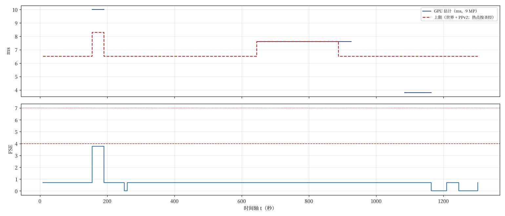

# 全片账本（性能 · 透明叠绘 · 显存 · 下载 · 粒子 · Udon · 全局量）

维护：总工程师。每个包推上来就更新。数据在 `ledger_data.json`（每一项都有出处），表由 `ledger.py` 生成（下面 AUTO 那一段），全局量对账由 `globals_scan.py` 生成（`globals_report.md`）。

```bash
~/bpy/bin/python Engineering/ledgers/ledger.py           # 重算下面的表和时间线图
python3 Engineering/ledgers/globals_scan.py --fetch      # 扫 main + 所有包分支的 _Udon_ 名字，对照登记表
```

**上限（圣经 §1.9，参考机 RTX 3060 级、Index 100% / Quest 2 Link 1.0×，约 9 MP @ 90 Hz）**：世界 ≤ 5.3 ms 持续（峰值 ≤ 6.3 ms、≤ 5 秒；含常开阴影平行光约 1.0 ms）；PPv2 ≤ 1.2 ms；透明 ≤ 4 FSE 持续、≤ 7 峰值（车厢玻璃 0.7 每幕都算）；任一像素 ≤ 8 层；每幕粒子 ≤ 5 000（≤ 8 个系统）；Udon ≤ 0.4 ms；显存 ≤ 700 MB；下载 ≤ 250 MB。热点：第 4 幕 ≈ 7.1 ms、第 7b 宫殿 ≈ 6.4 ms（圣经自己写的，已经超过 5.3 的持续上限，按“热点预算”单列）。

## 一、怎么算的

### 1.1 GPU 时间的标定（第一个真实标定点：门，`FromLocal/gate_test/perf.txt`）

本地 2026-10-08 在 RTX 4060 Laptop 上实测（编辑模式、`Camera.Render()` 进 ARGBHalf、含 PPv2；前后各读 1 像素同步；合计 = CPU 提交 + 等 GPU，不重叠，偏保守）：

| | 像素 | 合计 | CPU | → GPU |
|---|---|---|---|---|
| 桌面 1920×1080，U7 | 2.07 MP | 4.8 ms | 1.1 | **3.7** |
| VR 估算：两只眼各渲一遍 1832×1920 | 7.03 MP | 10.3 ms | 2.2 | **8.1** |

两点拆成 “每遍几何 G + 每百万像素填充 F”：G ≈ **3.2 ms / 遍**，F ≈ **0.24 ms / MP**。几何占大头，和 Play 里读到的 87.7 万三角、206 draw（单遍 27.9 万三角的约 3 倍：基础 + 补光的 ForwardAdd + 深度）对得上。

换到圣经的参考条件（9.03 MP = Index 100% 2016×2240×2；SPS-I 下顶点着色仍然每只眼一次，所以几何仍按 2 遍算）：

- RTX 4060 Laptop：2 × 3.2 + 9.03 × 0.24 ≈ **8.6 ms**（全按填充缩放的另一种算法：8.1 × 9.03 / 7.03 ≈ 10.4 ms）
- RTX 3060（台式）大约比 4060 Laptop 慢 10–25%：**≈ 9.5–11 ms**

对照圣经第 4 幕的热点预算 7.1 + 1.2 = 8.3 ms：**门在还没有云海、没有车厢玻璃、没有车的时候，估计已经超了 15–35%。** 但这两个数的不确定性很大（编辑模式、MSAA 4×、像素光 8、4 级阴影、补光当时是 Important、同步读回的开销、只有两个点），所以账本里第 4 幕先按这个估计记、标成“标定估计”，同时请本地按 §3 的协议再测一次。这件事写进了 `Engineering/给总导演.md`。

### 1.2 别的包

没有实测之前，每一项按三种来源之一记（`status`）：`bible`（圣经写的数）、`package`（包自己的 README 报的数）、`engineer-estimate`（总工程师按着色复杂度 × 覆盖像素估的，写明算法）。实测来了就换成 `measured`。

### 1.3 透明叠绘 FSE

FSE（全屏等效）= 这一层在画面里覆盖的像素数 ÷ 全屏像素数，按层加。每个包按自己的透明层在主座位机位、关键时刻算（门的 `gate_fse.py` 是范例：每层渲一张覆盖掩码，数像素），报给总工程师。车厢玻璃 0.7 每一幕都算。

### 1.4 显存 / 下载

贴图：宽 × 高 × 每像素字节（BC7 / BC6H / DXT5 = 1、DXT1 = 0.5、RGBA32 = 4、RGBAHalf = 8）× 1.33（mip）。下载：Crunch 的 DXT 约 ÷ 3–5，BC7 / BC6H 不 crunch 按 LZ4 约 ÷ 1.3。网格：顶点数 × 顶点字节。音频：Vorbis 0.5 按文件长度。包的 README 要列每张贴图的尺寸和格式。

## 二、表（自动生成）

<!-- AUTO:BEGIN（ledger.py 生成，别手改这一段） -->

### 按时刻（9 MP、SPS-I、RTX 3060 级的估计）

| 时刻 | t | GPU 世界 + PPv2（ms；上限 6.5，热点按圣经） | 透明 FSE | 粒子 | Udon ms | 实时灯 | 缺数的项 |
|---|---|---|---|---|---|---|---|
| 静候（中点） | 8.75 | ? + 1.2（世界未知） | 0.70 ✅ | 3290 ✅ | 0.00 | 0 | 1：第 1→2 幕 世界 |
| 2 夜路（中点） | 28.30 | ? + 1.2（世界未知） | 0.70 ✅ | 2100 ✅ | 0.00 | 0 | 1：第 2 幕 世界 |
| 暗段（中点） | 44.70 | ? + 1.2（世界未知） | 0.70 ✅ | 900 ✅ | 0.00 | 0 | 1：第 2→3 幕 世界 |
| 3a 升起（中点） | 63.05 | ? + 1.2（世界未知） | 0.70 ✅ | 0 ✅ | 0.00 | 0 | 1：第 3a 幕 世界 |
| 3b 云底（中点） | 87.65 | ? + 1.2（世界未知） | 0.70 ✅ | 0 ✅ | 0.00 | 0 | 1：第 3b 幕 世界 |
| 触云（中点） | 103.50 | ? + 1.2（世界未知） | 0.70 ✅ | 0 ✅ | 0.00 | 0 | 1：第 3b 幕 世界 |
| 云中（中点） | 118.30 | ? + 1.2（世界未知） | 0.70 ✅ | 0 ✅ | 0.00 | 0 | 1：第 3b 幕 世界 |
| 3c 月之路（中点） | 139.70 | ? + 1.2（世界未知） | 0.70 ✅ | 0 ✅ | 0.00 | 0 | 1：第 3c 幕 世界 |
| U7b 门主视觉 | 155.10 | 8.30 ✅；**标定估计 10.0** ❌ | 3.77 ✅ | 300 ✅ | 0.00 | 0 |  |
| 4 门（中点） | 164.93 | 8.30 ✅；**标定估计 10.0** ❌ | 3.77 ✅ | 300 ✅ | 0.00 | 0 |  |
| U8 门透明峰 | 166.15 | 8.30 ✅；**标定估计 10.0** ❌ | 3.77 ✅ | 300 ✅ | 0.00 | 0 |  |
| U8+7 天窗 | 173.15 | 8.30 ✅；**标定估计 10.0** ❌ | 3.77 ✅ | 300 ✅ | 0.00 | 0 |  |
| 4c 喉·Lichtchen（中点） | 190.98 | ? + 1.2（世界未知） | 0.70 ✅ | 90 ✅ | 0.00 | 0 | 1：第 4c 幕 世界 |
| 4c selig Leben（中点） | 225.52 | ? + 1.2（世界未知） | 0.70 ✅ | 90 ✅ | 0.00 | 0 | 1：第 4c 幕 世界 |
| 5 投入（中点） | 251.39 | ? + 1.2（世界未知） | 0.00 ✅ | 0 ✅ | 0.00 | 0 | 1：第 5 幕 世界 |
| 日出（中点） | 260.24 | ? + 1.2（世界未知） | 0.70 ✅ | 300 ✅ | 0.00 | 0 | 1：第 6a 幕 世界 |
| 6 晨（中点） | 274.10 | ? + 1.2（世界未知） | 0.70 ✅ | 300 ✅ | 0.00 | 0 | 1：第 6a 幕 世界 |
| 6b 云峡（中点） | 293.63 | ? + 1.2（世界未知） | 0.70 ✅ | 300 ✅ | 0.00 | 0 | 1：第 6b 幕 世界 |
| 6c 云盖下（中点） | 311.88 | ? + 1.2（世界未知） | 0.70 ✅ | 300 ✅ | 0.00 | 0 | 1：第 6c 幕 世界 |
| F1b1 太阳重现 | 318.36 | ? + 1.2（世界未知） | 0.70 ✅ | 300 ✅ | 0.00 | 0 | 1：第 6c 幕 世界 |
| 太阳重现（中点） | 327.68 | ? + 1.2（世界未知） | 0.70 ✅ | 300 ✅ | 0.00 | 0 | 1：第 6c 幕 世界 |
| 6d 海镜（中点） | 350.13 | ? + 1.2（世界未知） | 0.70 ✅ | 300 ✅ | 0.00 | 0 | 1：第 6d 幕 世界 |
| 7a 被海接住（中点） | 418.81 | ? + 1.2（世界未知） | 0.70 ✅ | 2340 ✅ | 0.00 | 0 | 1：第 7a 幕 世界 |
| 水柱（中点） | 490.36 | ? + 1.2（世界未知） | 0.70 ✅ | 2340 ✅ | 0.00 | 0 | 1：第 7a 幕 世界 |
| 最后一闪（中点） | 519.36 | ? + 1.2（世界未知） | 0.70 ✅ | 2340 ✅ | 0.00 | 0 | 1：第 7a 幕 世界 |
| 海脊（中点） | 544.36 | ? + 1.2（世界未知） | 0.70 ✅ | 2340 ✅ | 0.00 | 0 | 1：第 7a 幕 世界 |
| 藍熄灭（中点） | 557.61 | ? + 1.2（世界未知） | 0.70 ✅ | 2340 ✅ | 0.00 | 0 | 1：第 7a 幕 世界 |
| 播种（中点） | 601.91 | ? + 1.2（世界未知） | 0.70 ✅ | 2340 ✅ | 0.00 | 0 | 1：第 7a 幕 世界 |
| F5 宫殿入画 | 645.00 | 7.60 ✅ | 0.70 ✅ | 200 ✅ | 0.00 | 0 |  |
| 7b 近（中点） | 656.78 | 7.60 ✅ | 0.70 ✅ | 200 ✅ | 0.00 | 0 |  |
| 7b 行列（中点） | 702.08 | 7.60 ✅ | 0.70 ✅ | 200 ✅ | 0.00 | 0 |  |
| 7b 门前（中点） | 766.21 | 7.60 ✅ | 0.70 ✅ | 200 ✅ | 0.00 | 0 |  |
| F7p 宫殿最近 | 810.00 | 7.60 ✅ | 0.70 ✅ | 200 ✅ | 0.00 | 0 |  |
| 7b 离开（中点） | 816.01 | 7.60 ✅ | 0.70 ✅ | 200 ✅ | 0.00 | 0 |  |
| 7c 退去（中点） | 856.56 | 7.60 ✅ | 0.70 ✅ | 0 ✅ | 0.00 | 0 |  |
| 7c 海底发光（中点） | 887.96 | 7.60 ❌ | 0.70 ✅ | 0 ✅ | 0.00 | 0 |  |
| 倒置的窗（中点） | 910.16 | 7.60 ❌ | 0.70 ✅ | 0 ✅ | 0.00 | 0 |  |
| 出海（中点） | 925.74 | ? + 1.2（世界未知） | 0.70 ✅ | 0 ✅ | 0.00 | 0 | 1：第 8 幕 世界 |
| 8 暮·天花（中点） | 942.74 | ? + 1.2（世界未知） | 0.70 ✅ | 0 ✅ | 0.00 | 0 | 1：第 8 幕 世界 |
| 变形（中点） | 960.88 | ? + 1.2（世界未知） | 0.70 ✅ | 0 ✅ | 0.00 | 0 | 1：第 8 幕 世界 |
| 8 另一片天（中点） | 976.23 | ? + 1.2（世界未知） | 0.70 ✅ | 0 ✅ | 0.00 | 0 | 1：第 8 幕 世界 |
| 日线收（中点） | 990.06 | ? + 1.2（世界未知） | 0.70 ✅ | 0 ✅ | 0.00 | 0 | 1：第 8b 幕 世界 |
| 8b 蓝时（中点） | 997.13 | ? + 1.2（世界未知） | 0.70 ✅ | 0 ✅ | 0.00 | 0 | 1：第 8b 幕 世界 |
| 变暗（中点） | 1005.21 | ? + 1.2（世界未知） | 0.70 ✅ | 0 ✅ | 0.00 | 0 | 1：第 9a 幕 世界 |
| 9a 天问（中点） | 1013.71 | ? + 1.2（世界未知） | 0.70 ✅ | 0 ✅ | 0.00 | 0 | 1：第 9a 幕 世界 |
| F13 银河点燃 | 1018.50 | ? + 1.2（世界未知） | 0.70 ✅ | 0 ✅ | 0.00 | 0 | 1：第 9b 幕 世界 |
| 点燃（中点） | 1020.31 | ? + 1.2（世界未知） | 0.70 ✅ | 0 ✅ | 0.00 | 0 | 1：第 9b 幕 世界 |
| 9b 一瞬（中点） | 1027.41 | ? + 1.2（世界未知） | 0.70 ✅ | 0 ✅ | 0.00 | 0 | 1：第 9b 幕 世界 |
| 9c 十三面镜（中点） | 1084.99 | 3.80 ✅ | 0.70 ✅ | 750 ✅ | 0.00 | 0 |  |
| 第 12 面镜 | 1137.60 | 3.80 ✅ | 0.70 ✅ | 750 ✅ | 0.00 | 0 |  |
| 白光爬升（中点） | 1143.44 | 3.80 ✅ | 0.70 ✅ | 750 ✅ | 0.00 | 0 |  |
| 10 白（中点） | 1163.88 | ? + 1.2（世界未知） | 0.00 ✅ | 0 ✅ | 0.00 | 0 | 1：第 10 幕 世界 |
| 11 假醒（中点） | 1209.46 | ? + 1.2（世界未知） | 0.70 ✅ | 0 ✅ | 0.00 | 0 | 1：第 11 幕 世界 |
| 第二次白（中点） | 1246.21 | ? + 1.2（世界未知） | 0.00 ✅ | 0 ✅ | 0.00 | 0 | 1：第 11→12 幕 世界 |
| 白保持（中点） | 1253.46 | ? + 1.2（世界未知） | 0.00 ✅ | 0 ✅ | 0.00 | 0 | 1：第 11→12 幕 世界 |
| 12 醒（中点） | 1302.48 | ? + 1.2（世界未知） | 0.70 ✅ | 46 ✅ | 0.00 | 0 | 1：第 12 幕 世界 |

### 显存 / 下载（按包）

| 包 | 显存 MB | 下载 MB | 项数 | 缺显存数的资产项 |
|---|---|---|---|---|
| ? | 304 | 0 | 42 | 6 |
| Grading | 0 | 0 | 26 | 0 |
| 云 | 0 | 0 | 10 | 0 |
| 天空 | 0 | 0 | 2 | 0 |
| 天空+镜与白 | 0 | 0 | 2 | 0 |
| 待定 | 0 | 0 | 3 | 0 |
| 本地 | 0 | 0 | 11 | 0 |
| 海 | 0 | 0 | 6 | 0 |
| 海+宫殿 | 0 | 0 | 2 | 0 |
| 灯与假醒 | 0 | 0 | 2 | 0 |
| 车厢 | 0 | 0 | 22 | 0 |
| 镜与白 | 0 | 0 | 1 | 0 |
| 门 | 0 | 0 | 4 | 0 |
| 门内 | 0 | 0 | 3 | 0 |
| **合计** | **304** / 700 ✅ | **0** / 250 ✅ | | |



<!-- AUTO:END -->

## 三、请本地测的（性能协议，给 HANDOFF 用）

1. **Play 模式**、真的 VR（SteamVR，Index 100% 或同等像素），不是编辑模式的 `Camera.Render()`。
2. 记 GPU 帧时间（SteamVR 的 Frame Timing 或 Unity Profiler 的 GPU 模块），每个机位 10 秒取中位数和 95 分位。
3. Frame Debugger 里数：深度预渲染、阴影、主 pass、ForwardAdd、透明、PPv2 各几个 draw；GPU Profiler 里最贵的 10 项。
4. 和这次对比：补光改 Not Important 前后各一次（圣经 / CONTROL §3 的要求）。
5. 记下 QualitySettings（像素光数、阴影距离、级联、MSAA、LOD Bias），VRChat 客户端会覆盖其中几项，**按 VRChat 的“高”画质设一遍再测**。

## 四、圣经里和性能有关的矛盾（`bible_inventory.json` 的 contradictions，逐条有行号和原文）

1. **Palace hotspot duration**：§1.9 defines the window as F5 (644.96) → first 40 s of 7c (835.16 + 40 = 875.16) = 230.2 s, but calls it '约 190–210 秒'; §9 #10 writes '644.96 → ≈875 s，约 190–210 秒'. 7b alone is 190.2 s.（bible §1.9 line 264；bible §9 line 1832；bible §6·7b line 1222）
2. **Hotspots exceed the peak budget for longer than allowed**：World peak ≤ 6.3 ms for ≤ 5 s, yet act 4 is budgeted ≈7.1 ms for 29.25 s and the palace ≈6.4 ms for ~230 s. Both rely on cut orders/auto-lite; the bible never states the post-cut target.（bible §1.9 line 262；bible §1.9 line 264）
3. **Gate §12 approval status**：Bible says v2.3 gate revision approved by AD (2026-10-02) and gate §12 wins; gate README §12 header still says pending user + AD approval, and §8.1 #5 still specs the old 24–40 mid layer / 300–500 tide.（bible §6·4 line 885；gate README §12 line 554；bible §8.1 #5 line 1785）
4. **Bus climbs 90 m before U9 in the gate layout**：Bible (E4): car stays 60 m above cloud top at U9, no climb; gate README h_bus rises 60 → 150 m from 160.50 to U9 with 1.49 m/s² peak — and this deviation is NOT listed in gate §12.（bible §6·4 line 895；gate README §2 line 127）
5. **Far tide / mid layer counts & fog**：Bible 300–500 tide arms at 80–92% fog (cut 500→300) vs gate 360 cards at 48–58% fog; mid layer 24–40 vs gate two hands + 36 multitude arms; shafts ≤12 cards vs gate 2 beams.（bible §6·4 line 925；gate README §12 line 566；gate README §8.1 line 383）
6. **Act 4 U8 transparency split vs gate measurement**：Bible U8 caps list halo/shafts/fibres/glass/cloud sea/tide (sum 4.0). Gate's measured 3.77 uses different buckets (lens, pre-depth, halo 0.432, sky folds, CloudGlow 0.452, foot skyline, light lane, towers 0.413, far clouds 0.295, shafts 0.042, glass 0.7, cloud-sea 0.9) — no fibre or tide line; glass and cloud sea are still estimates.（bible §1.9 line 264；gate README §9 line 427）
7. **Act 12 realtime lights**：§6·12 calls the Lichtchen point light 'this act's only realtime light', but §1.6 requires the shadowed world directional in every act, a realtime BusExterior point light in acts 1 and 12, the realtime headlight spot in acts 1/2/11/12, and §5 an avatar realtime spot.（bible §6·12 line 1611；bible §1.6 line 165；bible §1.6 line 163；bible §1.6 line 164）
8. **Avatar lighting in act 1**：§1.6 says avatar fill = two Not Important cabin point lights; §6·1/§5.4 additionally add a realtime avatar spot light (culling Player + PlayerLocal) at the stop — whether it counts against the Important budget is not stated.（bible §6·1 line 725；bible §1.6 line 166）
9. **Rain particle count act 1**：Bible: other-places rain 600 (sum ≤ 3 300); rain kit uses 560 (3 290 total). Kit also has its own cut order (560→300, 900→600) not present in §1.9.（bible §6·1 line 733；rain README §3.1 line 217）
10. **Glass de-rain timing**：Bible §4.6/§6·3: glass flow slows from U3 (50.30), stops 58.3, glass clean by U4+20 (95.8); rain kit Preset_LiftOff starts at U4 (75.80) and runs 20 s. Rain README §14 also flags §6·3 'in-cloud drops streak sideways' vs 'glass clean before U4+20'.（bible §4.6 line 587；rain README §9 line 374；rain README §14 line 484）
11. **R_Gate / R_Sea residency vs 'roots only switch under occlusion'**：GateRoot activates at 113.80 (inside cloud) and R_Gate only deactivates at 248.64 — resident through 3b/3c/4/4c (≈135 s); R_Sea (palace + 1 500 fish) is activated before water entry (≤363.26) and stays to ≈922 — the 6.4 ms 'hotspot window' starting at F5 assumes nothing costs before it is visible.（gate README §2 line 133；bible §6·5 line 1051；bible §6·7a line 1216）
12. **Glass 0.7 FSE every act vs disappearing cabin**：§1.9 says count 0.7 FSE glass in every act, but under water glass alpha → 0.02 and from act 8 the roof/upper walls are eroded (0.25 → 0.97), and acts 5/10 are fully behind the overlay. The flat 0.7 is conservative, not physical.（bible §1.9 line 262；bible §6·7a line 1208；bible §4.8 line 617）
13. **Gate test frame time vs budget**：Gate test (RTX 4060 Laptop, editor, U7) measured 10.3 ms for VR stereo 1832×1920×2 including PPv2 — vs bible world 7.1 ms hotspot + PPv2 1.2 ms on a 3060-class at ~9 MP; different hardware/resolution, and the test has no final cabin/clouds, so neither confirms nor refutes the 7.1 ms.（gate_test perf.txt §1 line 24）
14. **Mirror timetable source**：cues.json mirror_crossings_* (forward, r = 1.2265) is superseded by the two-segment table (r = 1.3083); Director must not use cues.json values.（bible §8.1 #14 line 1795）
