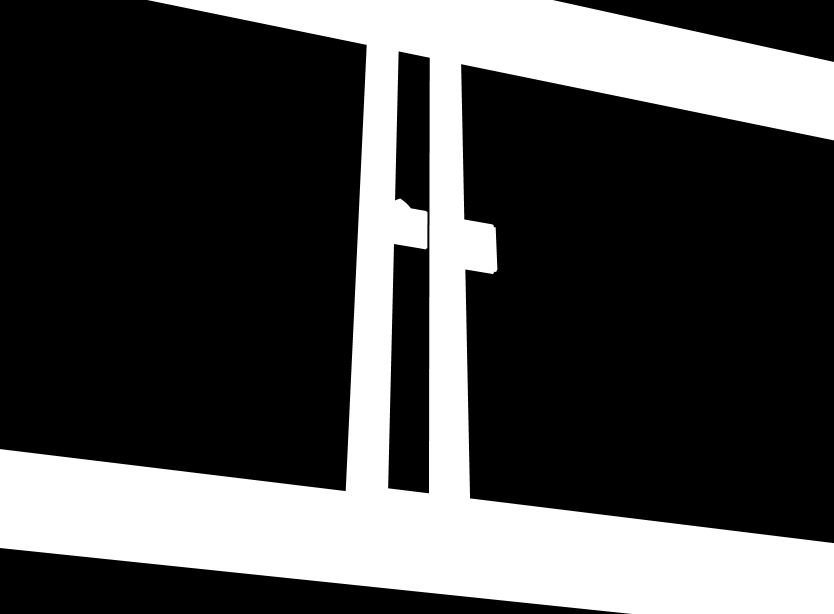
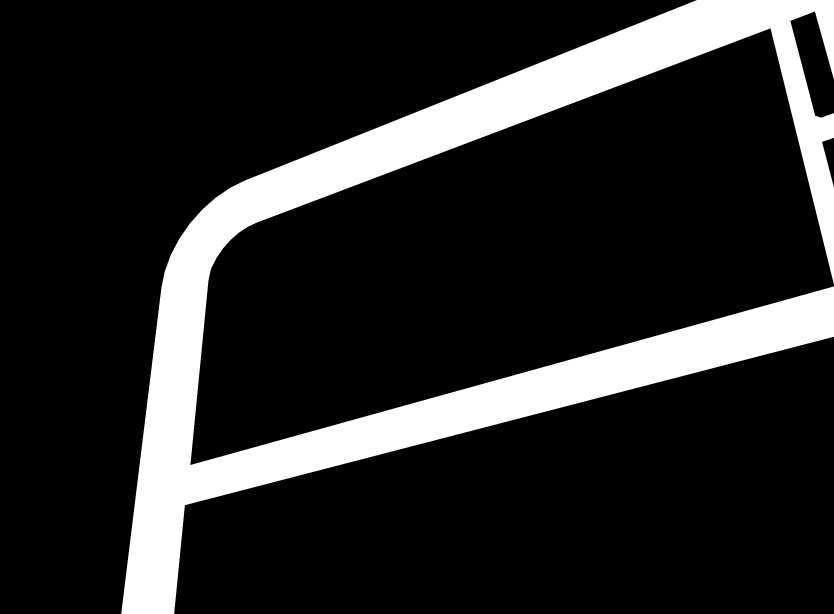
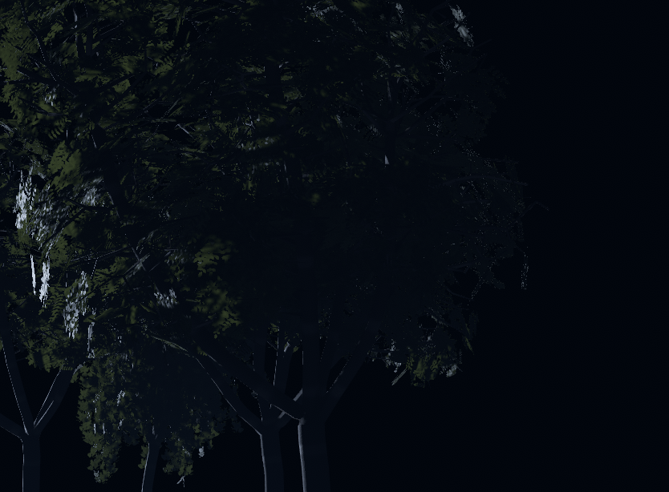

# 窗框真实面积与树的受控诊断 · 2026-10-26

**当前可部署包已齐。** 本轮增量 fetch 后 main 仍为 d51bf9e，工程源与已接入版本无新增交付；没有全量重导、重搭或等待额度。新增的是有限诊断证据，原公交与树的 FAIL 均保留，未改变模型、音乐、艺术方向或验收门槛。

## 窗框：差图少计，但两原机位的真实面积仍不足

只用了原 bus_slice/20261026-023007 的两个正式机位、834×614、40°×30°取景、0.02 m 近裁面。由当前 FullPreview 的已交付网格/材质复制出原切片的四件对象，放进不保存的 PreviewScene；没有再次调用车搭建器。目标 Window_R1 全四个子网格计入；座椅与立柱保留深度遮挡。透明 Glass_WinR1 原本 ZWrite Off，几何归属掩码中不遮挡也不计入窗框；正常画面/差图仍保留玻璃。

| 原机位 | 旧报告亮度差 coverage | 本次正常画面差图 | 2× ID 面积 | 8×全样本平均 ID 面积 |
|---|---:|---:|---:|---:|
| window_05m | 23.8521% | 22.6898% | 29.8018% | **29.7988%** |
| window_10m | 8.6425% | 7.7104% | 16.1999% | **16.2003%** |

两者仍低于原30%门槛。0.5 m 只差0.2012个百分点，不能四舍五入宣布通过；2×→8×差仅0.0030个百分点，不是采样精度翻转。保留/去掉座椅和立柱的 ID 面积相同，说明这两个机位里它们没有遮住目标；不是忽略遮挡得到的虚高面积。

**结论：原 coverage 确有计量偏差，但“只修指标就能通过”不成立。** 后续需要原公交负责人明确机位/统计对象定义；本地不继续盲换角度或把玻璃算成窗框。旧未保存切片已不存在，本次使用现有 FullPreview 副本；后来更新过的 HDR CabinCube 等会影响画面差图，所以本次差图不冒充逐像素重现旧报告，也不追改旧 FAIL。

## 树：时间、参考采样和高光已分开取证

### 1. 实际 GPU 时间

独立相机使用与测试工具相同的 Camera.Render，并在该相机渲染命令中把 `_Time.y` 写入浮点纹理读回。两批各12次低/高分辨率交替渲染，间隔约2秒编辑器时间，GPU时间仍全部为 **2.6866667**；CPU frameCount 也未推进。随后树对照逐帧记录了实际 GPU 时间，每一对低/高采样时间完全一致。

这证明当前后台编辑模式的 Render 调用及等待编辑器时间不会自动推进树风使用的时间。它不能回填历史记录的具体时相，更不能把“静止0”写成真实 Play 风噪已经排除。未来真实时间控制需要明确的 Play 帧或诊断材料时相输入。

### 2. 4×参考图不是完整4×4平均

现工具 `Renderer2.Frame` 只调用一次双线性 `Graphics.Blit(big, small)`。独立线性浮点校准图每个4×4格只亮1像素，正确平均为0.0625，现方法结果为 **0**；2×2控制则与正确平均0.25完全相等。此限制不影响本次2×窗框面积；8× ID用CPU完整64样本平均。

树诊断对同一张高分辨率渲染，同时输出旧单次缩小参考与4→2→1的两次2×平均参考；不是重新渲染第二张参考，也没有修改正式工具或门槛。工程师可据此修参考图缩小方法，但旧 FAIL不能因此直接撤销。

### 3. 固定风相位、LOD与相机噪声的实物树对照

使用已生成的四种预制体、原7棵测试排布、原hero机位、MSAA4、30个覆盖原89/90秒区间的确定微动采样。仅诊断材质实例把WindFreq/FlutterFreq设0（幅度、顶点相位和根部位置保留），只复制LOD0网格，不存在LOD切换。使用S1和当前启用灯的副本；控制环境并非旧测试现场，绝对数值不作为旧18.55的前后改善。

| 同一固定条件，只有参考图缩小方法不同 | shimmer p99 | 误差标准差>4的ROI占比 |
|---|---:|---:|
| 旧单次双线性参考 | **20.7930** | **38.2410%** |
| 完整4→2→1平均参考 | **20.4067** | **37.7717%** |

相位和LOD固定后仍有明显采样误差。参考图修正只有小幅影响，不能单独解释或撤销树的旧FAIL；这个控制环境不是历史现场，不能把20.4067与旧18.55当成前后变化。未锁噪声的第一组也保留在 tree/lod0_fixedphase_reference_ab。

### 高光归因未完成，以下尝试不能用作根因结论

1. 首次高光副本校验发现基准图最大亮度差2，故请求0935保护性终止，原failed保留。
2. 从本机PPv2源码确认每Render会推进噪声纹理与随机偏移；只固定了临时诊断相机自身的噪声状态。新请求0940中，关键词关闭之前副本与原材质最大像素差为0。
3. 0940的后半段同时开了`_SPECULARHIGHLIGHTS_OFF`与`_GLOSSYREFLECTIONS_OFF`，得到p99=7.9031、比例37.8331%。**后续审图和源码核对发现：Unity的后一个开关把环境镜面反射换成unity_IndirectSpecColor常量，并不是归零。画面亮度同时改变，此组有混杂因素，不能用来证明高光贡献多少，更不能据此提出永久关闭高光的修复。** 原结果原样保留、明确失去纯高光归因资格，不篡改成成功证据。
4. 新请求0950改为仅关闭直接高光、保留环境反射；但在切换前的严格副本自检仍测到0.0722最大亮度差，因此再次保护性终止，没有产生新的高光归因序列。没有放宽该自检或原树的验收门槛。

下一步可先记录同一Shader副本的开/关成对结果，使用共同ROI，并量化它与原Shader的基准差分分布；不可再把两个不同光照模型混在一起。当前能够确定的是时间/LOD固定未消除采样误差，参考图有缩小缺陷；**纯高光根因仍未证实**。未重置全局随机数、未改世界相机、未扩大材料保护。

## 工程与结论边界

- 本轮8个新桥请求6 done / 2保护性failed，均已终态；没有重放任何旧请求。
- 2627个既有受监测文件hash全部保持，只增加7份Editor诊断文件及其7份meta。原材质、源Shader、预制体、正式场景、FullPreview、Journey和既有修复均未改；未保存场景、未进入Play、未调用SaveAssets。PreviewScene均关闭，最终FullPreview干净/nonPlay/无请求/编译正常。
- 诊断仅桌面渲染，Quest3+VD和多人仍未测；树、公交、整片美术未标通过。片尾门硬切仍S2，不改音乐、开门时间、白权重；锈漆金属仍候选。
- 下一步已收窄：公交由对象/机位定义继续；树先记录副本基准差分并用共同ROI进一步分离叶缘/枝条空间采样与高光，再测固定LOD1/2及真实Play风相位。不要重跑已通过无变化的全片测试，不因等总控而停止可独立的诊断/方案准备。

## 文件与方法

- [工程保护与请求状态](protection.json)，[两机位普通画面及差图](window/official_two_cameras/measurements.json)，[8×几何面积](window/precision_ss8_box/measurements.json)
- [时间与采样校准A](sampling_time/same_update_A.json)、[跨编辑器更新校准B](sampling_time/later_update_B.json)
- [固定相位/LOD/噪声基线](tree/lod0_fixedphase_locked_dither/measurements.json)、[有混杂因素、不得用于纯高光归因的历史尝试](tree/lod0_fixedphase_locked_dither_nospec/measurements.json)
- code为本地诊断实现与必要历史版本，只作审阅，不属于正式交付替换；原测试源码/阈值不变。
- 隔离场景使用Unity的[NewPreviewScene](https://docs.unity3d.com/2022.3/Documentation/ScriptReference/SceneManagement.EditorSceneManager.NewPreviewScene.html)和[Camera.scene](https://docs.unity3d.com/2022.3/Documentation/ScriptReference/Camera-scene.html)。采样、风、高光、噪声依据本机已安装Unity2022.3.22f1、PPv2 3.4.0及实际项目源码验证，未升级依赖。
